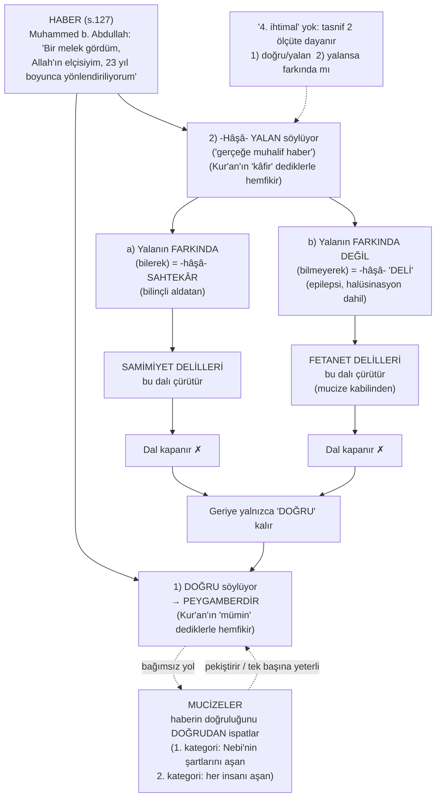
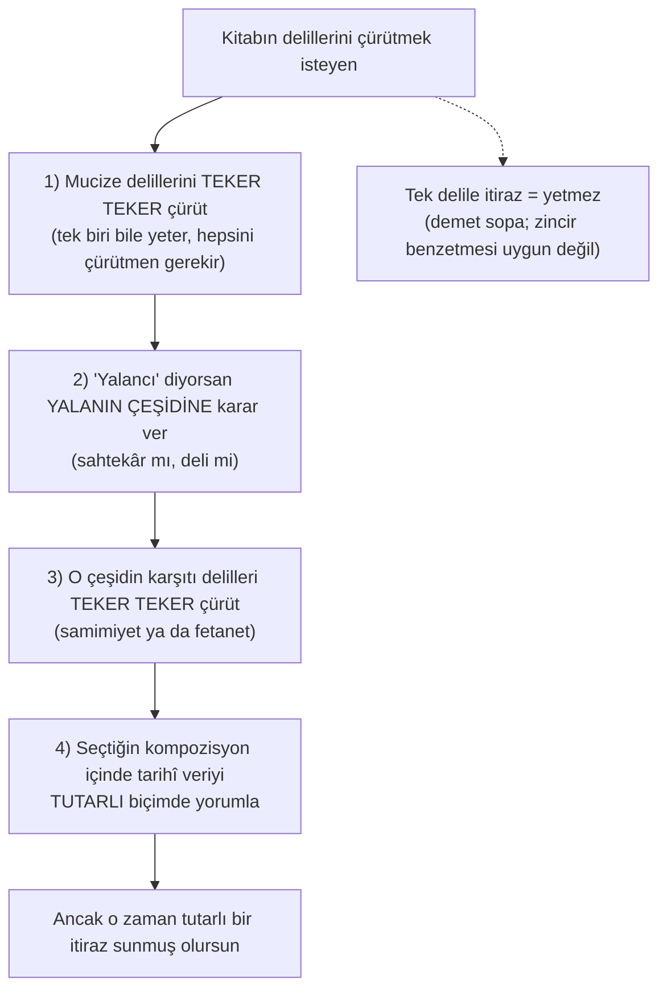

# Bölüm 2 — Haber İnşası (kitap s. 127–156)

> Kaynak: Altay Cem Meriç, *Peygamberliğin İspatı – Haber Delili*, "Haber İnşası" bölümü. Metin: `docs/metin/02-haber-insasi.txt`. Parantez içindeki "s." numaraları kitap sayfasıdır. OCR hataları anlamdan düzeltilmiştir; tırnak içindeki ifadeler kitaba yakın aktarımdır. Peygamber için olumsuz ihtimaller anılırken kitaptaki "hâşâ" edebi korunmuştur.

---

## 1. Bölümün kapalı devre ispattaki rolü

Bu bölüm kitabın **metod çekirdeğidir**. Yazarın kendi ifadesiyle amaç, "kitap boyunca kullanılacak olan 'haber yöntemi'nin aktarılması"dır (s. 127). Sonraki bütün bölümler bu çerçevenin içinde yer alır.

Bölüm üç şeyi kurar:

1. **Tartışmanın konusu bir haberdir.** Mekke'de Muhammed b. Abdullah kırk yaşında bir melek gördüğünü, Allah'ın elçisi olduğunu ve yirmi üç yıl boyunca bu meleği görmeye devam ettiğini söylemiştir. Konu bir "teori" değil, "Dün Ankara'daydım" türünden bir haberdir.
2. **İhtimaller kapalı bir devredir.** Haber ya doğrudur ya yalandır. Yalansa söyleyen ya bilerek söylemiştir (sahtekâr) ya da bilmeyerek söylemiştir (deli). Dördüncü bir ihtimal yoktur, çünkü tasnif iki ölçüte göre yapılmıştır: (1) doğru mu, yalan mı; (2) yalansa söyleyen farkında mı, değil mi.
3. **Delil aileleri bu devreye göre isimlendirilir.**
   - Bilerek yalanı çürüten deliller = **Samimiyet delilleri**.
   - Bilmeyerek yalanı çürüten deliller = **Fetanet delilleri**.
   - Haberin doğruluğunu doğrudan gösteren deliller = **Mucizeler**.

   İki yalan dalı kapanınca geriye yalnızca "doğru" kalır (s. 134).

Bölüm ayrıca iki şeyi önceden savunur:

- Muhalifin bu devre karşısında **ne yapması gerektiğini** söyler (delilleri teker teker çürütmek, bir kompozisyon kurmak).
- Muhalifin kaçış yollarını (orta yol, anlaşılmazlık perdesi, kâhinlik, umursamazlık) kapatır.

Bu bölümün **delil sunmadığına** dikkat etmek gerekir. Fetanet, samimiyet ve mucize delillerinin gerçek içeriği sonraki bölümlerdedir. Bu bölüm yalnızca çerçeveyi, tanımları ve ispat yükünün kimde olduğunu belirler. İki örnek olay (iblis hadisi, namaz vakitleri hadisi) delil değil, "orta yol kurgusunun neden çalışmadığını" gösteren **demo**dur.

### Ana akış (özet)

```
Haber (s.127) → Tasnif: doğru / yalan(bilerek) / yalan(bilmeyerek) (s.127-129)
→ Kur'an'ın aynı tasnifi (s.129-133) → Haber ≠ teori (s.133)
→ Güncel söylemler de aynı üç kutuda (s.134) → Delil aileleri (s.134-135)
→ Çürütmek isteyen ne yapmalı (s.135-136) → Delil isimleri (s.136-137)
→ Mucize tanımı ve çürütme (s.137-141) → Kompozisyon zorunluluğu (s.141-144)
→ Umursamazlık / yüz çevirme (s.144-146) → Anlaşılmazlık perdesi (s.146-147)
→ Kâhinlik (s.147-149) → Haberin keskinliği: orta yol yok (s.149-156)
```

---

## 2. Alt başlık sırasıyla akış

### 2.1. Giriş: Haberin niteliği ve ihtimaller (s. 127–129)

**Tez.** Tartışılan şey bir haberdir ve sıfır noktasından bakıldığında bu haberi yorumlamanın yalnızca üç yolu vardır.

**Argüman zinciri.**

1. Haberin içeriği (s. 127): Mekke'de Muhammed b. Abdullah, kırk yaşında bir melek gördüğünü ve Allah'ın elçisi olduğunu iddia ediyor. Allah'ın emirlerinin kendisi vasıtasıyla topluma iletileceğini söylüyor. Yirmi üç yıl boyunca bu meleği görmeye devam ettiğini ve meleğin kendisini yönlendirdiğini söylüyor. İnsanların bu iddiayı doğru ya da yalan sayarak iki gruba ayrıldığını da bildiriyor: doğru söylediğine inananlara mümin, yalan söylediğine inananlara kâfir deniyor.
2. Soru: "Biz, sıfır noktasından başlayarak bugünden geriye doğru baktığımızda, bu olguyu nasıl yorumlayabiliriz?"
3. İhtimaller:
   - **(1)** Doğru söylüyor olabilir. O hâlde peygamberdir. Bu durumda Kur'an'da kendilerine mümin ismi verilenlerle hemfikir oluruz.
   - **(2)** -Hâşâ- yalan söylüyordur. Bu durumda Kur'an'da kendilerine kâfir ismi verilenlerle hemfikir oluruz. Yalan olması durumunda iki ihtimal vardır:
     - **(a)** Yalan söylediğinin farkındadır. Bu durumda söz konusu iddianın sahibi -hâşâ- sahtekârdır ve insanları kandırmıştır.
     - **(b)** Yalan söylediğinin farkında değildir; çünkü -hâşâ- delidir. Söz ve davranışları, akli melekesi ve kendi iradesiyle yaptığı şeyler değildir.
4. **Kitabın tanımları** (s. 128):
   - "Sahtekâr": "yalan söylediğinin farkında olan, bilinçli bir şekilde kişisel ya da toplumsal amaçları için insanları aldatan biri."
   - "Deli": "söylediği ve yaptığı şeyleri kendi bilinçli faaliyeti olarak yapmayan kişi."
   - "Yalan": "aktardığı haberin gerçeğe uygun olmaması." Türkçede kasıtsız olarak gerçeğe aykırı bilgi nakleden kişiye "yalancı" denmez (halüsinasyon gören akıl hastası örneği). Tasnifin kolay anlaşılması için "yalan" kelimesi, söyleyen farkında olsun olmasın "gerçeğe muhalif haber" anlamında kullanılmıştır.
5. **Dördüncü ihtimal yoktur** (s. 128): "Burada dördüncü bir ihtimal söz konusu değildir. Zira biz burada, bir haberi iki açıdan tasnife tabi tutmuş olduk: (1) yalan ve doğru olması açısından, (2) şayet yalansa söyleyenin bunun farkında olması ya da olmaması açısından."
6. **İsimlendirme uyarısı** (dipnot 266, s. 128): "Sahtekâr" ve "deli" yalnızca anlatım kolaylığı için konmuş adlardır. Epilepsi ya da halüsinasyon gibi "farkında olmadan yalan söyleme" ihtimalleri bugünkü kullanımla "delilik" diye adlandırılmaz. Dikkat edilecek nokta isim değil, **farkındalıktır**. (a) ve (b) şıkları farkındalık üzerinden ayrılan iki ihtimaldir.
7. Dipnot 265 (s. 127): Oryantalistlerin çoğu birinci ihtimali gündem dahi etmediği için haberi düzgün değerlendirememektedir. Örnekleri kitabın ilerleyen sayfalarında gelecektir.

**Muhatap:** "Sen 'deli' ve 'sahtekâr' derken Peygamber'e hakaret etmiş olmuyor musun?"
**Cevap:** Bunlar yalnızca anlatım kolaylığı için konmuş adlardır. Esas olan "farkında olma / olmama" ayrımıdır; epilepsi ve halüsinasyon gibi bugünkü iddialar da "farkında olmadan yalan" kutusundadır (dn. 266). Bu ihtimaller muhalifin kendi ihtimalleridir. Kitap bunları ancak çürütmek için anar.

**Muhatap:** "Ya iyi niyetle yanılmışsa? Yalan demek de ağır değil mi?"
**Cevap:** "Yalan" burada kasıt ifade etmez; "gerçeğe uygun olmayan haber" demektir. İyi niyetli yanılma "farkında olmadan" kutusuna girer (s. 128).

---

### 2.2. Haber tasnifinin imanı anlatmaktaki önemi (s. 129)

**Tez.** İmanı kabul etmemek, Nebi'nin getirdiği haberi yalanlamaktan ibarettir; bu yüzden haber tasnifi Kur'an'ı doğru anlamak için de önemlidir.

**Argüman zinciri.**

1. Küfür = haberi yalan saymak. İman = onu doğru kabul etmek.
2. Gazali'den tanım (Izutsu aracılığıyla): "Küfür, bize anlattığı ne ise onun herhangi bir ciheti konusunda Allah elçisinin tekzibidir. Tekzip (yalanlama) literal olarak, bir kişiyi yalancı çıkartmak, onun söylediğini yalan addetmektir ve tasdikin zıddıdır. Tasdikin anlamı ise bir şeyi doğru kabul etmek, ona iman etmektir."
3. Cahız: "Oysa insanlar, haberlerle gerçek nebiyi sahtesinden, doğru olanı yalancıdan ayırt ederler."
4. Cahız (başka bir bölüm): Allah, peygamberlerin delillerini bütün insanlara doğrudan işittirmedi ve tasarruflarını göstermedi; bu yüzden görenlerin görmeyenlere haber vermesi gerekir.
5. Sonuç: İman tartışması, s. 128'deki şıklar etrafında dönen bir tartışmadır.

**Muhatap:** "İman bir duygu / sezgi meselesi; bunu 'haber doğru mu yalan mı' diye masaya yatırmak yapay."
**Cevap:** Gazali'nin tanımına göre küfür, elçiyi tekzip etmektir; iman da tasdik, yani doğru kabul etmektir. Cahız'a göre insanlar gerçek nebiyi sahtesinden haberlerle ayırt ederler. Yani klasik literatürün kendisi meseleyi haber çerçevesinde kurmuştur.

---

### 2.3. Kur'an'da haber tasnifi (s. 129–133)

**Tez.** Kur'an, hem yalanlama olgusunu sıkça anar hem de muhataplarının itirazlarını kategorik olarak aktarır. Bu kategoriler kitabın tasnifiyle örtüşür.

**Argüman zinciri.**

1. "k-z-b" (yalan) kökü Kur'an'da 220 defa geçer ve çoğunlukla müşriklerin yalanlamasından bahseder. Haber inşasının iman-küfür tartışmasındaki önemi bu sıklıktan bile anlaşılır (s. 129–130).
2. Ayet: "Allah hakkında yalan uyduran veya O'nun ayetlerini yalanlayandan daha zalim kimse var mıdır? Günah yoluna sapanların kurtuluşu yoktur." (Yûnus 10/17) (s. 130)
3. **"Delilik" iddiası (bilmeyerek dalı).** Kâfirlerin Hz. Peygamber'e, genelde ise bütün peygamberlere "deli" dediklerini gösteren ayetler (s. 130–131):
   - el-Hicr 15/6: "Ey kendisine sözde Kur'an indirilen adam! Sen elbette delinin birisin."
   - eş-Şuarâ 26/27: Firavun: "Size gönderilen bu elçiniz mutlaka delidir."
   - es-Sâffât 37/36: "Biz, deli bir şair için ilahlarımızı mı terk edeceğiz?"
   - ez-Zâriyât 51/39: Firavun: "O, ya bir sihirbaz veya bir delidir."
   - el-Kalem 68/51: "Hiç şüphe yok o bir delidir, diyorlar."
   - ez-Zâriyât 51/52: Hiçbir peygamber gelmemiştir ki "sihirbaz veya deli" dememiş olsunlar.
   - et-Tûr 52/29: "Sen ne bir kâhinsin ne de bir deli."
   - el-Mü'minûn 23/70: "Onda delilik var, diyorlar."
   - Kitabın çıkarımı: Hz. Peygamber başta olmak üzere bütün peygamberlere "söylediği yalanın farkında olmayan bir deli" ithamı yapılmıştır.
4. **Tasnif yapmaksızın yalana nispet (s. 132–133).** Yalanlayanlar o zaman da bugün çoğunun yaptığı gibi yalanın niteliğini incelemiyor ve önemsemiyorlardı. Bu yüzden "k-z-b" kökü, yalanın hangi çeşit olduğuna vurgu yapılmaksızın gelir. Ayetler:
   - es-Secde 32/3: "Onu Peygamber kendisi uydurdu, diyorlar."
   - el-Ahkâf 46/11: "Bu eski bir yalandır."
   - Sâd 38/4: "Bu, yalancı bir sihirbazdır."
   - el-Mü'min 40/23: Musa için "O bir yalancı, bir sihirbaz!"
   - el-Kamer 54/25: "O yalancının, şımarığın biridir."
   - Kitabın çıkarımı: Muhatapların muhtelif sıfatlar ekleyerek, diğer peygamberler gibi Hz. Muhammed'i de "kezzab" (çok yalancı) ile itham ettiği görülür.

**Muhatap:** "Bu tasnif, senin sonradan Kur'an'a giydirdiğin bir şema."
**Cevap:** Kur'an iki türlü itham aktarır. Biri açıkça "deli" ithamıdır (bilmeyerek dalı). Diğeri "yalancı / uyduruyor" ithamıdır (genel yalan, çoğunlukla çeşidi belirtilmeden). Kitabın tasnifi bu iki aileyi ayırır. Ayrıca Kur'an'da yalanlayanların yalanın çeşidini önemsemediği de not edilir (s. 132). Bu noktaya s. 144–146'daki "umursamazlık" başlığında dönülür.

---

### 2.4. Haber ve teori arasındaki fark (s. 133)

**Tez.** Haberi teoriye benzeterek anlayamayız. Teoride sahtekâr ya da deli olmaksızın yanılmak mümkündür; haberde mümkün değildir.

**Argüman zinciri.**

1. Platon bir teori ortaya koymuş ve yanılmış olabilir. Bu, akıl sağlığından kuşku duymamıza ya da sahtekâr saymamıza yol açmaz, çünkü her insan teori kurarken yanılabilir.
2. Yazarın örneği: "İnsanlık için en uygun iktisadi sistem şudur" şeklinde bir teori kursam, sahtekâr ya da deli olmaksızın yanılmış olabilirim.
3. Haber başkadır. "Ben bugün Ankara'daydım" dersem bu ya doğrudur ya yalandır. Yalansa ben ya birini kandırmak için yalan söyleyen bir sahtekâr olurum ya da Ankara'da olmamama rağmen orada olduğumu zanneden bir deli olurum.
4. Dipnotlar: "sahtekâr" = farkında olarak bile bile yalan söyleyen; "deli" = farkında olmaksızın yalan söyleyen (dn. 285–286).

**Muhatap:** "Peygamber de sadece yanlış bir dünya görüşü / teori kurmuş olabilir."
**Cevap:** Teori ile haber ayrı kategorilerdir. Peygamberin iddiası "şöyle düşünüyorum" değil, "bir melek gördüm, Allah benimle konuştu" şeklinde olgusal bir bildirimdir. Olgusal bildirimde masum yanılma yoktur; yanlışsa ya bilinçli yalandır ya da gerçeklik algısının bozukluğudur.

---

### 2.5. Habere dair güncel söylemler (s. 134)

**Tez.** Çağdaş itirazlar da üçlü sınıflamanın dışına çıkmaz.

**Argüman zinciri.**

1. **Epilepsi, halüsinasyon** gibi iddialar yeni görünse de son tahlilde Nebi'nin söylediklerinin farkında olmayan bir çeşit hasta olduğu anlamına gelir. Çünkü farkında olmaksızın gerçeğe muhalif haber nakletmektedir. Bunlar, anlaşılma kolaylığı için "deli" dediğimiz kategorinin içindedir. Haberin olağanüstü olaylar (meleklerle konuşma vb.) düzeyine çıkması, yine akıl sağlığının yerinde olmadığı anlamına gelecektir.
2. Ayrıca haberin niteliği ve Hz. Muhammed'in tarihî olarak gerçekleştirdiği olaylar, epilepsi nöbeti gibi **farkındalıktan uzak** bir duruma bağlanamaz.
3. **İyi niyetli toplum önderi, devrimci, halkını ikna için yalan söyledi** gibi iddialar, "farkında olarak yalan söyleyen kişi" tanımının dışına çıkmaz. Bunlar "sahtekâr" kategorisinde kalır.
4. Bu yüzden kitap bu üçlü sınıflandırmayı ele alacak ve sınıflandırmalar arasındaki gerilime işaret ederek **kompozisyon** oluşturacaktır.

**Muhatap:** "Ben ne deli diyorum ne sahtekâr: epilepsi, halüsinasyon ya da iyi niyetli bir reformcu olarak görüyorum."
**Cevap:** Epilepsi ve halüsinasyon "farkında olmadan yalan" kutusundadır; iyi niyetli reformcu ise "farkında olarak yalan" kutusundadır. İsimler değişse bile ihtimal sayısı değişmez. Yeni bir isim yeni bir kutu açmaz.

---

### 2.6. Delillerimizin tasnifi (s. 134–135)

**Tez.** Her yalan dalının karşısında ona özel bir delil ailesi vardır; iki yalan dalı çürüyünce geriye yalnızca doğru kalır. Ayrıca doğruluğu doğrudan gösteren mucizeler de bağımsız bir delil ailesidir.

**Argüman zinciri.**

1. "Farkında olmayarak yalan söylediği" iddiasını çürüten deliller = **Fetanet delilleri**.
2. "Farkında olarak yalan söylediği" iddiasını çürüten deliller = **Samimiyet delilleri**.
3. Bu iki çürütmeden sonra haberin doğruluğu ortaya çıkar, "zira geriye sadece doğru olma ihtimali kalmış olacaktır."
4. **Sahabe hatırası** (s. 134–135): Yazar, sahabeden pek çoğunun böyle bir akıl yürütmeyle Müslüman olduğu kanaatindedir; bunu sarahaten bu sistemde anlatmamış olsalar bile:
   - Hz. Muhammed'i görünce "Bu yüz yalan söylemez" diyerek iman eden kişi, **samimiyet delili** denen şeye işaret etmiştir.
   - "Ben bundan önce sizin içinizde bir ömür sürdüm..." (Yûnus 10/16) gibi ifadeler, **fetanet delili** dediği kısma işaret eder. Çünkü Peygamber'i eskiden beri tanıyan sahabe, onun deli olmadığını, "arkadaşınızın deli olmadığını bildiğiniz gibi" biliyordu. Dipnot 288: bu ifadede samimiyet deliline de atıf vardır.
5. **Mucize ayrı ve doğrudan bir yoldur.** Yalan olma ihtimalini dışlamakla hiç uğraşmaksızın haberin doğruluğunu doğrudan ispatlayan delillerimiz vardır; bunlar mucizelerdir. Yalan ihtimalini dışlamak doğruluğu ispata zaten yeterli bir nedendir.

**Muhatap:** "Bunlar sonradan icat edilmiş bir terminoloji; ilk Müslümanlar böyle düşünmüyordu."
**Cevap:** Yazar sahabenin bu sistemi sarahaten kurduğunu iddia etmez; "Bu yüz yalan söylemez" tepkisinin ve Yûnus 10/16'nın bu delil ailelerine işaret ettiğini söyler. Kitabın katkısı, halk ve âlimler tarafından bilinip uygulanan bu yaklaşımı **sistemli bir yapıya** dönüştürmektir (s. 141).

---

### 2.7. Delillerimizi çürütmek isteyenler ne yapmalı? (s. 135–136)

**Tez.** Kitaba tutarlı biçimde itiraz etmek isteyen kişinin, kitabın kurduğu devreyi bütünüyle yıkması gerekir; tek bir delile itiraz yetmez.

**Argüman zinciri (yapılması gerekenler, sırasıyla).**

1. Kitap hem haberin doğruluğuna direkt deliller (mucizeler) getirir, hem de yalan olmadığını gösteren deliller (fetanet + samimiyet) serdeder.
2. Bu yüzden delilleri çürütmek isteyen kişi:
   - **(i)** Önce haberin doğruluğunu gösteren **mucize delillerini teker teker çürütmeli**.
   - **(ii)** Akabinde, haberi getireni "yalancı" sayıyorsa **yalanın hangi çeşit olduğuna karar vermeli**.
   - **(iii)** O çeşitle ilgili **muhalif delilleri (samimiyet ya da fetanet) teker teker çürütmeli**.
   - **(iv)** Kendi seçtiği kompozisyon içinde tarihî veriyi **tutarlı biçimde anlamlandırmalı**.
3. **"Teker teker" vurgusu ve demet sopa örneği.** "Zincirin gücü en zayıf halkanın gücü kadardır" sözü doğrudur ama buradaki deliller bu örnekle anlaşılamaz. Daha iyi örnek **bir demet sopayı kırmaya çalışan adamdır**. Her delil diğerini takviye eder; birine itiraz etmekle ispat çürümüş olmaz.
4. **Minimum yeterlilik.** Kitap birer adet fetanet, samimiyet delili ve bir mucize iddiasıyla da maksadına ulaşmış olurdu.
5. **Aritmetik** (s. 135–136): Muhalif "toplum önderi" diyorsa, mucize iddiasını bertaraf edip samimiyet delilimize cevap verdiğinde bizden kurtulmuş olurdu. Ancak **10'ar tane mucize, fetanet ve samimiyet delili** ortaya konduysa tek tek itiraz problemi çözmez:
   - 10 mucize iddiasının bir tanesi dahi iddiayı ispata yetiyorsa, muhalifin **hepsini** çürütmesi gerekir.
   - Sonra 10 samimiyet delilinin **tamamını** çürütmesi ve kendi kurduğu toplum önderi kompozisyonu içinde anlamlandırması gerekir.
6. Netice: Muhalif, zayıf olduğunu düşündüğü birer delile itiraz etmekle problemin içinden çıkamaz.

**Muhatap:** "Zincirin gücü en zayıf halkanın gücü kadardır; sen de en zayıf delili çürütürsem tüm ispat çöker."
**Cevap:** Burada zincir değil demet sopa söz konusudur. Her delil bağımsızdır ve diğerlerini takviye eder. Üstelik mucizelerden biri bile haberin doğruluğunu ispata yeter; çürütücünün hepsini çürütmesi gerekir.

**Muhatap:** "Ben sadece birkaç delilinize itiraz ediyorum, o yeter."
**Cevap:** Yetmez. Birkaç delile itiraz, Peygamber'in deli ya da sahtekâr olduğunu ispat etmez; "haklı ya da haksız olarak delillerden birisine itiraz etmiş" olursunuz (s. 142). Kendi ihtimalinizi bütünlüklü bir kompozisyonla kurmanız gerekir.

---

### 2.8. Delil isimlendirmeleri (s. 136–137)

**Tez.** Kullanılan adların neyi kastettiği açıkça belirlenmelidir.

**Tanımlar (kitaba yakın).**

1. **Samimiyet delilleri:** Nebi'nin -farkında olarak- "Allah, meleği aracılığı ile benimle derişime geçti" şeklinde yalan söyleyen birisi olma ihtimalini çürüten delillerdir.
   - Burada "farkındalığın" vurgulanması önemlidir; çünkü bununla toplumunu kandırma ve bir yere kanalize etme amacıyla bu yalanı söylemiş olma ihtimali gösterilir. Bu durumda bilerek bir toplumu kandırmış birisi olur.
   - Bu yüzden "sahtekâr" tabiri kullanılmış ve "sahtekâr olmadığını gösteren deliller" anlamında bir kullanıma gidilmiştir.
2. **Fetanet delilleri:** "Nebi'nin olağanüstü zekâsını gösteren deliller."
   - Buradaki fetanet, sıradan bir insanın zeki olması gibi düşünülmemelidir. Normal bir insanın ulaşamayacağı düzeyde bir zekâdır; "Allah'ın yardımı olmaksızın böyle bir düzeye çıkılamaz."
   - Alternatif adlar: "zekâ delilleri", "inayet", "tevfik-i ilahi". Bunlar zekânın beşer tabakasının üzerinde olduğunu ve Allah'ın yardımıyla elde edilebileceğini belki daha doğru gösterirdi.
   - Ama Nebi'nin sıfatlarının tasnifinde daha önce kullanılmış olan "fetanet" kelimesini kullanmak yazara daha hoş gelmiştir.
3. **Fetanet delillerinin mucize boyutu (s. 137).** Kitabın bağlamındaki fetanet delilleri, insan zekâsıyla açıklanamayacak düzeyde olduğu için **"mucize" kabilindendir**. Çünkü kitap burada, ona farklı biçimlerde "deli" denmesini çürütürken aslında "yeryüzünde hiç kimsenin göstermediği derecede yüksek zekâ gösteren şeyler ortaya koyması" yönünü görünür kılarak mucizevi bir duruma işaret edecektir.

**Muhatap:** "Fetanet sıradan zekâ demek; zeki insan çok."
**Cevap:** Hayır. Kastedilen, beşer takatinin üzerinde, Allah'ın yardımı olmadan ulaşılamayacak zekâdır; bu yüzden fetanet delilleri mucize kabilindendir (s. 136–137).

---

### 2.9. Mucize nedir? (s. 137–138)

**Tez.** Mucize, doğa kanunlarının çiğnenmesine indirgenemez; iki farklı ölçüde tanımlanır.

**Tanım (kitaba yakın).**

- "Mucize, **beşerî benzerini ortaya koymaktan aciz bırakan şey** demektir. Hakeza, **'kişinin marifeti ile açıklanamayacak olan şey'** anlamında da alınabilir."
- Türkçedeki karşılıkları: "olağanüstü", "fevkalade", "harikulade". Üçü de alışılmışın (doğal akışın) dışında olanı ifade eder.
- **Yaygın yanlış algı:** Çoğu insan mucizenin yalnızca "ateşin yakmaması" gibi doğa olaylarının aşılması olabileceğini sanır; bu hatalıdır. Müslümanların tamamının Kur'an'ın mucize olduğunu iddia etmesi, bu algının hatasını göstermeye yeter. Rum suresindeki geleceğe yönelik haberin mucizeliği de buna örnektir (kitapta ileride gelecek).

**İki kategori** (s. 137–138; dn. 289: kitap ilerleyen sayfalarda "birinci ve ikinci kategorideki mucize çeşitleri" diye bu bölüme atıf yapacağı için dikkatli okunması önerilir):

1. **Birinci kategori: Nebi'nin şahsi marifetiyle açıklanamayacak durum.** Nebi'nin şartlarındaki birisi için olağanın ve âdetin üstündeki durum. Haberin zemini Nebi üzerinden olduğu için, delillerin Nebi'nin şartlarını aşması dahi haberi tasdik için yeterli "mucize" işlevi görür. Yazara göre eski kitaplarda ve bugün bu anlam sık kullanılan anlam olmasa da önemli bir tanımlamadır.
2. **İkinci kategori: Her insan ferdini aşan, insan marifetiyle açıklanamayacak durum.** İnsanlar için olağanın ve âdetin üstündeki durum.

**Muhatap:** "Mucize demek doğaya aykırı olay demek; Kur'an'da doğa kanunu çiğnenmiyor ki."
**Cevap:** Mucize "beşerî benzerini ortaya koymaktan aciz bırakan şey"dir; doğa olaylarına muhalefetle sınırlı değildir. Müslümanların Kur'an'ı mucize sayması bile bu algının yanlışlığını gösterir.

---

### 2.10. Mucize iddiası nasıl çürütülür? (s. 138–139)

**Tez.** Mucize iddiası "bunu yapan birileri olmuş olabilir" gibi vehimle (delilsiz kuruntu) ve kabul etmemekle çürütülemez. Doğru soru "bunu yapabilen başka biri olmuş mudur?" sorusudur.

**Argüman zinciri.**

1. Pek çok insan "Bunu yapan birileri olmuş olabilir" diyerek mucize iddialarını çürütebileceğini sanır. Oysa vehim ve adem-i kabul (kabul etmemek) burada delil değildir.
2. Doğru tartışma noktası: **"Bunu yapabilen başka bir insan olmuş mudur?"**
3. Aksi hâlde gözümüzün önünde uçan bir insana da "Belki yapan vardır" diye itiraz edilebilir. Ona "Yapanı gösterin ya da örnek verin" dememiz kâfidir.
4. Absürt noktaya vurma: Uçarak ağzından alev çıkaran ve aynı anda beş farklı yerde olan bir insana bile "Belki başka yapan da vardır" denebilir. Cevap aynıdır: "Daha önce ya da şu an bunu yapabilen başka biri varsa, örnek ver" demek ilzam için yeterlidir.
5. **Belagat örneği:** Belagat açısından mislini ya da onu aşan bir örnek getirme mucizesi de buna benzer. Kimse yapamamasına rağmen muhatabın "Belki yapabilecek düzeyde olan vardır" diye kaçması, delil getirmekten kurtulmuş olmaz. (Belagat konusu ileride işlenecektir.)
6. **İtiraz olarak örnek bulunursa** (s. 138–139): Her insan ferdini aşan ya da aştığını düşündüğümüz bir delile "Bakın şu da yapmıştır" şeklinde bir örnek bulunarak itiraz edilse bile **bu bir mucize delili olmaktan çıkmaz**. Delilin parlaklığı azalmış olur, ama biz onu yine Nebi'nin şartlarında değerlendirerek **"Onun donanımları ve şartları ile bu olay açıklanabilir mi?"** diye tekrar bakmak zorunda kalırız. Yani ikinci kategoriden çıkan bir delil birinci kategorinin kapsamına girebilir.
7. **Mucizelerin yeri.** Haberin konusu, Hz. Muhammed'in yapmasının mümkün olmadığı örneklerle dahi ispatlanır. Bu iki sınıf delil hiç olmasa bile, yalan olmadığını ispatlayan samimiyet ve fetanet delilleri yeterlidir. "İşin esası, mucizeler nübüvvet delillerini pekiştirir." Hiçbir mucize olmasaydı da yalan olmadığını bilmek sayesinde iman etmekle mükellef olunabilirdi. Allahu a'lem.

**Muhatap:** "Bunu belki başka biri de yapmıştır; bilmiyoruz."
**Cevap:** "Bilmiyoruz" delil değildir. Mucizeyi çürütmek isteyen **örnek göstermelidir**. Örnek gösterirse mucize ortadan kalkmaz; birinci kategoriye döner ve Nebi'nin şartlarında yeniden değerlendirilir.

**Muhatap:** "Mucize yoksa hepsi çöker."
**Cevap:** Hayır. Mucizeler ispatı pekiştirir; tek başına temel yük, samimiyet ve fetanet delilleriyle yalanın iki dalını kapatmaktır.

---

### 2.11. Hz. Muhammed'in şartlarını aşan mucize tanımı (s. 139–141)

**Tez.** Birinci kategori mucize (şahsın kendi şartlarını aşan), toplumun hiçbir bireyinin yapamayacağı bir şey olmak zorunda değildir; bu mucize türü yeterince anlaşılmamıştır ve ısrarla vurgulanması gerekir.

**Argüman zinciri.**

1. **Yanlış anlama:** Bu tanımlar -özellikle birincisi- fazla anlaşılmamaktadır. Bu yüzden "Mucize, sadece kâinatta gözlemlediğimiz düzenin zıddına olaylar gerçekleşmesi ile olur" diye düşünülür; hatta ikinci kategorideki "hiç kimsenin yapamayacağı mucizeler" de sadece doğa olaylarına muhalefete indirgenir. Yazar bunu "çok nakıs bir bakış açısı" olarak niteler. "Kur'an mucizedir" derken, Kur'an'ın doğa olaylarına muhalefet ettiği öne sürülmez.
2. **İlke:** "Allah beni yönlendiriyor" diyen birinin **kendi marifetleri üzerinde işler başarması**, haberinin doğruluğuna muhakkak delil olur.
3. **Örnek 1 (yazılım):** Cep telefonunu bile kullanamayacak derecede teknolojiden uzak, çok yaşlı birisi "Allah beni yönlendiriyor" dedikten sonra kısa süre içinde, yazılım üzerine hiçbir çalışma yapmamasına rağmen çok kompleks bir bilgisayar yazılımı yazsa, bu onun açısından mucize olur. Normalde yazılım yapan binlerce insan olsa da geçmişi buna müsait olmayan kişinin bunu yapması lehine mucizevi bir yön taşır.
4. **Örnek 2 (organ nakli):** Doktorlukla ilgili hiçbir şey bilmeyen birisi "Melek beni yönlendiriyor" dedikten sonra, eğitim almaksızın çok kompleks bir organ nakli ameliyatını ve ameliyat sonrası hasta bakımını yapabilse bu bir mucizedir. Organ nakli yapan çok doktor olsa da bu böyledir.
5. Bu örnekler ikinci kategoriden mucize olmasa da **birinci kategoriden mucizedir**; insanlar bunu "fevkalade" ya da "olağanüstü" olarak algılar, çünkü olağan ve âdet aşılmıştır.
6. **Somut örnek: Duhân 44/29.** "Gök ve yer onların ardından ağlamadı, onlara mühlet de verilmedi."
   - Hiyeratik metinde (British Museum, S. BM 10188; MÖ 4. yy.; çeviri R.O. Faulkner; İngilizce metin: attalus.org/egypt/isis_nephthys.html, son erişim 20.05.2022): "Diyarlar senin için yas tutar, sen sıhhatle uyanan olduğun için; tanrılardan daha büyük olduğun için gökler ve yer senin için ağlar." İngilizce: "The regions mourn for you, inasmuch as you are He-who-awakes-in-health; Heaven and earth weep for you, inasmuch as you are greater than the gods."
   - Bu hiyeroglif metni 19. yüzyılın başlarında çözülmeden önce ölü bir dil ve ölü bir alfabedeydi; Hz. Muhammed'in bu metni bilmesi imkânsızdır. Oysa Kur'an direkt bu metne cevap vermiştir.
   - Bu mucize iddiasında doğa olayına muhalefet yoktur ve hiç kimsenin yapamayacağı bir olgu da değildir; bugün hiyeroglifler okunur olduğundan her yazar bu metinlere atıfla cevap verebilir. Ama bunun Hz. Muhammed döneminde yapılması mucizedir.
   - Çıkarım: Nitelikleri itibarıyla bunu başaramayacak bir insan, bu olağanüstü iddiadan sonra kendisi açısından olağanüstü bir olguyu ortaya koymuştur.
7. **Literatür notu (s. 141):** Fetanet ve samimiyet delilleri hem halk hem âlimler tarafından bilinip uygulanmasına rağmen sistemli bir yapıya dönüşmemiştir. Açıklanan mucize tipi üzerinde de fazla durulmamıştır. Âlimler daha açık ve net olduğu için daha ziyade ikinci kategori mucizeleri (tüm insanların takatini aşanlar) işlemiş, kelam kitapları da çoğunlukla bunlardan bahsetmiştir. Kitap ise hem fetanet/samimiyet delillerini hem de birinci kategori mucizeleri ayrıca önemser.

**Muhatap:** "Yazılımı binlerce kişi yazabiliyor; bunun neresi mucize?"
**Cevap:** İkinci kategoriden (herkesi aşan) bir mucize değildir; birinci kategoriden (iddia sahibinin şartlarını aşan) mucizedir. "Allah beni yönlendiriyor" diyen birinin kendi geçmişiyle açıklanamayacak bir iş başarması, haberinin doğruluğuna delildir.

**Muhatap:** "Duhân 44/29'un Mısır metniyle benzerliği tesadüf ya da dolaylı aktarımdır."
**Cevap:** Kitabın bu bölümdeki tutumu: metin ölü bir dil ve alfabedeydi, Hz. Muhammed'in bilmesi imkânsızdır, Kur'an direkt bu metne cevap verir. (Metnin ayrıntılı savunusu bu bölümün konusu değildir; yalnızca birinci kategori mucizenin örneği olarak verilmiştir.)

---

### 2.12. Bir kompozisyon kurmanın gerekliliği (s. 141–144)

**Tez.** Tarihî olay yorumlanırken parçalı itirazlar yetmez; her ihtimalin bütün veriyi tutarlı biçimde açıklayan bir **kompozisyonu** olmalıdır. Kitap Nebi'nin iddiası üzerinden yola çıkar ve "peygamber / deli / sahtekâr" dışında ihtimal olmadığını söyler.

**Kitabın tanımı:** "Burada yaptığımız kurguda, elimizdeki verilerden yola çıkarak **tarihî bir kompozisyon** oluşturmaya çalışıyoruz. Zaten işin ehli takdir edecektir ki tüm tarihî metinler, bu yaklaşımla okunur ve yorumlanır."

**Argüman zinciri.**

1. Bir muhatabın mucize olarak öne sürülen delillerden birine itiraz etmesi iddiayı ortadan kaldırmaz; çünkü bununla tarihî olayı yorumlarken bir bütünlük ya da kompozisyon kurulmuş olmaz (s. 142).
2. **Müslümanların tutumu.** Gayrimüslimler "-hâşâ- O bir peygamber değil, sahtekârdı. Bunun delili evlatlığının kızı ile evlenmesidir" tarzı itirazlar ortaya attığında Müslümanlar kompozisyonlarının bütünlüğü içinde örneği çürütmek için olayı ele alıp cevap verirler (dn. 295: yazarın cevabının video bağlantısı verilmiştir).
3. **Aynı tutarlılık gayrimüslimden de beklenir.** Gayrimüslimlerin Müslümanların iddialarına cevap verip kendi kompozisyonlarının (örneğin sahtekâr kompozisyonu) bütünlüğü içinde tarihî verileri yorumlaması gerekir. Müslüman "Bir sahtekâr neden böyle yapsın?" diyerek bir tarihî veri sunduğunda, ona kompozisyonlarına uygun bir anlam atfetmelidirler. Aksi hâlde "tarih içerisinden rivayet cımbızlayarak işimize yarayanı seçmekten fazlasını" yapmamış oluruz; "bu ise iyi niyetli bir metin okuma şekli değildir."
4. **Kısaca:** Gayrimüslimler Müslümanlardan gelen herhangi bir delile itiraz ettiklerinde Nebi'nin deli ya da sahtekâr olduğunu ispat etmiş olmazlar; "sadece -haklı ya da haksız olarak- delillerden birisine itiraz etmiş olurlar" (s. 142).
5. **Tutarsızlık örnekleri** (s. 142–143): "Hz. Muhammed yaşamamıştır" diyen aynı kişi evlilikleri üzerinden itiraz edebiliyor. Vahyi epilepsiye bağlayan (yani yaptığı şeyleri iradesiyle yapmadığını söyleyen) kişi, aynı zamanda Nebi'yi toplum önderi olarak tavsif edip bütün faaliyetlerini siyasi yorumlamaya çalışabiliyor. Oysa vahyin kendisi epilepsiye bağlanmışken, o vahyin oluşturduğu siyaset Nebi'nin siyasi farkındalığına nasıl bağlanabilir?
6. **Kur'an'la paralellik** (s. 143): Bu durum, Mekkelilerin Kur'an'da nakledilen "yalancı, mecnun, sihirbaz" gibi muhtelif iddialarını anımsatır. Bu yönüyle 1400 yıldır Kur'an'a karşı değişmeyen tutarsız iddialar, Kur'an'ın bu konudaki betimlemesini doğrulayan bir tavırdır.
7. **Tarih yazımı ve kompozisyon** (s. 143–144): İnsanlar tarihî şahısların tamamını kompozisyon üzerinden anlamaya çalışıyorken, söz konusu İslam Peygamberi olduğunda sadece cımbızlanmış itirazlarla biyografi yazılabileceğini düşünüyorlar. Örnek: Napolyon'un biyografisini yazan kişi onun faaliyetlerini kendi zihnindeki Napolyon kompozisyonuna göre yorumlar. Özellikle **oryantalist biyografiler** bu açıdan ilginçtir.
8. **Veri bolluğu, dolayısıyla kompozisyon talep edilebilir** (s. 143–144):
   - Bernard Lewis'in aktardığına göre Ernest Renan, İslamiyet'in "tarih ışığında doğduğunu" belirtir: "Kökleri yüzey seviyesindedir. Kurucusunun hayatı bize 16. yüzyıl reformcularınınki kadar malumdur."
   - Leone Caetani: İslamiyet'in ortaya çıkışı ve olgunlaşması hakkında "hadsiz hesapsız birçok tafsilat ve teferruata vâkıfız. Bunlara sair dinlerin tarihinde tesadüf edemeyiz."
   - Margoliouth'un da ifade ettiği üzere bu metinler oldukça organik bir görüntüye sahiptir (kitap bu atfı bu sayfada ayrıntı vermeden anar).
   - Marshall Hodgson: Muhammed söz konusu olduğunda tahminlere sık başvurmak zorunda olsak da bunları makul ölçülerde nesnel araştırma ilkeleri üzerine kurabiliriz. Kur'an metni doğrudan kanıt olarak kullanılabilir (somut atıfları bakımından muğlaklık sergilese de; dn. 298: yazar bunu metnin güvenilirliğine değil içeriğin tarihî atfının zorluğuna yorar). Kur'an'ı yorumlamak için ayetlerin gelişinden birkaç kuşak sonra derlenmiş rivayetlere başvurulur, ama bunlar arasında yolumuzu tamamen kaybetmiş sayılmayız: **zaman boyunca kimsenin itiraz etmediği ve bütün içinde makul bir yere oturan rivayetlere başvurmakta sakınca yoktur.**
9. Bu kadar veri varken kompozisyon kurma çabasından uzak, cımbızla yorumlamak ve sadece reddetmek, yazarın kanaatine göre yalnızca Hz. Muhammed'e münhasır bir durumdur.

**Muhatap:** "Ben senin delilini reddettim; Peygamber'in sahtekâr olduğunu ispat etmek zorunda değilim."
**Cevap:** Delile itiraz, kendi iddianızın ispatı değildir. "Peygamber değil" diyorsanız bu, "deli ya da sahtekâr" demektir; bunlardan hangisini seçtiğinizi ve bütün tarihî veriyi o seçimle nasıl açıkladığınızı göstermeniz gerekir. Müslümanlar da evlilik gibi itirazlara kompozisyonları içinde cevap vermektedir; aynı tutarlılık sizden de beklenir.

**Muhatap:** "Erken dönem İslam kaynakları sonradan yazılmış; bunlara güvenemeyiz."
**Cevap (bu bölümün sunduğu):** Hodgson'a göre zaman boyunca kimsenin itiraz etmediği ve bütün içinde makul yere oturan rivayetler kullanılabilir. Lewis'in aktardığı Renan ve Caetani'ye göre de veri bolluğu başka din tarihlerinde görülmez. (Kaynakların güvenilirliğinin ayrıntılı ispatı sonraki bölümlerin konusudur.)

---

### 2.13. Haber karşısında insanların tavırları: umursamazlık / yüz çevirme (s. 144–146)

**Tez.** Haberi umursamamak yaygın bir tavırdır; ancak bu tavır, aslında "peygamber değil" ihtimalini seçmek ve yalanın çeşidine kayıtsız kalmak anlamına gelir. Kur'an bunu "yüz çevirme" olarak tespit eder.

**Argüman zinciri.**

1. **Araba kilidi örneği** (s. 144–145): Biri size "Bir şahıs arabanızın kilidini zorluyor" der; ciddiye alıp kontrol etmezsiniz. Aynı kişi "Arabanızın alarmı çalıyor" der; alarm sesini duymanıza rağmen "Benim arabamı çalmazlar" dersiniz. Araba çalınırsa gerekli incelemeyi yapmadığınız bir haberin sonucuna katlanırsınız. Aynen böyle, dünyadaki ve kâinattaki varlığımız bizi böyle haberleri incelemeye yöneltmelidir.
2. **Net kompozisyon çizmeden**, anlamadığımız ya da yanlış anladığımız birkaç ayrıntılı mesele üzerinden İslam'ın doğru olmadığı kanısını kabul eder ve hayatımızı ona göre kurarsak, aslında **üç ihtimalden "peygamber değil"i seçmiş** oluruz. Ayrıca yalanın çeşidi hakkında "İki ihtimalden biridir, ama hangisi olduğu beni ilgilendirmiyor" demiş oluruz. Yani "Yalan söylüyor ama yalanın hangi çeşit olduğu umurumda değil." Fiil ve sözlerimizle "Muhammed ya delidir ya sahtekâr, üçüncüsü değil" demiş oluruz.
3. **Sınır notu.** Bu mükellefiyetin oluşması için haberi değerlendirebilecek miktarda sağlıklı verinin kişiye ulaşmış olması gerekir; bu ayrı bir konudur. Verinin kişiyi mükellef kılıp kılmayacağı üzerine bahis açmak kitabın konusu dışındadır ve takdiri ahirette Allah'ın adaletle yapacağına inanılır.
4. **Genel ilke.** Bu, sadece Nebi'den gelen haber için değil, takriben bütün haberleri değerlendirirken doğal olarak yürüttüğümüz akli bir süreçtir.
5. **Kur'an'da yüz çevirme.** Kur'an belki bu yüzden kasıtlı inkâr kadar ya da ondan daha fazla vurguyla yüz çevirmeden bahseder:
   - Tâhâ 20/48: "(Peygamberleri) yalanlayan ve yüz çevirenlere azap edilecektir."
   - en-Necm 53/29: "Bizi anmaktan yüz çeviren ve dünya hayatından başka bir şey istemeyen kimselere yüz verme."
   - el-Kıyâme 75/32: "Aksine yalan saymış ve yüz çevirmişti."
   - el-Leyl 92/16: "O ateşe ancak yalanlayıp yüz çeviren kötüler girer."
   - Çıkarım: "Yüz çevirme" kelimesi yalanlamakla eş değer görülmüştür. Bu, "yalanın hangi çeşit olduğu ile ilgilenmeme" anlamına geldiği gibi, "haberi umursamadığı için sonuçlarına katlanma" bağlamında da kitabın anlattıklarıyla uyumludur. Bu da Kur'an'ın muhataplarını 1400 yıldır değişmeyen tavırları yönünden tespit ettiğini gösterir.

**Muhatap:** "Bu konu beni ilgilendirmiyor, bir tavır almak zorunda değilim."
**Cevap:** Tavır almamak da bir tavırdır: pratikte "peygamber değil" ihtimalini seçmiş ve yalanın çeşidini umursamadığınızı ilan etmiş olursunuz. Alarm çalan arabayı kontrol etmeyen kişi örneğinde olduğu gibi, haberi incelememenin sonucuna katlanılır. (Muhatabı zorlayıcı değil, sakin bir dille aktarılmalıdır; bkz. §4.)

**Muhatap:** "Verilen mesajı yeterince duymamış biri de mi sorumlu?"
**Cevap:** Kitap bunu açıkça ayırır: sorumluluk için haberi değerlendirmeye yetecek sağlıklı verinin ulaşmış olması gerekir; ulaşıp ulaşmadığının takdiri Allah'a aittir (s. 145).

---

### 2.14. Anlaşılmazlık perdesi (s. 146–147)

**Tez.** "Ne olduğunu bilemiyorum" demek, meselenin üstüne bir örtü çekmektir; hiçbir tarihî vakıaya böyle bir bilinemezlik uygulanmaz, bu temel meselede ise hiç uygulanamaz.

**Tanım.** Yukarıdaki umursamazlık tavrının gündelik hayata yansıması, "Ne olduğunu bilemiyorum" şeklinde meselenin üstüne bir örtü gibi **"anlaşılmazlık perdesi"**ni örtmektir.

**Argüman zinciri.**

1. Hiçbir tarihî vakıayı böyle bir bilinemezliğin ardına atmıyoruz. Hem de böylesi temel bir meselede.
2. Konuştuğumuz şey Nebi'nin hayatının ikincil bir davranışının anlamı değil, hayatının **"ana arter"** meseleleridir. İnsanlık tarihini 1400 yıldır etkilemiş, Batı'da bile üzerinde çalışmalar yapılmak zorunda kalınan bir dönem hakkında henüz ilk ve en temel konuyu tartışıyoruz.
3. İslam üzerine konuşma yapmaksızın neredeyse geçmiş 1500 yılın hiçbir coğrafyada tarihi yazılamaz. Bu fikrin temas etmediği hiçbir coğrafya, toplum ve düşünür yoktur.
4. Bu fikrin en temel meselesi olan iddiayı "bilinemezlik" arkasına alarak koca bir İslami metinler dizisi ve medeniyeti hakkında yorum yapılamaz. Savaş, devlet, din üzerine yorum yaparken, hepsini etkileyen bu vakıada bir anda "Bilemiyorum" kaçamağına sığınılamaz.
5. **Tutarlılık testi:** Burada "Bilemiyorum" diyen biri, bu dönemin bütün detayları hakkında susmalı değil mi? Bu, "Alfabenin ilk harfi nedir?" sorusuna "Bilmiyorum" diyen birinin hemen ardından Kant'ın *Saf Aklın Eleştirisi* üzerine eleştiri yazmak istemesi gibi **abes**tir.
6. Sonuç: Elimizde yeterli verinin olduğu önemli bir olay hakkında tutarlı bir kompozisyon kurmaksızın konuşmak "abesle iştigaldir."

**Muhatap:** "Bu konuda kesin bir şey bilinemez; ben agnostik kalıyorum."
**Cevap:** Bu temel iddia hakkında "bilemiyorum" diyen kişi, ondan türeyen bütün tarihî olgular hakkında konuşma hakkını da kaybeder. Temeli bilinemez sayıp üstüne yorum yapmak, alfabenin ilk harfini bilmeyip felsefe eleştirisi yazmak gibidir. Üstelik elimizde yeterli veri vardır.

---

### 2.15. Kâhinlik iddiası (s. 147–149)

**Tez.** "O çağlarda her yerde kâhinler vardı" cevabı bir cevap değil, bir sorudur ve yine aynı ikili tasnifin içinde kalır. Anlaşılmazlık perdesinin bir başka biçimidir.

**Argüman zinciri.**

1. Bu bir "anlaşılmazlık perdesi" formudur: Bazı gayrimüslimler haberi "O çağlarda her yerde pek çok kâhin vardı" diye geçiştirebileceğini sanır; oysa bununla ne söylediklerini -çoğunlukla kendileri dahi anlamaksızın- bir anlaşılmazlık perdesi arkasına alırlar.
2. **Test sorusu:** "O çağlarda dinî ritüeller organize eden ve vahye benzer iddialarda bulunan kâhinlerin durumları sizce nedir?" Haber inşasını hiç gündeme getirmeden sorulduğunda muhatap muhtemelen şöyle cevap verir: kâhinlerin büyük kısmı sahtekârdı, bilerek yalan söylüyordu; bazıları halüsinasyon gören kişilerdi, hatta halüsinasyon için uyuşturucu alıyorlardı.
3. Demek ki "kâhin" bizim sorumuza **cevap olmuyor, cevaplanması gereken bir soru oluyor.** Muhatabın o soruya cevapları da kitabın "farkında olarak yalan söyleyen (sahtekâr)" ya da "farkında olmayarak yalan söyleyen (halüsinasyon gören kişi)" tasnifinin dışına çıkmaz. Hatta ikisi birlikte de düşünülebilir.
4. **Aydınlanma sonrası dünyada** "kâhin" kelimesi, bu ikili tasnif dışında anlaşılır bir kategori değildir. Bu, bir psikiyatrik rahatsızlığa "histeri" tanısı koymaya çalışmak gibidir: 19. yüzyılda ve 20. yüzyıl ortasına kadar kullanılan bu tabir, bugün modern psikiyatride pek çok hastalığa karşılık gelir ("histeri" diye bir hastalık yoktur).
5. **Eğer muhatap paranormali kabul ediyor ve kâhinlerin gerçekten vahiy aldığına inanıyorsa:**
   - "Kâhinlerin vahiy aldığına inanıyorsun da Hz. Muhammed'in vahiy aldığına neden inanmıyorsun? Oysa hiçbir kâhinin hikâyesi Hz. Muhammed'in hikâyesi kadar ilginç değildir."
   - Hiçbir kâhin -ileride detaylıca gösterileceği üzere- Hz. Muhammed'in yaptıklarını yapamamıştır. Onların vahiy aldığına inanıp Hz. Muhammed'in almadığını söylemek muhatap açısından çözülmesi gereken bir problemdir.
   - Kâhinlerin gaipten haber alabileceğini kabul eden bir muhatabın **materyalist, pozitivist** bir felsefeyi benimsemesi tutarsızlıktır. Bu kabulle vahiy olgusunu ve ruh, cin, melek gibi bütün metafizik olayları kabul etmiş olur. O zaman iş kolaylaşır; hatta şaman dinlerini tercih edip ateizmi terk etmeleri gerektiği bile söylenebilir.
6. **Gözlem ve bağ.** Kâhinlik iddiasını dillendirenlerin kısa zaman aralıklarıyla kaba materyalist felsefeleri de dile getirdiği görülüyor; bu "Kompozisyon oluşturmanın gerekliliği" başlığını hatırlatır. O yüzden bu iddia, anlaşılmazlık perdesinin hemen akabinde ele alınmıştır: muhatap, anlamını bilmediği ve kendilerinin de bilmediği bir tanımla haberden kurtulmaya çalışmaktadır.

**Muhatap:** "O devirde kâhinler vardı; Muhammed de onlardan biriydi."
**Cevap:** Kâhinlerin durumu sizce nedir? Cevabınız "çoğu sahtekârdı, bir kısmı halüsinasyon görüyordu" ise bu iki kutuya geri dönmüşsünüz demektir; "kâhin" ayrı bir kutu değildir. Kâhinlerin gerçekten vahiy aldığını kabul ediyorsanız, Hz. Muhammed'i neden dışarıda bırakıyorsunuz ve materyalizminizle bu kabulü nasıl bağdaştırıyorsunuz?

---

### 2.16. Haberin keskinliği: orta yol yoktur (s. 149–156)

Bu alt başlık, bölümün **en yoğun kısmıdır**. "Keskinlik" kavramı ve iki örnek olay burada işlenir.

**Tez.** Haber, "yumuşak geçişlere" (orta yol kurgularına) müsaade etmez. "Deli ama zeki" ya da "sahtekâr ama iyi" diye bir kompozisyon kurulamaz. Haberin detaylarına inildiğinde bu köşeler görünür olur.

**Kavramın tanımı (kitaba yakın).** Fetanet delillerine karşı muhalifler "zincirlik deli" tablosuyla büyük işleri açıklayamayacaklarını, samimiyet delillerine karşı da "çok kötü bir insan" tablosunu savunamayacaklarını görünce **orta yolcu bir çözüm** ararlar. Yazar buna karşı çıkar: "Haberin neredeyse hiçbir detayı bu şekilde ele alınamaz. Eğer o, Cebrail'i gördüğünü -hâşâ- zanneden ve farkında olmadan yalan söyleyen birisi ise **'zeki' olamaz**. Ya da -hâşâ- Cebrail'i görmediğini bilen, ancak farkında olarak yalan söyleyen birisi ise **'iyi' olamaz**. Haberin detayları bu tarz orta yollu kurgulara müsaade etmez." Yazar bu noktanın sıkça atlandığı kanaatindedir: haberin detaylarına yeterince dikkat edilmediğinde olgu kendini açmaz, "haberin köşeleri" fark edilemez ve yumuşak geçişler yapılır.

**Argüman zinciri.**

1. **Orta yolcu iki anlatı.**
   - Birinci anlatı: "farkında olarak yalan" tercih edenler, yine de O'nun iyi bir insan olduğunu ve toplumunu iyiye ulaştırmak isteyen biri olduğunu savunur.
   - İkinci anlatı: "farkında olmadan yalan" tercih edenler (bir melek gördüğünü zannederek), yine de O'nun oldukça zeki bir önder olduğunu ve bunun büyük işler başarmasına mani olmadığını savunur.
2. **Yöntem.** Haberin birkaç tanesini yalan varsayımıyla iki yoldan okumak. Elimizdeki haberler "yüzlerce örnek" bulunabilecek bir olgudur; yazar herkesin bileceği olaylardan birkaç örnek verir.
3. **Örnek olay 1: İblis ve ateş parçası hadisi** (s. 150–151, 153–154). Ebu'd-Derda'dan: Rasûlullah namazda "Senden Allah'a sığınırım" der, üç defa "Allah'ın laneti ile seni lanetlerim" der, sanki bir şey yakalayacakmış gibi elini uzatır. Namazdan sonra sahabe sorar. Cevabı: Allah'ın düşmanı iblis yüzüne bir ateş parçası yaklaştırdı; üç kere sığındı, üç kere lanetledi, kaçıp kaybolmadı; onu yakalamak istedi; Süleyman kardeşin duası (Sâd 38/35) olmasaydı mescidin direğine bağlanır, Medine çocukları onunla oynardı (Müslim, Mesâcid 40; Nesâî, Sehv 19).
   - **"Farkında olmadan yalan" okuması (s. 151):** Bir mescit dolusu insan, öndeki bir kişi hayal görüyor, arkasındaki hiç kimse görmüyor. Hayalini sadece bir his gibi algılamadığı belli: eliyle koluyla engellemeye çalışıyor, karşısındakine bir şeyler söylüyor, muhtemelen onun da bir şeyler söylediğini duyuyor. Bu, **işitsel, görsel ve tensel/dokunsal halüsinasyon** demektir; ağır bir psikotik rahatsızlığı ifade eder. Ayrıca bunu söze dökerek kalabalığa anlatmıştır; farkındalığı çok düşük, ağır seyirli bir tablo çıkar. Bu "hastalık" başladığı andan vefatına kadar hiç azalmadan sürmüştür: kalabalıkta ya da tek başına, rahat anlarda ya da savaşta, mutlu ya da üzüntülüyken. Vefatı öncesindeki "En yüce dosta, dünya ile ahiret arasında muhayyer bırakıldım..." sözleri de aynı tablonun ölüme kadar değişmeden sürdüğünü gösterir.
   - **"Farkında olarak yalan" okuması (s. 153–154):** Kendinizi o mescitte hayal edin: arkanızdaki cemaat sizin için evlat, can, mal, itibar feda etmiş; yer yurtlarından olmuş; anne babalarıyla görüşmez olmuş; ne derseniz inanıyor, ne isterseniz yapıyor. Siz bir anda itişme kakışma hareketleri yapıyor, birileriyle konuşuyormuş gibi mırıldanıyorsunuz, sonra sorulunca bu sözleri söylüyorsunuz. Bu sözlere inanan insanları manipüle ederek ne kazanırsınız? Sizi tasdik etmeyenler inanmaz, tasdik edenler için de ekstra getirisi olmaz. Bu, insanların aklıyla alay etmek, temiz duygularını ve fedakârlıklarını suiistimal etmek değil midir? (Dn. 310: Nebi bundan münezzehtir; bu pasajda böyle bir gayrimüslim bakışın tutarsızlığı gösterilmeye çalışılmaktadır.)
   - **Sonuç:** Olayın toplum önderliğiyle neredeyse hiçbir direkt ilişkisi yoktur. Gayrimüslim nazarıyla bakılırsa -hâşâ- tamamen anlamsız ve sahibini rezil edici bir manipülasyondan ibaret görünür. "İyi bir toplum önderi ama bile bile yalan söylüyordu" kurgusuyla uyumlu sonuçlara ulaşılamaz.
4. **Örnek olay 2: Namaz vakitlerini Cebrail'in öğretmesi** (s. 151–152). Nebi, namazın ilk ve son vakitlerinde Cebrail'in arkasında namaz kılar ve vakitleri sahabeye öğretir; ilk gün öğle ve ikindinin ilk vakitlerinde, ikinci gün son vakitlerinde (Buhârî, "Bâbu Zikri'l-Melâike" 3221; Muvatta, "Vukûtu's-Salât" 1).
   - Bunu "farkında olmadan yalan" saymak, O'nun **aralıksız iki gün boyunca düzenli halüsinasyon** gördüğünü ve halüsinasyonun arkasında namaz kıldığını söylemek demektir; öyle ki bunun halüsinasyon olduğunun farkında bile değildir.
   - Ayrıca Hendek sonrası Cebrail'in zırhını çıkarmayıp Benî Kurayza üzerine sefer düzenlemesini söylemesi gibi rivayetler de aynı bağlamda düşünülebilir. Reinhart Dozy: "Cebrail, daha elbiselerinin tozu henüz silkelenmiş olduğu hâlde Muhammed'e, Benî Kurayza üzerine yürüme emrini getirdi." (*İslam Tarihi*, s. 76)
5. **0–100 skala örneği (s. 152–153).** Nübüvvet iddiasını 0–100 arası bir skala gibi ele alırsak, biz "peygamber" derken **+100** demiş oluruz. Muhatabımız "Farkında olmadan yalan söylüyordu" diyerek kompozisyon oluşturduğunda 70–80 demek şöyle dursun, **0 dahi demiş olmaz; −100 demiş olur.** Çünkü bu tabloda Nebi, büyük zekâ şöyle dursun, kendi gündelik kişisel bakımını dahi yerine getirmesine şaşıracağımız, halk arasındaki tabirle **"zincirlik deli"** şeklinde ele alınan çok ağır bir psikiyatrik durumda olmuş olur. Kitaba göre onun yaptığı hiçbir şey bu tabloyla açıklanamaz; bu bir açıklama olmaktan ziyade çok daha büyük problemler doğurur. Bu, "Fetanet Delilleri" kısmında gösterilecektir.
6. **Vahyin geliş şekilleri (s. 154).** Vahyin geliş şekillerini açıklayan hadisler de ciddi bir yekûn oluşturur. Nebi'nin muhtelif hareketlerine "farkında olarak yalan söylüyordu" gözüyle bakılsaydı, -hâşâ- insanların aklıyla alay eden, lüzumsuz ve saçma hareketler peşinde koşan bir profil çıkardı. Lesley Hazleton'dan aktarım: Hz. Muhammed "bir elçiden ziyade, anlatılamayacak şeylere beşerî şekil vermek için çabalayan bir tercümandı"; vahiyler onu "eşit miktarda gururlu, kararlı, yorgun ama güçlü, sersemlemiş ama aklı başında" yapmıştı; bazen soğuk havalarda bile ter içinde kalır, bazen soğuktan titrerdi (*İlk Müslüman*, s. 122). Titreme, terleme, üzerini örtme gibi bu detayların kandırmacadan ibaret olduğunu düşündüğümüzde, "iyi bir insandı ve toplum önderiydi ancak bile bile yalan söylüyordu" kurgusuyla işin içinden çıkılamayacağı anlaşılır.
7. **Örnek olay 3: Übey b. Ka'b ve Beyyine suresi** (s. 155). Hz. Peygamber Übey'i çağırıp "Allah, sana Beyyine suresini okumamı emretti" der; Übey heyecanla "Allah size benim adımı mı andı ya Rasûlallah?" diye sorar, "Evet" cevabını alınca sevinçten ağlar (Buhârî, "Menâkıbü'l-Ensâr" 16; Müslim, "Fezâilü's-Sahâbe" 122). Nebi'nin bunu bilerek ve sahabesini manipüle etmek için söylediği düşünülürse, onun iyi bir insan olabildiğine ihtimal verilebilir mi? Böylesi bir iddiaya göre -hâşâ- en saf duyguların üzerinde tepen, kötü karakterli biri olması gerekmez mi?
8. **İyi insan olamayacağının gerekçeleri (s. 155):**
   - Toplumunu 23 yıl sürecek bir düşmanlığın içine atmış; babaların oğullara, oğulların babalara düşman olmasına sebep olmuştur.
   - "Hangi arkadaşınız sizin oğlunuzu ya da babanızı böyle manipüle etse onun iyi bir insan olduğunu düşünürsünüz?"
   - Keyfî ve anlamsız bir sürü yasak ve ibadetle hayatı kısıtlanan, ömürlerini buna harcayan kimseler, üstüne garip hareketlerle göz boyayan bir profil önlerinde dururken, onun için nasıl "iyi" görülebilir?
   - "Eğer O, bilerek yalan söyleyen biri olsaydı, gerçekten düşük karakterli ve kötü ahlaklı olması lazım gelirdi. O, tüm bunlardan münezzehtir."
9. **Her iki dalda da yumuşak geçiş yoktur** (s. 155): "O hâlde biz burada, 'farkında olmadan yalan söyleme' kısmında ele aldığımız gibi 'farkında olarak yalan söyleme' bağlamında da olgunun yumuşak geçişe uygun olmadığını söyleyebiliriz."
10. **Eski müelliflerin tespiti (s. 155–156).** Nübüvvetin orta hâlli bir iddia olmadığı ısrarla vurgulanmıştır: "İnsanların en faziletlilerinden (gerçek peygamberler) ve en düşüklerinden (sahte peygamberler) başkası nübüvvet iddiasında bulunmaz." (Kitapta kaynağı gösterilmemiş bir aktarımdır.) Faziletli bir sahte peygamber olamaz; hayatın detayları buna müsaade etmez. "23 yıl aralıksız yalan söyleyen bir insan gerçekten iğrenç bir karaktere sahip olur. Pak ve temiz Nebi, böyle olma konusunda insanların en uzağıdır."
11. **Kur'an tanığı (s. 156):** "Kur'an gelmeden önce aranızda uzun bir süre yaşadım, siz aklınızı kullanıp düşünmez misiniz? Allah hakkında yalan uyduran veya O'nun âyetlerini yalanlayandan daha zalim kimdir? Günah yoluna sapanların kurtuluşu yoktur." (Yûnus 10/16-17). Yazara göre "Allah hakkında yalan uydurandan daha zalim kimdir?" üslubunda, "İnsanların en düşükleri sahte peygamberlerdir" sözüne delil vardır. Bu ihtimal, Nebi'nin bu kavmin içinde bir ömür yaşamış olması ve böyle bir düşüklükten uzak olduğunun kavmi tarafından bilinmesi sebebiyle delil olarak kullanılmıştır. Allahu a'lem.
12. **Kapanış alıntısı:** Ira M. Lapidus: "Peygamberlik sıra dışı bir fenomendir ve bir peygamberin etkisinin, halkının yaşam biçimini külliyen değiştirip arkasında dünyanın büyük dinlerinden birini miras bırakması nadirdir." (*İslâm Toplumları Tarihi*, s. 55)

**Muhatap:** "Peygamber iyi niyetli bir toplum önderiydi; halkını kurtarmak için 'melek geldi' demiş olabilir."
**Cevap:** Bu, haberin köşelerini yuvarlamaktır. İblis hadisindeki gibi bir sahne (el kol hareketleri, mırıldanma, mescitte ilan) toplum önderliğiyle hiç ilgisi olmayan, aklıyla alay edici bir numara olurdu. Fedakâr bir kitlenin duygularını suiistimal eden, 23 yıl boyunca babaları oğullara düşman eden birine "iyi" denemez. Haber bu tabloya izin vermez.

**Muhatap:** "Belki epilepsi ya da halüsinasyon vardı ama o yine de zeki bir liderdi."
**Cevap:** Sahne halüsinasyon olarak okunduğunda ortaya çıkan tablo "zincirlik deli" seviyesinde ağır bir psikozdur: görsel, işitsel, dokunsal halüsinasyon; iki gün düzenli namaz vakti sahnesi; ölüme kadar hiç azalmayan seyir. Zeki ve başarılı bir önder tablosuyla çelişir. Skalada bu ihtimal 0 bile değil, −100'dür.

**Muhatap:** "İkisinin arası olamaz mı? Biraz yanılmış, biraz abartmış."
**Cevap:** "Orta hâlli nübüvvet iddiası" yoktur: eski müellifler, nübüvvet iddiasında bulunanların ya en faziletliler ya en düşükler olduğunu söylemiştir. Haberin detayları (iblis sahnesi, namaz vakitleri, Übey olayı, vahiy halleri) iki yönde de orta yola izin vermez.

---

## 3. İhtimaller ağacı ve diğer görsel şemalar

### 3.1. İhtimaller ağacı (kapalı devre)



### 3.2. Tasnifin iki ölçütü (s. 128)

| Ölçüt | Soru | Sonuç |
|---|---|---|
| 1 | Haber gerçeğe uygun mu? | Evet: peygamber. Hayır: yalan (geniş anlamda) |
| 2 (yalansa) | Söyleyen yalanın farkında mı? | Evet: sahtekâr (samimiyet delilleri). Hayır: "deli" (fetanet delilleri) |

### 3.3. Güncel iddiaların yerleşimi (s. 134, 147–149)

| Güncel söylem | Kitabın yerleştirdiği kutu |
|---|---|
| Epilepsi / halüsinasyon | Farkında olmadan yalan ("deli") |
| İyi niyetli toplum önderi / devrimci / halkı ikna için yalan | Farkında olarak yalan ("sahtekâr") |
| Kâhin | Sahtekâr ya da halüsinasyon gören (hatta ikisi birlikte); ya da paranormali kabul edip vahyi kabul etmek zorunda kalmak |
| "Bilemiyorum / anlaşılmaz" | Kutu seçmeme = fiilen "peygamber değil" seçmek; anlaşılmazlık perdesi |
| "O hiç yaşamadı" | Kitap bu iddiayı tutarsızlık örneği olarak anar (aynı kişi evliliklerinden itiraz edebiliyor, s. 142) |

### 3.4. Mucize kategorileri (s. 137–141)

| Kategori | Tanım | Örnek (kitaptan) |
|---|---|---|
| 1. Nebi'nin şahsi marifetiyle açıklanamayan | Nebi'nin şartlarındaki biri için olağanın ve âdetin üstündeki durum | Yaşlı teknoloji yabancısının karmaşık yazılım yazması; eğitimsizin organ nakli ameliyatı; Duhân 44/29 ile hiyeratik metin (MÖ 4. yy.) |
| 2. Her insan ferdini aşan | İnsanlar için olağanın ve âdetin üstündeki durum | Gözümüzün önünde uçan insan; ağzından alev çıkarıp aynı anda beş yerde olan; belagatte mislini getirememe |
| Not | Kategoriler arası geçiş: 2. kategoriye "şu da yapmış" diye örnek bulunursa delil 1. kategoriye düşer ve Nebi'nin şartlarında yeniden değerlendirilir (s. 139) | |

### 3.5. Çürütme yol haritası (s. 135–136)



---

## 4. Kaynak envanteri

> Aşağıda yalnızca bu bölümde (s. 127–156) geçen kaynaklar yer alır; kitapta olmayan bilgi eklenmemiştir. Yazar, eser ve sayfa bilgileri kitabın dipnotlarından alınmıştır. Kimlik sütunu, yalnızca kitabın kendisinde ya da kitaptaki bağlamda anlaşılan bilgiyi içerir.

### 4.1. Kitap-dışı kaynaklar (yazar / eser)

| Yazar | Eser | Kimlik | Alıntının özü | Sayfa |
|---|---|---|---|---|
| Gazali (Izutsu aracılığıyla aktarım) | Izutsu, *İslam Düşüncesinde İman Kavramı*, s. 61 | Klasik İslam âlimi (kitap "Gazali" olarak anar) | Küfür, elçinin bildirdiğinin herhangi bir yönünde onu tekzip etmektir; tekzip yalancı çıkarmaktır; tasdik doğru kabul edip iman etmektir | 129 (dn. 267) |
| Cahız | *Kitâbü Hüceci'n-Nübüvve*, s. 50 | Klasik müellif | İnsanlar haberlerle gerçek nebiyi sahtesinden, doğruyu yalancıdan ayırt eder | 129 (dn. 268) |
| Cahız | *Kitâbü Hüceci'n-Nübüvve*, s. 62 | Klasik müellif | Allah peygamberlerin delillerini/tasarruflarını herkese doğrudan göstermedi; görenlerin görmeyenlere haber vermesi gerekir | 129 (dn. 269) |
| Bernard Lewis (içinde Ernest Renan) | Lewis, *Tarihte Araplar*, s. 17 | Kitap ayrıca nitelemiyor (Renan'ı Lewis aktarıyor) | İslamiyet tarih ışığında doğdu; kökleri yüzeyde; kurucusunun hayatı 16. yy. reformcularınınki kadar malum | 143 (dn. 296) |
| Leone Caetani | *İslam Tarihi*, s. 221 | Oryantalist (kitap bağlamı) | İslamiyet'in ortaya çıkışı ve olgunlaşması hakkında sayısız ayrıntıya vâkıfız; başka dinlerin tarihinde yok | 143–144 (dn. 297) |
| Margoliouth (adı geçiyor, atıf yok) | Eser belirtilmemiş | Kitap sadece adını anar | Bu metinlerin oldukça organik bir görüntüsü olduğu | 144 |
| Marshall Hodgson | *İslam'ın Serüveni*, s. 209 | Oryantalist/tarihçi (kitap bağlamı) | Kur'an doğrudan kanıt olarak kullanılabilir; sonradan derlenmiş rivayetler arasında, itiraz edilmeyen ve bütünde makul olanlar kullanılabilir | 144 (dn. 299) |
| Reinhart Dozy | *İslam Tarihi*, s. 76 | Oryantalist (kitap bağlamı) | "Cebrail, daha elbiselerinin tozu silkelenmemişken Muhammed'e Benî Kurayza'ya yürüme emrini getirdi" | 152 (dn. 307) |
| Lesley Hazleton | *İlk Müslüman*, s. 122 | Çağdaş yazar (kitap bağlamı: gayrimüslim bakış) | Vahiy anında terleme/titreme; vahiyden sonra pelte gibi yorgunluk | 154 (dn. 311) |
| Ira M. Lapidus | *İslâm Toplumları Tarihi*, s. 55 | Tarihçi (kitap bağlamı) | Peygamberlik sıra dışı bir fenomendir; halkının yaşam biçimini külliyen değiştirip büyük bir din bırakması nadirdir | 156 (dn. 314) |
| R. O. Faulkner (çevirmen) | Metin: S. BM 10188, hiyeratik, MÖ 4. yy.; İngilizce: attalus.org/egypt/isis_nephthys.html (son erişim 20.05.2022) | Mısırbilimci çevirmen (kitapta yalnızca "R.O. Faulkner" olarak geçer) | "Gökler ve yer senin için ağlar; tanrılardan daha büyük olduğun için" (Duhân 44/29 ile karşılaştırma) | 140 (dn. 293–294) |
| Eski müellifler (adsız) | Kaynak gösterilmemiş | Kitap "eski müellifler" der | "İnsanların en faziletlilerinden ve en düşüklerinden başkası nübüvvet iddiasında bulunmaz" | 155–156 |

Notlar:
- Kitap Caetani, Hodgson, Dozy, Lewis, Hazleton, Lapidus için kimlik/uzmanlık bilgisi vermemektedir (dipnotlarda yalnızca eser ve sayfa vardır). "Oryantalist" nitelemesi kitabın s. 143'teki genel ifadesinden ("özellikle oryantalist yazarların biyografileri") ve CLAUDE.md'deki proje yaklaşımından çıkarımdır; sunumda ayrı ayrı doğrulanmadan kimlik verilmemelidir.
- OCR'da Lewis aktarımının Renan kısmı ("Hz. Muhammed ve İslamiyet'in kökeni üzerine yazdığı bir denemede...") Lewis'in aktarımı olarak okunmuştur.

### 4.2. Hadis kaynakları

| Rivayet | Kaynak | Alıntının özü | Sayfa |
|---|---|---|---|
| Ebu'd-Derda'dan, namazda iblis ve ateş parçası | Müslim, "Mesâcid" 40; Nesâî, "Sehv" 19 | Nebi namazda elini uzatır, iblisi yakalamak ister; Süleyman'ın duası olmasaydı mescit direğine bağlanırdı | 150 (dn. 305) |
| Cebrail'in namaz vakitlerini öğretmesi | Buhârî, "Bâbu Zikri'l-Melâike" 3221; Muvatta, "Vukûtu's-Salât" 1 | Cebrail önde, iki günde ilk ve son vakitleri öğretir | 152 (dn. 306) |
| Übey b. Ka'b'a Beyyine suresi | Buhârî, "Menâkıbü'l-Ensâr" 16; Müslim, "Fezâilü's-Sahâbe" 122 | "Allah, sana Beyyine suresini okumamı emretti"; Übey sevinçten ağlar | 155 (dn. 312) |
| Son sözler | Kaynak belirtilmemiş | "En yüce dosta, dünya ile ahiret arasında muhayyer bırakıldım..." | 151 |

### 4.3. Ayetler (sure:ayet + amaç)

| Ayet | Amaç | Sayfa |
|---|---|---|
| Yûnus 10/16–17 | "Aranızda bir ömür yaşadım" (fetanet/samimiyet atfı); "Allah'a yalan uydurandan daha zalim kimdir" (sahte peygamberin en düşük olması) | 130, 135, 156 |
| el-Hicr 15/6 | "Delisin" ithamı (bilmeyerek dalı) | 130 |
| eş-Şuarâ 26/27 | Firavun'un Musa'ya "deli" demesi | 130 |
| es-Sâffât 37/36 | "Deli şair için ilahlarımızı mı terk edeceğiz" | 130 |
| ez-Zâriyât 51/39 | Firavun: "sihirbaz veya deli" | 131 |
| el-Kalem 68/51 | "O bir delidir" ithamı | 131 |
| ez-Zâriyât 51/52 | Her peygamber "sihirbaz veya deli" ile suçlanmıştır | 131 |
| et-Tûr 52/29 | "Ne kâhinsin ne deli" (kâhinlik ithamının reddi) | 131 |
| el-Mü'minûn 23/70 | "Onda delilik var" ithamı | 131 |
| es-Secde 32/3 | "Uydurdu" ithamı; ayet Kitap'ın haktan olduğunu söyler | 132 |
| el-Ahkâf 46/11 | "Bu eski bir yalandır" | 132 |
| Sâd 38/4 | "Yalancı sihirbaz" | 132 |
| el-Mü'min 40/23 | Musa'ya "yalancı, sihirbaz" | 133 |
| el-Kamer 54/25 | "Yalancı, şımarık" | 133 |
| ed-Duhân 44/29 | Birinci kategori mucize örneği (Mısır metniyle ilişkisi) | 140 |
| Tâhâ 20/48 | Yalanlayan ve yüz çevirene azap (yüz çevirme = yalanlama) | 145 |
| en-Necm 53/29 | Zikirden yüz çevirenlere yüz verme | 146 |
| el-Kıyâme 75/32 | "Yalan saymış ve yüz çevirmişti" | 146 |
| el-Leyl 92/16 | "Yalanlayıp yüz çeviren" | 146 |
| Sâd 38/35 | Süleyman'ın duası (iblis hadisinde atıf) | 150, 153 |

OCR notu: Ayet numaraları kitabın dipnotlarından alındı. Ez-Zâriyât 51/39 ve 51/52, Duhân 44/29 gibi atıfların numaraları metinde net okundu.

---

## 5. Sunum için öneriler

(Proje ilkeleri: CLAUDE.md. Kitabın kronolojisine sadık, sohbet havasında, muhatabı dayatmadan.)

1. **Önce "haber" çerçevesi, sonra ihtimaller.** Ağaçtan önce muhataba "Bu bir teori mi, bir haber mi?" sorusu sorulabilir. Teori/haber ayrımı (Platon ve "Ankara'daydım" örneği) ağacın gerekçesini sezdirir; dayatma hissi yaratmaz.
2. **Ağaç etkileşimli olsun.** §3.1'deki Mermaid ağacı, muhatabın tıklayarak ilerleyeceği bir kart yapısına dönüşebilir: "Bu haberi hangi kutuya koyuyorsun?" Seçimine göre ilgili itiraz bloğu ("Muhatap/Cevap") açılır: epilepsi → "deli" kutusu; toplum önderi → "sahtekâr" kutusu; "bilmiyorum" → anlaşılmazlık perdesi.
3. **Muhatap profiline göre giriş noktası:**
   - Ateist/materyalist: kâhinlik bloğu (tutarsızlık) ve "bilemiyorum" bloğu (tutarlılık testi).
   - Agnostik: anlaşılmazlık perdesi + alarm çalan araba örneği.
   - Başka din mensubu: haber/teori farkı ve kompozisyon zorunluluğu (kendi kutusunu seçme).
   - Şüpheci Müslüman: Gazali/Cahız ile iman = haberi tasdik; sahabenin "Bu yüz yalan söylemez" tepkisi.
4. **"Kendi kutunu seç" tarzı özgürlük hissi.** Muhataba hiçbir dalı dayatma; ağacı gösterip "hangisine daha yakın hissediyorsun?" diye sor. Her dalın kendi delil ailesi sonraki bölümlerde açılır (kronolojiye uygun).
5. **Çürütme yol haritasını (§3.5) sunumun şeffaflık sözü yap.** "Delillerime itiraz etmek istersen şu 4 adımı izlemen gerekir" demek muhatabı kendi itirazını sistemli kurmaya davet eder; bu saygılı ve özgürlükçü bir tondur. Demet sopa görseli akılda kalıcıdır.
6. **Keskinlik bölümünü kronolojide fetanet/samimiyet bölümlerine köprü yap.** İblis hadisi, namaz vakitleri, Übey olayı bu bölümde yalnızca "orta yol yoktur" demosu olarak kullanıldı. Asıl delil içeriği sonraki bölümlerdedir (kitap kendisi "Fetanet Delilleri" ve "Sahabenin Tarihî Kaynaklığı" bölümlerine atıf yapar, s. 153 dn. 308). Sunumda bu örnekler "ön gösterim" olarak kalmalı, delil olarak sunulmamalı.
7. **Hassas anlatı.** İblis hadisi ve "zincirlik deli" ifadeleri tek başına sert durabilir. "Hâşâ" edebini koru ve şu çerçeveyi ver: "Şimdi bu ihtimali ciddiye alıp sonuçlarını görelim." Dipnot 310'daki gibi, sahnenin Nebi için değil, yalnızca muhalif kurgunun tutarsızlığını göstermek için kurulduğunu açıkça belirt.
8. **0–100 skalası görseli.** Muhatap "Farkında olmadan yalan söylüyordu ama zeki bir liderdi" dediğinde, bu ifadenin skalada nereye düştüğünü gösteren basit bir çizgi (−100, 0, +100) sohbeti hafifletir ve kavramı hatırlatır.
9. **Mucize tanımı ve "örnek ver" kuralı.** Mucize konusu gelince önce tanımı ("beşerî benzerini ortaya koymaktan aciz bırakan şey") ve iki kategoriyi göster. Muhatap "belki başkası yapmıştır" derse, kural tek cümleyle verilir: "Örnek ver." Örnek gelirse delil kategori 1'e geçer (s. 139). Böylece muhatap kendini köşeye sıkışmış hissetmeden kuralı görür.
10. **Oryantalist kaynak kullanımı.** Bu bölümde Lewis/Renan, Caetani, Hodgson, Dozy, Hazleton ve Lapidus muhatabın kabul edeceği kaynaklardır. Ancak bu bölümdeki kullanımları "veri bolluğu" ve "bazı sahnelerin anlatımı" ile sınırlıdır; sunumda bunları sahtekâr/deli dallarını çürüten delil olarak değil, kompozisyon talebini destekleyen alıntılar olarak koy. Kimlik/uzmanlık bilgisi kitapta yok; sunum öncesi doğrulanmadan eklenmemeli.
11. **Doğrulanması gereken noktalar (uydurma yapmamak için).**
    - Margoliouth atfında eser ve sayfa yoktur.
    - "En faziletliler ve en düşükler" sözünün kaynağı kitapta gösterilmemiştir.
    - Son sözler hadisinin kaynağı verilmemiştir.
    - Duhân 44/29 ve Mısır metni iddiasının ayrıntılı savunusu bu bölümde yoktur; başka yerde işleniyorsa oraya bağlanmalıdır.
    - "Evlatlığının kızı ile evlenmesi" ifadesi OCR'dan okunduğu şekliyle aktarılmıştır; kitabın kendi ifadesi buradadır, sunumda olduğu gibi tekrarlanmak yerine ilgili bölüme yönlendirme yapılmalıdır.
