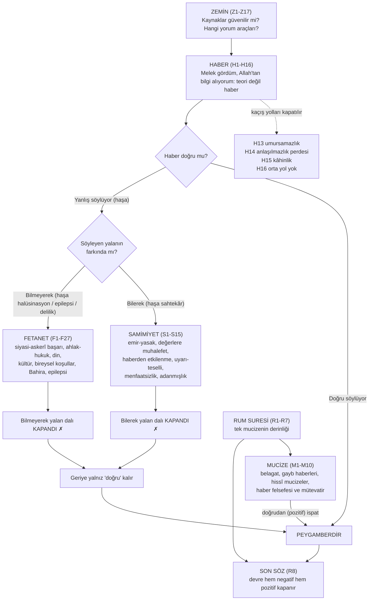
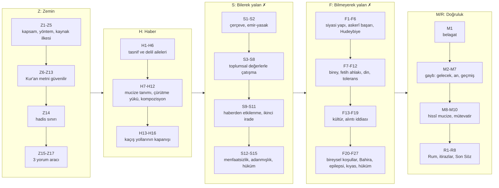

# Metod Haritası — Nübüvvet İspatı (tek referans)

> Kaynak kitap: Altay Cem Meriç, *Peygamberliğin İspatı – Haber Delili* (İnsan Yayınları, 2022). Bu harita yalnızca `docs/bolumler/01..07` dosyalarındaki bilgiye dayanır; yeni bilgi eklenmemiştir. Sayfa numaraları kitap sayfasıdır. Belirsiz/OCR'lı noktaların listesi: `docs/dogrulanacaklar.md`.
> Peygamber için olumsuz ihtimaller anılırken kitaptaki "haşa" edebi korunur; bu haritadaki "sahtekâr/deli" etiketleri yalnızca kitabın tasnif adlarıdır (H1, dn. 266).

## Nasıl okunur

- **ID şeması:** `Z` Zemin (kaynak güvenilirliği + yorum yöntemleri, s. 14–125) · `H` Haber inşası (s. 127–156) · `S` Samimiyet delilleri (s. 157–264) · `F` Fetanet delilleri (s. 265–407) · `M` Mucize delilleri (s. 409–482) · `R` Rum suresi mucizesi, itirazlar, Son Söz (s. 483–511).
- **Kronoloji kuralı:** Düğümler kitabın sırasıyla numaralıdır; bir düğüm yalnızca "önkoşul" sütunundaki düğümler tamamlandıktan sonra açılmalıdır. Kitap, aynı rivayeti tek yerde işleyip diğer yerlerden atıf yapar (Z2); bu yüzden "çapraz atıf" satırları önemlidir.
- **Üç delil ailesinin tanımı (H8):** Samimiyet = "farkında olarak yalan" ihtimalini çürüten deliller; Fetanet = "farkında olmadan yalan" ihtimalini çürüten, beşer takatini aşan zekâ/başarı delilleri; Mucize = haberin doğruluğunu doğrudan gösteren deliller.

---

## 1. Kapalı devre metodun özeti

1. **Zemin (Z).** Konuşmanın kuralları ve kaynakların değeri, muhatabın kendi kabulleriyle kurulur. Kur'an'ın erken yazımı, çoğaltılması, tahrifin tarihen imkânsızlığı, hafız ezberi, ≈45 yazma ve karbon verisi, Corpus Coranicum, antik metinlerle kıyas (Z6–Z13); hadisin sınırlı ve muhatabın da kabul ettiği kısmının kullanılması (Z14); üç yorum aracı: **ikincil delil mantığı** (Z15), **sahabenin tepkisizliği** (Z16), **müşriklerin sessizliği** (Z17). Metafizik önkoşul yoktur: nübüvvet gözlemlenen tarihî veriden tasdik edilir, melek/şeytan gibi unsurlar sonradan o tasdikin içeriği olarak gelir (Z4).
2. **Haber (H).** Tartışılan şey bir teori değil bir **haberdir**: "Mekke'de Muhammed b. Abdullah kırk yaşında bir melek gördüğünü, Allah'ın elçisi olduğunu söylüyor" ("Dün Ankara'daydım" türünden). Haber ya doğrudur ya yalandır; yalansa söyleyen ya farkındadır ya değildir. **Dördüncü ihtimal yoktur** (H1). Çağdaş itirazlar (epilepsi, halüsinasyon, iyi niyetli reformcu) yeni kutu açmaz (H5). Muhalifin kaçış yolları — umursamazlık, "anlaşılmazlık perdesi", "kâhinlik", "orta yol" — kapatılır (H13–H16).
3. **Yanlış dalları.** *Bilerek* (haşa sahtekâr) → **Samimiyet** (S1–S15). *Bilmeyerek* (haşa halüsinasyon/epilepsi/delilik) → **Fetanet** (F1–F27). İkisi kapanınca geriye yalnız "doğru" kalır (H6).
4. **Mucize (M, R).** Yalan ihtimallerini dışlamanın ötesinde haberin doğruluğuna **doğrudan** delildir: belagat, gayb haberleri (gelecek/an/geçmiş-kıssalar), hissî mucizeler + haber felsefesi/mütevatir (M1–M10); tek mucizenin derinleştirilmesi olarak Rum suresi (R1–R7). Mucize bu devrenin şartı değil, "ek pencere"dir (H10, M ön notu).
5. **Muhalif ne yapmalı (H7)?** Delilleri "demet sopa" gibi teker teker çürütmeli, yalanın çeşidine karar vermeli ve bütün tarihî veriyi tutarlı bir **kompozisyonla** açıklamalıdır (H12).
6. **Kaynak ilkesi (Z3, F-başı):** Samimiyet/fetanet delilleri ağırlıkla **oryantalist/gayrimüslim kaynaklarla** desteklenir; sebep onların daha güvenilir olması değil, muhatabın onları kabul etmesidir.
7. **Son Söz (R8):** Sıra: haber → kaynak güvenilirliği → yöntem → insan tepkileri → fetanet → samimiyet → doğruluk (Rum). 07 dosyasına göre bu sıra, sunumun akış sırası olarak kullanılabilir.

> **Sıralama notu.** Kitapta Samimiyet bölümü Fetanet'ten önce gelir; ancak çok sayıda alt başlık (atalar kültü, toplumsal değişim vb.) "hem samimiyet hem fetanet" delilidir ve fetanette yalnızca atıf yapılır (S6, F2). Bu haritada kitap sırası korunmuştur.

## 2. Birleşik ihtimaller ağacı

**Dal düzeyinde (alt kümeler):**

---

## 3. Düğüm kataloğu

Biçim: **ID · Başlık** · sayfa · *ağaçtaki yer*; ardından tez, önkoşul, cevapladığı şüpheler, ana kaynaklar (yazar + kitap sayfası) ve görsel/etkileşim fikri. "Kimlik" etiketleri (oryantalist vb.) bölüm dosyalarında kitaptan gelmiyorsa orada "kitapta belirtilmiyor" diye geçer; burada yalnızca kitaptaki sayfa atıfları kullanılmıştır.

### 3.1 ZEMİN (Z) — s. 14–125 · kaynak: `01-onsoz-kaynaklar-yorum.md`

**Z1 · Ön söz ve kitabın sınırları** · s. 14–16 · *Zemin / kapsam*
- *Tez:* Kitap tek bir yöntemi ("haber yöntemi") sistemleştirir; İslam'ın bütün itirazlarına cevap, Tanrı'nın varlığı tartışması, teorik içerik kıyası ve bilimsel mucize kapsam dışıdır. Kişisel hikâye delil sayılmaz ("Fikrin pazarında tek geçerli akçe delildir", s. 14).
- *Önkoşul:* yok (giriş).
- *Şüpheler:* "Kitap Hristiyanlık/ateizm/bilim itirazlarına cevap vermiyor mu?" · "Önce Tanrı'nın varlığını ispatlayın."
- *Kaynaklar:* yazarın kendi beyanı (s. 14–16).
- *Görsel/etkileşim:* "Bu sunum neyi yapar / yapmaz" tek ekranlık kapsam kartı; profil ölçmeden önce gösterilen şeffaflık notu.

**Z2 · Eserin yöntemi** · s. 16–18 · *Zemin / yöntem*
- *Tez:* Yöntem yeni değildir; Müslümanların bilinçaltında uyguladığı yaklaşımın sistemleştirilmesidir. Yapı itiraz-cevap usulüyle kurulmuş, yayımdan önce bir yıl Müslüman ve gayrimüslim okurlara sert tenkit için gönderilmiştir; aynı rivayet bir yerde işlenir, diğerlerinde atıf yapılır; eser "kronolojik olmayan bir siyer" gibi de okunabilir.
- *Önkoşul:* Z1.
- *Şüpheler:* "Bu deliller kendi davalarını ispat için uydurulmuş olmasın?" (cevap: s. 18, 90) · "Deliller yeterince kapsamlı mı?"
- *Kaynaklar:* yazarın beyanı (s. 16–18).
- *Görsel/etkileşim:* Çapraz atıf göstergesi (bir kartta "bu delil ayrıca X düğümünde de kullanılır" rozeti).

**Z3 · Kaynak kullanımı ve oryantalizm** · s. 18–19 · *Zemin / kaynak ilkesi*
- *Tez:* Oryantalist alıntılar "onlar söyledi, o hâlde doğrudur" için değil, muhatabın kabulü ve vurgu için, kitabın kendi delillerinden sonra kullanılır; yazar oryantalistlerin donanımının gereğinden fazla ciddiye alındığı kanaatindedir.
- *Önkoşul:* Z2.
- *Şüpheler:* "Neden hep Batılı yazarlar?" · "Bu kaynaklara neden güveniyorsunuz?"
- *Kaynaklar:* yazarın beyanı (s. 18–19).
- *Görsel/etkileşim:* Kaynak rozeti sistemi (oryantalist / gayrimüslim / Müslüman); her kartta "bu isim sizin kabul ettiğiniz bir kaynak olduğu için" notu.

**Z4 · Aydınlanma ve nübüvvetin ispatı (metafizik önkoşulsuz)** · s. 19–20 · *Zemin / yöntem*
- *Tez:* "Önce olağanüstü olay mümkündür, sonra nübüvvet" sırasına gerek yoktur; nübüvvet gözlemlenen tarihî veriden tasdik edilir, melek/şeytan gibi unsurlar tasdik edilmiş nübüvvetin içeriği olarak sonradan kabul edilir.
- *Önkoşul:* Z1.
- *Şüpheler:* "Önce doğaüstünün mümkün olduğunu ispatlayın."
- *Kaynaklar:* yazarın beyanı (s. 19–20).
- *Görsel/etkileşim:* Sıra şeması: "tarihî veri → haberin doğruluğu → içeriğin kabulü".

**Z5 · Kaynak seçiminde tutarlılık ilkesi** · s. 22 · *Zemin / kaynak ilkesi*
- *Tez:* Kaynak seçimi keyfî olamaz; antik dünya/Hristiyanlık hakkında kaynak saydığı metinlerden çok daha güçlü metinleri reddeden kişi ilmî tutarsızlık sergiler. Ana kaynaklar Kur'an ve (kısmen) hadistir; nakleden sahabe de sürecin parçasıdır.
- *Önkoşul:* Z3.
- *Şüpheler:* "Neden Kur'an'ı tarih kaynağı sayıyorsunuz?"
- *Kaynaklar:* yazarın ilkesi (s. 22); kapanışı Z13'te (s. 89).
- *Görsel/etkileşim:* "Tutarlılık terazisi": muhatabın kabul ettiği antik kaynaklar bir kefede, Kur'an kriterleri öbür kefede (Z13 ile birleşik).

**Z6 · Kur'an'ın erken yazımı ve çoğaltılması (Sıffin sahnesi)** · s. 23–28 · *Zemin / Kur'an metni*
- *Tez:* Kur'an matbaa öncesi eşi olmayacak kadar erken kayda geçti ve çoğaltıldı. Sıffin'de iki ordunun da aynı mushafa başvurması, çoğaltmadan ≈7, vefattan ≈27 yıl sonra metnin doğruluğunda ittifakı gösterir; "sahabe neden sustu?" sorusu vehim sahibine döner.
- *Önkoşul:* Z5.
- *Şüpheler:* "Kur'an çok sonra yazıya geçti, sözlü kültürde değişir." · "Osman mushafları yaktı, asıl metin kayboldu."
- *Kaynaklar:* Bodley (23); Irving, Rodinson, Lewis, Wellhausen (Sıffin, 24–26); Cerrahoğlu (500 nüsha, 26–27); Hodgson, Muir (27–28).
- *Görsel/etkileşim:* Zaman şeridi 632 → ≈650 → ≈657 (27 ve 7 yıl göstergeleri, 500+500 mushaf).

**Z7 · İhtilaf-ittifak ve sistemli tahrifin imkânsızlığı** · s. 28–33 · *Zemin / Kur'an metni*
- *Tez:* Tahrife dair hiçbir ihtilafın nakledilmemesi, tahrifin en güçlü karşı delilidir: iktidar el değiştirmeleri (Emevi/Abbasi/Endülüs), Haricilerin tavrı, Roma'nın izini silememesi örneği ve muhaliflerin kitaplarının sergilenmesi. Tahrif iddiası "hangi dönem, kim, hangi kayıt" sorularına cevap vermelidir.
- *Önkoşul:* Z6.
- *Şüpheler:* "Güçlü bir iktidar muhalefeti susturabilir." · "Roma İncilleri dikte etti, İslam'da da böyle olmuştur." · "Bir iktidar tahrif etmiş olabilir."
- *Kaynaklar:* Kadı Abdülcabbar (30–33); Hristiyanlık örneği (28–29); kronoloji 750 sonrası çok devletlilik (29–30).
- *Görsel/etkileşim:* Harita/zaman çizelgesi: tek devlet hâkimiyetinin bittiği 750 sonrası rakip iktidarlar; "tarihî veri yok etmek" karşılaştırma kartı (Hristiyanlık/İslam).

**Z8 · Hafızların ezberi** · s. 33–34 · *Zemin / Kur'an metni*
- *Tez:* Korumanın ikinci ayağı ezberdir; silsilenin başında Nebi vardır. Rakam kabadır (Türkiye ≈200 bin resmî hafız → dünyada kabaca 3–4 milyon).
- *Önkoşul:* Z6.
- *Şüpheler:* "Sadece yazıya mı dayanıyor?"
- *Kaynaklar:* Diyanet haberi (s. 34, dipnot); oransal tahmin yazara ait.
- *Görsel/etkileşim:* "Kabaca" etiketli hafız infografiği (rakam kesin gibi sunulmamalı).

**Z9 · Yazma eserler üzerinden varsayımsal akıl yürütme** · s. 34–36 · *Zemin / Kur'an metni*
- *Tez:* Yazmalar zorunlu değil "fazladan" delildir. Tahrifin ispatı için tek farklı mushaf yetmez; sistemli ve sonrakilere yayılmış fark gerekir (Kanuni–Fatih örneği). Elde Kur'an'a muhalif tek yazma yoktur; birçoğu hiç incelenmemiştir (Birmingham).
- *Önkoşul:* Z7.
- *Şüpheler:* "Yazmalarda farklılık çıkarsa ne olur?" · "Tek farklı bir yazma bulunursa?"
- *Kaynaklar:* yazarın akıl yürütmesi (35–36); Birmingham örneği (36).
- *Görsel/etkileşim:* Etkileşimli senaryo: "800 yılına ait tek farklı yazma bulundu; ne olur?".

**Z10 · Karbon testinin mahiyeti** · s. 37–41 · *Zemin / Kur'an metni*
- *Tez:* Karbon testi yazının değil malzemenin yaşını, aralıkla (%95) verir; "Peygamber'den önceye ait Kur'an" iddiası bu mantığı bilmemekten doğar (Birmingham 568–645, aralık 77 yıl).
- *Önkoşul:* Z9.
- *Şüpheler:* "Peygamber'den öncesine ait Kur'an bulundu diyorlar." · "Karbon testi neyi gösterir?"
- *Kaynaklar:* Bloom (kâğıt, 37–38); yazarın kronoloji ve seçim kriterleri (37, 40).
- *Görsel/etkileşim:* Kronoloji şeridi (610–777) üzerinde aralık çubuğu; Birmingham aralığı ile Peygamber'in ömrü (63 yıl) karşılaştırması.

**Z11 · Mushaf listesi ve çıkarımlar (≈45 giriş)** · s. 42–83 · *Zemin / Kur'an metni (veri çekirdeği)*
- *Tez:* İlk yüzyıla nispet edilen 44 yazma metin + 7 tek sayfalık varak; belli tarih, coğrafya veya sureye yığılmaz, birbirini tamamlar, bugünkü mushafla birliktelik içindedir; Medine/Basra/Şam/Kûfe nüshalarıyla eşleşir.
- *Önkoşul:* Z10.
- *Şüpheler:* "Elimizdeki en eski Kur'an ne zaman?" · "Kur'an tarihte kaç yazma ile belgeli?"
- *Kaynaklar:* Altıkulaç (80–83); Hamidullah (80–81); islamic-awareness.org dipnotları (42–79; bkz. dogrulanacaklar).
- *Görsel/etkileşim:* Ülke haritası + kapsam yüzdeleri (Topkapı ~99,5%, Kahire ~99,7% vb.); Osman nüshası eşleşme şeması (s. 82). Tekrar-sayım uyarısı kaydı için doğrulanacaklar'a bakınız.

**Z12 · Corpus Coranicum (ayet bazında yazma tarihleri)** · s. 83–86 · *Zemin / Kur'an metni*
- *Tez:* Muhatap yazma tarihlerini oryantalistlerin kendi veri tabanından denetleyebilir; Tevbe 9:128–129 (Reşad Halife iddiası) ve Rum 30:5 örnek alınmıştır. Dam 01-27.1 için yazarın kaba dağılımı: ≈%60 Hz. Muhammed dönemi.
- *Önkoşul:* Z11.
- *Şüpheler:* "Reşad Halife: Tevbe'nin son iki ayeti sonradan eklendi." · "Kendim denetleyebilir miyim?"
- *Kaynaklar:* Corpus Coranicum (83–86); yazarın kaba yıl-üzeri hesabı.
- *Görsel/etkileşim:* Canlı site bağlantısı + iki ayet için zaman ekseni; "yazarın kaba hesabı" etiketi.

**Z13 · Antik metinlerle ve İncillerle kıyas** · s. 86–89 · *Zemin / Kur'an metni (kapanış)*
- *Tez:* Homeros, Herodot, Thukydides, Eflatun vb. ve İncil'ler yazım–en eski kopya aralığı bakımından Kur'an'ın seviyesine ulaşmaz; Kur'an hakkında şüphe duyan, bu kriterlerin onda biri kadar delil sunan başka metin göstermelidir (Z5'in kapanışı).
- *Önkoşul:* Z11, Z5.
- *Şüpheler:* "Kur'an tarihte diğer antik metinlere göre ne durumda?"
- *Kaynaklar:* McDowell tablosu (86–87); Duygu İncil tablosu (87–88).
- *Görsel/etkileşim:* Çubuk grafik: yazım ile en eski kopya arası yıl farkı; Kur'an satırı ayrı vurgu.

**Z14 · Hadis (kullanımın sınırı)** · s. 89–90 · *Zemin / hadis*
- *Tez:* Hadisin güvenilirliği ayrı bir eserin konusudur; kitap tarihî çıkarımı ağırlıkla ayetlerden ve gayrimüslim yazarların da kullandığı hadislerden yapar; amaç muhatabın "Müslümanlar bunları peygamberliği ispatlamak için mi uydurdu?" şüphesini gidermektir.
- *Önkoşul:* Z5.
- *Şüpheler:* "Hadisler sonradan uydurulmuştur." · "Hadis güvenilir değil."
- *Kaynaklar:* yazarın beyanı (s. 89–90).
- *Görsel/etkileşim:* Her hadis kartında "bu hadis hangi kaynaklarca da kullanılır / hadissiz alternatif delil" rozeti.

**Z15 · İkincil delil mantığı** · s. 91–94 · *Zemin / yorum aracı 1*
- *Tez:* Metin bir iddiayı ispat için yazılmamış ama bağlamı o iddiayı varsayıyorsa ("kazadaki doktor" örneği), bu ikincil delil doğrudan iddiadan daha güçlüdür, kurgu töhmetinden uzaktır (Bakara 2:214, Kalem 68:46, Tekvir 81:8–9).
- *Önkoşul:* Z14.
- *Şüpheler:* "Kur'an'daki bu cümleler kurgudur." · "Kur'an Müslümanların yazdığı propaganda; kendini ispat için yazılmış."
- *Kaynaklar:* Bakara 2:214, Kalem 68:46, Tekvir 81:8–9; Thukydides/Peloponnesos örneği (91–94).
- *Görsel/etkileşim:* Tek bir "kural kartı" (sonraki bölümlerde kısaltılarak tekrar çağrılır): "Ayet itirazsız kalmışsa olgu doğrudur".

**Z16 · Sahabenin tarihî kaynaklığı (tepkisizlik argümanı)** · s. 94–119 · *Zemin / yorum aracı 2*
- *Tez:* Ağır baskıya, yoksulluğa ve iktidarsızlığa katlanan samimi sahabe, Kur'an tahrif edilse ya da toplumu hakkında açık bir hata olsa tepki gösterirdi; üstelik sorgulamayan insanlar değildiler (Hayber, Hudeybiye, Miraç). Dolayısıyla Kur'an'daki tarihî veriler "yorum güvenilirliği" kazanır. Yusuf 12:3 uygulama örneğidir.
- *Önkoşul:* Z15.
- *Şüpheler:* "Sahabe yanlış bir şeye bile sadakatle inanabilir." · "Deliler gibi inanıp körleşebilirler." · "Kur'an'da tarihî hata varsa?"
- *Kaynaklar:* Hazleton, Watt, Caetani (95–99); Dermenghem (98–101, 104, 106, 111, 116); Arnold (100); Margoliouth, Rodinson (101–103); Armstrong (97, 100, 103, 105); Hitti (104–105); Irving (107–109); Lapidus (107–108); Bodley (111–112, 116); Massignon (105–106).
- *Görsel/etkileşim:* Vaka kartları (Bilal, Ammar, İbn Mesud, Osman, Akabe, Ebubekir'in 40 bin → 5 bin dirhemi, Ebu Talha'nın bahçesi, Abdurrahman b. Avf); "Bu olayları yaşayan bir arkadaşınızı hayal edin" etkileşimi (s. 95).

**Z17 · Mekke müşriklerinin sessizliği** · s. 119–125 · *Zemin / yorum aracı 3*
- *Tez:* Kur'an düşmanlarının çok zayıf itirazlarını bile aktarıp cevaplar; açık bir yalan olsaydı müşrikler, Yahudiler, münafıklar bunu propaganda yapardı. Kur'an "spot ışığı altında" bir metindir. Kapanış: kullanılacak metinlerin güvenilirliği ve yorum yöntemleri temellendirilmiştir.
- *Önkoşul:* Z16.
- *Şüpheler:* "Peki Kur'an'da hatalı bir tarihî bilgi olsaydı?" · "Peygamber kitaplardan hikâye anlatmış olsa rakipleri söylemez miydi?"
- *Kaynaklar:* Margoliouth (119, 125); Armstrong (124); Furkan 25:33 ve itiraz-cevap ayetleri (120–124).
- *Görsel/etkileşim:* "İtiraz–cevap" ayet kartı galerisi (kıble, sivrisinek, "melek inmeliydi" vb.); Z15–Z17 üç aracın "yorum kuralları" panosu.

### 3.2 HABER İNŞASI (H) — s. 127–156 · kaynak: `02-haber-insasi.md`

**H1 · Haberin niteliği ve ihtimaller** · s. 127–129 · *Haber / tasnif*
- *Tez:* Konu bir haberdir; yorumlamanın üç yolu vardır: doğru; yalan-bilerek (sahtekâr); yalan-bilmeyerek (deli). İsimler kolaylık içindir, esas olan **farkındalıktır**; dördüncü ihtimal yoktur.
- *Önkoşul:* Z17 (zemin tamam).
- *Şüpheler:* "'Deli/sahtekâr' demek Peygamber'e hakaret değil mi?" · "İyi niyetle yanılmışsa? 'Yalan' ağır değil mi?"
- *Kaynaklar:* tanımlar (128, dn. 265–266).
- *Görsel/etkileşim:* Üç kutulu ihtimal şeması; "iki ölçüt" (doğru/yalan × farkında/değil) animasyonu.

**H2 · Haber tasnifinin imandaki önemi** · s. 129 · *Haber / tasnif*
- *Tez:* Küfür = elçiyi tekzip, iman = tasdik; klasik literatürün kendisi meseleyi haber çerçevesinde kurar.
- *Önkoşul:* H1.
- *Şüpheler:* "İman bir sezgi meselesi; 'doğru mu yalan mı' diye masaya yatırmak yapay."
- *Kaynaklar:* Gazali (Izutsu aracılığıyla), Cahız (129).
- *Görsel/etkileşim:* Kısa alıntı kartı (isteğe bağlı derinleştirme).

**H3 · Kur'an'da haber tasnifi** · s. 129–133 · *Haber / tasnif*
- *Tez:* "k-z-b" kökü Kur'an'da 220 kez geçer; Kur'an hem "deli" ithamını (bilmeyerek dalı) hem "yalancı/uyduruyor" ithamını (yalan) aktarır, yani tasnif sonradan giydirilmiş değildir.
- *Önkoşul:* H1, Z17.
- *Şüpheler:* "Bu tasnif senin Kur'an'a giydirdiğin bir şema."
- *Kaynaklar:* Hicr 15/6, Şuarâ 26/27, Sâffât 37/36, Zâriyât 51/39, 51/52, Kalem 68/51, Tûr 52/29, Mü'minûn 23/70; Secde 32/3, Ahkâf 46/11, Sâd 38/4, Mü'min 40/23, Kamer 54/25.
- *Görsel/etkileşim:* İki sütunlu ayet haritası: "deli" ayetleri / "yalancı" ayetleri.

**H4 · Haber ve teori arasındaki fark** · s. 133 · *Haber / tasnif*
- *Tez:* Teoride sahtekâr ya da deli olmadan yanılmak mümkündür; haberde ("Bugün Ankara'daydım") değildir: yalansa ya bilinçli yalan ya da algı bozukluğudur.
- *Önkoşul:* H1.
- *Şüpheler:* "Peygamber sadece yanlış bir dünya görüşü / teori kurmuş olabilir."
- *Kaynaklar:* Platon ve iktisat sistemi örnekleri (yazarın kendi örnekleri, 133).
- *Görsel/etkileşim:* "Teori mi haber mi?" mini sınıflandırma oyunu.

**H5 · Habere dair güncel söylemler** · s. 134 · *Haber / tasnif*
- *Tez:* Epilepsi/halüsinasyon "farkında olmadan yalan" kutusundadır; iyi niyetli reformcu/toplum önderi "farkında olarak yalan" kutusundadır; yeni isim yeni kutu açmaz.
- *Önkoşul:* H1, H4.
- *Şüpheler:* "Ben ne deli diyorum ne sahtekâr: epilepsi, halüsinasyon ya da iyi niyetli reformcu."
- *Kaynaklar:* yazarın tasnifi (134).
- *Görsel/etkileşim:* Muhatabın kendi görüşünü seçtiği "iddiamı yerleştir" etkileşimi → ağaçta ilgili dala yönlendirir.

**H6 · Delillerin tasnifi** · s. 134–135 · *Haber / delil aileleri*
- *Tez:* Fetanet delilleri "farkında olmadan", samimiyet delilleri "farkında olarak" yalanı çürütür; ikisi kapanınca yalnız doğru kalır; mucize ayrı ve doğrudan bir yoldur. Sahabenin "bu yüz yalan söylemez" tepkisi ve Yunus 10/16 bu ailelerin işaretidir.
- *Önkoşul:* H5.
- *Şüpheler:* "Bunlar sonradan icat edilmiş bir terminoloji; ilk Müslümanlar böyle düşünmüyordu."
- *Kaynaklar:* Yunus 10/16 (135); yazarın tasnifi.
- *Görsel/etkileşim:* **Ana ağaç şeması** (bölüm 2'deki Mermaid): kapanan dallar ✗ işaretiyle.

**H7 · Delilleri çürütmek isteyen ne yapmalı?** · s. 135–136 · *Haber / ispat yükü*
- *Tez:* Muhalif önce mucizeleri teker teker çürütmeli, yalanın çeşidine karar vermeli, o çeşidin delillerini çürütmeli ve tutarlı kompozisyon kurmalıdır. Deliller "zincir" değil "demet sopa"dır; 10'ar delil varken tek tek itiraz yetmez.
- *Önkoşul:* H6.
- *Şüpheler:* "Zincirin gücü en zayıf halkanın gücü kadardır." · "Ben sadece birkaç delilinize itiraz ediyorum, o yeter."
- *Kaynaklar:* yazarın aritmetiği (135–136).
- *Görsel/etkileşim:* "Demet sopa" animasyonu; muhatabın "hangi delili çürütürdünüz?" seçimi.

**H8 · Delil isimlendirmeleri (samimiyet, fetanet)** · s. 136–137 · *Haber / tanımlar*
- *Tez:* Fetanet, sıradan zekâ değil beşer takatini aşan, "Allah'ın yardımı olmadan ulaşılamayan" zekâdır; bu yüzden fetanet delilleri mucize kabilindendir. Samimiyet delilleri "sahtekâr olmadığını" gösterir.
- *Önkoşul:* H6.
- *Şüpheler:* "Fetanet sıradan zekâ demek; zeki insan çok."
- *Kaynaklar:* yazarın tanımları (136–137).
- *Görsel/etkileşim:* Terim sözlüğü kartı (tooltip).

**H9 · Mucize nedir?** · s. 137–138 · *Haber / mucize teorisi*
- *Tez:* Mucize, "beşerî benzerini ortaya koymaktan aciz bırakan" veya "kişinin marifetiyle açıklanamayan" şeydir; doğa kanunlarının çiğnenmesine indirgenemez. İki kategori: (1) Nebi'nin şahsi marifetini aşan, (2) her insanı aşan.
- *Önkoşul:* H8.
- *Şüpheler:* "Mucize doğaya aykırı olay demektir; Kur'an'da doğa kanunu çiğnenmiyor ki."
- *Kaynaklar:* yazarın tanımı; dn. 289 (ileri atıf).
- *Görsel/etkileşim:* İki kategori diyagramı (kitabın sonraki bölümlerinde rozet olarak tekrar kullanılır).

**H10 · Mucize iddiası nasıl çürütülür?** · s. 138–139 · *Haber / ispat yükü*
- *Tez:* "Bunu yapan birileri olmuş olabilir" vehimdir; doğru soru "bunu yapabilen başka biri olmuş mudur?"dır. Örnek gösterilirse mucize ortadan kalkmaz, birinci kategoriye döner. Mucizeler ispatı pekiştirir; esas yük samimiyet + fetanetledir.
- *Önkoşul:* H9.
- *Şüpheler:* "Bunu belki başka biri de yapmıştır; bilmiyoruz." · "Mucize yoksa hepsi çöker."
- *Kaynaklar:* yazarın uçan adam / belagat örnekleri (138–139).
- *Görsel/etkileşim:* "Örnek getir" akış şeması (örnek varsa → 1. kategoriye dön).

**H11 · Hz. Muhammed'in şartlarını aşan mucize** · s. 139–141 · *Haber / mucize teorisi*
- *Tez:* Birinci kategori mucize, toplumdaki hiç kimsenin yapamayacağı bir şey olmak zorunda değildir; iddia sahibinin kendi geçmişiyle açıklanamayan başarı (yazılım/organ nakli örnekleri) haberin doğruluğuna delildir. Örnek: Duhân 44/29 ve Mısır ağıtı metni.
- *Önkoşul:* H9, H10.
- *Şüpheler:* "Yazılımı binlerce kişi yazabiliyor; bunun neresi mucize?" · "Duhân 44/29 benzerliği tesadüf ya da dolaylı aktarımdır."
- *Kaynaklar:* British Museum S. BM 10188 (Faulkner çevirisi, 139–141); fetanet/samimiyet'in sistemleştirilmediği literatür notu (141).
- *Görsel/etkileşim:* Yaşlı adam–yazılım örneği için mini senaryo; Duhân 44/29 ayrıntısı M7'ye ertelenir (burada yalnız örnek).

**H12 · Bir kompozisyon kurmanın gerekliliği** · s. 141–144 · *Haber / ispat yükü*
- *Tez:* Delile itiraz, muhalifin kendi iddiasının ispatı değildir; "peygamber değil" diyen deli ya da sahtekâr seçmeli ve bütün tarihî veriyi o seçimle tutarlı açıklamalıdır. Veri bolluğu (Renan, Caetani, Hodgson) kompozisyon talebini haklı kılar.
- *Önkoşul:* H7.
- *Şüpheler:* "Ben senin delilini reddettim; Peygamber'in sahtekâr olduğunu ispat etmek zorunda değilim." · "Erken dönem İslam kaynakları sonradan yazılmış; güvenemeyiz."
- *Kaynaklar:* Lewis (Renan aktarımı), Caetani, Hodgson (dn. 298) (143–144); Margoliouth (atıf eksik, bkz. doğrulanacaklar).
- *Görsel/etkileşim:* "Kompozisyon panosu": muhatap bir kutu seçer, sistem seçtiği kutunun açıklaması gereken verileri listeler.

**H13 · Umursamazlık / yüz çevirme** · s. 144–146 · *Haber / kaçış yolu 1 kapanışı*
- *Tez:* Tavır almamak da bir tavırdır: pratikte "peygamber değil" ihtimalini seçmek ve yalanın çeşidine kayıtsız kalmaktır (araba alarmı örneği). Mükellefiyet için haberi değerlendirmeye yetecek sağlıklı verinin ulaşması gerekir; takdiri Allah'a aittir.
- *Önkoşul:* H12.
- *Şüpheler:* "Bu konu beni ilgilendirmiyor." · "Mesajı yeterince duymamış biri de mi sorumlu?"
- *Kaynaklar:* Tâhâ 20/48, Necm 53/29, Kıyâme 75/32, Leyl 92/16.
- *Görsel/etkileşim:* Sakin tonda alarm örneği; baskı yok, "isterseniz devam edelim" geçişi.

**H14 · Anlaşılmazlık perdesi** · s. 146–147 · *Haber / kaçış yolu 2 kapanışı*
- *Tez:* Temel meselede "bilemiyorum" demek tutarsızdır; bu iddiadan türeyen bütün tarihî olgular hakkında konuşma hakkını da kaldırır (alfabenin ilk harfini bilmeyip Kant eleştirmek gibi).
- *Önkoşul:* H13.
- *Şüpheler:* "Bu konuda kesin bir şey bilinemez; agnostik kalıyorum."
- *Kaynaklar:* yazarın benzetmeleri (146–147).
- *Görsel/etkileşim:* Agnostik profil için "tutarlılık testi" kartı.

**H15 · Kâhinlik iddiası** · s. 147–149 · *Haber / kaçış yolu 3 kapanışı*
- *Tez:* "O çağda kâhinler vardı" cevap değil sorudur; kâhinleri açıklamak için de iki kutuya (sahtekâr / halüsinasyon) dönülür. Paranormali kabul eden materyalist/pozitivist olamaz; kâhinlere vahiy atfeden Hz. Muhammed'i neden dışarıda bırakır?
- *Önkoşul:* H14.
- *Şüpheler:* "O devirde kâhinler vardı; Muhammed de onlardan biriydi."
- *Kaynaklar:* yazarın "histeri" benzetmesi ve test sorusu (147–149).
- *Görsel/etkileşim:* "Kâhinlerin durumu sizce nedir?" sorusu → cevabı iki kutuya otomatik yerleştirme.

**H16 · Haberin keskinliği: orta yol yoktur** · s. 149–156 · *Haber / kaçış yolu 4 kapanışı*
- *Tez:* "Deli ama zeki" ve "sahtekâr ama iyi" gibi yumuşak geçişler haberin ayrıntılarına inince çöker: iblis–ateş parçası hadisi, namaz vakitlerini Cebrail'in öğretmesi, Übey–Beyyine olayı, vahyin geliş şekilleri. Skalada halüsinasyon ihtimali "0" değil "−100"dür. Eski müelliflerin ifadesi: nübüvvet iddiası ya en faziletlilerden ya en düşüklerden gelir.
- *Önkoşul:* H15.
- *Şüpheler:* "Peygamber iyi niyetli bir toplum önderiydi; halkını kurtarmak için 'melek geldi' demiş olabilir." · "Belki epilepsi/halüsinasyon vardı ama zeki bir liderdi." · "İkisinin arası olamaz mı?"
- *Kaynaklar:* Ebu'd-Derda hadisi (150–151, 153–154); Buhârî 3221, Muvatta (151–152); Dozy (Cebrail–Kurayza, 152); Hazleton (154); Buhârî/Müslim Übey olayı (155); Yûnus 10/16–17 (156); Lapidus (156).
- *Görsel/etkileşim:* "Mescitte iblis sahnesi" iki okuma (halüsinasyon / bilerek) yan yana; 0–100 skalası. Sert içerik: "yalnızca bu ihtimali ciddiye alıp sonucuna bakıyoruz" çerçevesi şarttır.

### 3.3 SAMİMİYET DELİLLERİ (S) — s. 157–264 · "bilerek yalan" dalı · kaynak: `03-samimiyet.md`

> Ortak kalıp: "Haşa yalancı olsaydı X'i yapar mıydı / Y'yi yapmaz mıydı?" (karşı-olgusal akıl yürütme) + ikincil delil (Z15). Ek kavram: **"ikinci irade"** (S6, S10, S11). Hedef iddia (s. 157): "zeki bir toplum önderi, dini siyasal fikirlerine araç yaptı" (kaba sürüm: kadın/iktidar düşkünü).

**S1 · Giriş ve bir itiraz** · s. 157–159 · *Samimiyet / çerçeve*
- *Tez:* Bölüm yalnızca "bilerek yalan" ihtimalini çürütür; samimiyet tek başına nübüvveti ispatlamaz. Soru: bu yorumlar tarihî verileri açıklıyor mu, kompozisyon kuruyor mu?
- *Önkoşul:* H6, H12, H16.
- *Şüpheler:* "Samimi olmak peygamberlik göstermez." · "Bruno da Diyojen de samimiydi."
- *Kaynaklar:* Bruno/Diyojen farkı (159: olağanüstü olayın nakilcisi değiller, teoriye bağlılık, peygamberlik iddiaları yok).
- *Görsel/etkileşim:* Küçük "bu delil neyi yapar/yapmaz" kutusu; devrede kapanan dalı vurgulayan ağaç görünümü.

**S2 · Mükellefiyetler: emir ve yasaklar** · s. 159–172 · *Samimiyet / sahte peygamber olsaydı*
- *Tez:* Yük ağır ve tepki çekicidir (içki/fuhuş yasağı, oruç, namaz, korku namazı, Sakif heyeti pazarlığı); tüm sahte peygamberler yükü azaltarak başlar (Müseylime, Tuleyha); üstelik Peygamber bunları kendisi de uygular ve kendine fazlasını yükler (vısâl, gece namazı).
- *Önkoşul:* S1.
- *Şüpheler:* "Siyasi önder ama niye yük?" · "Kendisi de yapıyor olması neden delil?"
- *Kaynaklar:* Arnold, Dermenghem, Dozy, Goldziher, Hitti (içki/fuhuş/oruç, 160–162); Goldziher, Armstrong, Watt (namaz, Hevazin/Sakif, 162–167); Kister (Tuleyha, 167–168); Carlyle (169); Buhârî/Müslim (vısâl, teheccüd, 170–172).
- *Görsel/etkileşim:* İki sütunlu kart: "Menfaat peşindeki biri ne yapardı?" / "Tarihte ne oldu?"; "bir ay deneyin" (oruç, namaz, teheccüd) isteğe bağlı görev.

**S3 · Hâkim değer yargılarına muhalefet** · s. 173–175 · *Samimiyet / toplumsal değerler*
- *Tez:* Hareket adamı toplumun zeminindeki değerlere durduk yere muhalefet etmez; oryantalistlerin kendi itirafıyla getirilenler Arapların ideallerine ve ataların sünnetine zıttır.
- *Önkoşul:* S2.
- *Şüpheler:* "Muhammed Arapların değerlerine din kisvesi giydirdi."
- *Kaynaklar:* Goldziher, Izutsu (Rodinson aktarımı), Watt, Caetani (173–175).
- *Görsel/etkileşim:* Değer matrisi: cahiliye değeri ↔ getirilen (S4–S6 kartlarına açılır).

**S4 · Cömertlik algısı** · s. 175–178 · *Samimiyet / toplumsal değerler*
- *Tez:* *Kerim* kavramı müsrifçe cömertlik/soy asaleti iken Kur'an 49/13 ile "en takvalı", 17/26–27 ile israf yasağı getirir; Sa'd b. Ebi Vakkas hadisi.
- *Önkoşul:* S3.
- *Şüpheler:* "Bu sadece Arap ahlakının İslamlaştırılmış hâli."
- *Kaynaklar:* Izutsu, Rodinson (175–178); Buhârî Da'avât 43.
- *Görsel/etkileşim:* Kelime evrimi kartı ("kerim" önce/sonra).

**S5 · Affetme ve öç alma algısı** · s. 178–185 · *Samimiyet / toplumsal değerler*
- *Tez:* Cahiliyede af korkaklık, kan davası mürüvvettir; Peygamber amcasının (Hamza) katili Vahşî'yi, Hint'i ve kızı/torununun ölümüne sebep olan Hebbâr'ı affeder; siyasi figürden güç eline geçince beklenmeyecek merhamet.
- *Önkoşul:* S4.
- *Şüpheler:* "Güç sahibi biri siyaseten affeder."
- *Kaynaklar:* Goldziher, Rodinson, Arnold (178–180, genel çerçeve); Dermenghem, Caetani, Hazleton, Rodinson, Watt (Hamza/Hint/Vahşî, 180–182); Watt, Bodley (Zeynep, 183–184); İbn Abbas rivayeti (Edebü'l-Müfred 151).
- *Görsel/etkileşim:* Uhud–Mekke fethi hikâye akışı (hassas anlatım: Hamza'ya yapılan müsle yumuşak dille).

**S6 · Atalar kültü ve kabile bağları** · s. 185–211 · *Samimiyet + fetanet (çifte delil; fetanette yalnız atıf)*
- *Tez:* Soy/atalara muhalefet siyaseten intihardır; Kur'an ataların cahil olabileceğini söyler; Peygamber kendi atalarının (Ebu Talib, anne-baba) durumunu da yumuşatmaz ("ikinci irade": istiğfar isteğini ayet yasaklar). Değişimin sonucu: kölelik/ırk/eşitlik devrimi.
- *Önkoşul:* S5.
- *Şüpheler:* "Atalarının durumu hakkında söylediği bir siyaset olamaz mı?" · "Kabileciliğe dayanmak daha kolay olmaz mıydı?"
- *Kaynaklar:* Lapidus, Wellhausen, Goldziher (186–188); Izutsu (189–192); Buhârî 1360, Müslim İman 40, 357–363, Müslim Cenâiz (193–196); Dozy (Ebu Leheb, 197–198); Hazleton (atalar/Goldziher alıntısı, 193–199); Dermenghem, Margoliouth, Lewis (200–211); Kadı Abdülcebbar (203, dn. 446).
- *Görsel/etkileşim:* Ebu Talib/anne-baba rivayetleri "yalnızca muhatap isterse açılır" genişletilebilir kutu (kitap kendisi de rahatsızlığını belirtir); eşitlik devrimi için "önce/sonra" kartı; modern ırkçılık karşılaştırması isteğe bağlı derin dalış.

**S7 · Coğrafyada dinî hareket beklentisi** · s. 211–213 · *Samimiyet + fetanet*
- *Tez:* Arapların ne kabile ne din konusunda değişim talebi/beklentisi vardı; Peygamber ikisine birden (atalar kültü ve putperest din) saldırdı.
- *Önkoşul:* S6.
- *Şüpheler:* "Zaten bir dinî ihtiyaç vardı, o doldurdu."
- *Kaynaklar:* Rodinson, Dozy, Watt, Wellhausen, Caetani (211–213).
- *Görsel/etkileşim:* Kısa "talep var mıydı?" kartı.

**S8 · Güçlülere muhalefet ve uzlaşmayı reddetme** · s. 213–219 · *Samimiyet*
- *Tez:* Güçlülerin muhalefeti Kur'an'da "doğal" kabul edilir (ikincil delil); Peygamber mal, liderlik, uzlaşma tekliflerini reddeder; Medine'de de hem Yahudileri hem Hristiyanları karşısına alır.
- *Önkoşul:* S7, Z15.
- *Şüpheler:* "Güçlüler muhalefet etti" ifadesi neden delil sayılıyor?
- *Kaynaklar:* Armstrong (Kâfirûn 109, uzlaşma teklifi); Dermenghem, Dozy, Caetani, Hazleton, Gibbon, Arnold ("güneşi sağ elime" anlatısı); Hazleton (Utbe teklifi); hepsi 213–219.
- *Görsel/etkileşim:* "Teklifler tablosu" (kimin ne teklif ettiği / cevap).

**S9 · Kendi getirdiği haberden etkilenmesi** · s. 219–230 · *Samimiyet / ana delil*
- *Tez:* Yalanını bilen yalandan psikolojik olarak etkilenmez: İbrahim'in vefatı ve güneş tutulması ("yazarın tek başına yeter dediği delil"), mağara, Taif duası, bulut–rüzgâr korkusu, ilk vahyin korku ve "beni örtün" tepkisi.
- *Önkoşul:* S2–S8 (tarihî zemin), Z15.
- *Şüpheler:* "Bu duygusal tepkiler oynanmış olabilir." · "Hatice mucize mi gördü?"
- *Kaynaklar:* Buhârî Küsûf, Müslim Küsûf (220–223); Apaydın (27 Ocak 632 hesabı); Bodley, Dermenghem, Hazleton, Margoliouth, Schimmel, Watt (223–226); Buhârî Bed'ü'l-Vahy, Müslim İman 252 (227); Hazleton, Armstrong, Hodgson, Dozy (227–230).
- *Görsel/etkileşim:* Güneş tutulması sahnesi ("kimsenin ölümü için tutulmaz" hadisi karşılaştırması); ilk vahiy için "ne beklerdiniz?" etkileşimi.

**S10 · Uyarı ve teselli ayetleri** · s. 231–241 · *Samimiyet / ikinci irade*
- *Tez:* Kur'an Peygamber'e hitap ettiğinde onun kendi mırıltısı gibi değil, onun iradesinden farklı bir irade gibidir: Abese, İsrâ 17/73–75, 6/35, 9/43, Ahzab 33/37 (uyarı); Duhâ 93, İnşirah 94 (teselli). Yazar bu delilin ateistken kendisini çok etkilediğini söyler (s. 231, 235).
- *Önkoşul:* S9.
- *Şüpheler:* "Bu uyarılar da siyasi bir manevra olabilir."
- *Kaynaklar:* Hazleton, Dermenghem, Watt (236–241).
- *Görsel/etkileşim:* Ayet-ses kartları: "kim kime konuşuyor?" (hitap şahısları vurgulu metin).

**S11 · Kıyamet suresinin ortasındaki dört ayet** · s. 241–243 · *Samimiyet / ikinci irade*
- *Tez:* 75/16–19, kıyamet anlatısını ortadan keserek Peygamber'e "dilini kımıldatma" der; hangi şair şiirini böyle böler?
- *Önkoşul:* S10.
- *Şüpheler:* "Bu cümle metne sonradan eklenmiş de olabilir."
- *Kaynaklar:* Kıyâme 75/15–20 metni (241–243).
- *Görsel/etkileşim:* Arapça tilavet + Türkçe meal eşzamanlı oynatma (kitabın kendi önerisi).

**S12 · Mal ve dünyaya dair şahsi tavrı** · s. 244–248 · *Samimiyet / menfaatsizlik*
- *Tez:* Saray kurmadı, Mekke fethinden sonra Medine'ye döndü, zırhı rehinde vefat etti, evleri hurma lifinden; "kral ilan edebilirdi".
- *Önkoşul:* S9.
- *Şüpheler:* "Menfaat peşindeydi" · "Batı Orta Çağ anlatısı: şehvetperest sahte peygamber."
- *Kaynaklar:* Caetani, Hodgson, Hazleton, Gibbon, Dermenghem, Margoliouth (zırh), Kadı Abdülcebbar, Armstrong, Hitti (hepsi 244–248).
- *Görsel/etkileşim:* "Ne bıraktı?" envanter kartı (zırh, rehin, mirasın devlet mülkü sayılması).

**S13 · Ailesine dünya malı konusundaki muamelesi** · s. 248–254 · *Samimiyet / menfaatsizlik*
- *Tez:* Eşlere muhayyerlik (33/28–29, Medenî ayet), Ömer'in hasır izi ziyareti, Fatıma'ya hizmetçi verilmemesi, zekâtı kullanmama, açlıktan çıkış: sahte biri ailesini servetle donatırdı.
- *Önkoşul:* S12.
- *Şüpheler:* "Ailesine rahatlık sağlamayan biri neden bu kadar kararlıydı?"
- *Kaynaklar:* Margoliouth, Dermenghem, Hazleton (248–254); Kadı Abdülcebbar (kitabın dn. atıfı s. 1030, 1032); Müslim Eşribe 140.
- *Görsel/etkileşim:* Kısa sahne: "Hz. Ömer'in ziyareti" (hasır izi); kronoloji notu (güçlü dönemde yaşandı).

**S14 · Adanmışlık** · s. 254–260 · *Samimiyet / menfaatsizlik*
- *Tez:* Uhud'da öldü söylentisi, ilk 13 yıl hiçbir menfaat ufukta yokken zulüm, sevdiklerinin kaybı (Hamza, Mus'ab, Cafer); 10/16 ve 68/4: müşrikler ahlakına itiraz edemedi.
- *Önkoşul:* S13.
- *Şüpheler:* "Hangi menfaati talep ettiğini söyleyin?"
- *Kaynaklar:* Dermenghem, Hazleton, Caetani, Margoliouth (Mute) (254–260); Watt (260); 3/144 ikincil okuması.
- *Görsel/etkileşim:* "Teklif edilen menfaat" zaman çizelgesi (13 yıl, hiçbiri gelmedi).

**S15 · Nihai yargı (Samimiyet)** · s. 260–264 · *Samimiyet / kapanış — "bilerek yalan" dalı ✗*
- *Tez:* Oryantalistlerin toplu hükümleri: kötü bir yalancı dünya dini kuramaz; hilekâr ya da şehvet düşkünü işi değil; dal kapanır, "bilmeyerek" dalına (Fetanet) geçilir.
- *Önkoşul:* S1–S14.
- *Şüpheler:* "Hâlâ bilerek yalan olmasın?"
- *Kaynaklar:* Dozy, Watt, Lewis, Caetani, Rodinson, Dermenghem (260–264).
- *Görsel/etkileşim:* "Uzman paneli" kartı + ağaçta S dalının ✗ işareti.

### 3.4 FETANET DELİLLERİ (F) — s. 265–407 · "bilmeyerek yalan" dalı · kaynak: `04-fetanet-1.md`, `05-fetanet-2-birey.md`

> Çerçeve (F1): üç katman — **mucize / koşul / fetanet (asgari)**; strateji "deli değil" yerine "tarihin en başarılı insanı"; formül **Başarı = Son durum − (toplum koşulları + bireyin koşulları)** (s. 268, 373). Mucize iddiaları reddedilse bile fetanet katmanı ayakta durmalıdır (04, §4.6).

**F1 · Giriş: kurgu, doktor deneyi ve plan** · s. 265–268 · *Fetanet / çerçeve*
- *Tez:* Hedef kurgu: Nebi samimiyetle Cebrail'i gördüğünü zannediyor ama görmüyor. Doktor deneyi (muhatap bir doktora "amcam üç aydır melek görüyor" diye anlatsın); kanıt tek: Nebi'nin başarıları, üçlü katmanla; teori söyleyip çekilmek ile uygulamak farklıdır.
- *Önkoşul:* S15, H16.
- *Şüpheler:* "Bu sadece teoride güzel bir şey söylemiş olabilir." · "Peygamber halüsinasyon görüyordu."
- *Kaynaklar:* Hitti (267); yazarın formülü (268).
- *Görsel/etkileşim:* **Doktor deneyi** etkileşimi (muhatap kendi cevabını üretir); denklem sürgüsü (toplum + birey → sonuç).

**F2 · Siyasi yapı** · s. 268–278 · *Fetanet / başlangıç koşulu*
- *Tez:* Çöl, kabile ve iç savaş ortamından 23 yılda birleşik siyasi yapı; güçle değil fikirle, tabansız ve talepsiz bir ortamda; ilk 13 yıl ikna.
- *Önkoşul:* F1, S6.
- *Şüpheler:* "Cengiz de dağınık kabileleri birleştirdi." · "Bu başarıyı mucize saymıyorum, olağan siyasi dehadır."
- *Kaynaklar:* Armstrong (268, 277–278); Watt, Lewis, Lapidus, Caetani, Wellhausen (268–271); Strabon (Dermenghem aracılığıyla, 271); Habbab hadisi (271–272); Hazleton (274); Caetani (275, 278).
- *Görsel/etkileşim:* Zaman çizelgesi/harita (başlangıç koşulları → 23 yıl sonrası); "Sizin Ebubekir'iniz kim olurdu?" sorusu (s. 277).

**F3 · Siyasi-askerî başarılar: girişteki kıyas** · s. 278–283 · *Fetanet / başarı formülü uygulaması*
- *Tez:* Cahiliye Arapları savaş sanatını bilmiyordu; kıyas ve kurumsallaşma (Ömer Halid'i azlettiğinde ve Ömer vefat ettiğinde fetihler durmadı); süper güçler karşısında yüz yılda Loire–Indus.
- *Önkoşul:* F2.
- *Şüpheler:* "Cengiz'in başarısı da aynı." · "Bu bir kişinin değil dönemin başarısı."
- *Kaynaklar:* Margoliouth, Rodinson, Lapidus, Pedersen (278–283); Bodley (Bilal, 281–282).
- *Görsel/etkileşim:* "Bilal'in gözüyle" empati egzersizi (1. kişi).

**F4 · Bu başarıların haber verilmesi (Irak benzetmesi, i'câz)** · s. 283–288 · *Fetanet + mucize (çifte)*
- *Tez:* İşkence altında İran/Bizans ve yol güvenliği vaadi; hepsinin tersine hesap; Kadı Abdülcebbar'a göre tedbir kâfirlerin galibiyetini gerektirirdi. Irak benzetmesi ve i'câz meydan okuması.
- *Önkoşul:* F3.
- *Şüpheler:* "Haber vermesi tesadüf ya da genel iyimserlikti."
- *Kaynaklar:* Rodinson (283); Caetani (283); Kadı Abdülcebbar (285–286); Hitti (285); 2:214.
- *Görsel/etkileşim:* "Irak senaryosu" (s. 287): "bugün Irak'ta biri çıkıp... siz olsanız?".

**F5 · Şahsi, siyasi ve askerî başarılar** · s. 288–292 · *Fetanet*
- *Tez:* Medine antlaşması, Bedir, Uhud, Hendek, Mekke'nin fethi, Huneyn; kırk yaşına kadar siyasetle, elli üç yaşına kadar savaşla uğraşmamış biri için başarı.
- *Önkoşul:* F4.
- *Şüpheler:* "Savaş stratejisi vahiy olmadan açıklanır mı?" · "Epilepsi/halüsinasyon bu stratejiyi üretebilir mi?"
- *Kaynaklar:* Hazleton (289); Hitti (289); Watt (Uhud, Hendek, Mekke fethi, Huneyn, 290–292).
- *Görsel/etkileşim:* Kronolojik savaş şeridi (kitabın zamanlamasına dair: 53 yaş hesabı kitabın kendi hesabıdır).

**F6 · Fetih Suresi ve Hudeybiye** · s. 292–300 · *Fetanet + mucize (çifte)*
- *Tez:* Aleyhte görünen antlaşmayı "apaçık fetih" diye tanımlayıp altı sonucun doğrulaması; en tecrübeli sahabe ve müşrikler aksini düşünürken; dört tekit.
- *Önkoşul:* F5.
- *Şüpheler:* "Bu antlaşmanın sonradan iyi çıkması şans olabilir."
- *Kaynaklar:* Dermenghem (Hudeybiye anlatısı, 297; dn. 676'da eserin s. 342–348'i); Dozy, Watt, Caetani, Bodley, Hazleton (292–300).
- *Görsel/etkileşim:* **Hudeybiye karar anı** (muhatap sahabe olsa ne yapardı? → altı sonuç).

**F7 · Bireyler ve toplum: bireyleri etkileme ve soyla övünme** · s. 300–305 · *Fetanet / birey ve toplum*
- *Tez:* Değişim güçle değil bireylerin dönüşümüyle; Vahşî'nin affı, Mekke liderlerinin dönüşümü, içki yasağında toplu tepki (Ebu Talha), i'câz meydan okuması ("sigara bıraktırın"); soyla övünme S6'da işlendiği için yalnız atıf.
- *Önkoşul:* F6, S6.
- *Şüpheler:* "Kitleleri kandırmakla açıklanamaz mı?"
- *Kaynaklar:* Schimmel/Tor Andrae (301); Irving (301); Watt (301); Armstrong (303); Dermenghem (Ebu Talha, 301–304); Hitti (304).
- *Görsel/etkileşim:* "Sigara bıraktırın" meydan okuma kartı (davetkâr ton).

**F8 · Fetihlerin ruhu** · s. 305–312 · *Fetanet / fetih ahlakı*
- *Tez:* Fetihleri sürükleyen Arap emperyalizmi değil öğretidir: siyasetin ahlakı değil ahlakın siyaseti; Ebubekir'in ilk hutbesi, Ömer'in kamçı olayı, düşmanın gözünden Müslümanlar.
- *Önkoşul:* F7.
- *Şüpheler:* "Fetih ganimet ve iktisadi nedenlerle açıklanır."
- *Kaynaklar:* Arnold (305–306); Lewis, Armstrong, Irving, Hitti (Cyrus'un elçileri) (305–312).
- *Görsel/etkileşim:* Düşmanın gözünden anlatı kartları (elçi tasviri).

**F9 · İslam öncesi Arap ahlak ve hukuku** · s. 312–318 · *Fetanet / hukuk-ahlak (1)*
- *Tez:* Güç/servet odaklı çöl ahlakı; kız çocuklarının diri diri gömülmesi; organize otorite yoksa adalet sistemi de yok; Nebi'nin getirdikleri bu toplumun ve kendi donanımının ürünü olarak açıklanamaz.
- *Önkoşul:* F8, Z15 (81:8–9 örneği).
- *Şüpheler:* "Bu ahlak zaten çevre toplumlarda vardı."
- *Kaynaklar:* Watt (312); Dermenghem (316); Schacht (316, 318); Caetani (316–317); Hallaq (318).
- *Görsel/etkileşim:* "Önce/sonra" kartı: cahiliye hukuku ↔ fetih hukuku. (Cinsiyete dayalı kürtaj istatistikleri atlanabilir/güncelliği kontrol edilmeli.)

**F10 · Fetihlerde hukuk ve ahlak (İslam sonrası)** · s. 318–324 · *Fetanet / hukuk-ahlak (2)*
- *Tez:* Savaşın insanı canavarlaştırdığı koşulda, Mekke fethi ve sonrasında cizye muafiyetleri, köleleştirme yapılmaması, barbar Arap imajının uydurma olması: ahlak, yetiştiği toplumun değil öğretinin ürünü.
- *Önkoşul:* F9.
- *Şüpheler:* "Savaşlarda her zaman böyle şeyler olur; Müslümanlar da yağma yapmıştır."
- *Kaynaklar:* Watt, Caetani (cahiliye savaş ahlakı); Muir (321, dn. 751); Hitti (321–323); Bauer (322–324); Bodley (318–324).
- *Görsel/etkileşim:* Karşılaştırma tablosu (cahiliye savaş ahlakı / fetih ahlakı).

**F11 · Din: ilerlemeci dinler tarihi** · s. 324–330 · *Fetanet / din*
- *Tez:* İlerlemeci (evrimci) dinler tarihi kabul edilse bile İslam'ın sıçraması eski dinle açıklanamaz; Lange–Schmidt ilerlemeci tezi zayıflatır; Yahudi–Hristiyan temasıyla da açıklanmaz.
- *Önkoşul:* F10.
- *Şüpheler:* "Yahudi/Hristiyan temasından öğrenmiş olabilir." · "Dinler tarihi bunu açıklar."
- *Kaynaklar:* Lange–Schmidt, Lapidus, Dozy, Hitti, Armstrong, Goldziher (324–330).
- *Görsel/etkileşim:* Dinler tarihi iki modelli şema (ilerlemeci ↔ İslam anlatısı).

**F12 · Dinî tolerans** · s. 330–344 · *Fetanet / din*
- *Tez:* Cahiliye toplumunun ürünü olsa toleransta o seviyede kalırdı; Şam–Kudüs fethinde Hristiyan/Yahudi kaynakları, İshoyahb III'ün mektubu, cizyenin iadesi (Ebu Ubeyde), kılıçla yayılma tezinin yetersizliği.
- *Önkoşul:* F11.
- *Şüpheler:* "İslam kılıçla yayıldı, cizye baskı aracıydı."
- *Kaynaklar:* Lewis, Dermenghem, Bauer, Arnold (İshoyahb III mektubu), Hitti (330–344); Robertson, Michon (Dermenghem aracılığıyla, 341–342); Arnold (342); Armstrong (toplu yargı).
- *Görsel/etkileşim:* **Cizye iadesi vakası** (s. 339–340): "Bu ordu olsaydınız iade eder miydiniz?". Hristiyan/Yahudi muhatap için güçlü giriş (kendi geleneklerinin kayıtları).

**F13 · Kültür: benzerlik üzerinden alıntı iddiası** · s. 345–348 · *Fetanet / kültür*
- *Tez:* Benzerlik alıntı kanıtı değildir (bin meselede iki yüz ortak görüş); oryantalistlerin fıkıh usulü/kelam gibi alanlara yabancılığı; hadis usulü ve Gazzali örnekleri.
- *Önkoşul:* F12.
- *Şüpheler:* "İslam kültürü başkalarından alıntıdır."
- *Kaynaklar:* yazarın örnekleri (345–348) (hadis usulü, Gazzali, Hume tartışması).
- *Görsel/etkileşim:* Uzman muhataplar için "derin dalış" modülü; genel muhataba atlanabilir.

**F14 · Batı merkezli okuma ve alımlamanın özgün oluşu** · s. 349–354 · *Fetanet / kültür*
- *Tez:* Oryantalizmin ideolojik yapısı ve "gri alan problemi"; alımlamayı yapanın kendi fikri olması önemlidir; Gassanîler ve Lahmîler neden gelişmedi?
- *Önkoşul:* F13.
- *Şüpheler:* "Yunan mirası olmadan bu medeniyet olmazdı."
- *Kaynaklar:* Bauer (350–351); Lewis (351); Platon/Aristo atıfları (352–353).
- *Görsel/etkileşim:* Yalnızca muhatap alıntı itirazı yaparsa açılır; oryantalizm eleştirisi "kendi kaynaklarımızı da eleştiriyoruz" çerçevesiyle verilmeli (04 §4.4).

**F15 · Cahiliye toplumunun kültürel donanımı** · s. 354–358 · *Fetanet / kültür*
- *Tez:* Arap toplumu yazılı eser, düşünür ve kitap bakımından ilkeldi; Mekke ticaret yolu itirazı yetmez; çağdaş tanıklar (Cafer'in Necaşi'ye hitabı).
- *Önkoşul:* F14.
- *Şüpheler:* "Mekke ticaret yolu üzerindeydi, kültürlüydü."
- *Kaynaklar:* Lewis, Hitti, Cafer'in Necaşi'ye hitabı (354–358).
- *Görsel/etkileşim:* "Nebi'den önceki Platon/Hipokrat'ınız kim?" (davetkâr, alaycı olmadan, s. 356).

**F16 · Kültürel erime** · s. 358–360 · *Fetanet / kültür*
- *Tez:* İstilacılar yüksek kültürde erir; İslam fetihleri tersini gösterir (Mısır, İran, Türk coğrafyaları); İskenderiye örneği.
- *Önkoşul:* F15.
- *Şüpheler:* "Barbar istilacılar fethettikleri kültürde erir; bu da öyle."
- *Kaynaklar:* Hitti (İskenderiye tasviri, 358–360).
- *Görsel/etkileşim:* Önce/sonra yan yana kartlar (fetheden kavim – fethedilen kültür).

**F17 · Bir itiraz: "Başkalarının başarısını Hz. Muhammed'e atfediyorsunuz"** · s. 360–363 · *Fetanet / kültür*
- *Tez:* Atılımı Nebi'ye atfetmeyeceksek neye atfedeceğiz? Orijinal öz + öze bağlı insan grubu + müsamaha; kültür siyasi-askerîden yavaş gelir (İskender–Helenistik dönem).
- *Önkoşul:* F16.
- *Şüpheler:* "Başkalarının başarısını Hz. Muhammed'e atfediyorsunuz." · "Muhammed doğmasaydı başkası çıkardı (Rodinson ilkesi)."
- *Kaynaklar:* Rodinson (363).
- *Görsel/etkileşim:* "Atıf soru kartı": muhatabın alternatif atfı sorulur, sistem 5 maddeyle cevaplar.

**F18 · Bazı sonuçlar (çeviri hareketi, hoşgörü, kütüphaneler)** · s. 364–370 · *Fetanet / kültür*
- *Tez:* Sistematik çeviri hareketi, yazının doğuşu, mezhep/din çoğulculuğu, kütüphane sayıları.
- *Önkoşul:* F17.
- *Şüpheler:* "Bu sonuçlar başka medeniyetlerden gelir."
- *Kaynaklar:* Bauer (364–366); Dermenghem (367); Lewis (365); Griffel (365–366); Arnold (Yezdan Baht); Goldziher, O'Leary (367); Bloom (kütüphaneler, 364–370).
- *Görsel/etkileşim:* Kütüphane sayıları infografiği (görsel olarak güçlü).

**F19 · Hayvanların durumu** · s. 370–373 · *Fetanet / kültür (numune)*
- *Tez:* Kültür kitaptan ibaret değil: hayvan hakları açısından cahiliye (beliyye) ile İslam kıyası.
- *Önkoşul:* F18.
- *Şüpheler:* "Her kültür kendi içinden bunu geliştirir."
- *Kaynaklar:* Izutsu (370); Armstrong, Margoliouth (370–371); Dermenghem, Bodley (371–372); Watt (372, metin burada kesik).
- *Görsel/etkileşim:* Kısa kıyas kartı; kısaltılabilir.

**F20 · Haberi getiren birey: çıkış noktası ve büyüdüğü koşullar** · s. 373–377 · *Fetanet / birey*
- *Tez:* Toplum açıklamıyorsa birey açıklar mı? Yetim, yoksul, ehemmiyetsiz konumda (Duhâ 93/6–8; Zuhruf 43/31); özel bir ortamda büyümedi; kendini ortaya atan biri değildi.
- *Önkoşul:* F19 (veya F12 sonrası kültür atlanırsa F12).
- *Şüpheler:* "Yetim ama belki iyi eğitim aldı." · "Kendini öne çıkarmak isteyen hırslı biriydi."
- *Kaynaklar:* Dozy (374); Watt (374–375); Hazleton (374); Caetani (375); Bodley (375–377); Armstrong (374–375, 377).
- *Görsel/etkileşim:* Başarı denklemi sürgüsü (toplum + birey); 0–10 puan benzetmesi örnek olarak (gerçek veri değil).

**F21 · Yazılı eğitim: okuma-yazma** · s. 377–379 · *Fetanet / birey*
- *Tez:* Nübüvvet başlangıcında yazılı birikimi yoktu ("ümmi"); Ankebût 29/48 ikincil delil olarak; tüccar olduğu için yazı bilmesi gerektiği iddiasına kayıt yokluğu.
- *Önkoşul:* F20, Z15.
- *Şüpheler:* "Tüccardı, yazı-hesap bilmesi gerekirdi."
- *Kaynaklar:* Armstrong (377–379); Hitti (379).
- *Görsel/etkileşim:* Kısa kart (ümmi kelimesi etimolojisi).

**F22 · Sözlü eğitim** · s. 379–381 · *Fetanet / birey*
- *Tez:* Sözlü eğitim iddiasının delili yoktur; Şûrâ 42/52, Kasas 28/86, Yûsuf 12/3, Âl-i İmrân 3/44 ve Kadı Abdülcebbar'ın "öğrenme aşamaları gizlenemez" argümanı.
- *Önkoşul:* F21.
- *Şüpheler:* "Yazılı yoksa sözlü eğitim almıştır."
- *Kaynaklar:* Kadı Abdülcebbar (379–381); ayetler.
- *Görsel/etkileşim:* Z16–Z17 kuralının uygulaması olarak rozet.

**F23 · Rahip Bahira (sened, metin, Süryani kökeni, "velev ki")** · s. 381–392 · *Fetanet / birey (modül)*
- *Tez:* Rivayetin iki metni (Tirmizi, İbn İshak) sened ve metin bakımından sağlam değil (ortak ravi, Bilal hatası, senedsiz); Süryani/Hristiyan kökenli bir efsane olması muhtemel (Gottheil); sahih farz edilse bile kervan konağında karmaşık öğreti öğrenilemezdi.
- *Önkoşul:* F22.
- *Şüpheler:* "Peygamber'e Bahira öğretti." · "Hristiyan bir rahipten öğrendi."
- *Kaynaklar:* Tirmizi (382–384); İbn İshak (384–385); Şibli Numani, Zehebi, İbn Hacer; Gottheil (387–390); Yuhanna ed-Dımaşki (387–390); Caetani, Lewis, Gottheil'in eleştirel alıntıları (387–390).
- *Görsel/etkileşim:* Katmanlı modül: kısa (iki metin, ikisi de zayıf) / orta (hadis ilmi) / derin (Gottheil); Müslüman muhataba hadis kısmı, gayrimüslime Gottheil ve "velev ki". Kitap da bunu "konu dağılması" sayar; muhatap getirmezse sona ek modül.

**F24 · Halüsinasyon sorusu ve epilepsi iddiası** · s. 392–396 · *Fetanet / çekirdek*
- *Tez:* Tüm eğitim yolları kapandıktan sonra "gördüğünü zannetti" savunulamaz; epilepsi iddiası Orta Çağ kökenlidir, belirtiler uyuşmaz (Watt), mantıksal bağ yok (Caetani), histeri çürüdü (Babinski), muhalifler siyasi olarak kullanırdı (Hazleton), sara kimseyi peygamber yapmamıştır (Bodley).
- *Önkoşul:* F23 (veya F22), H16.
- *Şüpheler:* "Vahiy halüsinasyon veya sara nöbetiydi." · "Epilepsi/halüsinasyon iddiasını şimdi kim savunuyor?"
- *Kaynaklar:* Watt (393); Caetani (393–394); Dermenghem (394); Hazleton (394); Bodley (393–396); Armstrong, Lapidus, Rodinson (395–396).
- *Görsel/etkileşim:* "Oryantalist panel" kartları; "tıp kitaplarına koşalım" hamlesi sohbet tonunda.

**F25 · Karşılaştırmalı başarı analizi ("Benzeri var mı?")** · s. 396–404 · *Fetanet / çekirdek kıyas*
- *Tez:* Cengiz, Sokrates, Platon, Napolyon, İskender, Timur, Lenin hem toplum koşulları hem bireysel eğitim bakımından kıyaslanır; Nebi'nin başarısı toplum ve eğitimle açıklanmaz. Sayı analizi (yılda 25 kişi) varsayımsaldır.
- *Önkoşul:* F20–F24.
- *Şüpheler:* "Dahi bir insandı, Napolyon veya İskender gibi." · "Cengiz de başardı."
- *Kaynaklar:* Caetani (399–402); yazarın karşılaştırmaları (başlık "Mucize İddiası" içeriğe tam uymuyor).
- *Görsel/etkileşim:* Etkileşimli denklem sürgüsü + kişi kartları (toplum puanı, birey puanı, sonuç kalıcılığı); puanlar benzetme, gerçek veri gibi sunulmamalı.

**F26 · Michael H. Hart** · s. 404–406 · *Fetanet / tanık*
- *Tez:* Hart'ın "Dünyaya Yön Veren En Etkin 100" listesinde Hz. Muhammed'i birinci sıraya koyması yerindedir (o olmasaydı olay olur muydu; dinî + din dışı etki).
- *Önkoşul:* F25.
- *Şüpheler:* "Bu sıralama öznel."
- *Kaynaklar:* Hart (alıntılar kitabın s. 21, 22, 27, 30'undan; 404–406).
- *Görsel/etkileşim:* Tek kart + "Benzerini başaran bir beşer gösterebilir misin?" sorusu.

**F27 · Nihai yargı (Fetanet)** · s. 406–407 · *Fetanet / kapanış — "bilmeyerek yalan" dalı ✗*
- *Tez:* Başarı toplumla, bireyin koşullarıyla ve hastalıkla açıklanamaz; tarihte benzeri yoktur; beşer takatiyle açıklanır diyen, benzerini başaran bir beşer göstermelidir.
- *Önkoşul:* F1–F26.
- *Şüpheler:* "Hâlâ bilmeyerek yanılmış olmasın?"
- *Kaynaklar:* Dermenghem, Caetani, Watt (406–407).
- *Görsel/etkileşim:* Ağaçta F dalının ✗ işareti; "geriye yalnız doğru kaldı" geçiş sahnesi.

### 3.5 MUCİZE DELİLLERİ (M) — s. 409–482 · doğruluk (pozitif ispat) · kaynak: `06-mucize.md`

> Çerçeve: "negatif ispat" bitmiştir; mucize yalan ihtimalini dışlamanın ötesinde haberin doğruluğuna doğrudan delildir. Mucize **iman için şart değil, ek bir penceredir** (s. 409). Yalnızca üç eksen seçilmiştir: belagat, gayb haberleri, hissî mucizeler (s. 410). Fetanetteki bazı unsurlar da mucizedir ("katmerli mucize", s. 409).

**M1 · Kur'an belagatı ve meydan okuma** · s. 410–424 · *Mucize / belagat*
- *Tez:* "Misl" benzer değil **denk** demektir; denk eser içerik ve etki bakımından da denk olmalıdır. Çağdaşlar mislini getiremedi; şiirin "her şey" olduğu bir toplumda, şiire en uygun dilde, şiirle ilgisi olmayan (vezni bozan) birinden gelmesi katmerli mucizedir. "Yapmamak = yapamamak" (basketbol benzetmesi).
- *Önkoşul:* F27 (devre kapanmış; ayrıca H9–H11 mucize teorisi).
- *Şüpheler:* "Edebî eserin benzeri olamaz; taklit olur." · "Belki yüzyıllar sonra benim eserim de aynı etkiyi gösterir." · "Şartlarım uygun değil." · "Biz şiirden ne anlarız?" · "Ben de yaparım ama denemiyorum."
- *Kaynaklar:* Goldziher (Âyetü'l-Kürsî, 412; şiir ve hiciv, 415–418); Bodley (Müseylime, 414); Hazleton, Watt, Armstrong, Hitti (şiirin yeri, 415–418); Rodinson, Hazleton, Margoliouth, Hitti (Arapça, 418–419); Hamidullah (Ebubekir sözü, Gilbert anısı, 420–421); Margoliouth, Rodinson (421–423); Armstrong (423); 10/38, 2/23–24, 17/88, 36/69, 8/31.
- *Görsel/etkileşim:* "Siz yapın" simülatörü (bahane seçenekleri ve cevapları; ironi var, küçümseme yok); iki sesli okunuş karşılaştırması (Nasr 110/2 ve Peygamber'in şiir okuma hatası, s. 422; Arapça bilmeyen de farkı duyar); Çanakkale şiiri kıyası.

**M2 · Gayb haberleri: geleceğe dair** · s. 425–433 · *Mucize / gayb*
- *Tez:* Yedi haber: "mağlup olacaksınız/Allah yeter"; çobanların yüksek bina yarışı; milletlerin ümmeti sofraya çağırması (vehn); Ammâr'ı bâğî grubun öldürmesi; Medine'ye deccal ve veba girmemesi; gözleri küçük/yassı burunlu kavimle savaş (Moğol); Kevser suresi. Hadis kitaplarının derlenme tarihi olayların sonrasına düştüğü için "uydurulamaz".
- *Önkoşul:* M1, Z14, H10.
- *Şüpheler:* "Hadisler sonradan uydurulmuştur (kitap: hadise güvenmeyen için bile en geç tarihlerle)." · "Turan Dursun'un Türkler hadisi itirazı."
- *Kaynaklar:* Tzortzis (428); Buhârî Fiten 25, Müsned (427); Nedvî (430–431); Nevevî (430); Taberânî, Ebu Ya'lâ (432); 8/62, 9/40, 2/214, 110/1–3, 61/13.
- *Görsel/etkileşim:* İki tarihli çizelge: "hadis kitabında geçtiği tarih / olay tarihi" (çobanlar, vehn, Ammâr). Moğol/Türk hadisinde yazarın yorumu (Türkler değil Moğollar) "bir okuma" diye etiketlenmeli.

**M3 · Gayb haberleri: yaşanılan ana dair** · s. 434–435 · *Mucize / gayb*
- *Tez:* Tahrîm suresi: eşler arasındaki gizli sözün Nebi'ye haber verilmesi; eşlerin Nebi'nin peygamber olmadığını bilmeleri hâlinde bu ağır mükellefiyetlere katlanmaları anlaşılmaz; muhayyerlik ayetiyle kurtulma imkânı vardı, Nebi'yi seçtiler.
- *Önkoşul:* M2, S13.
- *Şüpheler:* "Eşleri bile mi inandı?"
- *Kaynaklar:* Tahrîm (3. ayet), Ahzâb 33/28 (sure adları kitapta OCR'da eksik, bkz. doğrulanacaklar).
- *Görsel/etkileşim:* Kısa sahne kartı.

**M4 · Kıssalar (1): "Esâtîru'l-Evvelîn", "bir beşer öğretiyor" ve Varaka** · s. 436–445 · *Mucize / geçmişe dair gayb*
- *Tez:* Kıssalar Muhammed'in eğitimiyle, Mekke'nin bilgi düzeyiyle, ehl-i kitaptan alıntıyla açıklanamaz. "Esâtîr" itirazı dört gruba ayrılır (çoğu kıssaya değil ahiret/i'câz itirazına yöneliktir); Furkan 25/4–6 ve Nahl 16/103'teki "kölelerden öğrendi" iddiasına sekiz cevap; Varaka iddiası.
- *Önkoşul:* M1, F21–F23, Z17.
- *Şüpheler:* "Kıssalar zaten biliniyordu, eskilerin masalları." · "Muhammed bunları ehl-i kitap kölelerden öğrendi." · "Varaka öğretti."
- *Kaynaklar:* Esâtîr ayet tablosu: 68/15, 83/13, 16/24, 23/83, 27/68, 46/17–18, 8/31–32, 6/25–26, 25/4–6, 16/103 (436–444).
- *Görsel/etkileşim:* Dört gruplu "Esâtîr" ayet tablosu; "8 cevap" açılır kartı.

**M5 · Kıssalar (2): yazılı kaynaklardan öğrenebilir miydi?** · s. 445–448 · *Mucize / geçmişe dair gayb*
- *Tez:* Okuma-yazması olmayan Nebi yazılı kaynaklardan öğrenemezdi; Corpus Coranicum'un "okunması gereken eserler" listesi 24 sayfa; yalnız kutsal kitap listesi için altı dil gerekir; apokrifler çoğunlukla 1945'te (Nag Hammadi) bulundu.
- *Önkoşul:* M4, F21, Z12.
- *Şüpheler:* "Yazılı kaynaktan almıştır." · "Margoliouth: sayısız kaynak (Habeş, Süryani, İbrani, Yunan)."
- *Kaynaklar:* Corpus Coranicum (446, dn. 1002–1004); gnosis.org (447); Margoliouth (447–448).
- *Görsel/etkileşim:* **24 sayfalık liste + "altı dil" kartı** (s. 446–447); "Hangi kütüphane?" sorusu.

**M6 · Kıssalar (3): Tevrat/İncil bilgisiyle yazılabilir mi? (Eyyub, Yusuf, Âdem karşılaştırmaları)** · s. 448–462 · *Mucize / geçmişe dair gayb*
- *Tez:* Medine/Arap Yahudilerinin bilgisi düşüktü; Kur'an her kıssada Tevrat'tan ayrılır, Tevrat'taki iç tutarsızlık ve teolojik problemleri nakletmez veya düzeltir (Eyyub, Yusuf, Âdem tabloları); ayrıca yaratılış, insan tarihi, direkler, ağaç–yıldız sırası gibi hataları nakletmez. İki metinde aynı ismin geçmesi alıntı kanıtı değildir.
- *Önkoşul:* M5.
- *Şüpheler:* "Tevrat ve İncil'den alıntı." · "'İbrahimî gelenek' bunların hepsini kapsar."
- *Kaynaklar:* Watt (448); Lapidus, Pedersen (448–449); Bucaille (Tevrat tarihleri, 460–462); Tekvin, Eyüp, Mezmurlar, 1. Timoteos; Kur'an 38/41–43, 12/18, 2/36, 31/14–15.
- *Görsel/etkileşim:* **Kıssa karşılaştırma tabloları** (iki sütunlu etkileşimli kartlar; "hangisi iç tutarlı?" mini quiz); Yahudi/Hristiyan muhatapta kutsal kitaba saygılı dil ("muharref" yerine "farklı metin geleneği" kullanıcı seçimine bağlanabilir).

**M7 · Kıssalar (4): şifahi anlatı olabilir mi? Doğrudan atıflar** · s. 462–474 · *Mucize / geçmişe dair gayb*
- *Tez:* "Açıklayamıyoruz, o hâlde Mekke'nin entelektüel ortamında vardır" bir delil değildir (delil yükü iddia sahibinde); Kur'an anlatısı > başka coğrafyalardaki Yahudi bilgisi > Arap Yahudileri > Mekke müşrikleri skalası; beş doğrudan atıf: Firavun ağıtı (44/29), Tevrat'a "getirin okuyun" (3/93), Zebur (21/105), "Râ'inâ" (2/104), büyü iftirası ve çarmıh (5/110, 4/157–158; Talmud Sanhedrin 43a).
- *Önkoşul:* M6, H11 (Duhân örneği).
- *Şüpheler:* "Bu bilgiler şifahi olarak Mekke'de dolaşıyordu." · "Duhân 44/29 benzerliği tesadüf."
- *Kaynaklar:* Watt (463); İsrâiliyyât skalası: Ka'bü'l-Ahbâr, Vehb b. Münebbih, Kelbî (466–468); *The Songs of Isis and Nephthys* (BM 10188, çev. R.O. Faulkner, 468–470); Tekvin 32/31–32; Zebur 37/29; Talmud Sanhedrin 43a.
- *Görsel/etkileşim:* **Firavun ağıtı sahnesi** (iki sütun metin + Rosetta taşı/hiyeroglif çözümü zaman çizgisi); alıntı skalası şeması (s. 468). Argüman yazarın kendi çıkarımıdır; "yazarın okuması" etiketi şart.

**M8 · Hissî mucizeler ("sihirbaz" itirazı)** · s. 474–476 · *Mucize / hissî*
- *Tez:* Müşriklerin "sihirbaz" demesi, Nebi'den duyuyla algılanan olağanüstü olaylar çıktığını gösterir; mecaz iddiası delil ister, hakiki anlam esastır; mecaz anlamı itiraf bile belagat mucizesini itiraf eder.
- *Önkoşul:* M7, Z15.
- *Şüpheler:* "Sihir mecazen 'etkileyici söz' demek; doğaüstü olay şart değil."
- *Kaynaklar:* 10/2, 38/4, 46/7, 51/52 (474–476); Tâhâ 20/56–76 (476).
- *Görsel/etkileşim:* "Kim kime ne zaman 'sihirbaz' der?" mini senaryo.

**M9 · Haber felsefesi ve mütevatir** · s. 477–480 · *Mucize / hissî delilin temeli*
- *Tez:* Farklı mucize hadisleri farklı olayları anlatsa da ortak "olağanüstü olaylar oldu" manasını mütevatiren nakleder; hayattaki bilgilerimizin çoğu haberdir (düz dünya, tıp/kozmoloji, Milgram örnekleri); mütevatiri reddetmek "insan aklına savaş açmaktır".
- *Önkoşul:* M8.
- *Şüpheler:* "2–3 ravi ile gelen hadis kesin bilgi vermez." · "Hadis/haber bilgi kaynağı değildir."
- *Kaynaklar:* dn. 1058 (477); yazarın örnekleri (479–480).
- *Görsel/etkileşim:* "Susayan ve su damlası" benzetmesi; "hiç gitmediğiniz Ağrı'nın varlığını nasıl biliyorsunuz?" gündelik örnek.

**M10 · Sonuç ve hissî mucizelerin sınırı** · s. 480–482 · *Mucize / kapanış*
- *Tez:* Mucize talebi (Uhud altına dönüşsün vb.) karşılanmasa da hissî mucizeler toplu olarak olağanüstü olayların varlığını gösterir; sahabeden pek çoğu hissî mucize görerek Müslüman olmadı; mucizeler müminlere müjde bağlamındadır.
- *Önkoşul:* M9.
- *Şüpheler:* "Müşrikler somut mucize istedi; neden verilmedi?"
- *Kaynaklar:* Beyhakî, *Delâilü'n-Nübüvve* (481, dn. 1060).
- *Görsel/etkileşim:* Erken bir "Neden dağ altına dönüşmedi?" SSS düğmesi.

### 3.6 RUM SURESİ MUCİZESİ, İ'CÂZ İTİRAZLARI VE SON SÖZ (R) — s. 483–511 · kaynak: `07-rum-sonsoz.md`

> Mucize bölümünde delillerin **yatay genişliği** gösterilmişti; burada tek delil derinleştirilir (**dikey boyut**, s. 483). Kaynakların çoğu gayrimüslim Bizans/Roma tarihçileridir.

**R1 · İlgili ayetler ve İslâmî kaynaklarda olayın anlatısı** · s. 483–485 · *Doğruluk / Rum*
- *Tez:* Rum 30/1–7, Bizans'ın yenildiği, Sasanilerin kazandığı bir dönemde "üç ile on yıl içinde" (bid'i sinîn) Bizans'ın yeniden galip geleceğini haber verir; müşrik propagandası ve Ebubekir–Übey iddialaşması (3 yıl/10 deve → 10 yıl/100 deve).
- *Önkoşul:* M10, Z12 (Rum 30:5 yazmaları), Z7.
- *Şüpheler:* "Bu ayetler sonradan yazılmış / değiştirilmiştir."
- *Kaynaklar:* Mukatil, Yahya b. Sellam, Ferra (484–485, tefsir paralelliği); dn. 1061–1066.
- *Görsel/etkileşim:* İki devletin güç haritası; iddialaşma sahnesi.

**R2 · Ayetlerin iniş zamanının tespiti** · s. 486–489 · *Doğruluk / Rum*
- *Tez:* Metnin kipleri (mazi + sin/sevfe ile gelecek), "o gün müminler ferahlayacak" ve Mekkî oluş, nüzulü Mekke dönemine (614–618) yerleştirir; Hirschfeld, Bell, Muir, Weil sureyi Mekkî sayar.
- *Önkoşul:* R1.
- *Şüpheler:* "Bu, olaydan sonra yazılmış olabilir." · "Ne zaman indiği belli değil."
- *Kaynaklar:* Hirschfeld (488, 490); Bell (488, 490, 502); Muir (488, 490); Weil (488, 490); Hazleton, Caetani, Margoliouth, Dermenghem (490).
- *Görsel/etkileşim:* 614–618 pencere çizelgesi; "nüzul penceresi + 10 yıl" hesabı (614+10=624; 618+10=628).

**R3 · Bu öngörülebilir miydi? Bizans'ın durumu (yalnız gayrimüslim kaynaklarla)** · s. 490–496 · *Doğruluk / Rum*
- *Tez:* Persler Suriye–Mısır–Anadolu'yu aldı, Kadıköy/Üsküdar'da karargâh kurdu; Avar/Slav baskısı, iç savaş, tahıl kaybı, boş hazine; Heraclius barış istedi, 619'da Afrika'ya kaçmaya hazırlandı; "Bu koşullarda Bizans'ın kazanacağına ihtimal verir miydiniz?".
- *Önkoşul:* R2.
- *Şüpheler:* "Savaşın seyri belliydi / dönüş tahmin edilebilirdi."
- *Kaynaklar:* Gibbon (490–492, 495–499); Stathakopoulos (490–495); Vasiliev (490–494); Lemerle (491); Bailly (491–493, 494–496; kitap "abartılı anlatım" notu düşer); Oman (494); Bauer (495–496).
- *Görsel/etkileşim:* **Zaman çizelgesi 603–641** (07 §2.5'teki tablo); "bahis şirketleri Bizans'a bire yüz verirdi" sezdirmesi.

**R4 · Heraclius'taki karakter değişimi ve Bizans zaferi** · s. 496–502 · *Doğruluk / Rum*
- *Tez:* 610–621 başarısız 11 yıl; 621 hazırlık, 622 ilk sefer, 623–624 Ganzak ve Thebarmes ateş tapınaklarının yıkılması, 627 Ninova; üç sefer "mükemmel derecede başarılı"; ardından yine uyuşukluk. Zafer ayetin penceresi içinde kalır.
- *Önkoşul:* R3.
- *Şüpheler:* "Zafer sıradan bir askerî toparlanmaydı."
- *Kaynaklar:* Gibbon, Stathakopoulos, Bauer, Theophanes (496–502); Oman (501); Vasiliev (501); Gregory (500–501); Uspensky (Vasiliev aracılığıyla, 497); Duygu (502).
- *Görsel/etkileşim:* Sefer haritası (622/623–624/627); kitabın iki iç tutarsızlığı (Ninova'nın tarihi 627/628) dipnotla belirtilmeli.

**R5 · İ'câz iddiasının unsurları** · s. 503–504 · *Doğruluk / Rum*
- *Tez:* Dar süre aralığı verilerek haber; belirtilerin tümü aleyhteyken yapılması; süre ve deve miktarı artırılmasaydı üçüncü yılda Heraclius sefere bile çıkmamış olacaktı; "o gün müminler ferahlayacak" (Bedir yorumu yazarın güçlü ihtimali); net tarih verilmemesi Kur'an'ın geriye dönük yazılmadığının ikincil delilidir.
- *Önkoşul:* R4.
- *Şüpheler:* "Bu sıradan bir siyasi öngörü."
- *Kaynaklar:* Mevdudi (503); dn. 1145 (503).
- *Görsel/etkileşim:* Mucize unsurları kontrol listesi (kartta rozetlerle).

**R6 · İtiraz: Nesh ("Tutmasaydı nesh derdiniz")** · s. 504–505 · *Doğruluk / Rum (itiraz)*
- *Tez:* Vehim delil değildir; haberlerde nesh olmaz (nesh hükümlerde olur); sürekli yanılan bir peygamberi müşriklerin ve sahabenin sessizce kabul etmesi mitsel bir kabuldür; sahte mehdilerin "beda" örneği.
- *Önkoşul:* R5, Z16–Z17.
- *Şüpheler:* "Tutmasaydı nesh diyecektiniz." · "Böyle pek çok tahmin yapmış, tutmayanlara 'nesh oldu' demiş olabilir."
- *Kaynaklar:* yazarın dört madde cevabı (504–505).
- *Görsel/etkileşim:* Kısa SSS kartı.

**R7 · İtiraz: "Bu bir kehanettir, Babavanga da Nostradamus da yapıyor"** · s. 506–508 · *Doğruluk / Rum (itiraz)*
- *Tez:* "Başkası da yapmıştır" ise örnek göstersin; örnek gelirse ikinci katmana geçilir; beş şartlı meydan okuma (herkesçe bilinen konu, net tarih, beklentinin tersi, binlerce tahminden biri değil, kırk yaşına kadar kehanet yok); kehanete inanan materyalist olamaz.
- *Önkoşul:* R5, H10, H15.
- *Şüpheler:* "Kehanet işte, Babavanga da Nostradamus da yapıyor."
- *Kaynaklar:* yazarın beş şartı (506–508).
- *Görsel/etkileşim:* Beş şart onay listesi; muhatabın getirdiği "örneğin" bu beş şarta karşı denendiği etkileşim.

**R8 · Son Söz: yöntemin toplanması** · s. 509–511 · *Kapanış — devre hem negatif hem pozitif kapanır*
- *Tez:* Yöntem yeni değildir; sahabe de aynı haber değerlendirmesini yapıyordu. Kaçamağa yer bırakılmamıştır: melekle diyalog iddiası → iki yalan şıkkı çürütüldü → yalnız doğru kaldı + mucize pozitif ayağı. "İnanç rasyoneldir" değil, tarihî veri yorumudur. Yazarın sırası: haber → kaynak → yöntem → tavırlar → fetanet → samimiyet → Rum.
- *Önkoşul:* tüm düğümler (zorunlu değil, ağaç tamamlandığında).
- *Şüpheler:* "İnanç rasyonel bir şey değildir, inançtır."
- *Kaynaklar:* yazarın Son Sözü (509–511; s. 511 kısmen OCR bozuk).
- *Görsel/etkileşim:* Tüm ağacın kapalı hâli (✗ ✗ ✓), muhataba hitap ve tevazu notu (hidayet "hak etme değil lütfetme"); kitap sonrası "kendi yolunu seç" çıkışı (dayatma yok).

---

## 4. Şüphe → düğüm indeksi

Muhatabın sorabileceği itirazlar, bölüm dosyalarındaki "Muhatap / Cevap" ve soru eşlemelerinden derlenmiştir (uydurma soru yoktur; ifade kısaltılmıştır). Düğüm sırası, soruyu **ilk ve asıl** cevaplayan düğümden başlar.

### 4.1 Kaynakların ve metinlerin güvenilirliği

| Şüphe | Düğüm(ler) |
|---|---|
| Kur'an çok sonra yazıya geçti; sözlü kültürde metin değişir | Z6 |
| Osman mushafları yaktı, asıl metin kayboldu | Z6, Z7 |
| Güçlü bir iktidar (veya bir iktidar değişimi) tahrif etmiş olabilir | Z7 |
| Roma İncilleri dikte etti, İslam'da da böyle olmuştur | Z7 |
| Elimizdeki en eski Kur'an ne zaman? Kaç yazma var? | Z11 |
| "Peygamber'den önceye ait Kur'an bulundu" | Z10 |
| Karbon testi neyi gösterir? | Z10 |
| Yazmalarda/tek bir yazmada farklılık çıkarsa ne olur? | Z9 |
| Sadece yazıya mı dayanıyor? (hafız, ezber) | Z8 |
| Reşad Halife: Tevbe'nin son iki ayeti sonradan eklendi | Z12 |
| Kendi başıma denetleyebilir miyim? (Corpus Coranicum) | Z12 |
| Kur'an diğer antik metinlere/İncil'e göre ne durumda? | Z13, Z5 |
| Neden Kur'an'ı tarih kaynağı sayıyorsunuz? (tutarlılık) | Z5, Z13 |
| Hadisler sonradan uydurulmuştur / güvenilmez | Z14, M2 |
| Müslümanlar bu delilleri davalarını ispat için uydurmuş olmasın | Z2, Z14, Z15 |
| Neden hep Batılı/oryantalist yazarlar? | Z3 |
| Kur'an'daki bu cümleler kurgudur; kendini ispat için yazılmış propaganda | Z15 |
| Sahabe yanlış bir şeye bile sadakatle inanabilir; deliler gibi körleşebilirler | Z16 |
| Kur'an'da tarihî hata varsa? (sahabe/müşrik tepkisizliği) | Z16, Z17 |
| Peygamber kitaplardan hikâye anlatmış olsa rakipleri söylemez miydi? | Z17, F22, M4 |
| Erken dönem İslam kaynakları sonradan yazılmış; güvenemeyiz | H12, Z5 |
| Ayet/olay sonradan yazılmış ya da değiştirilmiş olabilir (Rum için) | R1, R2, R5, Z7 |

### 4.2 Kapsam, yöntem ve önkoşullar

| Şüphe | Düğüm(ler) |
|---|---|
| Kitap Hristiyanlık/ateizm/bilim itirazlarına cevap vermiyor mu? | Z1 |
| Önce Tanrı'nın varlığını / doğaüstünün mümkün olduğunu ispatlayın | Z1, Z4 |
| Deliller yeterince kapsamlı mı? | Z2 |
| Bu terminoloji sonradan icat edilmiş; ilk Müslümanlar böyle düşünmüyordu | H6, R8 |
| İman sezgi/duygu meselesidir; "doğru mu yalan mı" demek yapay | H2, R8 |
| "İnanç rasyonel değildir, inançtır" | R8 |
| Bu tasnif Kur'an'a giydirilmiş bir şema | H3 |
| "Deli/sahtekâr" demek Peygamber'e hakaret değil mi? | H1 |
| Peygamber sadece yanlış bir teori/dünya görüşü kurmuş olabilir | H4 |

### 4.3 Haberin yorumu: kaçış yolları ve ispat yükü

| Şüphe | Düğüm(ler) |
|---|---|
| Ne deli ne sahtekâr: epilepsi/halüsinasyon/iyi niyetli reformcu | H5, F24, S1 |
| Zincirin gücü en zayıf halkanın gücüdür; birkaç delile itiraz yeter | H7, H12 |
| Ben delilini reddettim; sahtekâr olduğunu ispat etmek zorunda değilim | H12 |
| Bu konu beni ilgilendirmiyor / tavır almak zorunda değilim | H13 |
| Mesajı yeterince duymamış biri de mi sorumlu? | H13 |
| Bu konuda kesin bir şey bilinemez; agnostik kalıyorum | H14 |
| O devirde kâhinler vardı; Muhammed de onlardan biriydi | H15 |
| Peygamber iyi niyetli toplum önderiydi; halkı için "melek geldi" demiş olabilir | H16, S1–S15 |
| Epilepsi/halüsinasyon vardı ama o yine de zeki bir liderdi | H16, F24 |
| İkisinin arası olamaz mı? (biraz yanılmış, biraz abartmış) | H16 |
| Sahabenin "bu yüz yalan söylemez" tepkisi sonradan kurgu mu? | H6 |

### 4.4 Mucize teorisi

| Şüphe | Düğüm(ler) |
|---|---|
| Mucize doğaya aykırı olay demektir | H9 |
| Bunu belki başka biri de yapmıştır; bilmiyoruz | H10, M7, R7 |
| Mucize yoksa hepsi çöker | H10 |
| Yazılımı binlerce kişi yazabiliyor, bunun neresi mucize? (1. kategori) | H11 |
| Fetanet sıradan zekâ demek; zeki insan çok | H8 |

### 4.5 "Bilerek yalan" (Samimiyet) itirazları

| Şüphe | Düğüm(ler) |
|---|---|
| Samimi olmak peygamberlik göstermez | S1 |
| Bruno da Diyojen de samimiydi | S1 |
| Siyasi önder ama niye bu kadar yük (namaz, oruç, içki yasağı)? | S2 |
| Muhammed Arapların değerlerine din kisvesi giydirdi | S3–S6 |
| Güç sahibi biri siyaseten affeder | S5 |
| Atalarının durumu hakkındaki sözleri siyasi olabilir | S6 |
| Kabileciliğe dayanmak daha kolay olmaz mıydı? | S6 |
| Zaten dinî bir ihtiyaç/talep vardı | S7 |
| Güçlülerin muhalefeti neden delil? | S8 |
| Duygusal tepkileri (korku, ağlama) oynanmış olabilir | S9 |
| Hatice mucize mi gördü? | S9 |
| Uyarı ayetleri de siyasi manevra olabilir | S10 |
| 75/16–19 metne sonradan eklenmiş olabilir | S11 |
| Kadın/servet/iktidar düşkünü, menfaat peşinde | S12–S14 |
| Hangi menfaati talep ettiğini söyleyin | S14 |
| "Hâlâ bilerek yalan olmasın?" | S15 |

### 4.6 "Bilmeyerek yalan" (Fetanet) itirazları

| Şüphe | Düğüm(ler) |
|---|---|
| Peygamber halüsinasyon görüyordu / vahiy sara nöbetiydi | F1, F24, H16 |
| Sadece teoride güzel şeyler söylemiş olabilir; uygulama başka | F1 |
| Cengiz de kabileleri birleştirdi | F2, F3, F25 |
| Başarı olağan siyasi dehadır, mucize değil | F2 |
| Bu başarı bir kişinin değil dönemin eseri | F3 |
| Haber vermesi tesadüf / genel iyimserlik | F4 |
| Savaş stratejisi vahiy olmadan açıklanır | F5 |
| Hudeybiye'nin iyi çıkması şans | F6 |
| Kitleleri kandırmakla açıklanamaz mı? | F7 |
| Fetih ganimet ve iktisadi nedenlerle açıklanır | F8 |
| Savaşlarda her zaman böyle şeyler olur; yağma da yapılmıştır | F10 |
| Bu ahlak çevre toplumlarda zaten vardı | F9 |
| Yahudi/Hristiyan temasından öğrenmiş olabilir; dinler tarihi açıklar | F11 |
| İslam kılıçla yayıldı, cizye baskıydı | F12 |
| İslam kültürü başkalarından alıntıdır | F13, F14 |
| Yunan mirası olmadan olmazdı | F14, F18 |
| Mekke ticaret yolu üzerindeydi, kültürlüydü | F15 |
| Barbar istilacılar fethettikleri kültürde erir | F16 |
| Başkalarının başarısını Hz. Muhammed'e atfediyorsunuz | F17 |
| Yetim ama iyi eğitim almış olabilir | F20 |
| Kendini öne çıkarmak isteyen hırslı biriydi | F20 |
| Tüccardı, yazı-hesap bilmesi gerekirdi | F21 |
| Yazılı yoksa sözlü eğitim almıştır | F22 |
| Bahira / bir Hristiyan rahip ona öğretti | F23 |
| Dahi biriydi (Napolyon, İskender gibi) | F25 |
| Hart'ın sıralaması öznel | F26 |

### 4.7 Mucize ve Rum itirazları

| Şüphe | Düğüm(ler) |
|---|---|
| Edebî eserin benzeri olamaz, taklit olur | M1 |
| Belki yüzyıllar sonra benim eserim de aynı etkiyi gösterir | M1 |
| Şartlarım uygun değil / biz şiirden ne anlarız? | M1 |
| Ben de yaparım ama denemiyorum | M1 |
| Kıssalar zaten biliniyordu (eskilerin masalları) | M4 |
| Muhammed bunları ehl-i kitap kölelerden öğrendi | M4, F23 |
| Varaka öğretti | M4 |
| Yazılı kaynaktan almıştır | M5, F21 |
| Tevrat ve İncil'den alıntı; "İbrahimî gelenek" farkları siler | M6 |
| Bilgiler şifahi olarak Mekke'de dolaşıyordu | M7 |
| Duhân 44/29 benzerliği tesadüf ya da dolaylı aktarım | H11, M7 |
| Hadisler uydurma (gayb haberleri) | M2, Z14 |
| Türkler hadisi (Turan Dursun itirazı) | M2 |
| "Sihir" mecazen etkileyici söz demek | M8 |
| 2–3 ravili hadis kesin bilgi vermez | M9 |
| Müşrikler somut mucize istedi, neden verilmedi? | M10 |
| Tutmasaydı nesh diyecektiniz | R6 |
| Kehanet işte, Babavanga da Nostradamus da yapıyor | R7 |
| Rum zaferi sıradan toparlanmaydı; savaşın seyri belliydi | R3, R4, R5 |

---

## 5. Profil değişkenleri için ipuçları

> **Okuma anahtarı.** **K** = kritik (muhatap bu tipteyse atlanmamalı) · **O** = orta (kısa sürüm yeterli) · **A** = atlanabilir / yalnız muhatap getirirse · **Ö** = özel giriş noktası. **[d]** = bölüm dosyalarında doğrudan öneri olarak geçer; **[ç]** = bu haritanın çıkarımıdır (dosyalarda doğrudan belirtilmemiştir, kullanıcıyla teyit edilmeli). Kronoloji hiçbir profilde bozulmaz; değişen yalnızca derinlik, örnek seçimi ve atlama izni verilen düğümlerdir (CLAUDE.md: "Profil ölçme").

| Düğümler | Ateist | Agnostik | Hristiyan | Yahudi | Deist | Kaynaklara (Kur'an/hadis) güvenmeyen |
|---|---|---|---|---|---|---|
| **Z1, Z2, Z3** kapsam/yöntem/kaynak | K [d: kaynak ilkesi] | K | O | O | O [ç] | K |
| **Z4** metafizik önkoşulsuz | K [d: "önce doğaüstü ispatlayın"] | K [ç] | A [ç] | A [ç] | A [ç] (Tanrı inancı zaten var) | O |
| **Z5–Z13** Kur'an metni güvenilirliği | O | O | K [ç] (İncil kıyası Z13) | K [ç] | O | **K** [d] |
| **Z14** hadis sınırı | O | O | O | O | O | **K** [d: "hadisleri kabul etmeyen" için ayrı akış, M önerileri] |
| **Z15–Z17** üç yorum aracı | K | K | K | K | K | K (tüm sonraki delillerin yorum zemini) |
| **H1–H6** tasnif | K | K | K | K | K | K |
| **H7, H12** ispat yükü, kompozisyon | K | O | O | O | O | K [ç] |
| **H13 umursamazlık** | O | K [d: sakin tonda] | A | A | O [ç] | O |
| **H14 anlaşılmazlık perdesi** | O | **K** [d: "bilemiyorum" tutarlılık testi] | A | A | A [ç] | O |
| **H15 kâhinlik** | **K** [d: materyalist tutarsızlık] | O | A [ç] | A [ç] | O [ç] | O |
| **H16 orta yol yok** | K | K | K | K | K | O (hadis ağırlıklı sahneler; Kur'an içi kısım H3) |
| **S1–S15** samimiyet | K | K | K [ç] | K [ç] | K | O (ağırlıklı oryantalist kaynaklar; hadis rivayetleri çok) |
| **S6 Ebu Talib/anne-baba rivayetleri** | A (yalnız isterse) [d] | A | A | A | A | A [d: "yalnızca muhatap isterse"] |
| **F1 doktor deneyi** | **K** [d: halüsinasyon diyen için] | K | O | O | O | K |
| **F2–F6** siyasi-askerî başarı | K | K | O | O | O | O |
| **F7–F10** birey, fetih ahlakı, hukuk | O | O | O | O | O | O |
| **F11–F12 din, tolerans** | O | O | **K** [d: Michael Rabo, İshoyahb, Dionysios] | **K** [d] | O | A |
| **F13–F19 kültür** | A (uzun ve tartışmalı) [d] | A | O | O | A | A |
| **F13, F14 alıntı/Batı merkezli okuma** | A [d: yalnız alıntı itirazında] | A | A | A | A | A |
| **F20–F22 birey (büyüme, yazı, sözlü eğitim)** | K | K | K | K | K | O |
| **F23 Bahira** | A (muhatap getirirse) [d] | A | **K** [ç] (Süryani/Hristiyan kökeni, Gottheil) [d: gayrimüslime Gottheil ve "velev ki"] | O | A | A |
| **F24 epilepsi/halüsinasyon** | **K** | K | O | O | O | K |
| **F25–F27 kıyas ve hüküm** | K | K | K | K | K | K |
| **M1 belagat** | K [d: ateist/agnostik giriş] | K | O | O | K [ç] | **K** [d: Kur'an içi deliller önce] |
| **M2 gayb (gelecek, hadisli)** | O | O | O | O | O | O [d: "hadisleri kabul etmeyen için bile en geç tarihlerle" çerçevesi] |
| **M4–M7 kıssalar, Tevrat/İncil karşılaştırması** | O [d: "Tevrat'ı bilmeyenlere kısa özet kartları"] | O | **K** [d] | **K** [d] | O | K (Kur'an içi) |
| **M7 Firavun ağıtı, Râ'inâ, Talmud atıfları** | O | O | K [d] | K [d] | O | O |
| **M8–M10 hissî mucize, mütevatir** | A | A | O | O | A | O [ç] |
| **R1–R7 Rum** | K (gayrimüslim kaynaklarla) [d: muhatabın kabul edeceği zemin] | K | K | K | K | K (Kur'an içi/gayrimüslim tarihçi) |
| **R8 Son Söz** | K | K | K | K | K | K |

**Profil notları (dosyalardan):**

- **Ateist/agnostik:** Fetanet'te "doktor deneyi" ile aç (F1); mucize bölümünde önce belagat ve "yap bakalım" meydan okuması, sonra kıssa karşılaştırmaları (M1 → M6). Materyalist ise H15'teki tutarsızlık sorusu ve R7'deki kehanet itirazı (kehanete inanan materyalist olamaz).
- **Cengiz/İskender kıyası yapan:** F2'deki "velev ki" cevabı kısa tutulur; ardından kurumsallaşma (F3), fikirle başlama (F2), kültürde erimeme (F16); kıyasın sonu F25'te.
- **Şüpheci Müslüman:** İslami kaynaklar (Kadı Abdülcebbar, hadisler) öne çıkarılabilir, oryantalist alıntılar ikinci sıraya (F bölümü önerisi); mucizede haber felsefesi ve mütevatir, "Nebi neden istenen mucizeleri göstermedi?" (M9, M10).
- **Hristiyan/Yahudi:** F12 ve kendi geleneklerinin kayıtları; M6–M7 kıssa tabloları (kutsal kitaplarına saygılı, "muharref" yerine nötr dil); S8'de İsa/Meryem ve ilahlık meselesi (Medine'de Yahudileri ve Hristiyanları karşısına almak). Talmud atfı (M7) hassas: yalnızca isterse.
- **Kaynaklara (Kur'an/hadis) güvenmeyen:** Z5–Z14 kritik; Z14'te "hadis tek başına delil değildir" vurgusu; mucizede hadissiz delil sırası: belagat → Furkan/Nahl → kıssa alametleri; hadisli gayb haberleri (M2) "en geç tarihlerle" çerçevesinde.
- **Deist [ç]:** Bölüm dosyalarında deist profiline dair doğrudan öneri yoktur. Tanrı'nın varlığı kitabın kapsamı dışında olduğundan (Z1) Tanrı inancı kabul eden muhatap için Z4 kısa tutulabilir; asıl iş "Tanrı'nın bir insana haber göndermesi" sorusunun haber çerçevesinde (H1–H4) ele alınmasıdır. **Kullanıcıyla teyit edilmeli.**
