# Sunum Haritası

> Otomatik üretilir: `scripts/panel-ekran.sh` (içerik değişince yeniden çalıştır). Düzenleme: `icerik/akis/*.json`. Etkileşimli görünüm: `site/panel.html`.

Toplam 116 kare.

## Bölge: acilis

### acilis.merhaba

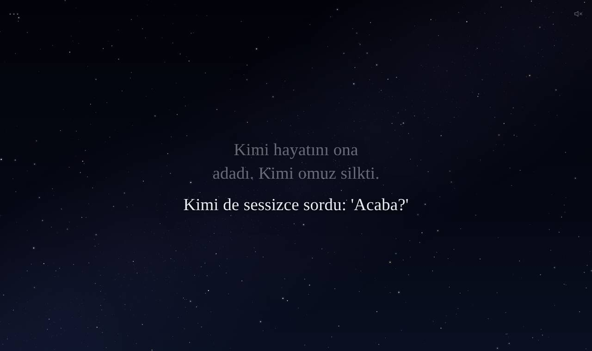

**Satırlar:**

1. Gece.
2. Her yer sessiz.
3. Böyle sessiz bir anda, eski bir soru geri gelir.
4. İnsanlık tarihinin en çok konuşulan iddialarından biri. _[vurgu]_
5. Bir adam, bin dört yüz yıl önce bir çölde bir şey söyledi.
6. Kimi hayatını ona adadı. Kimi omuz silkti.
7. Kimi de sessizce sordu: 'Acaba?'

| tür | anahtarlar | hedef |
|---|---|---|
| sonraki | — | acilis.iddia |

### acilis.iddia (düğüm H1)

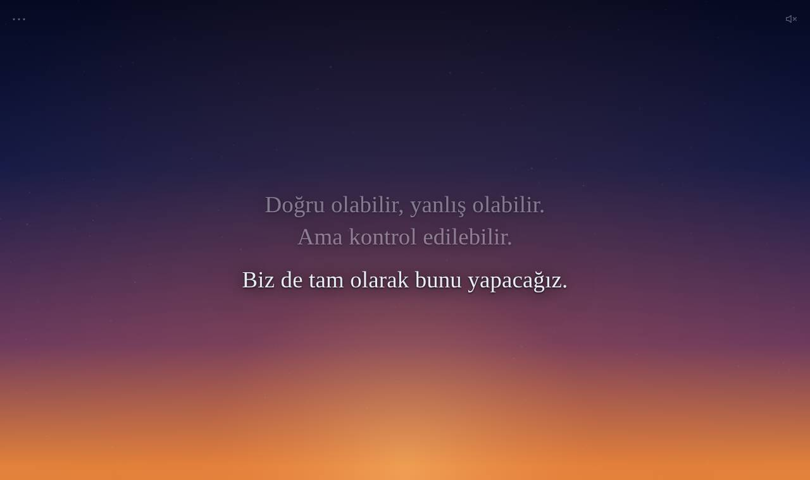

**Satırlar:**

1. Hz. Muhammed. Mekke'de yaşayan, kırk yaşında bir tüccar.
2. Bir gün şöyle dedi:
3. 'Allah benimle konuşuyor.' _[vurgu]_
4. 'Cebrail adlı bir elçi aracılığıyla, Allah'tan bilgi alıyorum.'
5. Tıpkı 'dün Ankara'daydım' demek gibi bir haber bu.
6. Doğru olabilir, yanlış olabilir. Ama kontrol edilebilir.
7. Biz de tam olarak bunu yapacağız.

| tür | anahtarlar | hedef |
|---|---|---|
| sonraki | — | acilis.davet |

### acilis.davet

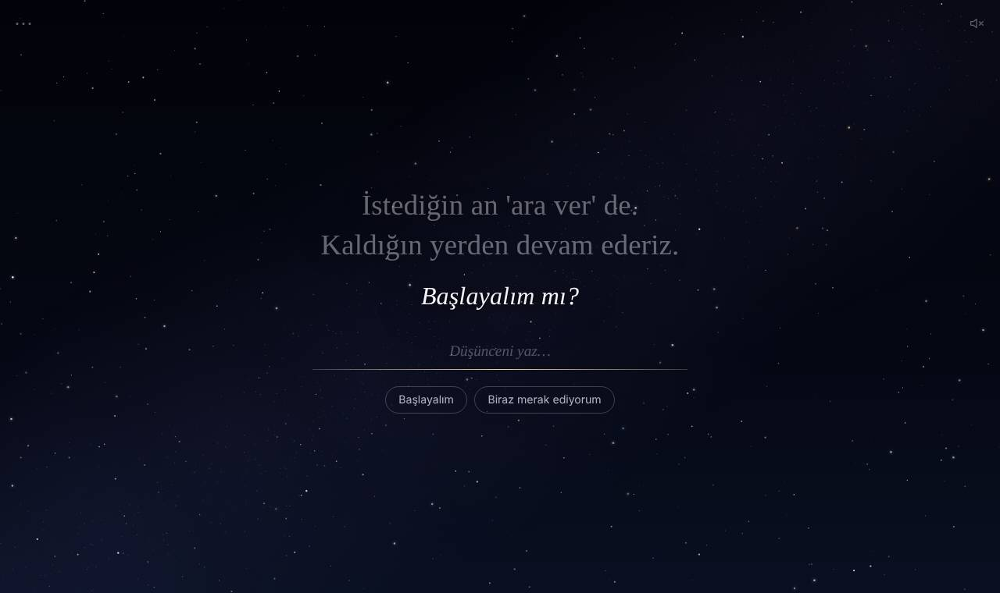

**Satırlar:**

1. Seni ikna etmeye çalışmayacağım. _[vurgu]_
2. Birlikte bakalım. Karar senin.
3. Sana hiçbir şeyi dayatmam.
4. Cevaplarını istediğin gibi yaz; ben anlamaya çalışırım.
5. İstediğin an 'ara ver' de. Kaldığın yerden devam ederiz.

**Soru:** Başlayalım mı? _(serbest)_

Çipler: “Başlayalım” · “Biraz merak ediyorum”

| tür | anahtarlar | hedef |
|---|---|---|
| itiraz | hayır, istemiyorum, gerek yok, ilgilenmiyorum, sıkıldım | (yanıt, aynı soru) |
| varsayılan | — | acilis.tanri |

### acilis.tanri (düğüm Z1)

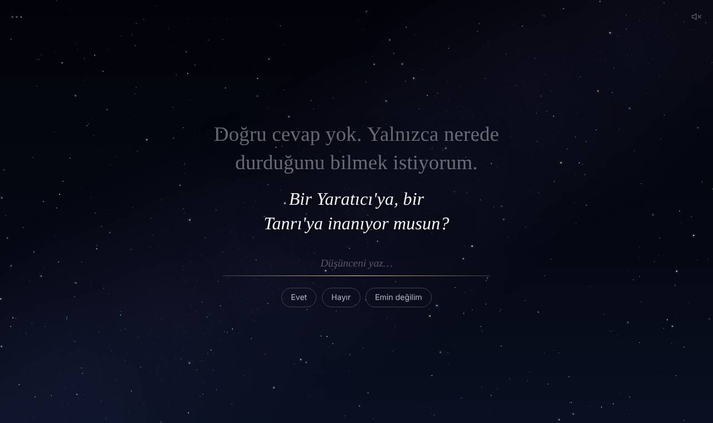

**Satırlar:**

1. Önce seni biraz tanıyayım.
2. Doğru cevap yok. Yalnızca nerede durduğunu bilmek istiyorum.

**Soru:** Bir Yaratıcı'ya, bir Tanrı'ya inanıyor musun? _(serbest)_

Çipler: “Evet” · “Hayır” · “Emin değilim”

| tür | anahtarlar | hedef |
|---|---|---|
| profil | evet, inanıyorum, inanırım, tanrı var, allah var, yaratıcıya inanıyorum, tanrıya inanıyorum, inançlıyım, dindarım, deistim, deist | (sonraki/varsayılan) |
| profil | hayır, inanmıyorum, inanmam, tanrı yok, yok, ateistim, ateist, materyalistim, inançsızım, hiç inanmam | (sonraki/varsayılan) |
| profil | emin değilim, bilmiyorum, bilmem, kararsızım, agnostik, agnostikim, belki, bazen, ne bileyim, fikrim yok | (sonraki/varsayılan) |
| varsayılan | — | acilis.din |

### acilis.din

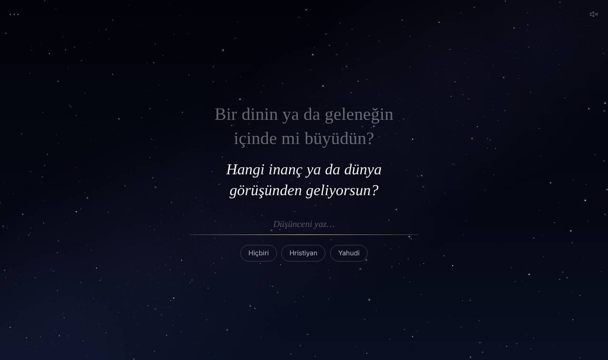

**Satırlar:**

1. Şimdi bir başka şey.
2. Bir dinin ya da geleneğin içinde mi büyüdün?

**Soru:** Hangi inanç ya da dünya görüşünden geliyorsun? _(serbest)_

Çipler: “Hiçbiri” · “Hristiyan” · “Yahudi” · “Başka bir dinden”

| tür | anahtarlar | hedef |
|---|---|---|
| profil | hiçbiri, hiçbir, dinsizim, dinim yok, dinsiz, ateist, ateistim, inançsız, deist, laik, seküler | (sonraki/varsayılan) |
| profil | hristiyan, hıristiyan, hristiyanım, hıristiyanım, katolik, ortodoks, protestan, kilise | (sonraki/varsayılan) |
| profil | yahudi, yahudiyim, musevi, museviyim, sinagog, tevrat | (sonraki/varsayılan) |
| profil | budist, budistim, hindu, sikh, pagan, taoist, başka bir dinden, başka bir din, başka din, ruhani, bahai | (sonraki/varsayılan) |
| profil | müslümanım, müslüman ailede, müslüman olarak büyüdüm, doğuştan müslüman, müslüman doğdum, müslümandım, eskiden müslüman, müslümanlıktan çıktım | (sonraki/varsayılan) |
| profil | müslüman değilim, müslüman değil | (sonraki/varsayılan) |
| varsayılan | — | acilis.bilgi |

### acilis.bilgi (düğüm H1)

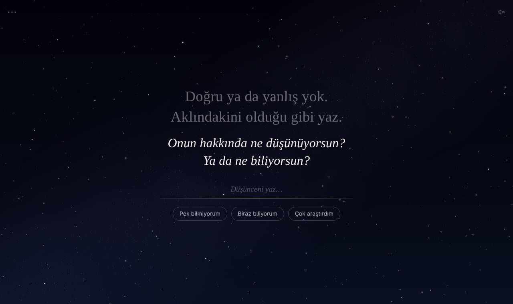

**Satırlar:**

1. Şimdi Hz. Muhammed'e gelelim.
2. Doğru ya da yanlış yok. Aklındakini olduğu gibi yaz.

**Soru:** Onun hakkında ne düşünüyorsun? Ya da ne biliyorsun? _(serbest)_

Çipler: “Pek bilmiyorum” · “Biraz biliyorum” · “Çok araştırdım”

| tür | anahtarlar | hedef |
|---|---|---|
| profil | uydurma, uydurmuş, uydurdu, yalan, yalancı, sahtekar, sahtekâr, çıkar, çıkarı, iktidar, para için, güç için, siyasi lider, kandırdı, kandırmış | (sonraki/varsayılan) |
| profil | hasta, deli, epilepsi, sara, hayal, hayal görmüş, halüsinasyon, psikolojik, yanılmış, sanrı, akıl sağlığı | (sonraki/varsayılan) |
| profil | pek bilmiyorum, çok bilmiyorum, hiç bilmiyorum, az biliyorum, bilmiyorum, fikrim yok, merak ediyorum, kararsızım | (sonraki/varsayılan) |
| profil | saygı duyuyorum, büyük bir lider, önemli biri, bilge biri, saygıdeğer | (sonraki/varsayılan) |
| profil | biraz biliyorum, biraz okudum, biraz bilgim var, duydum, okulda, belgesel | (sonraki/varsayılan) |
| profil | çok araştırdım, araştırdım, çok okudum, okudum, siyer, akademik, uzmanım, biliyorum | (sonraki/varsayılan) |
| varsayılan | — | acilis.kaynak |

### acilis.kaynak (düğüm Z5)

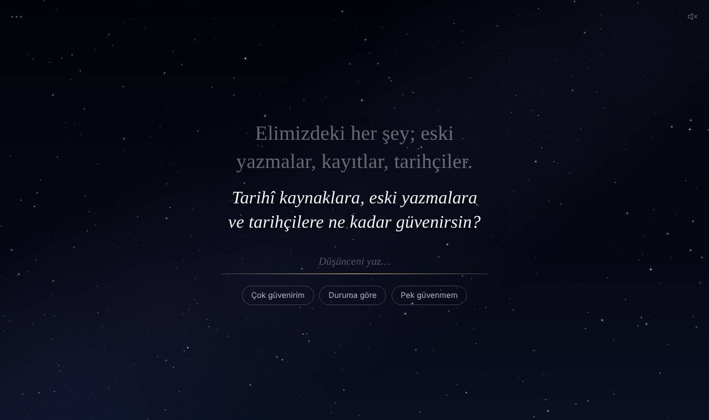

**Satırlar:**

1. Bir de şu var: tarih.
2. Elimizdeki her şey; eski yazmalar, kayıtlar, tarihçiler.

**Soru:** Tarihî kaynaklara, eski yazmalara ve tarihçilere ne kadar güvenirsin? _(serbest)_

Çipler: “Çok güvenirim” · “Duruma göre” · “Pek güvenmem”

| tür | anahtarlar | hedef |
|---|---|---|
| profil | çok güvenirim, güvenirim, genelde güvenirim, yüksek, tamamen, bilimsel yöntem, akademik | (sonraki/varsayılan) |
| profil | pek güvenmem, güvenmem, güvenmiyorum, hiç güvenmem, düşük, kazananlar yazar, sonradan yazılmış, taraflı, tarih uydurmadır, şüpheyle bakarım | (sonraki/varsayılan) |
| profil | duruma göre, orta, bazen, kaynağa bağlı, yarı yarıya, bazılarına | (sonraki/varsayılan) |
| varsayılan | — | acilis.sorun |

### acilis.sorun (düğüm Z1)

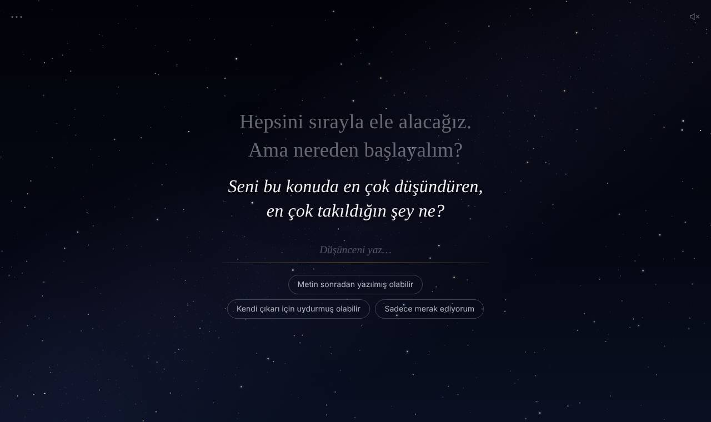

**Satırlar:**

1. Son bir şey.
2. Bu konuda aklına takılan çok şey olabilir.
3. Hepsini sırayla ele alacağız. Ama nereden başlayalım?

**Soru:** Seni bu konuda en çok düşündüren, en çok takıldığın şey ne? _(serbest)_

Çipler: “Metin sonradan yazılmış olabilir” · “Kendi çıkarı için uydurmuş olabilir” · “Sadece merak ediyorum”

| tür | anahtarlar | hedef |
|---|---|---|
| profil | sonradan yazılmış, sonradan yazıldı, sonradan değiştirilmiş, değiştirilmiş, değişmiş, değiştirildi, değişti, tahrif, bozulmuş, eklenmiş, çıkarılmış, kitap değişmiş, kur'an değişmiş, kuran değişmiş, orijinal, aslı | acilis.zeminKopru |
| profil | kaynak, kaynaklar, güvenilmez, tarih, tarihî, tarihi, rivayet, hadis, yıllar sonra, sonradan toplanmış, belge yok, kayıt yok, kaynak yok, tarihçi | acilis.zeminKopru |
| profil | uydurma, uydurdu, uydurmuş, yalan, yalancı, sahtekar, sahtekâr, kendisi yazdı, kendi yazdı, çıkarı vardı, çıkar, çıkarı için, iktidar, güç, para, siyasi, hırs, kandırdı, kandırmış, dolandırdı, lider olmak | acilis.yonlendir |
| profil | epilepsi, sara, hasta, hayal, hayal görmüş, halüsinasyon, sanrı, psikolojik, akıl hastası, deli, delirmiş, vehim, yanılmış, yanıldı, kendini peygamber sandı, zihinsel, nöbet, travma | acilis.yonlendir |
| profil | yahudilerden, hristiyanlardan, rahipten, bahira, öğrenmiş, öğrenmiş olabilir, öğrendi, bilgi aldı, kitaplardan, tevrat'tan, incil'den, varaka, başkasından, çevresinden, kopyalamış, ödünç, aktarmış | acilis.yonlendir |
| profil | mucize yok, mucizesi yok, mucize, kanıt istiyorum, delil istiyorum, kanıtı ne, neden bir şey göstermedi, olağanüstü, doğaüstü, gösterseydi, ispatla | acilis.yonlendir |
| profil | sadece merak, merak, bilmiyorum, bilmem, hiçbiri, hepsi, kafam karışık, emin değilim, genel, fikrim yok, karışık | acilis.yonlendir |
| varsayılan | — | acilis.yonlendir |

### acilis.zeminKopru

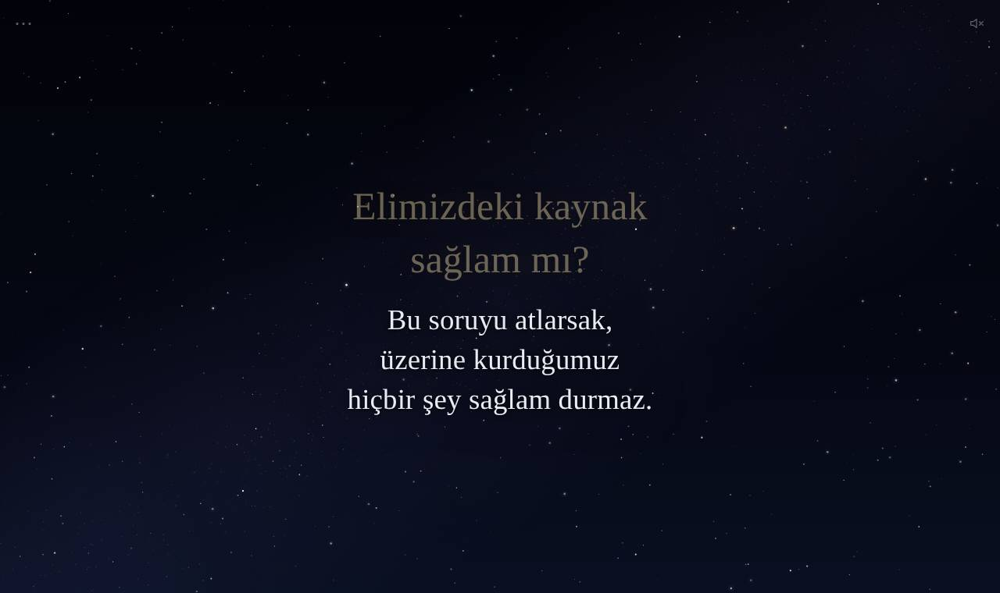

**Satırlar:**

1. Önce bir şeyi netleştirelim.
2. Elimizdeki kaynak sağlam mı? _[vurgu]_
3. Bu soruyu atlarsak, üzerine kurduğumuz hiçbir şey sağlam durmaz.

| tür | anahtarlar | hedef |
|---|---|---|
| sonraki | — | zemin.giris |

### acilis.yonlendir

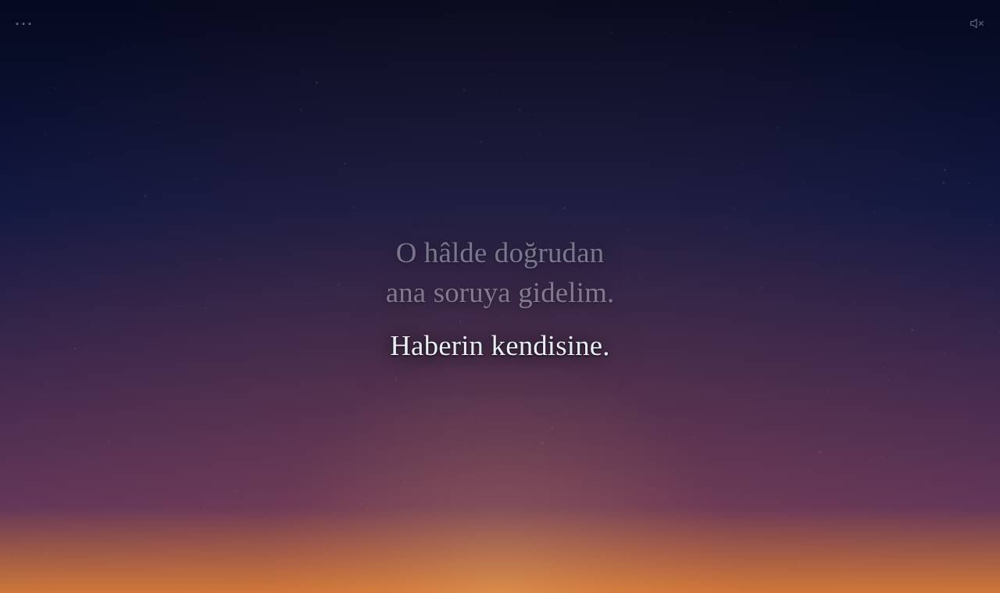

**Girişte dallan:**

- `{"profil.kaynakGuveni":["dusuk","orta"]}` → `acilis.zeminKopru`

**Satırlar:**

1. Anlaşıldı.
2. O hâlde doğrudan ana soruya gidelim.
3. Haberin kendisine.

| tür | anahtarlar | hedef |
|---|---|---|
| sonraki | — | haber.giris |

## Bölge: zemin

### zemin.giris (düğüm Z5)

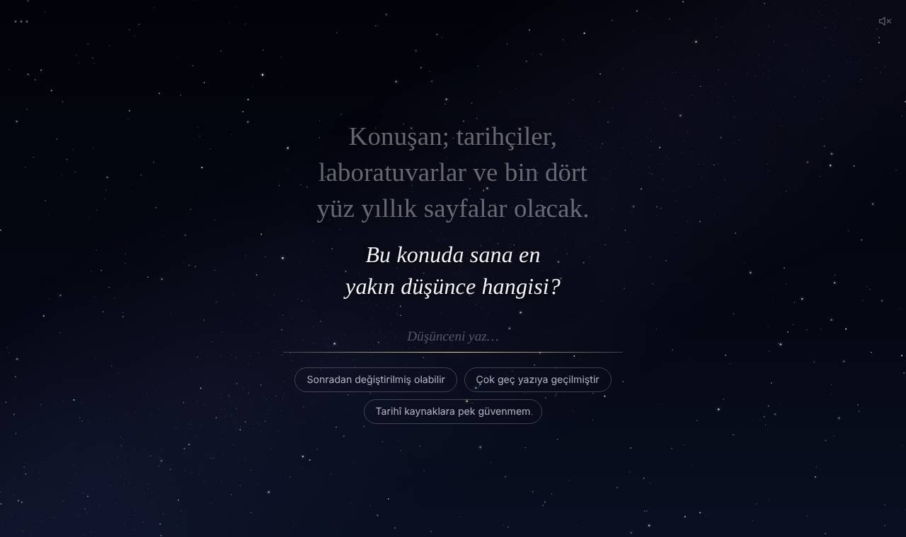

**Girişte dallan:**

- `{"kapali":"zemin"}` → `haber.giris`
- `{"profil.kaynakGuveni":"yuksek","profil.supheTuru":["uydurdu","hasta-yanildi","ogrendi","mucize-yok","genel"]}` → `zemin.kisa`

**Satırlar:**

1. Önce bir şeyi baştan söyleyeyim.
2. Elimizde bir metin var: Kur'an.
3. Bu metin sonradan değiştirilmişse, üzerine konuşmanın anlamı kalmaz.
4. O yüzden önce metne bakacağız. Sağlam mı, değil mi? _[vurgu]_
5. Kabul etmediğin hiçbir şeye dayanmayacağım.
6. Konuşan; tarihçiler, laboratuvarlar ve bin dört yüz yıllık sayfalar olacak.

**Soru:** Bu konuda sana en yakın düşünce hangisi? _(serbest)_

Çipler: “Sonradan değiştirilmiş olabilir” · “Çok geç yazıya geçilmiştir” · “Tarihî kaynaklara pek güvenmem”

| tür | anahtarlar | hedef |
|---|---|---|
| yonlendir | karbon, yazma, yazmalar, en eski, peygamber'den önce, peygamberden önce | zemin.karbon |
| yonlendir | antik, incil, tarihî kaynak, tarihi kaynak, güvenmem, güvenmiyorum, tarihçi | zemin.kiyas |
| yonlendir | değiştirilmiş, değişmiş, değişti, geç yazıya, sözlü, geç yazılmış, sonradan | zemin.yazim |
| varsayılan | — | zemin.yazim |

### zemin.yazim (düğüm Z6)

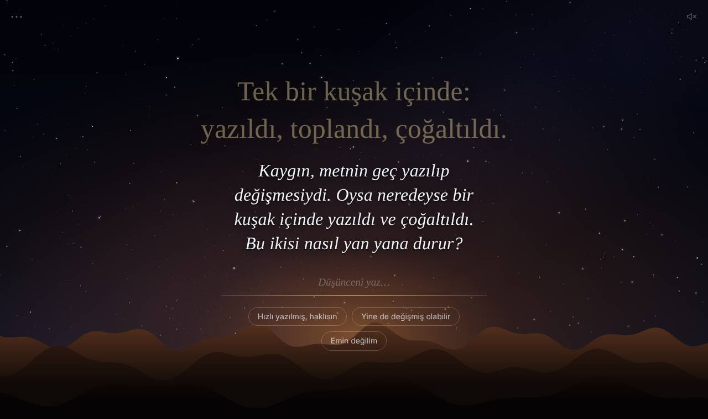

**Satırlar:**

1. İlk soru: bu metin ne kadar çabuk yazıya geçti?
2. Çoğu eski eser, yazarından yüzlerce yıl sonra kâğıda döküldü.
3. Bu metin farklı. Peygamber hayattayken kâtipler ayetleri yazıyordu.
4. Vefatından yaklaşık bir yıl sonra, yazılanlar tek bir nüshada toplandı.
5. Yirmi yıl dolmadan, bu nüshadan çoğaltılan kopyalar şehirlere gitti.
6. (metinsiz) _[diyagram: zaman]_
7. Tek bir kuşak içinde: yazıldı, toplandı, çoğaltıldı. _[vurgu]_

**Soru:** Kaygın, metnin geç yazılıp değişmesiydi. Oysa neredeyse bir kuşak içinde yazıldı ve çoğaltıldı. Bu ikisi nasıl yan yana durur?

Çipler: “Hızlı yazılmış, haklısın” · “Yine de değişmiş olabilir” · “Emin değilim”

| tür | anahtarlar | hedef |
|---|---|---|
| ikna | hızlı yazılmış, yan yana durmaz, durmaz, çelişiyor | (sonraki/varsayılan) |
| itiraz | yaktı, yaktırdı, yakılmış, yakıldı, osman, imha, yok edildi, yok etti, asıl metin | (yanıt, aynı soru) |
| yonlendir | gerek yok, geçelim, atlayalım, zaten güveniyorum | zemin.ikna |
| sonraki | — | zemin.siffin |

**Ek örnekler (2):**

1. Bir de şuna bak: matbaadan önceki çağ. Çoğu eski eser, yazarından beş yüz ila bin yıl sonra yazıya geçti. Kur'an ise, dönemin ölçüsüyle, neredeyse anında kayda alındı. → _Yüzyıllarca sözle yaşamış bir metinle, yazıya hemen geçmiş bir metni aynı kefeye koymak mantıklı mı?_
2. Batılı bir tarihçi, ilk derlemenin hemen kullanıldığını yazar. Üstelik bunu sorgulayan çıkmamış. Çoğaltma da aynı hızla, kimsenin itirazı olmadan yürümüş. → _İlk derleme itirazsız kabul edildiyse, hangi aşamada ve kimden gizli bir değişiklik geçmiş olabilir?_

**Kompozisyon:** Peki sen, bu kadar erken yazıya geçmiş bir metnin sonradan değiştiğini hangi tarihî olguyla açıklarsın?

### zemin.siffin (düğüm Z6)

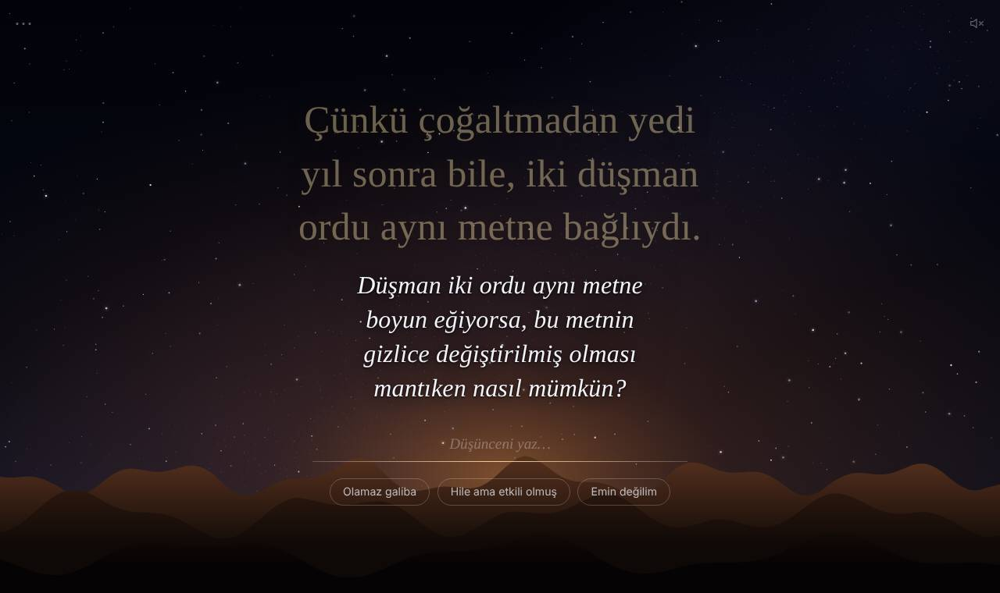

**Satırlar:**

1. Şimdi bir sahneye gidelim.
2. Çöl. İki ordu. Aynı dinden, ama birbirine düşman.
3. Birinin zaferi yakın. Diğeri yenilmek üzere.
4. Yenilmek üzere olan taraf, mızraklarının ucuna mushaf sayfaları bağlar.
5. Ve galip ordu durur. Silahlar iner.
6. Batılı tarihçiler bunu bir askerî hile olarak anlatır. Ama hile işe yaradı.
7. Çünkü çoğaltmadan yedi yıl sonra bile, iki düşman ordu aynı metne bağlıydı. _[vurgu]_

**Soru:** Düşman iki ordu aynı metne boyun eğiyorsa, bu metnin gizlice değiştirilmiş olması mantıken nasıl mümkün?

Çipler: “Olamaz galiba” · “Hile ama etkili olmuş” · “Emin değilim”

| tür | anahtarlar | hedef |
|---|---|---|
| ikna | olamaz galiba, olamaz, hile ama, etkili olmuş, mümkün görünmüyor | (sonraki/varsayılan) |
| itiraz | tek olay, tek bir olay, sadece bir sahne, tek bir sahne, abartı, abartmış | (yanıt, aynı soru) |
| yonlendir | gerek yok, geçelim, atlayalım, zaten güveniyorum | zemin.ikna |
| sonraki | — | zemin.tahrif |

**Ek örnekler (2):**

1. Bir klasik tarihçi, o gün mızraklara beş yüz nüsha takıldığını aktarır.  Karşı ordu da benzer sayıda taşıdıysa, bin eder. → _Yedi yıl önce çoğaltılmış bir metin bu kadar yayılmışsa, gizli bir değişikliğin fark edilmeden yayılması nasıl olur?_
2.  Bu cümleyi yazan, Müslüman değil. Yine de tarihe bakınca başka bir şey göremiyor. → _Dışarıdan bakan bir tarihçi bile bu ittifakı görüyorsa, 'gizli değişiklik' hangi tarihî kayda dayanır?_

**Kompozisyon:** Peki sen bu sahneyi, 'Kur'an gizlice değiştirildi' diyerek tutarlı biçimde nasıl açıklarsın?

### zemin.tahrif (düğüm Z7)

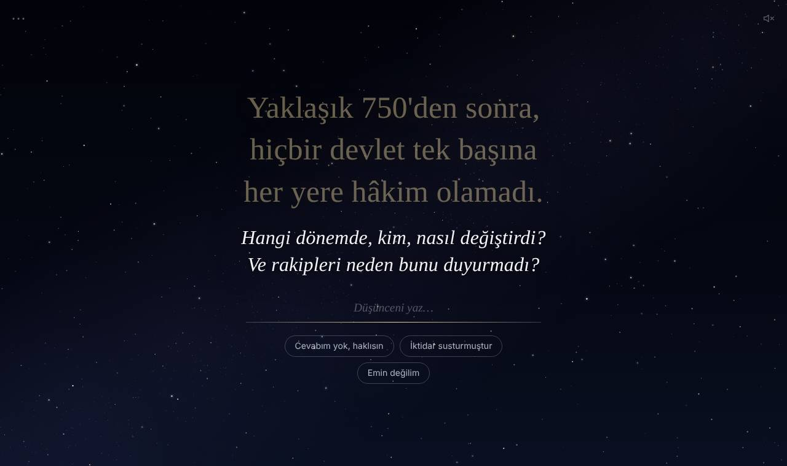

**Satırlar:**

1. Şimdi tersinden düşünelim. Biri metni değiştirmek istiyor.
2. Elinde ordu var, hazine var, saray var.
3. Ama karşısında rakip iktidarlar var. Her biri rakibinin açığını kolluyor.
4. (metinsiz) _[diyagram: demet]_
5. Emevileri yıkan Abbasiler, rakiplerinin her kusurunu duyurdu. Kerbela'yı bile.
6. Ama metnin değiştirilmesi üzerine tek bir ihtilaf kaydı bilinmiyor.
7. Yaklaşık 750'den sonra, hiçbir devlet tek başına her yere hâkim olamadı. _[vurgu]_

**Soru:** Hangi dönemde, kim, nasıl değiştirdi? Ve rakipleri neden bunu duyurmadı?

Çipler: “Cevabım yok, haklısın” · “İktidar susturmuştur” · “Emin değilim”

| tür | anahtarlar | hedef |
|---|---|---|
| ikna | cevabım yok, cevabım yok haklısın, haklısın | (sonraki/varsayılan) |
| itiraz | susturmuştur, susturdu, susturur, baskı, bastırdı, iktidar susturur, güçlüydü | (yanıt, aynı soru) |
| yonlendir | gerek yok, geçelim, atlayalım, zaten güveniyorum | zemin.ikna |
| sonraki | — | zemin.hafizlar |

**Ek örnekler (3):**

1. Bir de Hâricîler var. Bir ayetin yorumu yüzünden Ali'ye kılıç çektiler ve yüzyıllarca isyan ettiler. Bu kadar titiz bir grup, metin değiştirilirken susar mıydı? → _Tek bir ayetin yorumunda bu kadar keskin olanlar, metnin değiştirilmesine sessiz kalır mıydı?_
2. İslam'ın en güçlü döneminde, Peygamber'i yalanlayan kitaplar yazıldı. Bir Mutezile âlimi bunların dükkânlarda bulunduğunu aktarır. İtirazın bile serbestçe yazıldığı bir dünya bu. → _Peygamber'e en sert itirazların yazıldığı bir dünyada, sistemli bir değişiklik kaydı neden yok?_
3. Semerkant'ta, Tunus'ta, İspanya'da insanlar aynı metinle namaz kıldı. Her biri kendi nüshasını, kendi hafızasını taşıyordu. Bir merkez bunların hepsine nasıl ulaşıp değiştirebilirdi? → _Birbirinden bu kadar uzak yerlerde, hepsinin elindeki metni sessizce değiştirmek mantıken nasıl olur?_

**Kompozisyon:** Peki sen, bunca rakibe, bunca coğrafyaya rağmen sistemli bir değişikliği nasıl mümkün görüyorsun?

### zemin.hafizlar (düğüm Z8)

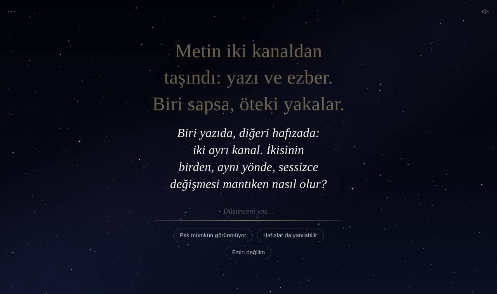

**Satırlar:**

1. Şimdi yazıyı bir kenara bırak. Yalnızca ezberi düşün.
2. Dünyanın dört bir yanında insanlar bu metni ezbere okuyor.
3. (metinsiz) _[diyagram: sayac]_
4. Dünya genelinde kabaca milyonlarca. Rakam kesin değil; büyüklüğü ortada.
5. Her hafız metni bir hocadan aldı. O da bir hocadan.
6. Zincirin en başında Peygamber'in kendisi var.
7. Metin iki kanaldan taşındı: yazı ve ezber. Biri sapsa, öteki yakalar. _[vurgu]_

**Soru:** Biri yazıda, diğeri hafızada: iki ayrı kanal. İkisinin birden, aynı yönde, sessizce değişmesi mantıken nasıl olur?

Çipler: “Pek mümkün görünmüyor” · “Hafızlar da yanılabilir” · “Emin değilim”

| tür | anahtarlar | hedef |
|---|---|---|
| ikna | pek mümkün görünmüyor, mümkün görünmüyor, görünmüyor | (sonraki/varsayılan) |
| itiraz | hafızlar da yanılabilir, yanılabilir, unutur, insan unutur, ezber yanılır, hafıza | (yanıt, aynı soru) |
| itiraz | kıraat, kıraatler, farklı okunuş, okunuş farkı, yedi harf, farklı okuyuş | (yanıt, aynı soru) |
| yonlendir | gerek yok, geçelim, atlayalım, zaten güveniyorum | zemin.ikna |
| sonraki | — | zemin.yazmalar |

**Ek örnekler (2):**

1. Bir deneme yap: kendi dilinde, herhangi bir kitap düşün. Onu baştan sona ezbere bilen kaç kişi tanırsın? Kur'an'ı ezbere bilenler ise milyonlarla ifade ediliyor. → _Böyle yaygın bir ezber ağında, tek bir değişikliğin fark edilmeden yayılması nasıl olur?_
2. Semerkant'taki bir hafızı, Tunus'taki bir hafızın yanına koy. Birbirini hiç görmemişler. Aynı metni, aynı sırayla okuyorlar. → _Birbirinden habersiz bu kadar insan aynı metinde buluşuyorsa, gizli bir değişiklik bunu nasıl bozmadı?_

**Kompozisyon:** Peki sen, bu iki kanalın hep aynı metni taşımasını, değişiklik varsayımıyla nasıl uzlaştırıyorsun?

### zemin.yazmalar (düğüm Z9)

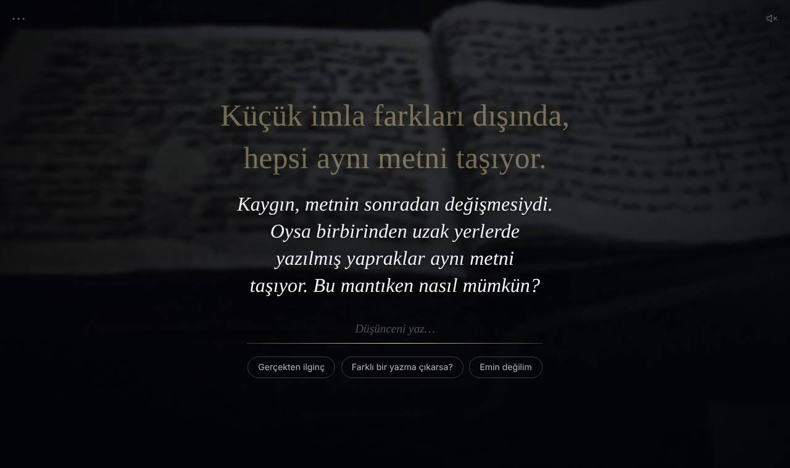

**Satırlar:**

1. Peki ya elimizde o dönemin sayfaları da varsa?
2. Var. _[vurgu]_
3. (metinsiz) _[diyagram: galeri]_
4. İstanbul'da. San'a'da. Paris'te. Taşkent'te. Tübingen'de. Birmingham'da.
5. Kimi deri üzerinde, kimi parşömende, kimi papirüste.
6. Farklı kâtiplerce, birbirinden uzak yerlerde, farklı boyutlarda yazılmışlar.
7. Küçük imla farkları dışında, hepsi aynı metni taşıyor. _[vurgu]_

**Soru:** Kaygın, metnin sonradan değişmesiydi. Oysa birbirinden uzak yerlerde yazılmış yapraklar aynı metni taşıyor. Bu mantıken nasıl mümkün?

Çipler: “Gerçekten ilginç” · “Farklı bir yazma çıkarsa?” · “Emin değilim”

| tür | anahtarlar | hedef |
|---|---|---|
| ikna | gerçekten ilginç, ilginç, etkileyici | (sonraki/varsayılan) |
| itiraz | farklı bir yazma çıkarsa, tek yazma, tek bir yazma, farklı bir yazma, farklı yazma, farklı çıkarsa, bulunursa | (yanıt, aynı soru) |
| yonlendir | gerek yok, geçelim, atlayalım, zaten güveniyorum | zemin.ikna |
| sonraki | — | zemin.cografya |

**Ek örnekler (2):**

1. Bunların çoğu hiç incelenmedi bile. Birmingham'daki yapraklar yaklaşık yüz yıl okunmadan bekledi. Onları fark eden, bir doktora öğrencisi oldu. Aynı üniversitede binlerce Arapça yazma, incelenmeyi bekliyor. → _Bulunan her yeni sayfa aynı metni teyit ediyorsa, gizli bir fark hangi sayfada saklanıyor olabilir?_
2. Kimi mushaf Kur'an'ın neredeyse tamamı. Kimi yalnızca birkaç yaprak. Birinde eksik olan, ötekinde tamamlanıyor. Hepsinde sure ve ayet sırası, bugünküyle aynı. → _Sıra, sure ve ayetler ilk yüzyıldan bugüne aynıysa, 'sonradan düzenlendi' demek neye dayanır?_

**Kompozisyon:** Peki sen bu yaprakları, 'Kur'an sonradan değişti' diyerek nasıl açıklıyorsun?

### zemin.cografya (düğüm Z11)

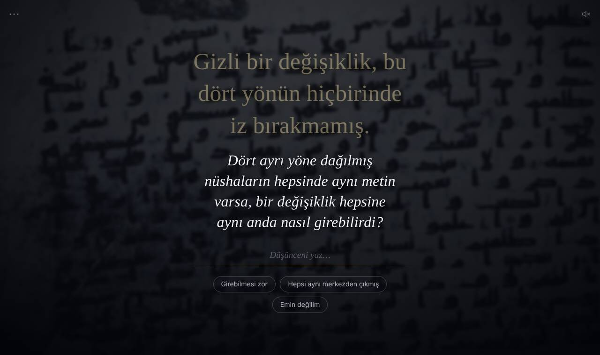

**Satırlar:**

1. Bu yapraklar rastgele değil. Haritaya dök.
2. Rivayete göre Hz. Osman'ın çoğalttığı nüshalar dört şehre gitti.
3. (metinsiz) _[diyagram: karsilastirma]_
4. Yazmalar bu dört yöne oturuyor.
5. Farklı kâtipler. Farklı boyutlar. Farklı satır düzenleri.
6. Metin yine aynı.
7. Gizli bir değişiklik, bu dört yönün hiçbirinde iz bırakmamış. _[vurgu]_

**Soru:** Dört ayrı yöne dağılmış nüshaların hepsinde aynı metin varsa, bir değişiklik hepsine aynı anda nasıl girebilirdi?

Çipler: “Girebilmesi zor” · “Hepsi aynı merkezden çıkmış” · “Emin değilim”

| tür | anahtarlar | hedef |
|---|---|---|
| ikna | girebilmesi zor, zor görünüyor | (sonraki/varsayılan) |
| itiraz | hepsi aynı merkezden çıkmış, aynı merkezden, merkezden çıkmış, aynı kaynak, osman'dan, hepsi osman | (yanıt, aynı soru) |
| yonlendir | gerek yok, geçelim, atlayalım, zaten güveniyorum | zemin.ikna |
| sonraki | — | zemin.karbon |

**Ek örnekler (2):**

1. Paris ve Tübingen'deki yazmalar, Şam nüshasıyla uyumlu. İkisinin karbon aralığı da 649 ile 675 arasına düşüyor. Bu, Peygamber'in vefatından yaklaşık kırk yıl içinde. → _Peygamber'den en fazla kırk yıl sonrasına ait yapraklarda sistemli bir değişiklik izi yoksa, değişiklik nerede başladı?_
2. Yemen'de bir yazmanın karbon aralığı yayımlandı. Batılı akademisyenler: yüzde 68 ihtimalle 614 ile 656. Yüzde 95 ihtimalle 578 ile 669. → _Peygamber'in zamanına bu kadar yakın bir yaprak bugünkü metni taşıyorsa, değişiklik için ne kadar zaman kalıyor?_

**Kompozisyon:** Peki sen bu coğrafi dağılımı, tek bir değişiklik varsayımıyla nasıl açıklıyorsun?

### zemin.karbon (düğüm Z10)

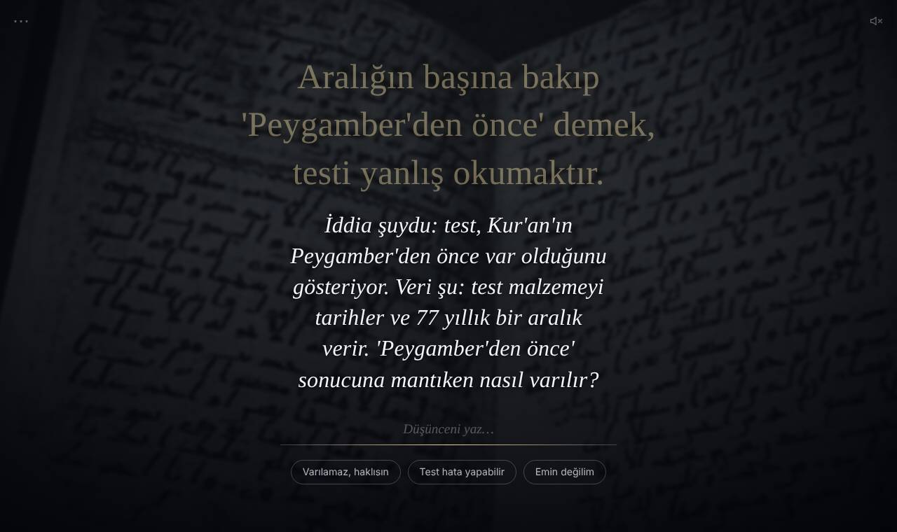

**Satırlar:**

1. Duymuş olabilirsin: 'Peygamber'den önceye ait Kur'an bulundu.'
2. Bu cümle, karbon testinin ne ölçtüğünü bilmemekten doğuyor.
3. Test yazının değil, yazıldığı malzemenin yaşını ölçer. Tek yıl vermez; aralık verir.
4. Birmingham'daki yaprak için aralık: 568 ile 645.
5. (metinsiz) _[diyagram: zaman]_
6. Bu aralık 77 yıl. Peygamber'in 63 yıllık ömründen bile uzun.
7. Aralığın başına bakıp 'Peygamber'den önce' demek, testi yanlış okumaktır. _[vurgu]_

**Soru:** İddia şuydu: test, Kur'an'ın Peygamber'den önce var olduğunu gösteriyor. Veri şu: test malzemeyi tarihler ve 77 yıllık bir aralık verir. 'Peygamber'den önce' sonucuna mantıken nasıl varılır?

Çipler: “Varılamaz, haklısın” · “Test hata yapabilir” · “Emin değilim”

| tür | anahtarlar | hedef |
|---|---|---|
| ikna | varılamaz, varılamaz haklısın, anladım | (sonraki/varsayılan) |
| itiraz | hata payı, hata yapabilir, test hata yapabilir, yanlış çıkabilir, güvenilir değil, güvenilir mi, test yanlış | (yanıt, aynı soru) |
| itiraz | palimpsest, palimpsesti, silinmiş, alt yazı, alt metin, sana palimpsesti, silinip | (yanıt, aynı soru) |
| yonlendir | gerek yok, geçelim, atlayalım, zaten güveniyorum | zemin.ikna |
| sonraki | — | zemin.corpus |

**Ek örnekler (2):**

1. Bir şey daha: deri pahalıdır. Kahire'deki bir mushaf bin seksen yedi varak, yaklaşık seksen kilo. Böyle bir malzeme yıllarca boş bekletilmez. → _Pahalı bir malzemeyi on yıllarca boş bekletmek mantıklı mı? O hâlde yazı, malzemenin tarihinden ne kadar sonra olabilir?_
2. Karbon tek tanık değil. Aynı yıllarda Süryani ve Bizans yazarları da Müslümanları ve Peygamber'i anlatır. Peygamber'den önce bir Kur'an olsaydı, bu kayıtlar bunu hiç anmaz mıydı? → _Peygamber'den önceye ait bir Kur'an varsa, o çağın başka hangi kaydı bunu anlatıyor?_

**Kompozisyon:** Peki sen, bu aralıkları ve yazma verilerini birlikte nasıl okuyorsun?

### zemin.corpus (düğüm Z12)

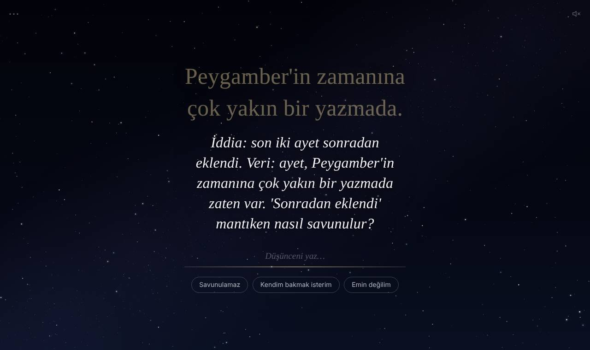

**Satırlar:**

1. Bunlara körü körüne inanmak zorunda değilsin.
2. Almanya'da akademik bir proje, ayet ayet yazma tarihlerini internete koydu.
3. Bir ayet seç. En eski yazmalarını kendin gör.
4. Mesela Tevbe suresinin son iki ayeti.
5. Biri, bu iki ayetin sonradan eklendiğini ileri sürdü.
6. Ayet, karbon aralığı 606 ile 649 olan bir yazmada bile yerinde duruyor.
7. Peygamber'in zamanına çok yakın bir yazmada. _[vurgu]_

**Soru:** İddia: son iki ayet sonradan eklendi. Veri: ayet, Peygamber'in zamanına çok yakın bir yazmada zaten var. 'Sonradan eklendi' mantıken nasıl savunulur?

Çipler: “Savunulamaz” · “Kendim bakmak isterim” · “Emin değilim”

| tür | anahtarlar | hedef |
|---|---|---|
| ikna | savunulamaz, savunulamıyor | (sonraki/varsayılan) |
| itiraz | kendim bakmak isterim, kendim bakmak, nereden, site, adres, kendim | (yanıt, aynı soru) |
| yonlendir | gerek yok, geçelim, atlayalım, zaten güveniyorum | zemin.ikna |
| sonraki | — | zemin.kiyas |

**Ek örnekler (1):**

1. Bir ayet daha: Rum suresinin beşinci ayeti. En erken yazması, karbon aralığı 649 ile 675 olan bir yazmada. Yani Peygamber'den yaklaşık kırk yıl sonrasına inmiyor bile. → _Bir ayet için bile Peygamber'in zamanına bu kadar yakın bir yazma varsa, 'sonradan eklendi' iddiası ne zaman, nasıl yapılmış olabilir?_

**Kompozisyon:** Peki sen, ayetlerin sonradan eklendiği iddiasını bu veriyle nasıl uzlaştırıyorsun?

### zemin.kiyas (düğüm Z13)

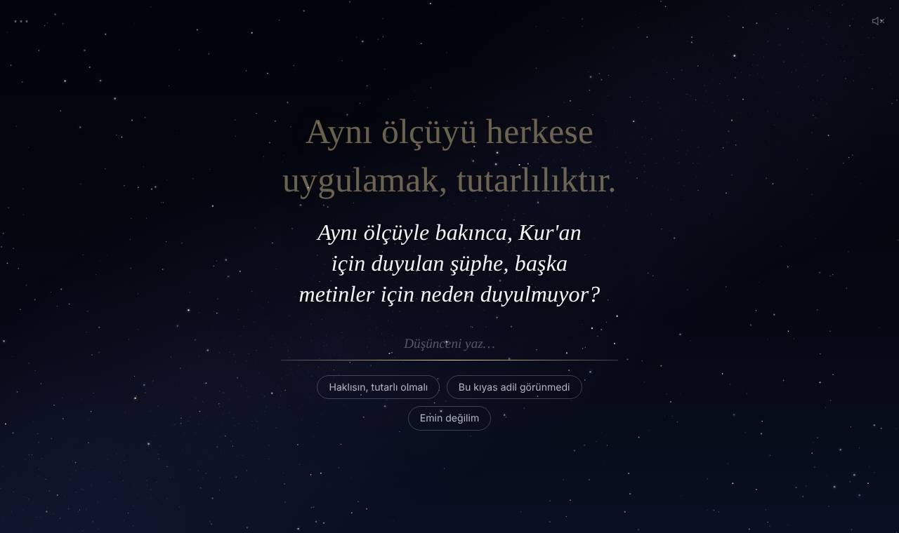

**Satırlar:**

1. Şimdi bir terazi kuralım.
2. Tarih derslerinde Herodot'a, Eflatun'a, Demostenes'e güvenerek konuşuruz.
3. (metinsiz) _[diyagram: karsilastirma]_
4. Bir araştırmacının ifadesiyle: yeryüzünde bu kadar yazması olan başka kitap yok.
5. Elimizdeki bütün bunlara güvenle 'tarih' diyoruz.
6. Aynı ölçüyü herkese uygulamak, tutarlılıktır. _[vurgu]_

**Soru:** Aynı ölçüyle bakınca, Kur'an için duyulan şüphe, başka metinler için neden duyulmuyor?

Çipler: “Haklısın, tutarlı olmalı” · “Bu kıyas adil görünmedi” · “Emin değilim”

| tür | anahtarlar | hedef |
|---|---|---|
| ikna | haklısın tutarlı olmalı, tutarlı olmalı, tutarlı | (sonraki/varsayılan) |
| itiraz | adil görünmedi, elma armut, kıyas olmaz, aynı değil, farklı konu | (yanıt, aynı soru) |
| yonlendir | gerek yok, geçelim, atlayalım, zaten güveniyorum | zemin.ikna |
| sonraki | — | zemin.hadis |

**Ek örnekler (2):**

1. İncil'ler de tarihî metinlerdir. Akademik tahminler onları yaklaşık 70 ile 110 arasına yerleştirir. Bu, onların değersiz olduğu anlamına gelmez. Sadece ölçünün herkes için aynı olması gerekir. → _Aynı ölçüyü her metne uyguladığımızda, yalnızca birine şüpheyle bakmak mantıken nasıl savunulur?_
2. Şunu dene. Kur'an için üç ölçüt yaz: Yazıya geçiş hızı. Yazma sayısı. Ezberleyenlerin sayısı. Bunların onda birine ulaşan başka bir metin bul. → _Hangi metin bu üç ölçüde Kur'an'ın onda birine bile ulaşıyor?_

**Kompozisyon:** Peki sen hangi ölçütle, Kur'an'a şüpheyle bakıp öbür metinlere güveniyorsun?

### zemin.hadis (düğüm Z14)

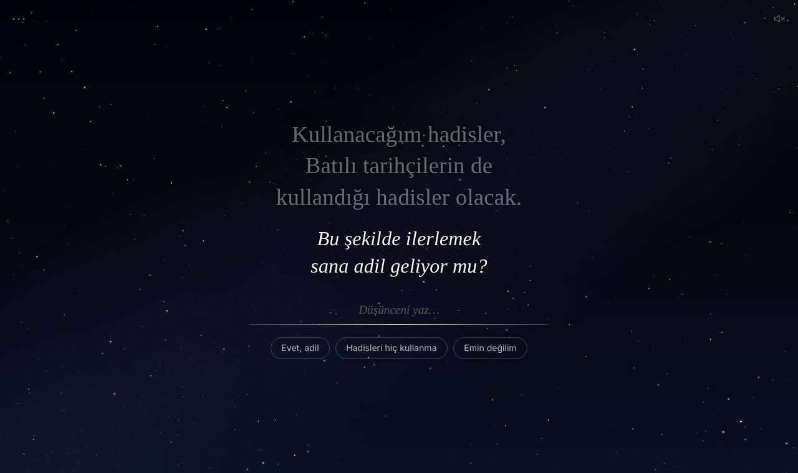

**Satırlar:**

1. Bir şey daha: hadisler.
2. Bazıları der ki: 'Hadisler sonradan uydurulmuş.'
3. Bu çok teknik, çok tartışmalı bir alan.
4. Bu yüzden ben hadise dayanan bir şey kurmayacağım.
5. Kullanacağım hadisler, Batılı tarihçilerin de kullandığı hadisler olacak.

**Soru:** Bu şekilde ilerlemek sana adil geliyor mu?

Çipler: “Evet, adil” · “Hadisleri hiç kullanma” · “Emin değilim”

| tür | anahtarlar | hedef |
|---|---|---|
| ikna | evet adil, adil | (sonraki/varsayılan) |
| profil | hadisleri hiç kullanma, hiç kullanma, kullanma, hadis istemiyorum | zemin.ikincil |
| sonraki | — | zemin.ikincil |

### zemin.ikincil (düğüm Z15)

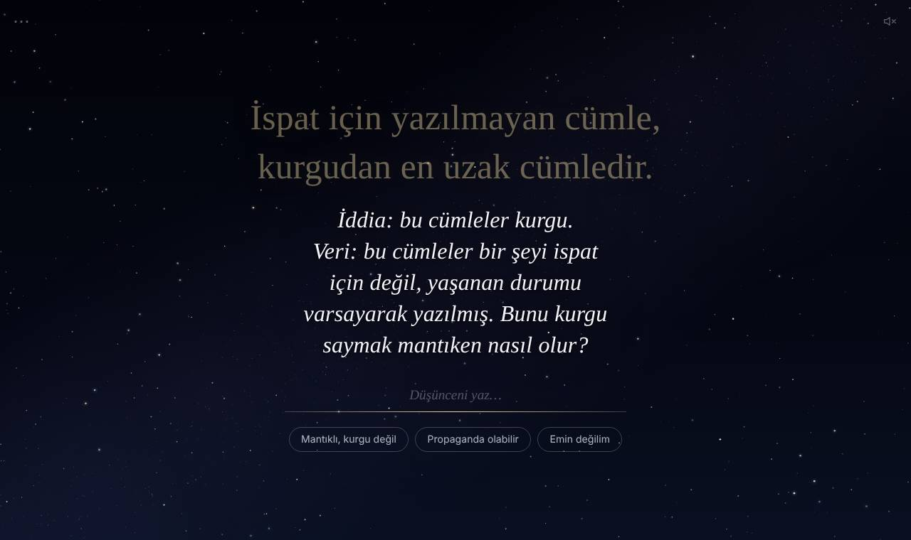

**Satırlar:**

1. Şimdi metnin kendisinden bir ipucu.
2. Kazada biri yere düşer. Kalabalıktan biri bağırır: 'Doktor yardım et!'
3. Biri 'ben doktorum' dese, ispat için söylemiş olabilir.
4. Ama kalabalığın doktoru çağırması, kimseyi ikna etmek için değildir. Bu yüzden daha güçlüdür.
5. Kur'an müminlere 'sabredin' der. Zulüm olduğunu ispatlamaya çalışmaz.
6. Ama sabır isteniyorsa, ortada çekilen bir sıkıntı vardır.
7. İspat için yazılmayan cümle, kurgudan en uzak cümledir. _[vurgu]_

**Soru:** İddia: bu cümleler kurgu. Veri: bu cümleler bir şeyi ispat için değil, yaşanan durumu varsayarak yazılmış. Bunu kurgu saymak mantıken nasıl olur?

Çipler: “Mantıklı, kurgu değil” · “Propaganda olabilir” · “Emin değilim”

| tür | anahtarlar | hedef |
|---|---|---|
| ikna | kurgu değil, mantıklı kurgu değil | (sonraki/varsayılan) |
| itiraz | propaganda, kendini ispat, kurgu, uydurma, propaganda olabilir | (yanıt, aynı soru) |
| yonlendir | gerek yok, geçelim, atlayalım, zaten güveniyorum | zemin.ikna |
| sonraki | — | zemin.sahabe |

**Ek örnekler (2):**

1. Kur'an, 'diri diri gömülen kıza hangi suçla öldürüldüğü sorulacak' der. Ayet, böyle bir uygulamanın var olduğunu anlatmaz. Dinleyenlerin bunu bildiğini varsayar. → _Bir uygulamayı kınayan ayet, dinleyenlerin onu bildiğini varsayıyorsa, bunu uydurma saymak ne kadar mümkün?_
2. Bir başka ayet, Peygamber'e der: 'Yoksa onlardan ücret mi istiyorsun?' Soru, onun ücret istemediğini herkesin bildiğini varsayar. Yani bu, ispat değil; ortak bilgi. → _Ücret almadığı bilinmeyen birine, o toplum önünde böyle bir soru yöneltmek nasıl iş görürdü?_

**Kompozisyon:** Peki sen, ispat amacı taşımayan bu cümleleri nasıl yorumluyorsun?

### zemin.sahabe (düğüm Z16)

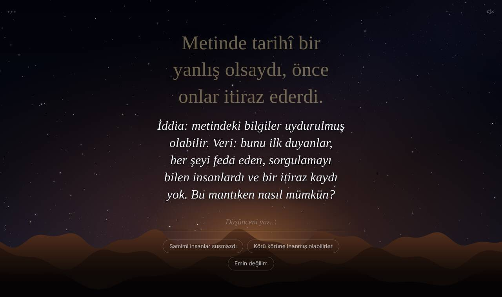

**Satırlar:**

1. Şimdi bu metni ilk dinleyenlere bakalım.
2. Kimdi onlar? Bilal. Ammar ve ailesi. Zayıf, korumasız insanlar.
3. Eziyet gördüler. Mallarını, yakınlarını, yurtlarını kaybettiler.
4. Dünyalık bir çıkar yoktu. Halife seçilen Ebubekir pazarda çalışmaya devam etti.
5. Sorgulayan insanlardı: Hudeybiye'de Ömer bile 'bu neden?' diye sordu.
6. Bir yalan ya da hata görselerdi, susmazlardı.
7. Metinde tarihî bir yanlış olsaydı, önce onlar itiraz ederdi. _[vurgu]_

**Soru:** İddia: metindeki bilgiler uydurulmuş olabilir. Veri: bunu ilk duyanlar, her şeyi feda eden, sorgulamayı bilen insanlardı ve bir itiraz kaydı yok. Bu mantıken nasıl mümkün?

Çipler: “Samimi insanlar susmazdı” · “Körü körüne inanmış olabilirler” · “Emin değilim”

| tür | anahtarlar | hedef |
|---|---|---|
| ikna | samimi insanlar susmazdı, susmazdı, susmazlardı | (sonraki/varsayılan) |
| itiraz | körü körüne, körleşmiş, deli gibi, saf, kandırılmış, sadakat, yanlış bir şeye, fanatik, körü körüne inanmış | (yanıt, aynı soru) |
| yonlendir | gerek yok, geçelim, atlayalım, zaten güveniyorum | zemin.ikna |
| sonraki | — | zemin.musrikler |

**Ek örnekler (3):**

1. Miraç haberi duyulduğunda, bazı müminlerin imanı sarsıldı. Bir kısmı ayrıldı. Batılı tarihçiler de bunu aktarır. Görünmeyen bir olay bile bu tepkiyi doğurdu. → _Görünmeyen bir olay bile tepki doğurduysa, herkesin bildiği bir olgudaki yanlışa ne tepki verirlerdi?_
2. Yusuf suresi, Peygamber'e der: 'Sen bundan önce haberi olmayanlardandın.' O bu kıssaları yıllardır biliyor olsaydı, en yakınları bunu bilirdi. Ayetin yalan olduğunu en önce onlar söylerdi. → _Bu ayet yalan olsaydı, en yakın çevresinin tepkisiz kalması nasıl açıklanır?_
3. Huneyn'den sonra ganimet dağıtılırken, Medineli Müslümanlar kırıldı. Peygamber onlara dünyalığı değil, kendisini hatırlattı. Cevapları: 'Evlerimize Allah'ın Peygamberiyle döneceğiz.' → _Güçlendikleri bir anda bile dünyalıktan çok elçiyi seçen insanlar, bir yalan fark etseler susar mıydı?_

**Kompozisyon:** Peki sen, bu insanların bunca bedeli ödeyip itirazsız kalmasını nasıl açıklıyorsun?

### zemin.musrikler (düğüm Z17)

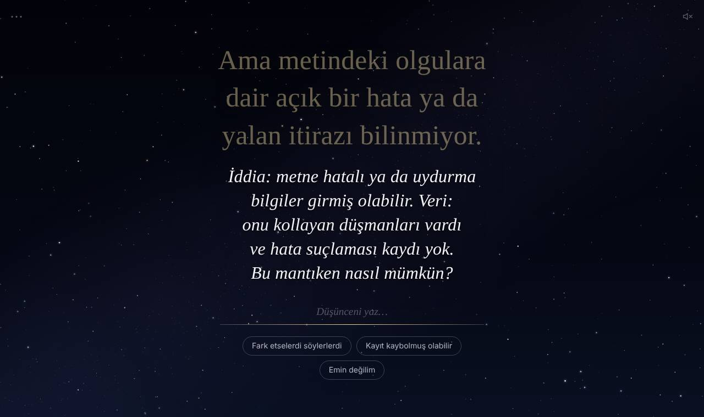

**Satırlar:**

1. Şimdi bu insanların karşı tarafına bakalım.
2. Mekke'nin müşrikleri. Medine'deki rakip topluluklar.
3. Hepsinin Peygamber'i yıpratmak için sebebi vardı.
4. Kur'an onların en zayıf itirazlarını bile kaydeder ve cevap verir.
5. Kıble neden değişti? Sivrisinek örneği ne demek? Neden bir melek inmedi?
6. (metinsiz) _[diyagram: alinti]_
7. Ama metindeki olgulara dair açık bir hata ya da yalan itirazı bilinmiyor. _[vurgu]_

**Soru:** İddia: metne hatalı ya da uydurma bilgiler girmiş olabilir. Veri: onu kollayan düşmanları vardı ve hata suçlaması kaydı yok. Bu mantıken nasıl mümkün?

Çipler: “Fark etselerdi söylerlerdi” · “Kayıt kaybolmuş olabilir” · “Emin değilim”

| tür | anahtarlar | hedef |
|---|---|---|
| ikna | fark etselerdi söylerlerdi, söylerlerdi, fark etselerdi | (sonraki/varsayılan) |
| itiraz | kayıt kaybolmuş, kaybolmuş, yok olmuş, yok edilmiş, kaydedilmemiş, kaybolmuş olabilir | (yanıt, aynı soru) |
| itiraz | sihirbaz, şair, kâhin, yalancı dediler, iftira attılar, sihir | (yanıt, aynı soru) |
| yonlendir | gerek yok, geçelim, atlayalım, zaten güveniyorum | zemin.ikna |
| sonraki | — | zemin.ikna |

**Ek örnekler (2):**

1. Kur'an bu rolü açıkça üstlenir. Sana bir itiraz getirmezler ki, biz sana doğrusunu getirmiş olmayalım, der. Yani itirazlar vardı ve cevaplandı. → _Her itirazı aktarıp cevaplayan bir metinde, gizli bir yalan nasıl saklanır?_
2. Peygamber hikâyeleri başka kitaplardan almış olsaydı, rakipleri kaynağı gösterirdi. Medine'de bu kitapları bilen, elinde okuyan insanlar vardı. 'Öğrenmiş mi' sorusuna ayrıca geleceğiz. → _Elinde somut bir kaynak olan düşmanın onu göstermemesi, mantıken nasıl açıklanır?_

**Kompozisyon:** Peki sen, metni bunca kollayan düşmanlara rağmen açık bir hata itirazının bulunmamasını nasıl yorumluyorsun?

### zemin.ikna (düğüm Z17)

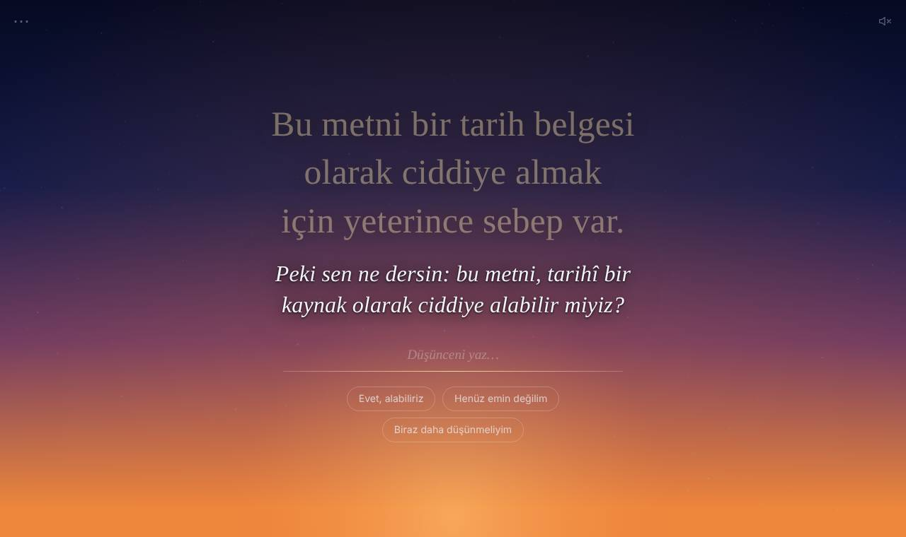

**Satırlar:**

1. Bir adım geri çekilip bakalım.
2. (metinsiz) _[diyagram: denklem]_
3. Hızlı yazıldı. Çoğaltıldı. Düşman ordular bile aynı metne baktı.
4. Rakip iktidarlardan, 'değiştirildi' diyen bir kayıt yok.
5. Peygamber'in zamanına çok yakın yapraklar, bugünkü metinle örtüşüyor.
6. İlk dinleyenler, bir yalan ya da hata görselerdi susmazlardı.
7. Bu metni bir tarih belgesi olarak ciddiye almak için yeterince sebep var. _[vurgu]_

**Soru:** Peki sen ne dersin: bu metni, tarihî bir kaynak olarak ciddiye alabilir miyiz?

Çipler: “Evet, alabiliriz” · “Henüz emin değilim” · “Biraz daha düşünmeliyim”

| tür | anahtarlar | hedef |
|---|---|---|
| ikna | evet alabiliriz, alabiliriz, ciddiye alabiliriz, güvenebilirim, tamam, ikna oldum, mantıklı, haklısın | zemin.kopru |
| sonraki | — | zemin.kopru |

**Ek örnekler (2):**

1. Tek tek bakınca her itirazın bir cevabı var. Birlikte bakınca iş değişir. Bir değişikliğin yazıyı, ezberi, rakipleri ve çok sayıda gözlemciyi aynı anda atlatması gerek. → _Bunların hepsinin aynı anda ve sessizce atlatılması, mantıken ne kadar mümkün?_
2. Kendine şunu sor: Hangi tarihî metne bu kadar güvenle bakabilirsin? Ve onu hangi ölçüyle seçiyorsun? → _Bu metne güvenmeyen biri, hangi başka tarihî metne güvenebilir, hangi ölçüyle?_

**Kompozisyon:** Peki aklında hâlâ bir soru işareti kalıyorsa, hangisi? Yaz, not edeyim.

**Kapatır:** zemin (kullanıcı ikna olursa)

### zemin.kopru

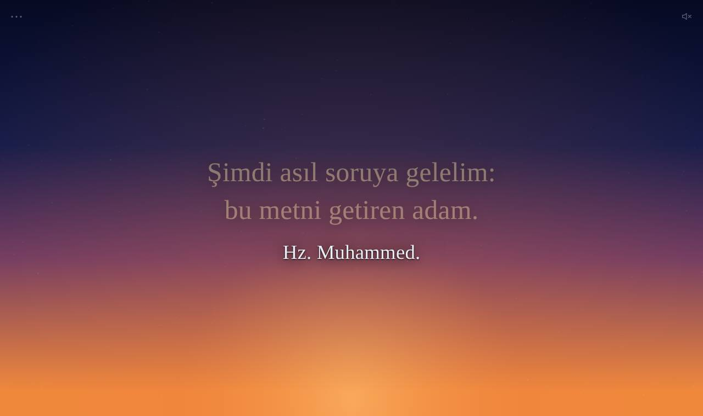

**Satırlar:**

1. Kaynak elimizde.
2. Şimdi asıl soruya gelelim: bu metni getiren adam. _[vurgu]_
3. Hz. Muhammed.

| tür | anahtarlar | hedef |
|---|---|---|
| sonraki | — | haber.giris |

### zemin.kisa (düğüm Z6)

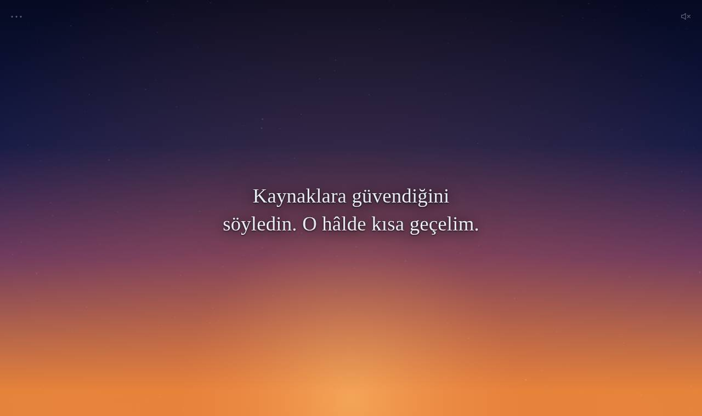

**Satırlar:**

1. Kaynaklara güvendiğini söyledin. O hâlde kısa geçelim.
2. Peygamber hayattayken kâtipler ayetleri yazıyordu.
3. Kısa sürede çoğaltıldı. Düşman ordular bile aynı metne baktı.
4. Hafızlar onu bugüne taşıdı. Yazmalar, bugünkü metinle örtüşüyor.
5. Şimdi asıl soruya gelelim: bu metni getiren adam. _[vurgu]_

| tür | anahtarlar | hedef |
|---|---|---|
| sonraki | — | haber.giris |

## Bölge: haber

### haber.giris (düğüm H1)

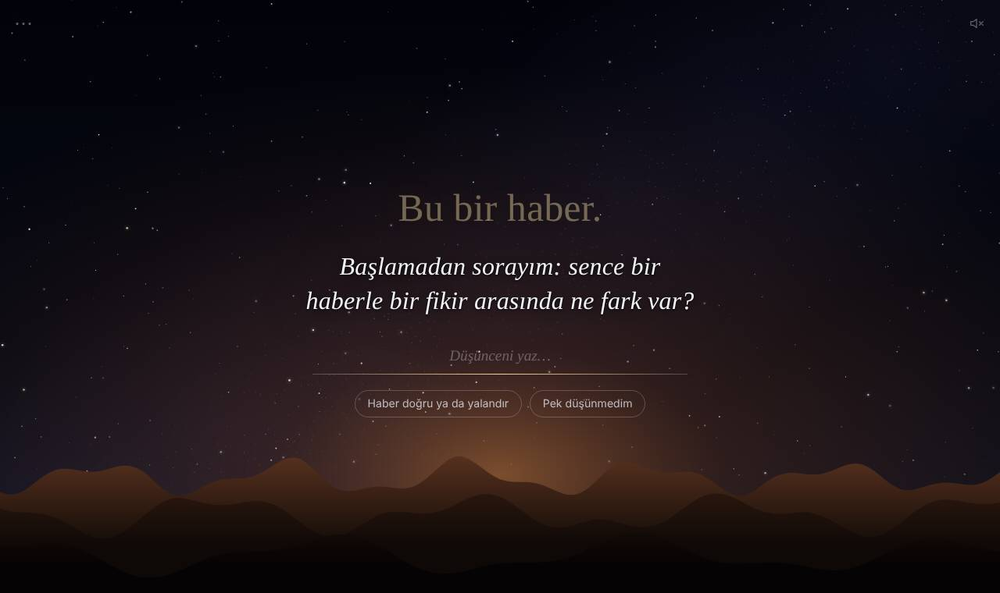

**Satırlar:**

1. Bundan yaklaşık 1400 yıl önce, Mekke'de bir adam bir haber getirdi.
2. Adı Muhammed'di. Yaşı kırktı.
3. Dedi ki: "Allah benimle bir melek aracılığıyla konuşuyor." _[vurgu]_
4. Bunu bir kez söylemedi. Yirmi üç yıl boyunca söyledi.
5. Dikkat et: bu bir felsefe değil, bir görüş değil.
6. Bu bir haber. _[vurgu]_

**Soru:** Başlamadan sorayım: sence bir haberle bir fikir arasında ne fark var? _(serbest)_

Çipler: “Haber doğru ya da yalandır” · “Pek düşünmedim”

| tür | anahtarlar | hedef |
|---|---|---|
| itiraz | aynı şey, aynı, fark yok, hepsi görüş, hepsi fikir | (yanıt, aynı soru) |
| sonraki | — | haber.teori |
| varsayılan | — | haber.teori |

**Ek örnekler (2):**

1. Bir de şunu düşün: bir tanık mahkemede "Olay yerindeydim" der. Hâkim bunu laboratuvarda denemez; tanığın söylediğini tartar. → _Haber dediğimiz şey bu: deneyle değil, tanıklıkla tartılır. Sence bu fark önemli mi?_ [ek]
2. Biri sana "dün Ankara'daydım" dese, ona kanıt mı sorarsın, yoksa güvenilir mi diye mi bakarsın? Çoğumuz ikincisini yaparız. Haberi hep böyle tartarız. → _Bu haber de aynı şekilde tartılmaya uygun değil mi?_

**Kompozisyon:** Peki sence bir haberi, fikirmiş gibi tartmak neden sorun çıkarır? Kendi cümlelerinle anlat.

### haber.teori (düğüm H4)

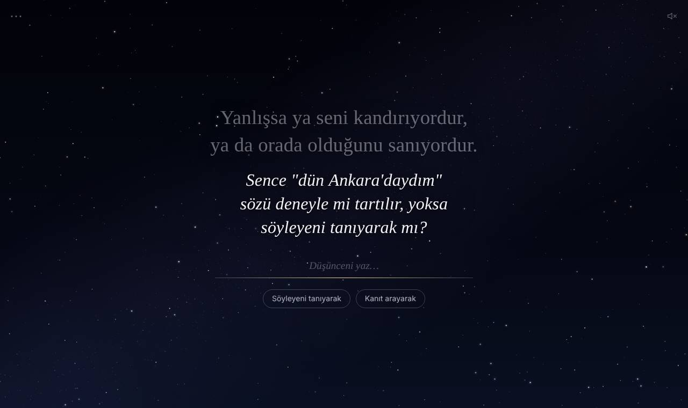

**Satırlar:**

1. Bir teoriyle bir haber çok farklıdır.
2. Biri "insanlığa en uygun ekonomi şudur" derse, bu bir teoridir.
3. Yanılabilir. Yanıldı diye ona deli ya da yalancı demeyiz.
4. Ama biri sana "dün Ankara'daydım" derse? _[vurgu]_
5. Bu ya doğrudur ya yanlış. Burada masum bir yanılgı yok.
6. Yanlışsa ya seni kandırıyordur, ya da orada olduğunu sanıyordur.

**Soru:** Sence "dün Ankara'daydım" sözü deneyle mi tartılır, yoksa söyleyeni tanıyarak mı? _(serbest)_

Çipler: “Söyleyeni tanıyarak” · “Kanıt arayarak”

| tür | anahtarlar | hedef |
|---|---|---|
| itiraz | teori, fikir, görüş, dünya görüşü, yorum, öğreti, felsefe, ahlak öğretisi | (yanıt, aynı soru) |
| sonraki | — | haber.keskin |
| varsayılan | — | haber.keskin |

**Ek örnekler (2):**

1. Platon bir teori kurdu; yanılmış olabilir. Bu, onun aklından ya da dürüstlüğünden şüphe etmemizi gerektirmez. → _Peki Platon "dün Atina'daydım" deyip orada olmamış olsaydı, o zaman ne düşünürdük?_
2. Haber, teoriden farklı olarak yanılma payı bırakmaz. Yanlışsa, söyleyenin ya niyetinde ya algısında bir sorun vardır. → _Bu tespit sana mantıklı geliyor mu?_

**Kompozisyon:** Peki bu iddiayı "sadece bir fikir" sayarsan, "melek gördüm" cümlesini nasıl açıklarsın?

### haber.keskin (düğüm H16)

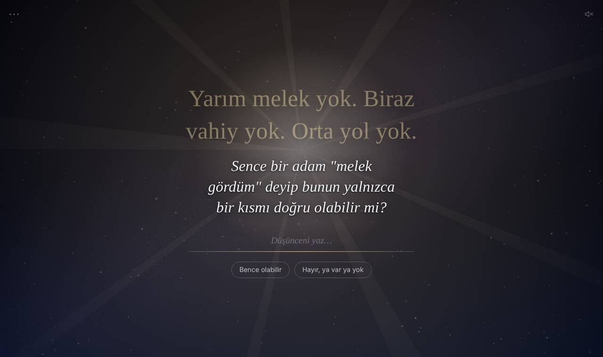

**Satırlar:**

1. Bu haber üstelik çok keskin.
2. "Ben iyi bir insanım" dese, yoruma açık olurdu.
3. Ama "bir melek gördüm" dedi. Yirmi üç yıl boyunca vahiy aldığını söyledi.
4. Melek ya geldi, ya gelmedi.
5. Yarım melek yok. Biraz vahiy yok. Orta yol yok. _[vurgu]_

**Soru:** Sence bir adam "melek gördüm" deyip bunun yalnızca bir kısmı doğru olabilir mi?

Çipler: “Bence olabilir” · “Hayır, ya var ya yok”

| tür | anahtarlar | hedef |
|---|---|---|
| ikna | ya var ya yok, orta yol yok, haklısın, olamaz, mantıklı, katılıyorum, hayır ya var | haber.agac |
| itiraz | olabilir, kısmen, biraz, mecaz, mecazi, sembolik, ilham, rüya, manevi, iyi niyetli, reformcu, toplum önderi | (yanıt, aynı soru) |
| sonraki | — | haber.agac |

**Ek örnekler (3):**

1. Bir akşam namazında, mescit cemaatle dolu. Peygamber birden elini uzatır, bir şeye sığınır, bir şeyi lanetler. Sonra anlatır: iblis yüzüne ateş parçasıyla geldi; onu yakalamak istedi. → _Bunu hâşâ hayal diye okursan ağır bir hastalık, bilerek diye okursan anlamsız bir hile çıkıyor. Orta yol nerede?_
2. Bir başka olay: namaz vakitleri. İki gün üst üste, Cebrail'in arkasında namaz kıldığını anlattı. İlk gün vakitlerin başında, ikinci gün sonunda. → _İki gün düzenli bir hayal mi, yoksa bilerek anlatılmış bir hikâye mi? Üçüncü bir açıklaman var mı?_
3. Bir sahabi vardı: Übey. Peygamber ona der: "Allah sana Kur'an okumamı emretti." Übey sorar: "Benim adımı mı andı?" "Evet." Übey sevinçten ağlar. → _Bu, hâşâ bilerek kurulmuş bir sahne olsaydı, anlatan kişiye "iyi bir insan" diyebilir miydin?_

**Kompozisyon:** Peki bu sahnelerin hepsini, orta yol bir açıklamayla nasıl birleştirirsin? Kendi cümlelerinle yaz.

### haber.agac (düğüm H1)

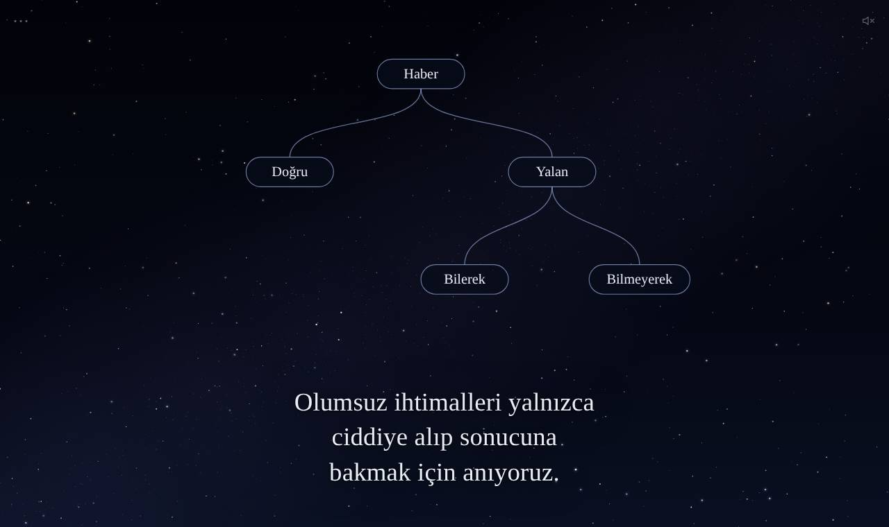

**Satırlar:**

1. Şimdi bu haberi nasıl yorumlayabiliriz? Sıfır noktasından bakalım. _[diyagram: ihtimaller]_
2. Birinci ihtimal: doğru söylüyor. O zaman peygamberdir. _[vurgu; diyagram: ihtimaller]_
3. İkinci ihtimal: hâşâ, yanlış söylüyor. _[diyagram: ihtimaller]_
4. Yanlışsa ya bilerek: hâşâ, bir yalan. _[diyagram: ihtimaller]_
5. Ya da bilmeden: hâşâ, bir yanılgı, bir hastalık. _[diyagram: ihtimaller]_
6. Bu kadar. Çünkü yalnızca iki soru sorduk: doğru mu? Yalansa, farkında mı? _[diyagram: ihtimaller]_
7. Olumsuz ihtimalleri yalnızca ciddiye alıp sonucuna bakmak için anıyoruz.

| tür | anahtarlar | hedef |
|---|---|---|
| sonraki | — | haber.dorduncu |

### haber.dorduncu (düğüm H5)

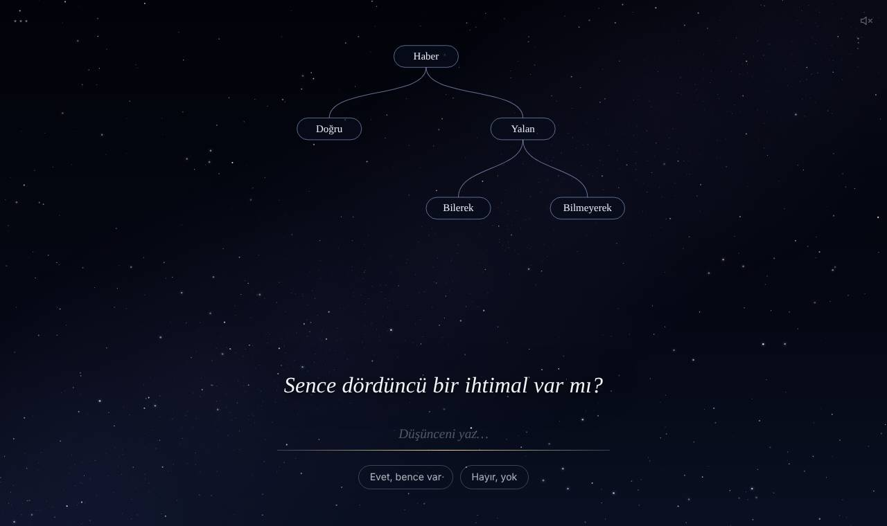

**Satırlar:**

1. Dördüncü bir kapı yok. Çünkü iki ölçüt, bütün ihtimalleri kapsar.
2. Yine de sen dene. Aklına başka bir ihtimal geliyorsa söyle.

**Soru:** Sence dördüncü bir ihtimal var mı?

Çipler: “Evet, bence var” · “Hayır, yok”

| tür | anahtarlar | hedef |
|---|---|---|
| ikna | yok, hayır yok, haklısın, katılıyorum, mantıklı, başka ihtimal yok, dördüncü yok, sanırım yok, bulamadım | haber.demet |
| yonlendir | kaynaklara dönelim, kaynaklara dön, kaynak konusuna dön, önce kaynaklar, kaynakları konuşalım | zemin.giris |
| itiraz | efsane, efsaneydi, sonradan uydurulmuş, sonradan yazılmış, sonradan eklenmiş, rivayet, kaynaklar güvenilmez, tarihsel değil, hiç yaşamadı, yaşamadı | (yanıt, aynı soru) |
| itiraz | reformcu, iyi niyetli, iyi niyetle, toplum önderi, devrimci, mecaz, mecazi, sembolik, ilham, vizyon, rüya, manevi tecrübe, manevi, ahlak öğretmeni | (yanıt, aynı soru) |
| itiraz | kısmen, biraz, bir kısmı, ikisi de, hem hem, arası, orta yol, kısmen doğru, yarı yarıya | (yanıt, aynı soru) |
| itiraz | kâhin, kahin, medyum, büyücü, sihirbaz, falcı, ruh çağıran | (yanıt, aynı soru) |
| itiraz | epilepsi, halüsinasyon, hayal, hasta, yanılmış, yanılgı, sara | (yanıt, aynı soru) |
| ret | evet bence var, bence var, başka ihtimal var, dördüncü ihtimal var, bir ihtimal daha var | (ret → ek örnek) |
| sonraki | — | haber.demet |

**Ek örnekler (2):**

1. Bir deneme yapalım: epilepsi, halüsinasyon, vizyon. Bunların hepsinde kişi, gerçek olmayanı gerçek sanıyor. O zaman hepsi aynı kutuda: bilmeden yanılma. → _Sence yeni bir isim, yeni bir ihtimal doğurur mu?_
2. Biri "o iyi niyetli bir reformcuydu" diyor. Ama reformcu "melek geldi" derken bunun gerçek olmadığını biliyorsa? Bu hâlde niyeti iyi olsa da, bilerek yanlış söylemiş olur. → _Bu iki özelliği bir arada tutmak sana mantıklı geliyor mu?_

**Kompozisyon:** Peki sen bu üç kutunun dışında bir ihtimal kurmak istesen, haberin hangi detayını nasıl açıklardın?

### haber.demet (düğüm H7)

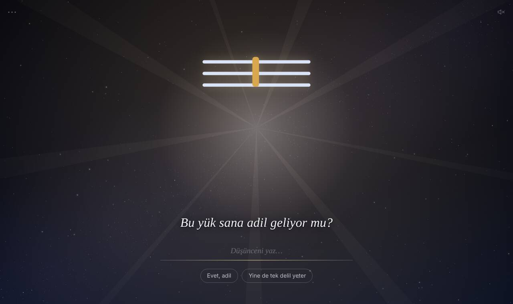

**Satırlar:**

1. Şimdi önemli bir şey: bu yolda tek bir delil yok.
2. Bir sopayı kırmak kolay. Bir demeti kırmak değil. _[vurgu; diyagram: demet]_
3. Birine itiraz etmek, ispatı çürütmez.
4. İtiraz edecek biri her delili tek tek çürütmeli.
5. Üstelik seçtiği ihtimalle bütün tarihi tutarlı biçimde açıklamalı.

**Soru:** Bu yük sana adil geliyor mu?

Çipler: “Evet, adil” · “Yine de tek delil yeter”

| tür | anahtarlar | hedef |
|---|---|---|
| ikna | adil, haklısın, mantıklı, katılıyorum, tamam, evet | haber.kisisel |
| itiraz | zincir, en zayıf halka, zayıf halka, tek delil, bir delil yeter, birkaç delil, bir tanesini çürütsem | (yanıt, aynı soru) |
| itiraz | kanıtlamak zorunda değilim, ispat etmek zorunda değilim, benim işim değil, senin işin, sen ispatla | (yanıt, aynı soru) |
| sonraki | — | haber.kisisel |

**Ek örnekler (2):**

1. On mucize, on samimiyet, on fetanet delili düşün. Muhalif otuzunu da çürütmeli. Üstelik her çürütmeyi, kendi kurduğu hikâyeyle uyumlu yapmalı. → _Birkaçına itiraz etmek bu işin üstesinden gelmeye yeter mi?_
2. "Ben şu delili kabul etmiyorum" demek, bir iddia değildir. İddia, "o şunu yaptı çünkü..." diye başlar. O iddianın bütün tarihi tutması gerekir. → _Sence bu iki şey aynı yük mü?_

**Kompozisyon:** Peki sen bu yükü yüklenmek isteseydin, hangi ihtimalle başlardın ve nasıl bir hikâye kurardın?

### haber.kisisel (düğüm H5)

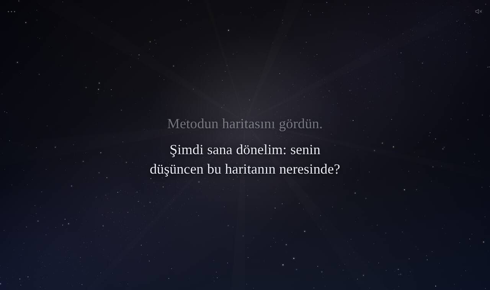

**Girişte dallan:**

- `{"profil.supheTuru":"uydurdu"}` → `haber.kopru-uydurdu`
- `{"profil.supheTuru":["hasta-yanildi","ogrendi"]}` → `haber.kopru-yanildi`
- `{"profil.supheTuru":"mucize-yok"}` → `haber.kopru-mucize`

**Satırlar:**

1. Metodun haritasını gördün.
2. Şimdi sana dönelim: senin düşüncen bu haritanın neresinde?

| tür | anahtarlar | hedef |
|---|---|---|
| sonraki | — | haber.ihtimaller |

### haber.kopru-uydurdu (düğüm H5/S1)

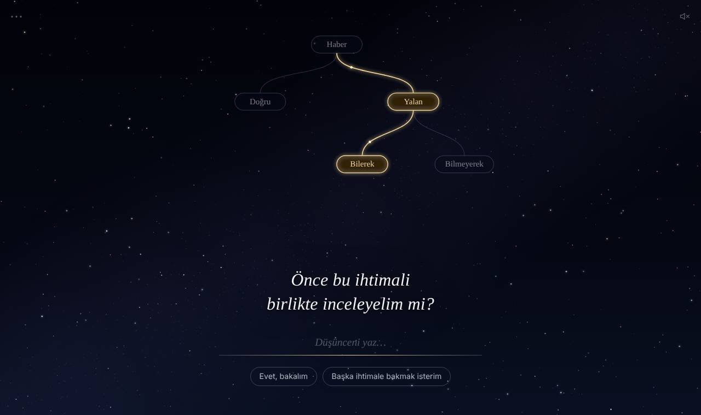

**Satırlar:**

1. Sen başta onun bunu uydurmuş olabileceğini söyledin.
2. Haritada bu birinci kutu: bilerek yalan. _[diyagram: ihtimaller]_
3. Bu ihtimali atlamayacağız. Önce onu ciddiye alalım.

**Soru:** Önce bu ihtimali birlikte inceleyelim mi? _(serbest)_

Çipler: “Evet, bakalım” · “Başka ihtimale bakmak isterim”

| tür | anahtarlar | hedef |
|---|---|---|
| yonlendir | başka, farklı, hayır, bence değil, vazgeçtim, diğer, başka ihtimale, başka ihtimal, başka birine, başka dala | haber.ihtimaller |
| yonlendir | evet, tamam, bakalım, olur, başlayalım, isterim, devam, buyur, peki, hadi, tabii | samimiyet.giris |
| varsayılan | — | haber.ihtimaller |

### haber.kopru-yanildi (düğüm H5/F24)

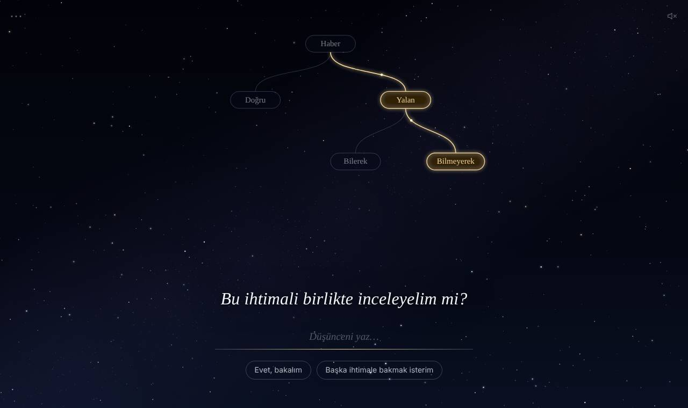

**Satırlar:**

1. Sen başta onun bilmeden yanılmış olabileceğini düşündüğünü söyledin.
2. Hastalık, hayal ya da çevresinden öğrendiği şeyler olabilir.
3. Haritada bu ikinci kutu. _[diyagram: ihtimaller]_
4. Önce bu ihtimali ciddiye alalım.

**Soru:** Bu ihtimali birlikte inceleyelim mi? _(serbest)_

Çipler: “Evet, bakalım” · “Başka ihtimale bakmak isterim”

| tür | anahtarlar | hedef |
|---|---|---|
| yonlendir | başka, farklı, hayır, bence değil, vazgeçtim, diğer, başka ihtimale, başka ihtimal, başka birine, başka dala | haber.ihtimaller |
| yonlendir | evet, tamam, bakalım, olur, başlayalım, isterim, devam, buyur, peki, hadi, tabii | fetanet.giris |
| varsayılan | — | haber.ihtimaller |

### haber.kopru-mucize (düğüm H9/M)

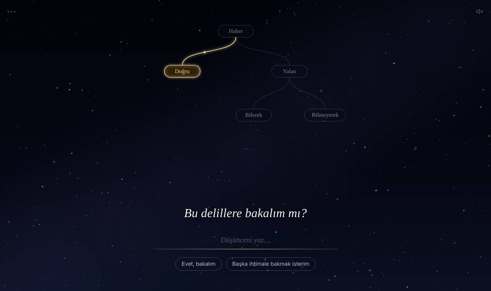

**Satırlar:**

1. Sen başta mucize olduğuna dair bir şey görmediğini söyledin.
2. Haklısın, bu önemli bir soru.
3. Haritada bu, "doğru söylüyor" kapısı. _[diyagram: ihtimaller]_
4. Onu doğrudan gösteren delillere bakalım.

**Soru:** Bu delillere bakalım mı? _(serbest)_

Çipler: “Evet, bakalım” · “Başka ihtimale bakmak isterim”

| tür | anahtarlar | hedef |
|---|---|---|
| yonlendir | başka, farklı, hayır, bence değil, vazgeçtim, diğer, başka ihtimale, başka ihtimal, başka birine, başka dala | haber.ihtimaller |
| yonlendir | evet, tamam, bakalım, olur, başlayalım, isterim, devam, buyur, peki, hadi, tabii | mucize.giris |
| varsayılan | — | haber.ihtimaller |

### haber.ihtimaller (düğüm H5)

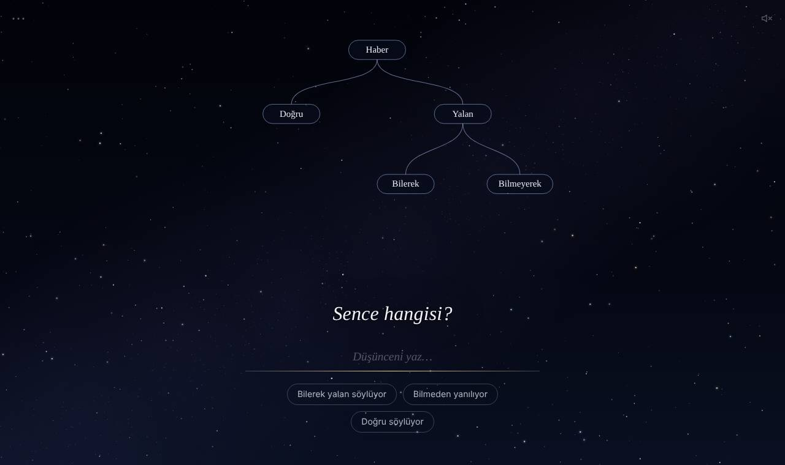

**Satırlar:**

1. Şimdi sıra sende.
2. Üç kapı var: doğru söylüyor, bilerek yalan söylüyor, bilmeden yanılıyor.
3. Dürüstçe, kendi aklınla: hangisine yakın duruyorsun?

**Soru:** Sence hangisi? _(serbest)_

Çipler: “Bilerek yalan söylüyor” · “Bilmeden yanılıyor” · “Doğru söylüyor”

| tür | anahtarlar | hedef |
|---|---|---|
| yonlendir | sahtekar, sahtekâr, yalan, yalan söylüyor, yalan söylemiş, yalan söylüyordu, yalan söyledi, yalan söylemiş olabilir, bilerek, bile bile, bilerek yalan, bilerek söylemiş, uydurdu, uydurmuş, uyduruyor, uydurmuş olabilir, uydurma, kandırdı, kandırmış, kandırıyor, kandırıyordu, aldattı, aldatmış, insanları kandırmış, çıkar, çıkar için, kendi çıkarı, iktidar, iktidar hırsı, siyasi, politik, güç için, para için, makam, şöhret, lider olmak için, liderlik hırsı, dolandırıcı, yalancı, hile, hileci, blöf, manipüle, manipülasyon, toplum önderi, reformcu, devrimci, siyasi lider, bile bile yalan, yalan uydurmuş | samimiyet.giris |
| yonlendir | deli, delilik, hasta, hastalık, hastaydı, hasta olabilir, epilepsi, epilepsiydi, sara, saralı, hayal, hayal görmüş, hayal görüyordu, halüsinasyon, halusinasyon, hayal görme, yanıldı, yanılmış, yanılmıştır, yanılgı, yanılıyor, yanılıyordu, yanıldığını, bilmeden, bilmeyerek, bilmeden yanılıyor, farkında olmadan, kendini kandırmış, kendini kandırdı, kendi kendini kandırmış, kendine inanmış, psikolojik, ruhsal, akıl hastası, akıl sağlığı, şizofreni, paranoya, sanrı, zannetmiş, zannediyordu, sanmış, sandı, çevresinden öğrenmiş, çevresinden etkilenmiş, öğrenmiş, ogrenmis, etkilenmiş, etkilendi, rahipten, rahiplerden, bahira, varaka, yahudilerden, hristiyanlardan, kitaplardan öğrenmiş, travma, bilinçaltı, aklı karışık, ruhsal bozukluk, samimi yanılgı, iyi niyetle yanılmış | fetanet.giris |
| yonlendir | doğru, dogru, doğru söylüyor, doğru söylüyordu, doğru söylemiş, doğrudur, doğru söyledi, gerçekten melek, gerçekten peygamber, gerçekten vahiy, peygamberdir, peygamberdi, haklıydı, haklıdır, inanıyorum, söylediği doğru, vahiy gerçek, vahiy doğru, elçidir, allah'tan, allah'tan geldi, melek gerçekten geldi, bence doğru | mucize.giris |
| yonlendir | bilmiyorum, bilemiyorum, bilmem, kararsızım, kararsiz, emin değilim, emin degilim, hiçbiri, hiçbirine, fikrim yok, karar veremedim, karar veremiyorum, ne bileyim, her ikisi, ikisi de olabilir, hepsi olabilir, düşünmem lazım, düşünmem gerek, henüz karar vermedim, şimdilik bilmiyorum, sence, hangisi bilmiyorum | haber.belirsiz |
| itiraz | hakaret, saygısızlık, saygisizlik, ayıp, edepsizlik, haşa, hâşâ, incitici | (yanıt, aynı soru) |
| yonlendir | doğru söylemiyor, doğru değil, doğru söylemedi, doğru söylemiyordu, doğru olduğunu sanmıyorum, doğru olmadığını | haber.belirsiz |
| varsayılan | — | haber.belirsiz |

### haber.belirsiz (düğüm H5)

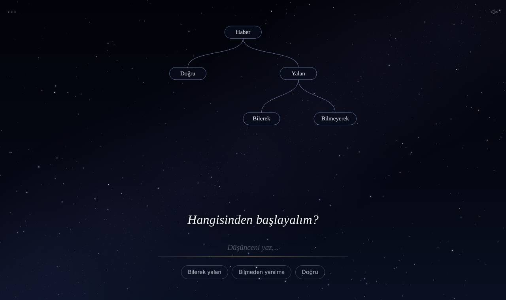

**Satırlar:**

1. Sorun değil. Karar vermek acele iş değil.
2. Bir kez daha bakalım: haber ya doğru, ya yanlış.
3. Yanlışsa ya bilerek, ya bilmeden.
4. Hiçbirini seçmek zorunda değilsin; yalnızca ilk incelemek istediğini seç.

**Soru:** Hangisinden başlayalım? _(serbest)_

Çipler: “Bilerek yalan” · “Bilmeden yanılma” · “Doğru”

| tür | anahtarlar | hedef |
|---|---|---|
| yonlendir | sahtekar, sahtekâr, yalan, yalan söylüyor, yalan söylemiş, yalan söylüyordu, yalan söyledi, yalan söylemiş olabilir, bilerek, bile bile, bilerek yalan, bilerek söylemiş, uydurdu, uydurmuş, uyduruyor, uydurmuş olabilir, uydurma, kandırdı, kandırmış, kandırıyor, kandırıyordu, aldattı, aldatmış, insanları kandırmış, çıkar, çıkar için, kendi çıkarı, iktidar, iktidar hırsı, siyasi, politik, güç için, para için, makam, şöhret, lider olmak için, liderlik hırsı, dolandırıcı, yalancı, hile, hileci, blöf, manipüle, manipülasyon, toplum önderi, reformcu, devrimci, siyasi lider, bile bile yalan, yalan uydurmuş | samimiyet.giris |
| yonlendir | deli, delilik, hasta, hastalık, hastaydı, hasta olabilir, epilepsi, epilepsiydi, sara, saralı, hayal, hayal görmüş, hayal görüyordu, halüsinasyon, halusinasyon, hayal görme, yanıldı, yanılmış, yanılmıştır, yanılgı, yanılıyor, yanılıyordu, yanıldığını, bilmeden, bilmeyerek, bilmeden yanılıyor, farkında olmadan, kendini kandırmış, kendini kandırdı, kendi kendini kandırmış, kendine inanmış, psikolojik, ruhsal, akıl hastası, akıl sağlığı, şizofreni, paranoya, sanrı, zannetmiş, zannediyordu, sanmış, sandı, çevresinden öğrenmiş, çevresinden etkilenmiş, öğrenmiş, ogrenmis, etkilenmiş, etkilendi, rahipten, rahiplerden, bahira, varaka, yahudilerden, hristiyanlardan, kitaplardan öğrenmiş, travma, bilinçaltı, aklı karışık, ruhsal bozukluk, samimi yanılgı, iyi niyetle yanılmış | fetanet.giris |
| yonlendir | doğru, dogru, doğru söylüyor, doğru söylüyordu, doğru söylemiş, doğrudur, doğru söyledi, gerçekten melek, gerçekten peygamber, gerçekten vahiy, peygamberdir, peygamberdi, haklıydı, haklıdır, inanıyorum, söylediği doğru, vahiy gerçek, vahiy doğru, elçidir, allah'tan, allah'tan geldi, melek gerçekten geldi, bence doğru | mucize.giris |
| yonlendir | bilmiyorum, bilemiyorum, bilmem, kararsızım, kararsiz, emin değilim, emin degilim, hiçbiri, hiçbirine, fikrim yok, karar veremedim, karar veremiyorum, ne bileyim, her ikisi, ikisi de olabilir, hepsi olabilir, düşünmem lazım, düşünmem gerek, henüz karar vermedim, şimdilik bilmiyorum, sence, hangisi bilmiyorum | haber.sirayla |
| itiraz | hakaret, saygısızlık, saygisizlik, ayıp, edepsizlik, haşa, hâşâ, incitici | (yanıt, aynı soru) |
| varsayılan | — | haber.sirayla |

### haber.sirayla (düğüm H5)

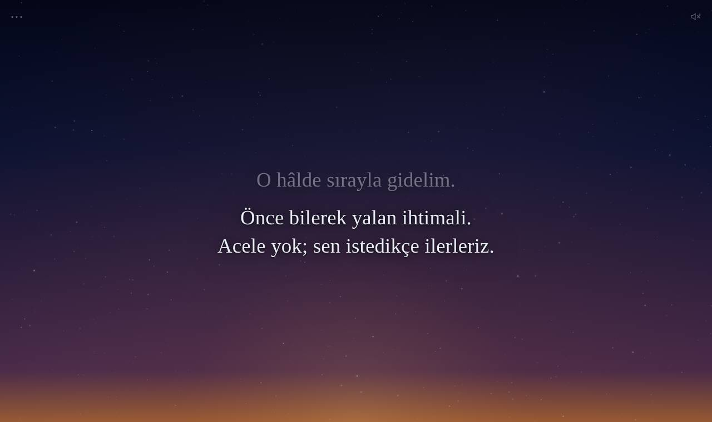

**Satırlar:**

1. O hâlde sırayla gidelim.
2. Önce bilerek yalan ihtimali. Acele yok; sen istedikçe ilerleriz.

| tür | anahtarlar | hedef |
|---|---|---|
| sonraki | — | samimiyet.giris |

### haber.kalan (düğüm H6)

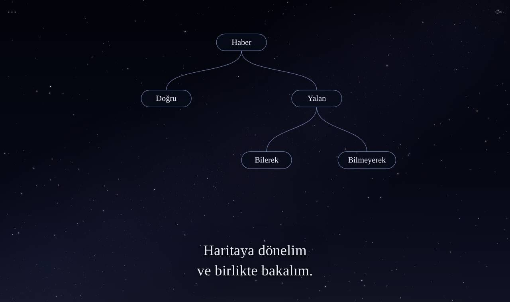

**Girişte dallan:**

- `{"kapali":"samimiyet"}` → `haber.kalan-s`
- `{"kapali":"fetanet"}` → `haber.kalan-f`

**Satırlar:**

1. Henüz kapanan bir ihtimal yok.
2. Haritaya dönelim ve birlikte bakalım.

| tür | anahtarlar | hedef |
|---|---|---|
| sonraki | — | haber.ihtimaller |

### haber.kalan-s (düğüm H6)

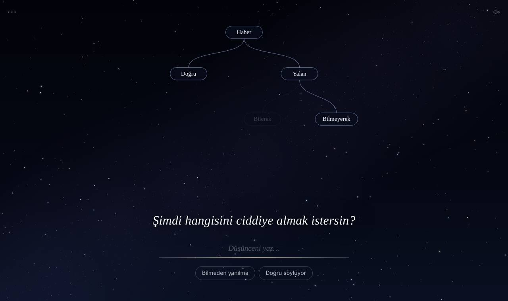

**Girişte dallan:**

- `{"kapali":"fetanet"}` → `haber.kalan-ikisi`

**Satırlar:**

1. Bilerek yalan ihtimali kapandı. _[vurgu; diyagram: ihtimaller]_
2. Geriye iki şey kaldı: bilmeden yanılma ya da doğruluk.
3. Bunu sen kendi ikna olduğun adımlarla buldun.

**Soru:** Şimdi hangisini ciddiye almak istersin? _(serbest)_

Çipler: “Bilmeden yanılma” · “Doğru söylüyor”

| tür | anahtarlar | hedef |
|---|---|---|
| yonlendir | deli, delilik, hasta, hastalık, hastaydı, hasta olabilir, epilepsi, epilepsiydi, sara, saralı, hayal, hayal görmüş, hayal görüyordu, halüsinasyon, halusinasyon, hayal görme, yanıldı, yanılmış, yanılmıştır, yanılgı, yanılıyor, yanılıyordu, yanıldığını, bilmeden, bilmeyerek, bilmeden yanılıyor, farkında olmadan, kendini kandırmış, kendini kandırdı, kendi kendini kandırmış, kendine inanmış, psikolojik, ruhsal, akıl hastası, akıl sağlığı, şizofreni, paranoya, sanrı, zannetmiş, zannediyordu, sanmış, sandı, çevresinden öğrenmiş, çevresinden etkilenmiş, öğrenmiş, ogrenmis, etkilenmiş, etkilendi, rahipten, rahiplerden, bahira, varaka, yahudilerden, hristiyanlardan, kitaplardan öğrenmiş, travma, bilinçaltı, aklı karışık, ruhsal bozukluk, samimi yanılgı, iyi niyetle yanılmış, bilmeden yanılma | fetanet.giris |
| yonlendir | doğru, dogru, doğru söylüyor, doğru söylüyordu, doğru söylemiş, doğrudur, doğru söyledi, gerçekten melek, gerçekten peygamber, gerçekten vahiy, peygamberdir, peygamberdi, haklıydı, haklıdır, inanıyorum, söylediği doğru, vahiy gerçek, vahiy doğru, elçidir, allah'tan, allah'tan geldi, melek gerçekten geldi, bence doğru | mucize.giris |
| varsayılan | — | fetanet.giris |

### haber.kalan-f (düğüm H6)

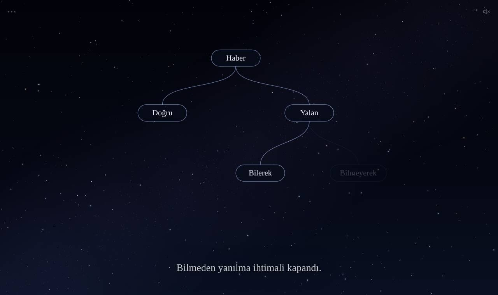

**Girişte dallan:**

- `{"kapali":"samimiyet"}` → `haber.kalan-ikisi`

**Satırlar:**

1. Bilmeden yanılma ihtimali kapandı. _[vurgu; diyagram: ihtimaller]_
2. Geriye iki şey kaldı: bilerek yalan ya da doğruluk.
3. Bunu sen kendi ikna olduğun adımlarla buldun.

**Soru:** Şimdi hangisini ciddiye almak istersin? _(serbest)_

Çipler: “Bilerek yalan” · “Doğru söylüyor”

| tür | anahtarlar | hedef |
|---|---|---|
| yonlendir | sahtekar, sahtekâr, yalan, yalan söylüyor, yalan söylemiş, yalan söylüyordu, yalan söyledi, yalan söylemiş olabilir, bilerek, bile bile, bilerek yalan, bilerek söylemiş, uydurdu, uydurmuş, uyduruyor, uydurmuş olabilir, uydurma, kandırdı, kandırmış, kandırıyor, kandırıyordu, aldattı, aldatmış, insanları kandırmış, çıkar, çıkar için, kendi çıkarı, iktidar, iktidar hırsı, siyasi, politik, güç için, para için, makam, şöhret, lider olmak için, liderlik hırsı, dolandırıcı, yalancı, hile, hileci, blöf, manipüle, manipülasyon, toplum önderi, reformcu, devrimci, siyasi lider, bile bile yalan, yalan uydurmuş | samimiyet.giris |
| yonlendir | doğru, dogru, doğru söylüyor, doğru söylüyordu, doğru söylemiş, doğrudur, doğru söyledi, gerçekten melek, gerçekten peygamber, gerçekten vahiy, peygamberdir, peygamberdi, haklıydı, haklıdır, inanıyorum, söylediği doğru, vahiy gerçek, vahiy doğru, elçidir, allah'tan, allah'tan geldi, melek gerçekten geldi, bence doğru | mucize.giris |
| varsayılan | — | samimiyet.giris |

### haber.kalan-ikisi (düğüm H6)

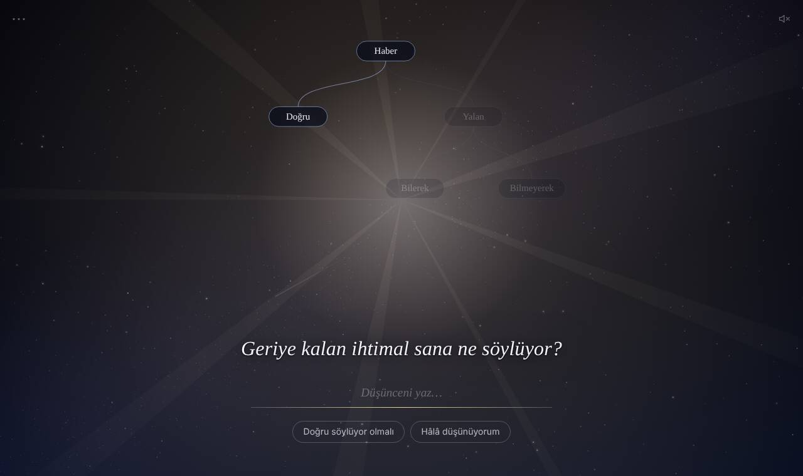

**Satırlar:**

1. İki yanlış ihtimal de kapandı. _[vurgu; diyagram: ihtimaller]_
2. Bilerek yalan: kapandı. Bilmeden yanılma: kapandı.
3. Geriye tek ihtimal kaldı. _[vurgu; diyagram: ihtimaller]_
4. Bunu ben söylemiyorum. Kendi verdiğin cevaplar seni buraya getirdi.

**Soru:** Geriye kalan ihtimal sana ne söylüyor? _(serbest)_

Çipler: “Doğru söylüyor olmalı” · “Hâlâ düşünüyorum”

| tür | anahtarlar | hedef |
|---|---|---|
| varsayılan | — | mucize.giris |

## Bölge: samimiyet

### samimiyet.giris (düğüm S1)

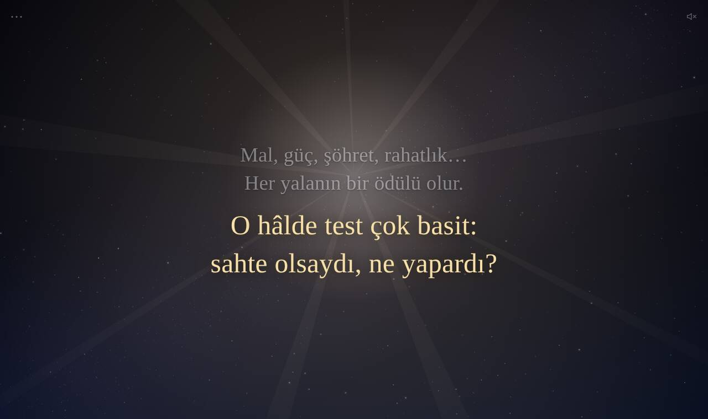

**Girişte dallan:**

- `{"kapali":"samimiyet"}` → `haber.kalan`

**Satırlar:**

1. Diyelim ki sen haklısın.
2. Hâşâ, Muhammed bile bile yalan söyledi. 'Cebrail geldi' dedi, ama gelen kimse yoktu.
3. Bir insan yalanı neden yaşar? Bir şey kazanmak için.
4. Mal, güç, şöhret, rahatlık… Her yalanın bir ödülü olur.
5. O hâlde test çok basit: sahte olsaydı, ne yapardı? _[vurgu]_
6. (metinsiz) _[diyagram: karsilastirma]_

| tür | anahtarlar | hedef |
|---|---|---|
| yonlendir | kutsal yalan, iyi niyetli, iyilik için, halk için | samimiyet.kutsalyalan |
| sonraki | — | samimiyet.teshis |

### samimiyet.teshis (düğüm S1)

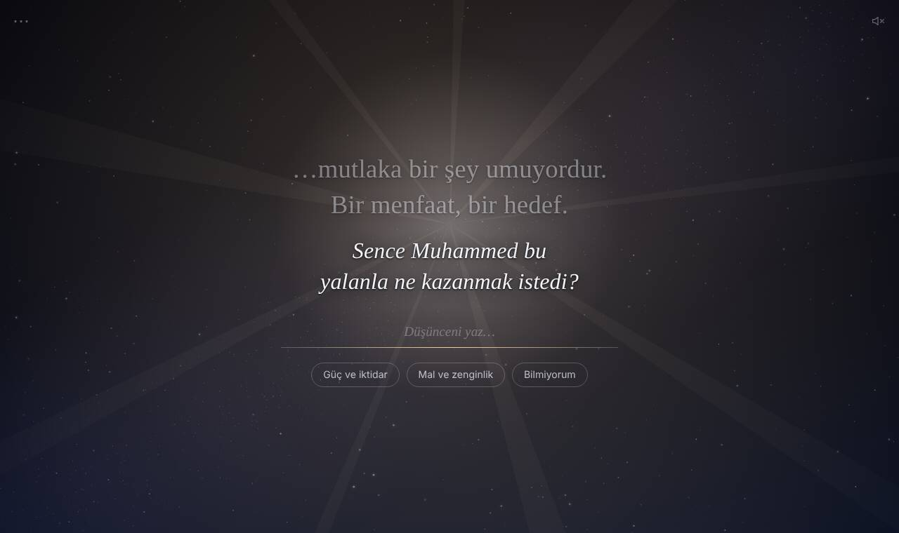

**Satırlar:**

1. Şimdi sana bir şey soracağım.
2. Biri yirmi üç yıl boyunca bir yalanın içinde yaşıyorsa…
3. …mutlaka bir şey umuyordur. Bir menfaat, bir hedef.

**Soru:** Sence Muhammed bu yalanla ne kazanmak istedi? _(serbest)_

Çipler: “Güç ve iktidar” · “Mal ve zenginlik” · “Bilmiyorum”

| tür | anahtarlar | hedef |
|---|---|---|
| yonlendir | mal, para, zengin, zenginlik, servet, dünyalık, altın, ticaret | samimiyet.mal |
| yonlendir | güç, iktidar, liderlik, hükümdar, kral, yönetim, siyaset, devlet, otorite, hükmetmek | samimiyet.guc |
| yonlendir | şöhret, ün, ünlü, saygınlık, itibar, tanınmak, hayranlık, prestij | samimiyet.sohret |
| yonlendir | kadın, kadınlar, şehvet, evlilik, eş, cinsel | samimiyet.kadin |
| yonlendir | kabile, aşiret, kavim, soy, kureyş, akraba, halkını | samimiyet.kabile |
| yonlendir | reform, toplumu değiştirmek, toplum, ahlak, düzen | samimiyet.deger |
| yonlendir | kutsal yalan, iyi niyet, iyilik, davası için, inandığı için, samimi | samimiyet.kutsalyalan |
| yonlendir | bilmiyorum, bilemem, emin değilim, hepsi | samimiyet.yuk |
| itiraz | strateji, siyasi deha, zeki, dâhi, deha, kurnaz, plan | (yanıt, aynı soru) |
| itiraz | rivayet, sonradan uydurulmuş, nesiller, sonraki nesil, anlatmış, uydurma | (yanıt, aynı soru) |
| sonraki | — | samimiyet.yuk |
| varsayılan | — | samimiyet.yuk |

### samimiyet.mal (düğüm S12)

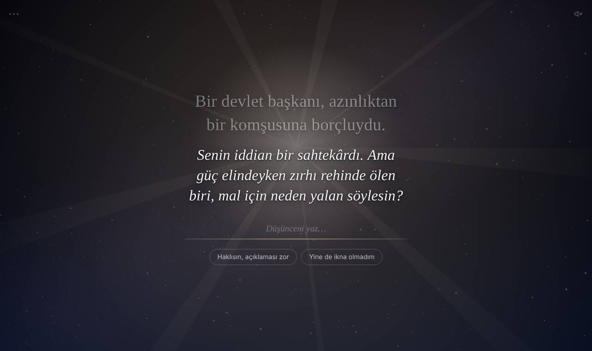

**Satırlar:**

1. Mal istediyse, önünde kolay bir yol vardı.
2. Mekke'de rahat bir ticaret hayatı vardı; Hatice ile birlikte refah içinde yaşıyordu.
3. Sonra Arabistan'ın büyük bölümü onun yönetimine girdi.
4. Yine de saray kurmadı, kapıcı tutmadı. Evi hurma lifinden örülmüştü; ev işini kendi yapardı.
5. Öldüğünde zırhı, bir ölçü arpa karşılığında bir Yahudi komşusunda rehindi. _[vurgu]_
6. Bir devlet başkanı, azınlıktan bir komşusuna borçluydu.

**Soru:** Senin iddian bir sahtekârdı. Ama güç elindeyken zırhı rehinde ölen biri, mal için neden yalan söylesin?

Çipler: “Haklısın, açıklaması zor” · “Yine de ikna olmadım”

| tür | anahtarlar | hedef |
|---|---|---|
| ikna | haklısın, mantıklı, ikna oldum, katılıyorum, açıklaması zor, kabul ediyorum | samimiyet.kapanis |
| itiraz | strateji, siyasi deha, zeki, dâhi, deha, kurnaz, plan | (yanıt, aynı soru) |
| itiraz | rivayet, sonradan uydurulmuş, nesiller, sonraki nesil, anlatmış, uydurma | (yanıt, aynı soru) |
| itiraz | güç kazandı, güçlendi, devlet kurdu, iktidara geldi, sonradan güç, sonradan zengin | (yanıt, aynı soru) |
| sonraki | — | samimiyet.aile |

**Ek örnekler (2):**

1. Bir örnek daha. Mirasının ailesine kalmayacağını, topluma ait olduğunu söyledi. Gelen hediyeleri hemen dağıtırdı; bir takımdan fazla elbisesi olmadı. → _Bir hanedan kurmak isteyen biri, çocuklarının geleceğini böyle mi kapatır?_
2. Bir de şunu düşün: yanındakilere de aynısını öğretti. Cübbesini kefen için isteyene çıkarıp verdi. → _Servet biriktirmek isteyen biri, elindekini isteyene neden verir?_

**Kompozisyon:** Peki zırhı rehinde ölen, mirası devlete bırakan, hediyeleri dağıtan biri… bunlar 'mal için yalan' ile nasıl bir arada durur?

### samimiyet.aile (düğüm S13)

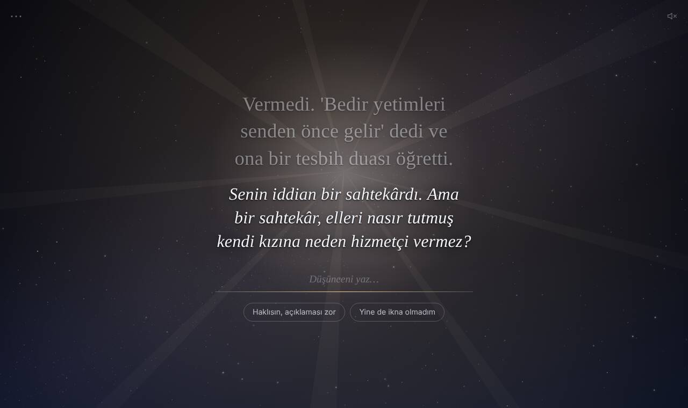

**Satırlar:**

1. Belki kendisi sade yaşadı, ama ailesine konfor sağladı?
2. Eşleri geçim darlığından yakındı. Üstelik bu, Medine'de, güçlü olduğu dönemdeydi.
3. Çözüm bir saray olmadı. Eşlerine açık bir seçenek sunuldu: dünya hayatını mı istiyorsunuz, yoksa bu sadeliği mi?
4. Evde iki üç ay ateş yanmadığı olurdu; yiyecek hurma ve sudan ibaretti.
5. Kızı Fatıma el değirmeninden elleri nasır tutmuşken bir hizmetçi istedi. _[vurgu]_
6. Vermedi. 'Bedir yetimleri senden önce gelir' dedi ve ona bir tesbih duası öğretti.

**Soru:** Senin iddian bir sahtekârdı. Ama bir sahtekâr, elleri nasır tutmuş kendi kızına neden hizmetçi vermez?

Çipler: “Haklısın, açıklaması zor” · “Yine de ikna olmadım”

| tür | anahtarlar | hedef |
|---|---|---|
| ikna | haklısın, mantıklı, ikna oldum, katılıyorum, açıklaması zor, kabul ediyorum | samimiyet.kapanis |
| itiraz | strateji, siyasi deha, zeki, dâhi, deha, kurnaz, plan | (yanıt, aynı soru) |
| itiraz | rivayet, sonradan uydurulmuş, nesiller, sonraki nesil, anlatmış, uydurma | (yanıt, aynı soru) |
| itiraz | güç kazandı, güçlendi, devlet kurdu, iktidara geldi, sonradan güç, sonradan zengin | (yanıt, aynı soru) |
| sonraki | — | samimiyet.guc |

**Ek örnekler (2):**

1. Bir gün Ömer, Peygamber'in odasına girdi. Hasırın izi böğründe kalmıştı; odada neredeyse hiçbir şey yoktu. 'Kisra ve Kayser refah içinde, sen böyle' dedi. Cevap: 'Onlar paylarını dünyada aldı; bizim payımız ahirette.' Bu, Mekke fethinden sonra, gücün zirvesindeyken yaşandı. → _Gücü elindeyken bile böyle yaşamayı sürdüren biri, bir yalandan ne bekliyordu?_
2. Bir de zekât: toplanan sadakayı kendi ihtiyaçlarına kullanmadı. Ailesi için de aynı ölçüyü korudu. → _Menfaat için yalan söyleyen biri, kendi ailesine bile sadakayı bu kadar uzak tutar mı?_

**Kompozisyon:** Eşleri açlık çekerken, kızı el değirmeniyle uğraşırken, gücün zirvesinde… bu tablo 'çıkar için yalan' diyen birine ne söylüyor?

### samimiyet.guc (düğüm S8)

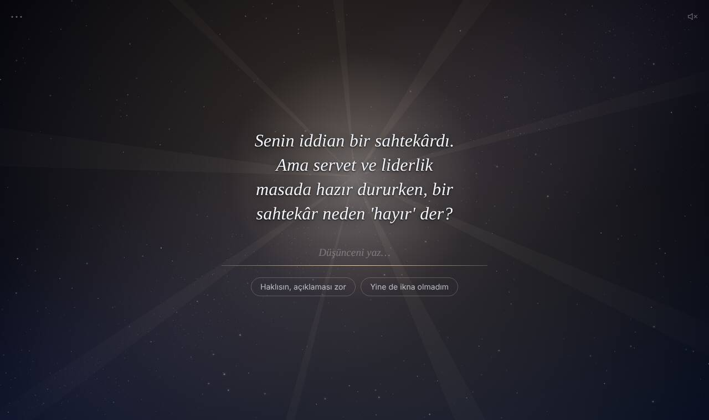

**Satırlar:**

1. Belki derdi iktidardı? Mekke'de bunu ona bizzat teklif ettiler.
2. Kureyş'in önde gelenlerinden biri geldi: 'İstersen servet toplarız, istersen seni başımıza geçiririz.'
3. Tek şart vardı: bu davadan vazgeç.
4. Reddetti. _[vurgu]_
5. Anlatılanlara göre amcasına, gözyaşları içinde şöyle dedi:
6. (metinsiz) _[diyagram: alinti]_

**Soru:** Senin iddian bir sahtekârdı. Ama servet ve liderlik masada hazır dururken, bir sahtekâr neden 'hayır' der?

Çipler: “Haklısın, açıklaması zor” · “Yine de ikna olmadım”

| tür | anahtarlar | hedef |
|---|---|---|
| ikna | haklısın, mantıklı, ikna oldum, katılıyorum, açıklaması zor, kabul ediyorum | samimiyet.kapanis |
| itiraz | strateji, siyasi deha, zeki, dâhi, deha, kurnaz, plan | (yanıt, aynı soru) |
| itiraz | rivayet, sonradan uydurulmuş, nesiller, sonraki nesil, anlatmış, uydurma | (yanıt, aynı soru) |
| itiraz | güç kazandı, güçlendi, devlet kurdu, iktidara geldi, sonradan güç, sonradan zengin | (yanıt, aynı soru) |
| sonraki | — | samimiyet.uzlasma |

**Ek örnekler (2):**

1. Yıllar sonra Mekke'yi fethetti. Kral ilan edilebilirdi; saray yaptırabilirdi. Mekke'yi başkent yapmadı. Medine'ye geri döndü. → _Hükmetmek isteyen biri, en parlak zaferinde neden başkentini bile değiştirmez?_
2. Teklif edenler ona hakaret edenler değildi; Mekke'nin saygın isimleriydi. 'Hayır' demenin bedelini herkes biliyordu: ezilen yoksullar ve köleler onun yanındaydı. → _Güçlüleri değil de en güçsüzleri yanına alan biri, iktidar için mi çalışıyor?_

**Kompozisyon:** Servet teklifini, liderlik teklifini reddeden, zaferde başkenti bile değiştirmeyen biri… iktidar hırsı ile bunu nasıl bağdaştırırsın?

### samimiyet.uzlasma (düğüm S8)

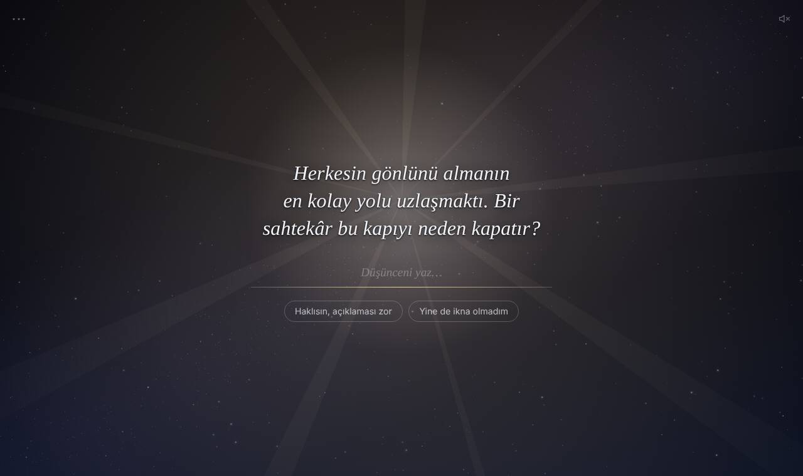

**Satırlar:**

1. Teklifler yalnızca servet değildi. Bir de uzlaşma vardı.
2. Kureyş şunu önerdi: biraz sen bizim ilahlarımıza saygı göster, biz de seninkine.
3. Karşılığında barış, ticaret, itibar: bütün düşmanlıklar biterdi.
4. Cevabı, Kur'an'da Kâfirûn suresi olarak kaldı: 'Ben sizin taptıklarınıza tapmam.' _[vurgu]_
5. (metinsiz) _[diyagram: alinti]_

**Soru:** Herkesin gönlünü almanın en kolay yolu uzlaşmaktı. Bir sahtekâr bu kapıyı neden kapatır?

Çipler: “Haklısın, açıklaması zor” · “Yine de ikna olmadım”

| tür | anahtarlar | hedef |
|---|---|---|
| ikna | haklısın, mantıklı, ikna oldum, katılıyorum, açıklaması zor, kabul ediyorum | samimiyet.kapanis |
| itiraz | strateji, siyasi deha, zeki, dâhi, deha, kurnaz, plan | (yanıt, aynı soru) |
| itiraz | rivayet, sonradan uydurulmuş, nesiller, sonraki nesil, anlatmış, uydurma | (yanıt, aynı soru) |
| sonraki | — | samimiyet.taif |

**Ek örnekler (2):**

1. Aynı tavrı Medine'de de sürdürdü. İsa'nın peygamberliğini ve annesinin temizliğini ilan etti: bu, Yahudilere ağır geldi. İsa'nın ilahlığını reddetti: bu da Hristiyanlara ağır geldi. → _Gücünü artırmak isteyen biri, iki büyük topluluğu aynı anda karşısına alır mı?_
2. Mekke'de amcası Ebu Talib'e baskı yaptılar: 'Yeğenini vazgeçir.' Amcası zorlandı. O ise gözyaşları içinde aynı cevabı verdi. Kırk yaşına kadar hiç kimse onu yalanla itham etmemişti. → _Kırk yıl boyunca doğru bilinmiş biri, birden ağlayarak bir yalan üzerinde mi ısrar eder?_

**Kompozisyon:** Uzlaşma tekliflerini reddeden, hem Mekke'yi hem Medine'yi karşısına alan biri… bu 'siyasi hesap' mı, yoksa gerçekten inanan birinin tavrı mı?

### samimiyet.taif (düğüm S14)

**Satırlar:**

1. Belki beklemeye razıydı: kazanç sonra gelecekti?
2. (metinsiz) _[diyagram: sayac]_
3. Alay, dışlanma, işkence. Sevdiklerini de kaybetti: Hamza, Mus'ab, Cafer.
4. Destek bulmak için Taif'e gitti. Çocuklar peşine takılıp onu taşladı.
5. O gün şöyle dua etti: 'Allah'ım, gücümün zayıflığını sana şikâyet ederim.' _[vurgu]_
6. Bunu yalan olduğunu bilen biri, kimsenin duymayacağı bir yerde neden söylesin?

**Soru:** Senin iddian bir sahtekârdı. Ama on üç yıl boyunca yalnızca bedel ödeyen biri, bu yalandan ne bekliyordu?

Çipler: “Haklısın, açıklaması zor” · “Yine de ikna olmadım”

| tür | anahtarlar | hedef |
|---|---|---|
| ikna | haklısın, mantıklı, ikna oldum, katılıyorum, açıklaması zor, kabul ediyorum | samimiyet.kapanis |
| itiraz | strateji, siyasi deha, zeki, dâhi, deha, kurnaz, plan | (yanıt, aynı soru) |
| itiraz | rivayet, sonradan uydurulmuş, nesiller, sonraki nesil, anlatmış, uydurma | (yanıt, aynı soru) |
| sonraki | — | samimiyet.sohret |

**Ek örnekler (2):**

1. Uhud'da 'Muhammed öldü' diye bir ses yayıldı. Dişi kırılmıştı, yaralıydı. Sonra inen ayet: 'Muhammed ancak bir peygamberdir. Ölürse ya da öldürülürse topuklarınız üstünde mi geri döneceksiniz?' → _Davayı kendi şahsının üstünde gören bu cümle, kişisel bir çıkar peşindeki zihne nasıl sığar?_
2. Kırk yaşına kadar Mekke'de dürüstlüğüyle tanınıyordu. Hira'da yalnız başına ne yapıyordu? Bir kazancı yoktu. → _Hiçbir yalancı, yalan söylemek için kırk yıl beklemez. Bu neden bu kadar geç başladı?_

**Kompozisyon:** On üç yıl boyunca hiçbir kazanç görmeyen, sevdiklerini kaybeden, taşlanan biri… bunun yalan olduğunu nasıl öne sürebilirsin?

### samimiyet.sohret (düğüm S10)

**Satırlar:**

1. Peki derdi şöhretse? Alkış, saygınlık, kusursuz bir lider imajı?
2. O zaman kendi hatalarını duyurmazdı.
3. Oysa okuduğu metinde onu azarlayan cümleler var.
4. Gözleri görmeyen bir adam yanına geldi, o yüz çevirdi. Bu olay metne girdi: 'Yüzünü ekşitti ve çevirdi.'
5. Bir başkasında: 'Allah seni affetsin, onlara neden izin verdin?'
6. Bir diğerinde: 'Neredeyse onlara biraz meyledecektin; o zaman sana kat kat azap tattırırdık.' _[vurgu]_
7. Bu cümleleri kendisi okudu, ezberletti, her gün tekrar ettirdi.

**Soru:** Senin iddian bir sahtekârdı. Ama imajını parlatmak isteyen biri, kendisini azarlayan cümleleri neden herkese okutur?

Çipler: “Haklısın, açıklaması zor” · “Yine de ikna olmadım”

| tür | anahtarlar | hedef |
|---|---|---|
| ikna | haklısın, mantıklı, ikna oldum, katılıyorum, açıklaması zor, kabul ediyorum | samimiyet.kapanis |
| itiraz | strateji, siyasi deha, zeki, dâhi, deha, kurnaz, plan | (yanıt, aynı soru) |
| itiraz | rivayet, sonradan uydurulmuş, nesiller, sonraki nesil, anlatmış, uydurma | (yanıt, aynı soru) |
| itiraz | manevra, taktik, güven kazanmak, dürüst görünmek, siyasi | (yanıt, aynı soru) |
| sonraki | — | samimiyet.tutulma |

**Ek örnekler (2):**

1. Bir örnek daha. Halkı iman etmeyince çok üzülürdü. Ayet inip şunu söyledi: 'Yüz çevirmeleri sana ağır geldiyse… sakın cahillerden olma.' Bu üzüntünün hiçbir siyasi faydası yoktu. → _Masa başında yazılan bir metin, yazarının iç geçirmesine bile böyle bir uyarı koyar mı?_
2. Daha hassas bir örnek: Peygamber'in içinde sakladığı bir şeyi ayet ortaya çıkarır. Ayet onu savunmaz; 'insanlardan çekiniyordun, oysa Allah'tan çekinmen daha uygundu' der. Bu olay, ona yöneltilen en kaba iddiaların dayanağı yapıldı. Ama ayetin tonu savunma değil, uyarı. → _Bir sahtekâr, kendi yazdığı metne bu tonu neden verir?_

**Kompozisyon:** Kendini azarlayan, uyaran, açığa çıkaran cümleleri bile titizlikle okutan biri… şöhret düşkünü bir sahtekâr böyle yapar mı?

### samimiyet.tutulma (düğüm S9)

**Satırlar:**

1. Şimdi dönüm noktası.
2. Küçük oğlu İbrahim vefat etti.
3. Tam o gün, güneş tutuldu. _[vurgu]_
4. İnsanlar fısıldaştı: 'Güneş, İbrahim'in ölümüne tutuldu.'
5. Hüzünlü bir peygamber, sarsılmış bir topluluk, gökyüzünde bir alamet. Bundan güçlü bir fırsat olamaz.
6. O kalktı ve şöyle dedi: 'Güneş ve ay Allah'ın iki ayetidir. Kimsenin ölümü ya da doğumu için tutulmaz.'

**Soru:** Senin iddian bir sahtekârdı. Ama bir sahtekâr, kendi oğlunun ölümünde gökyüzünün bile ağladığını söyleyen kalabalığı neden düzeltir?

Çipler: “Haklısın, açıklaması zor” · “Yine de ikna olmadım”

| tür | anahtarlar | hedef |
|---|---|---|
| ikna | haklısın, mantıklı, ikna oldum, katılıyorum, açıklaması zor, kabul ediyorum | samimiyet.kapanis |
| itiraz | rivayet, uydurma, sonradan eklenmiş, hadis, sonradan uydurulmuş | (yanıt, aynı soru) |
| itiraz | gösteri, oynadı, hesaplı, politika, dürüst görünmek | (yanıt, aynı soru) |
| itiraz | strateji, siyasi deha, zeki, dâhi, deha, kurnaz, plan | (yanıt, aynı soru) |
| sonraki | — | samimiyet.kadin |

**Ek örnekler (2):**

1. Hicret yolunda bir mağaraya saklandılar. Dışarıda onları arayanlar vardı. Ebubekir korktu. Peygamber sakindi: 'Üzülme, Allah bizimle.' Ebubekir ona inanmış biriydi; suç ortağı değildi. → _Yalanını bilen biri, tek tanığının önünde bile neden rolünü bırakmaz?_
2. Gökte bir bulut görünce yüzünün rengi değişirdi. 'Ad kavmi gibi azap olmasın' diye ürperirdi. Yağmur başlayınca rahatlardı. → _Bulutun azap olabileceğinden gerçekten korkan biri, o inancı uydurmuş olabilir mi?_

**Kompozisyon:** Oğlunun ölümünde bile alametten yararlanmayan, bunu açıkça düzelten biri… sahtekârlık bu davranışı nasıl açıklar?

### samimiyet.kadin (düğüm S12)

**Satırlar:**

1. Belki derdi kadındı. Eski Batı anlatıları tam bunu söylerdi.
2. Orta Çağ'ın Avrupa'sında 'şehvet düşkünü sahte peygamber' anlatısı yaygındı.
3. On dokuzuncu yüzyıla kadar bu görüş itirazsız dolaştı; sonra modern tarihçiler bunu bıraktı.
4. (metinsiz) _[diyagram: alinti]_
5. Dürüst olalım: Medine'de birden çok eşi oldu. Bunu geçiştirmiyoruz.
6. Ama aynı eşler onunla birlikte açlık çekti. Onlara, istiyorlarsa ayrılabilecekleri açıkça söylendi.

**Soru:** Senin iddian şehvete kapılmış bir sahtekârdı. Ama bu hayat, o iddianın bekleyeceği hayata benziyor mu?

Çipler: “Haklısın, açıklaması zor” · “Yine de ikna olmadım”

| tür | anahtarlar | hedef |
|---|---|---|
| ikna | haklısın, mantıklı, ikna oldum, katılıyorum, açıklaması zor, kabul ediyorum | samimiyet.kapanis |
| itiraz | strateji, siyasi deha, zeki, dâhi, deha, kurnaz, plan | (yanıt, aynı soru) |
| itiraz | rivayet, sonradan uydurulmuş, nesiller, sonraki nesil, anlatmış, uydurma | (yanıt, aynı soru) |
| itiraz | güç kazandı, güçlendi, devlet kurdu, iktidara geldi, sonradan güç, sonradan zengin | (yanıt, aynı soru) |
| itiraz | evlendi, çok eş, birden çok, evlilikler, siyasi evlilik | (yanıt, aynı soru) |
| sonraki | — | samimiyet.kabile |

**Ek örnekler (2):**

1. Gençliğinin ve olgunluk yıllarının yaklaşık yirmi beş yılını tek bir eşle, Hatice ile geçirdi. Hatice vefat edene kadar başka evlilik yapmadı. → _Şehvet peşindeki biri, hayatının en canlı yıllarını tek eşle mi geçirir?_ [ek]
2. Mekke'nin büyükleri ona, istediği kadınla evlendirmeyi bile teklif ettiler; bu rivayet siyer kaynaklarında geçer. O bu teklifi, diğerleri gibi, reddetti. → _Hazır konan teklifi reddeden birinin derdi kadın mıydı?_ [ek]

**Kompozisyon:** Hatice'yle yirmi beş yıl, sonra bu kadar sade bir hayat… kadın düşkünü bir sahtekâr tablosuna uyuyor mu?

### samimiyet.kabile (düğüm S6)

**Satırlar:**

1. Belki derdi kabileydi: soyunu, halkını yükseltmek.
2. Cahiliye Arabı için soy, atalar ve kan bağı her şeydi.
3. Kolay yol belliydi: 'Atalarımız da doğru yoldaydı' demek. Hem düşman kazanmaz hem destek toplar.
4. O ise şunu dedi: 'Ya atalarınız hiçbir şey anlamayan, doğru yolu bulamamış kimselerse?' _[vurgu]_
5. O toplumda bu, bir tür siyasi intihardı. Kabile korumasını yitiren birinin öldürülmesi cezasız kalırdı.
6. Yeni düzende eski bir kölenin oğlu Usame, ordunun başına geçirildi.

**Soru:** Senin iddian bir sahtekârdı. Ama kabilesini yükseltmek isteyen biri, kabileciliğin tam kalbine neden saldırır?

Çipler: “Haklısın, açıklaması zor” · “Yine de ikna olmadım”

| tür | anahtarlar | hedef |
|---|---|---|
| ikna | haklısın, mantıklı, ikna oldum, katılıyorum, açıklaması zor, kabul ediyorum | samimiyet.kapanis |
| itiraz | strateji, siyasi deha, zeki, dâhi, deha, kurnaz, plan | (yanıt, aynı soru) |
| itiraz | rivayet, sonradan uydurulmuş, nesiller, sonraki nesil, anlatmış, uydurma | (yanıt, aynı soru) |
| itiraz | dini ihtiyaç, zaten bekleniyordu, talep, boşluk | (yanıt, aynı soru) |
| sonraki | — | samimiyet.yuk |

**Ek örnekler (2):**

1. Ebu Zer, Bilal'e kızdı ve 'Ey Habeşli kadının oğlu!' dedi. Peygamber'in cevabı: 'Sende hâlâ cahiliye var.' Soy ve ırk üstünlüğünün en küçük belirtisine bile böyle karşı çıktı. → _Kabile gücüyle büyümek isteyen biri, kendi yandaşını ırk yüzünden neden azarlar?_
2. İstersen en zor örneği de anlatayım; konu bana da ağır. Ölçülü anlatıyorum. Amcası Ebu Talib ölürken, onun için bağışlanma dilemek istedi. İlgili ayet buna izin vermedi. Kendi atalarının durumunu 'cennettelik' diye yumuşatmak hiçbir bedel getirmezdi; yumuşatmadı. Bunun bedelini de ödedi: amcasından sonra himaye kalktı; saldırılar arttı. → _Hiçbir bedeli olmayacak bir yalan varken, bedeli ağır bir sözü seçen biri sahtekâr olabilir mi?_

**Kompozisyon:** Atalara, soya, kabile bağlarına meydan okuyan, bunun bedelini en yakınlarının hâlinden ödeyen biri… 'kabile çıkarı' bunu açıklar mı?

### samimiyet.yuk (düğüm S2)

**Satırlar:**

1. Şimdi başka bir yönden bakalım: getirdiği yük.
2. Sahte peygamberlerin ilk vaadi hep aynıdır: yükü hafiflet.
3. Müseylime bir kabileye namazı kısaltma izni verdi. Tuleyha secdeyi kaldırdı.
4. Muhammed ise içkiyi ve kumarı yasakladı. İçkiyi şiirle öven bir toplumda.
5. Namazı farz kıldı. Yeni Müslümanlar, soylu Kureyşlilerin gözü önünde yere kapanamadı; vadilerde gizlice kıldılar.
6. (metinsiz) _[diyagram: karsilastirma]_

**Soru:** Senin iddian bir sahtekârdı. Ama bir sahtekâr, insanları çekmek varken neden en çok tepki çeken yükleri getirir?

Çipler: “Haklısın, açıklaması zor” · “Yine de ikna olmadım”

| tür | anahtarlar | hedef |
|---|---|---|
| ikna | haklısın, mantıklı, ikna oldum, katılıyorum, açıklaması zor, kabul ediyorum | samimiyet.kapanis |
| itiraz | rivayet, sonradan uydurulmuş, nesiller, sonraki nesil, anlatmış, uydurma | (yanıt, aynı soru) |
| itiraz | disiplin, ordu, kontrol, itaat, strateji, siyasi, plan | (yanıt, aynı soru) |
| sonraki | — | samimiyet.gece |

**Ek örnekler (2):**

1. Sakif heyeti geldi: 'Müslüman olalım, ama namazdan muaf tutul.' Güçlü bir kabile, kendi isteğiyle gelmişti. Peygamber bu şartı kabul etmedi. → _Güçlü bir kabile kapıdayken tek şartı reddetmek, hangi siyasi hesapla örtüşür?_
2. Bu yüklerin hepsi kolay değil: sabah erken kalkış, kışın abdest, uzun yaz günlerinde oruç. Batılı bir tarihçi bile şöyle der: onun dini kolay bir din değildi. → _İnsanları kolay yoldan çekmek varken, zor yolu seçen bir sahtekâr olur mu?_

**Kompozisyon:** İçkiyi yasaklayan, namazı farz kılan, sakif heyetini reddeden biri… 'insanları kendine çekmek için' demek nasıl bir açıklama?

### samimiyet.gece (düğüm S2)

**Satırlar:**

1. Bu yükleri başkalarına yükleyip kendisi yapmayan biri olabilir miydi?
2. Hayır. İlk ve en çok kendisi yaptı.
3. Gece namazı yalnızca ona farz kılınmıştı.
4. O kadar uzun ayakta kalırdı ki, arkasındaki İbn Mesud 'oturmayı düşündüm' der.
5. Orucu bile sahabeye yasakladığı kadar kendine yükledi: aralıksız oruç yalnız ona mahsus bir özellikti.
6. Hepsini, hiç kimsenin izlemediği gecenin içinde. _[vurgu]_

**Soru:** Senin iddian bir sahtekârdı. Ama bir sahtekâr, kimse görmezken bile her gece saatlerce ayakta durup bir yalana mı secde eder?

Çipler: “Haklısın, açıklaması zor” · “Yine de ikna olmadım”

| tür | anahtarlar | hedef |
|---|---|---|
| ikna | haklısın, mantıklı, ikna oldum, katılıyorum, açıklaması zor, kabul ediyorum | samimiyet.kapanis |
| itiraz | strateji, siyasi deha, zeki, dâhi, deha, kurnaz, plan | (yanıt, aynı soru) |
| itiraz | gösteriş, imaj, propaganda, rol, tiyatro | (yanıt, aynı soru) |
| sonraki | — | samimiyet.deger |

**Ek örnekler (2):**

1. İstersen bir deney yap. Bir ay boyunca her gece üçte kalk, dört rekât namaz kıl, sabaha kadar bahane bulma. Çoğumuz birkaç gecede vazgeçeriz. O ise yalnız kendine farz kılınmış bir yükü yıllarca taşıdı. → _Bu kadar yükü, inanmadığı bir şey için taşıması mümkün mü?_
2. Sabah namazından sonra sağ yanına yatıp tesbih ederdi. Bunu eve yalnızca ailesi görürdü; kalabalığa hiçbir faydası yoktu. → _Seyircisiz bir rolü yıllarca oynayan biri, rolünü kime oynuyor?_

**Kompozisyon:** Gece namazını yalnız kendine farz kılan, yıllarca kimsenin görmediği yerde sürdüren biri… yalan bilen birinin davranışı mı bu?

### samimiyet.deger (düğüm S3)

**Satırlar:**

1. Bir toplum önderi, toplumun değerlerine durduk yere dokunmaz.
2. Cahiliyede af, korkaklıktı. Kan davası ise onurdu.
3. Muhammed tam tersini öğretti: kötülüğe karşılığı en güzeliyle ver.
4. Uhud'da amcası Hamza'ya yapılanlar, bir insanın kaldırabileceğinin ötesindeydi.
5. Mekke'yi fethettiğinde, güç elindeyken, bunu yapanları affetti. _[vurgu]_
6. O toplumda bu, kendi yandaşlarının gözünde zayıflık sayılırdı.

**Soru:** Senin iddian siyasi bir önderdi. Ama gücü eline geçince amcasının katilini affeden biri, hangi hesapla bunu yapar?

Çipler: “Haklısın, açıklaması zor” · “Yine de ikna olmadım”

| tür | anahtarlar | hedef |
|---|---|---|
| ikna | haklısın, mantıklı, ikna oldum, katılıyorum, açıklaması zor, kabul ediyorum | samimiyet.kapanis |
| itiraz | rivayet, sonradan uydurulmuş, nesiller, sonraki nesil, anlatmış, uydurma | (yanıt, aynı soru) |
| itiraz | siyaseten, politik, yumuşaklık, siyasi af | (yanıt, aynı soru) |
| sonraki | — | samimiyet.etkilenme |

**Ek örnekler (2):**

1. Kızı Zeynep, Mekke'den göç ederken saldırıya uğradı; çocuğunu düşürdü, sonra vefat etti. Buna sebep olan Hebbâr, sonradan Müslüman olduğunda affedildi. → _Kızının ölümüne sebep olanı affetmek hangi çıkara hizmet eder?_
2. Cömertlik de aynı: cahiliyede cömertlik, gösterişli israf ve soyun övünmesiydi. Veda Haccı'nda Sa'd malının üçte ikisini bağışlamak istedi; Peygamber 'üçte biri bile çok' dedi. Mirasçılarını yoksul bırakmamasını öğütledi. → _Gösterişi yücelten bir toplumun değerini kıran biri, halkın gönlünü hoş etmeyi mi amaçlar?_

**Kompozisyon:** Gücü eline geçtiğinde en yakınına yapılanı affeden, cömertliği israftan ayıran biri… toplumun alkışını mı arıyordu?

### samimiyet.etkilenme (düğüm S9)

**Satırlar:**

1. Bir de şuna bak: ölüm döşeğinde ne söylüyordu?
2. Hastayken halkın önüne çıktı: 'Sırtım ortada. Kimin hakkı varsa gelsin, alsın.'
3. Bilal'e şöyle derdi: 'Ezan oku, içimizi ferahlat.'
4. Son sözlerinden biri: 'Allah'ım, en yüce dost.' _[vurgu]_
5. Bunlar, yalanını bilen birinin son ânı gibi mi duruyor?

**Soru:** Senin iddian bir sahtekârdı. Ama ahireti uydurmuş biri, ölüm döşeğinde hesabı neden bu kadar ciddiye alır?

Çipler: “Haklısın, açıklaması zor” · “Yine de ikna olmadım”

| tür | anahtarlar | hedef |
|---|---|---|
| ikna | haklısın, mantıklı, ikna oldum, katılıyorum, açıklaması zor, kabul ediyorum | samimiyet.kapanis |
| itiraz | strateji, siyasi deha, zeki, dâhi, deha, kurnaz, plan | (yanıt, aynı soru) |
| itiraz | rivayet, sonradan uydurulmuş, nesiller, sonraki nesil, anlatmış, uydurma | (yanıt, aynı soru) |
| sonraki | — | samimiyet.vahiy |

**Ek örnekler (1):**

1. İlk günlerde en yakınındaki Hatice, hiçbir mucize görmeden ona inandı. Onu kırk yıl boyunca tanımıştı. → _Kırk yıl boyunca tanıdığı kocasında yalancı bir ruh görmeyen biri, neyi tanımıştı?_

**Kompozisyon:** Ölüm döşeğinde hakkı olanı çağıran, bulutta bile hesabı düşünen biri… bu, rol yapan birinin hâli mi?

### samimiyet.vahiy (düğüm S9)

**Satırlar:**

1. Peki ilk an? Yalanı planlayan biri o anı nasıl yaşar?
2. Hira'dan zaferle inmedi. Titreyerek eve koştu: 'Beni örtün!'
3. 'Nefsim için korktum' dedi.
4. Planlı bir yalancı bu sahneyi kendi lehine yazardı: nur, melek korosu, müjde.
5. Oysa ilk beş ayet 'oku' ve 'öğretmek' üzerine: peygamberliğe dair tek kelime yok. _[vurgu]_
6. (metinsiz) _[diyagram: alinti]_

**Soru:** Senin iddian bir sahtekârdı. Ama bir sahtekâr, kendi 'büyük günü'nü neden korku ve şüpheyle anlatır?

Çipler: “Haklısın, açıklaması zor” · “Yine de ikna olmadım”

| tür | anahtarlar | hedef |
|---|---|---|
| ikna | haklısın, mantıklı, ikna oldum, katılıyorum, açıklaması zor, kabul ediyorum | samimiyet.kapanis |
| itiraz | rivayet, sonradan uydurulmuş, nesiller, sonraki nesil, anlatmış, uydurma | (yanıt, aynı soru) |
| itiraz | hatice, mucize gördü, hatice mucize | (yanıt, aynı soru) |
| yonlendir | yanıldı, halüsinasyon, hasta, delirdi, epilepsi, kendi kendine, sanrı | fetanet.giris |
| sonraki | — | samimiyet.ikinci |

**Ek örnekler (2):**

1. Bir de ilk ayetlerin içeriği: Batılı bir oryantalistin tespitine göre bu metinde peygamberliği onaylayan bir işaret yok. Planlı bir yalancı ilk manifestosunda planladığı öncelikleri söylerdi. → _Planı olmayan bir giriş, planlı bir yalanın girişi gibi durur mu?_
2. Üstelik Kur'an'ı kendi normal bilincinden ayrı tuttu. Bir tarihçiye göre bu ayrım ona hayati bir şeydi: yoksa görevini sürdüremezdi. → _Kendi sözünü vahiyden ayıran biri, bilerek karıştırmaz mı?_

**Kompozisyon:** Korkuyla eve koşan, 'beni örtün' diyen, ilk ayetlerinde bir iddia bile taşımayan biri… 'planlı yalan' bunu nasıl açıklar?

### samimiyet.ikinci (düğüm S10)

**Satırlar:**

1. Bir de okuduğu metnin sesi var. Kime konuşuyor?
2. Kimi zaman onun adına değil, ona konuşuyor.
3. Vahiy bir süre gecikti. Mekkeliler alay etti: 'Rabbi onu bıraktı.'
4. O zaman şu ayet indi: 'Rabbin seni bırakmadı, sana darılmadı.'
5. Hemen ardından bir emir: 'Yetimi ezme, isteyeni azarlama.' _[vurgu]_
6. Kendi sesi olsaydı, kendine teselli yazıp hemen ardından kendine ödev verir miydi?

**Soru:** Senin iddian bir sahtekârdı. Ama bir sahtekâr, kendi yazdığı metinde kendisini hem uyaran hem teselli eden ayrı bir ses neden kurar?

Çipler: “Haklısın, açıklaması zor” · “Yine de ikna olmadım”

| tür | anahtarlar | hedef |
|---|---|---|
| ikna | haklısın, mantıklı, ikna oldum, katılıyorum, açıklaması zor, kabul ediyorum | samimiyet.kapanis |
| itiraz | rivayet, sonradan uydurulmuş, nesiller, sonraki nesil, anlatmış, uydurma | (yanıt, aynı soru) |
| itiraz | sonradan eklendi, ayrı ses, kurgu, yazar kendi | (yanıt, aynı soru) |
| sonraki | — | samimiyet.kiyamet |

**Ek örnekler (2):**

1. Başka peygamberlerin de yalanlandığı hatırlatılır: 'Ulu peygamberler gibi sabret.' 'Balık sahibi gibi olma' denir: üzüntüden doğan öfke bile yönlendirilir. → _Kendi kendine yazan biri, kendi moral konuşmasına neden 'sabret' emri ekler?_
2. Batılı bir tarihçi şöyle der: Muhammed, Kur'an'ı kendi bilincinden ayırt edebildiğine ikna olmuştu. Bir başkası: vahyi, kişisel düşüncelerinden büyük bir dikkatle ayırdı. → _Bunu hesaplı bir yalancıdan beklemek mümkün mü?_

**Kompozisyon:** Kendi sesinden ayrı bir sese, teselliye ve emre sahip bir metin… kendi kendine yazan biri bunu neden yapar?

### samimiyet.kiyamet (düğüm S11)

**Satırlar:**

1. En son, küçük ama çok şey söyleyen bir an.
2. 75. sure kıyameti anlatır: ölüm, hesap, korku. Anlatı hızla yükselir.
3. Tam ortasında bir cümle girer: 'Vahyi çarçabuk almak için dilini kımıldatma.'
4. 'Onu toplamak ve okutmak bize aittir. Biz onu okuduğumuzda sen okunuşuna uy. Sonra açıklamak da bize aittir.'
5. Ardından sure kaldığı yerden devam eder.
6. Hangi şair şiirini ortasından böyle keser? _[vurgu]_

**Soru:** Senin iddian bir sahtekârdı. Ama masa başında yazılmış bir metnin ortasına, yazan kişi kendini düzelten bir kesinti neden koyar?

Çipler: “Haklısın, açıklaması zor” · “Yine de ikna olmadım”

| tür | anahtarlar | hedef |
|---|---|---|
| ikna | haklısın, mantıklı, ikna oldum, katılıyorum, açıklaması zor, kabul ediyorum | samimiyet.kapanis |
| itiraz | rivayet, sonradan uydurulmuş, nesiller, sonraki nesil, anlatmış, uydurma | (yanıt, aynı soru) |
| itiraz | sonradan eklenmiş, eklenti, araya, sonradan eklendi | (yanıt, aynı soru) |
| sonraki | — | samimiyet.kapanis |

**Ek örnekler (1):**

1. Bu bir istisna değil. Kur'an'ın Peygamber'e hitabı genelde üç parçadan oluşur: uyarı, teselli, emir. Ona yönelik cümlelerin hiçbirinde 'sen harikasın' tonu yok. → _Kendi iddiasını destekleyen bir metin, kendine bu kadar az methiye eder mi?_

**Kompozisyon:** Heyecanlı bir anlatının ortasında kendini susturan bir ses… bunu bile bile yazan biri neden böyle yapar?

### samimiyet.kutsalyalan (düğüm S1)

**Satırlar:**

1. Bir ihtimal daha: bile bile söylenmiş ama iyi niyetli bir yalan.
2. Yani halkı daha iyiye götürmek için bir melek hikâyesi uydurmak.
3. Bu ihtimal ilk bakışta insani görünür. Ama iki şeyi birlikte taşıyamaz.
4. 'İyilik için yalan' diyen, yalanı yönetmek ister: işine gelince kullanır, gelmeyince susar.
5. Oysa ortada yönetilen hiçbir şey yok: kendini azarlayan ayetler, oğlunun ölümünde reddettiği mucize, ağır yükler. _[vurgu]_
6. Yalan, kendi yalancısını bu kadar zora sokmaz.

**Soru:** Senin iddian iyi niyetli bir yalandı. Ama halk için uydurulan bir yalan, neden yalancıyı bu kadar zora sokan şeylerle dolu?

Çipler: “Haklısın, açıklaması zor” · “Yine de ikna olmadım”

| tür | anahtarlar | hedef |
|---|---|---|
| ikna | haklısın, mantıklı, ikna oldum, katılıyorum, açıklaması zor, kabul ediyorum | samimiyet.kapanis |
| itiraz | bruno, diyojen, samimi olmak, fedakar, fedakâr | (yanıt, aynı soru) |
| yonlendir | gerçekten inandı, inandığı için, samimi inanç, kendi inandı | fetanet.giris |
| itiraz | strateji, siyasi deha, zeki, dâhi, deha, kurnaz, plan | (yanıt, aynı soru) |
| itiraz | rivayet, sonradan uydurulmuş, nesiller, sonraki nesil, anlatmış, uydurma | (yanıt, aynı soru) |
| sonraki | — | samimiyet.yuk |

**Ek örnekler (2):**

1. İyi niyetli bir yalancı, davasının yükünü hafifletir; çünkü amacı insanları ikna etmektir. Oysa bu metin zorlayıcı emirlerle dolu: oruç, namaz, içki yasağı. → _İnsanları ikna etmek isteyen iyi niyetli biri, neden en zorlayıcı emirleri seçer?_
2. Kırk yıl boyunca kimse onu yalanla itham etmemişti. 'Emin' diye anılırdı. Sonra aynı insan, birdenbire en büyük yalana mı girişti? → _Yalanla kırk yıl sınanmamış birinin, yalan için ömrünün sonunu ve gücünü harcaması mantıklı mı?_

**Kompozisyon:** İyi niyetli bile olsa, bir yalanın bu kadar kendi aleyhine işlediği bir hayat… sence hangi ölçüyle 'yalan' sayılır?

### samimiyet.kapanis (düğüm S15)

**Satırlar:**

1. Toparlayalım.
2. Diyelim ki bilerek yalan söylüyordu.
3. (metinsiz) _[diyagram: demet]_
4. (metinsiz) _[diyagram: alinti]_
5. (metinsiz) _[diyagram: alinti]_
6. Bu, peygamberliği tek başına kanıtlamaz. Yalnızca bir ihtimali kapatır. _[vurgu]_

**Soru:** Bütün bunlardan sonra: 'bilerek yalan söyledi' demeye devam ediyor musun?

Çipler: “Hayır, artık demiyorum” · “Yine de ikna olmadım”

| tür | anahtarlar | hedef |
|---|---|---|
| ikna | artık demiyorum, demiyorum, ikna oldum, haklısın, kabul ediyorum, mantıklı, açıklaması zor | haber.kalan |
| sonraki | — | haber.kalan |

**Ek örnekler (2):**

1. Bir de Batılı tarihçilerin kendi hükümlerine bak. Biri, modern bir tarihçinin bu hareketin menfaatçi bir sahtekâr tarafından başlatıldığına inanamayacağını söyler.  → _Birbirinden bağımsız bu kadar tarihçi aynı sonuca varmışsa, 'bilerek yalan' teorisi neyi açıklıyor?_
2. Bir de zamanlama: kırk yaşına kadar kimse onu yalanla itham etmemişti. Hiçbir yalancı, yalan söylemek için kırk yıl beklemez. → _Kırk yıl boyunca doğru bilinmiş biri, nasıl birden 'yeryüzünün en büyük yalancısı' olur?_

**Kompozisyon:** Kendi cümlelerinle söyle: zırhı rehinde ölen, teklifleri reddeden, kendini azarlayan ayetleri okutan biri bilerek yalan söylüyor olabilir mi?

**Kapatır:** samimiyet (kullanıcı ikna olursa)

## Bölge: fetanet

### fetanet.giris (düğüm F1)

**Girişte dallan:**

- `{"kapali":"fetanet"}` → `haber.kalan`

**Satırlar:**

1. Diyelim ki şunu söyledin: hâşâ, samimiydi.
2. Yalan söylemiyordu. Gördüğüne gerçekten inanıyordu.
3. Ama gördükleri gerçek değildi.
4. Peki bu tıbben ne demek?
5. Yirmi üç yıl. Gece gündüz. Mutlu günde, yas gününde.
6. Görerek, duyarak, bedeninde hissederek. Ölünceye kadar.
7. Bugünün tıbbında bu, en ağır psikoz tablolarından biridir. _[vurgu]_

| tür | anahtarlar | hedef |
|---|---|---|
| sonraki | — | fetanet.doktor |

### fetanet.doktor (düğüm F1)

**Satırlar:**

1. Bir deney yapalım. Tanıdığın bir doktoru ara.
2. 'Amcam üç aydır melek görüyor,' de.
3. 'Melek ona emirler veriyor. Yapmazsa kötü olacağını söylüyor.'
4. 'Kendini özel biri sanıyor. Gerekirse herkesi ve her şeyi feda edecek.'
5. 'Meleği hem görüyor, hem duyuyor.'
6. Şimdi doktorun yüzüne bak.

**Soru:** Sence doktor bu hikâyeye ne der? _(serbest)_

Çipler: “Ciddi bir rahatsızlık der” · “Bilmiyorum”

| tür | anahtarlar | hedef |
|---|---|---|
| sonraki | — | fetanet.teshis |
| varsayılan | — | fetanet.teshis |

### fetanet.teshis (düğüm F1)

**Satırlar:**

1. Doktor büyük ihtimalle gülmez.
2. Ciddi bir tablo olduğunu söyler.
3. İşte bu yüzden iddia, göründüğünden çok ağır.
4. Senin yerine karar vermeyeceğim. Önce seni dinlemek istiyorum.

**Soru:** Sence ne oldu? _(serbest)_

Çipler: “Hasta olabilir” · “Birinden öğrendi” · “Çok zekiydi, kendini kandırdı” · “Bilmiyorum”

| tür | anahtarlar | hedef |
|---|---|---|
| yonlendir | hasta, hastalik, epilepsi, sara, halusinasyon, hayal, psikoz, deli, akli, nobet, sanri | fetanet.hastalik |
| yonlendir | ogrendi, ogrenmis, birinden, bahira, rahip, yahudi, hristiyan, kitap ehli, cevre, cevresinden, kopya, kopyaladi | fetanet.ogrenme |
| yonlendir | zeki, zekiydi, zeka, dahi, deha, kendini kandirdi, kandirdi | fetanet.zeka |
| yonlendir | bilmiyorum, bilmem, fikrim yok, sen anlat, sen soyle | fetanet.formul |
| sonraki | — | fetanet.formul |
| varsayılan | — | fetanet.formul |

### fetanet.hastalik (düğüm F24)

**Satırlar:**

1. Hastalık dedin. Bunu ciddiye alıyorum.
2. Ama 'hastalık' tek kelime, içinde iki ayrı iddia var.
3. Biri sara: nöbetler, bilinç kaybı, bedenin kasılması.
4. Diğeri halüsinasyon: olmayan bir şeyi görmek, duymak.
5. İkisine de dürüstçe bakacağız.

**Soru:** Sen hangisini kastediyorsun? _(serbest)_

Çipler: “Sara” · “Halüsinasyon”

| tür | anahtarlar | hedef |
|---|---|---|
| yonlendir | sara, epilepsi, nobet, kasilma | fetanet.sara |
| yonlendir | halusinasyon, gorme, duyma, psikoz, hayal, sanri | fetanet.formul |
| sonraki | — | fetanet.sara |
| varsayılan | — | fetanet.sara |

### fetanet.sara (düğüm F24)

**Satırlar:**

1. Sara iddiası yeni değil.
2. Orta Çağ Avrupası'ndan gelir. Sonra bazı Batılı yazarlarda sürdü.
3. Bugün ise ciddi bir savunucusu yok.
4. Sara nöbetinden sonra zihin berrak çıkmaz. Hekimler bunu bilir.
5. Oysa o, vefatından bir hafta öncesine kadar sağlıklıydı.
6. (metinsiz) _[diyagram: alinti]_
7. Batılı bir tarihçi de anlatılan belirtilerin sarayla uyuşmadığını yazar.

**Soru:** Bu tablo, sara ile açıklanabilir mi sence?

Çipler: “Açıklanamıyor gibi” · “Yine de ikna olmadım”

| tür | anahtarlar | hedef |
|---|---|---|
| ikna | aciklanamiyor, olamaz, imkansiz, haklisin, mantikli, evet, ikna oldum, tamam | fetanet.formul |
| itiraz | deli dediler, deli dendi, mecnun, cinnet, deli demisler, delisin | (yanıt, aynı soru) |
| itiraz | deha delilik, dahi deli, ince cizgi, yakin | (yanıt, aynı soru) |
| sonraki | — | fetanet.formul |

**Ek örnekler (3):**

1. Bir dönem bazı Batılı yazarlar histeri dedi. Sonra Fransız nörolog Babinski bu tanının yanlış olduğunu gösterdi. Bir tanı düşünce, genelde bir başkası gelir. O da düştü. → _Tanılar tek tek düşüyorsa, geriye ne kalıyor sence?_
2. Gerçekten nöbetler olsaydı, Mekke'deki muhalifleri düşün. Batılı bir yazar şunu hatırlatır: bundan fazlasıyla yararlanırlardı. Çünkü bunlar, o günün insanlarının çok iyi bildiği şeylerdi. → _Sence muhalifler böyle bir fırsatı kaçırır mıydı?_
3. Bir şey daha. Başarılı birinin hikâyesini dinlerken tıp kitaplarına koşar mıyız? Bir hastalık böyle sonuçlar verseydi, tıp onu tedavi değil, inceleme konusu yapardı. Oysa tarihte hiçbir hastalık böyle bir sonuç vermedi. → _Başarıyı hastalıkla açıklamak sence bir açıklama mı, yoksa bir ön kabul mü?_

**Kompozisyon:** Peki tüm bu verileri birlikte nasıl açıklıyorsun? İstersen kendi cümlelerinle yaz.

### fetanet.zeka (düğüm F1)

**Satırlar:**

1. Çok zeki biri kendini kandırabilir mi? Ciddiye alalım.
2. Zekâ, insanı hataya düşmekten korumaz. Bu doğru.
3. Ama bizim sorumuz biraz farklı.
4. Kendini kandıran biri, 23 yıl aynı şeyi görmeye devam eder.
5. Bu sırada ordu kurar, hukuk koyar, yüzlerce kararı şaşmadan verir.
6. Ağır bir sanrı ile bu kadar berrak bir akıl, aynı kişide, yan yana mı? _[vurgu]_

**Soru:** Zeki biri hem ağır bir sanrı yaşayıp hem bu başarıları sürdürebilir mi sence?

Çipler: “Zor görünüyor” · “Yine de olabilir”

| tür | anahtarlar | hedef |
|---|---|---|
| ikna | zor, olamaz, imkansiz, aciklanamiyor, haklisin, mantikli, tamam | fetanet.formul |
| itiraz | deha delilik, dahi, ince cizgi, yakin, deha ile | (yanıt, aynı soru) |
| sonraki | — | fetanet.formul |

**Ek örnekler (2):**

1. Bir sanrının ürünü olan düzen, sahibi gidince çöker. Ömer, Halid'i görevden aldı. Fetihler durmadı. Ömer vefat etti. Fetihler yine durmadı. İskender, Timur ve Cengiz'de kurucunun ardından büyük parçalanma görülür. → _Bir kişinin hayaline dayanan düzen, ondan sonra bu kadar işler mi?_
2. Uhud'da savaş alanını ustalıkla seçmişti. Batılı bir tarihçi yazar: vaha korunmasız kalsa bile, küçük mevzilerin Mekkelileri oyalayacağını hesaplamıştı. Bu soğukkanlı bir askerî hesap. → _Sanrının içindeki biri böyle hesap yapabilir mi?_

**Kompozisyon:** Zekâ ile ağır psikozu aynı kişide nasıl bir araya getiriyorsun? Kendi sözlerinle anlatır mısın?

### fetanet.ogrenme (düğüm F23)

**Satırlar:**

1. Birinden öğrenmiş olabilir. Bu da ciddi bir ihtimal.
2. Ama bu iddia üç soruya cevap vermek zorunda.
3. Kimden öğrendi? Ne zaman? Neden kimse itiraz etmedi?
4. Yani bir isim, bir zaman ve tanık lazım.
5. En bilinen iddia bir rahip: Bahira. Bir de Yahudi ve Hristiyan çevre.

**Soru:** Hangisinden başlayalım? _(serbest)_

Çipler: “Bahira” · “Yahudi ve Hristiyanlar”

| tür | anahtarlar | hedef |
|---|---|---|
| yonlendir | bahira, rahip, kervan | fetanet.bahira |
| yonlendir | yahudi, hristiyan, kitap ehli, cevre, cevresinden, kiliseden | fetanet.kitapehli |
| sonraki | — | fetanet.bahira |
| varsayılan | — | fetanet.bahira |

### fetanet.bahira (düğüm F23)

**Satırlar:**

1. Bahira hikâyesini muhtemelen duymuşsundur.
2. Önce şunu soralım: bu rivayet ne kadar sağlam?
3. İki ana metin var. Biri hadis kitabında, biri bir siyer kitabında.
4. Hadis kitabındaki metinde Bilal'in adı geçer. Hadis âlimleri bunu açık hata sayar.
5. Üstelik tüm yollar tek bir ravide toplanır. Birbirini desteklemez.
6. Siyer kitabındaki metnin ise zinciri yok. Kimden alındığı bilinmez.
7. Yani elimizde güvenilir bir rivayet yok. _[vurgu]_

**Soru:** Bu kadar zayıf bir rivayetle, 23 yıllık bir sistemi açıklamak sence sağlam mı?

Çipler: “Zayıf görünüyor” · “Yine de ikna olmadım”

| tür | anahtarlar | hedef |
|---|---|---|
| ikna | zayif, olmaz, aciklanamiyor, haklisin, mantikli, tamam, ikna oldum | fetanet.bahira2 |
| sonraki | — | fetanet.bahira2 |

**Ek örnekler (3):**

1. Amerikalı bir Sami dilleri bilgini, Bahira'ya dair Süryanice metinleri inceledi. Hepsini uydurma saydı. Örneğin yazar Bakara suresinin adını duymuş. Bilgi boşluğunu 'inek Kitabı boynuzlarında getirdi' öyküsüyle doldurmuş. Bir okumaya göre bu hikâye, yenilen tarafın teselli anlatısı. → _Rivayetin kaynağı buysa, ona dayanmak sence ne kadar mantıklı?_
2. Eski Müslüman âlimlerin kendisi bu rivayeti sahih saymadı. Oysa olağanüstü yönleri İslam lehine delil olabilirdi. Yani kendi lehlerine olsa bile ilmî ölçüyü bıraktılar. → _Kendi lehindeki rivayeti bile eleyen biri hakkında ne düşünürsün?_
3. Batılı tarihçilerin çoğu bu anlatıyı kendileri de eleştirir. Savunan oryantaliste ise rastlanmaz. Orta Çağ'da 'yoldan çıkmış Hristiyan' söylemi de buradan doğmuş olabilir. → _Bu kadar eleştirilen bir anlatı, sence güvenilir bir temel olabilir mi?_

**Kompozisyon:** Rivayeti kendi başına nasıl değerlendiriyorsun? İstersen kendi cümlelerinle yaz.

### fetanet.bahira2 (düğüm F23)

**Satırlar:**

1. Rivayeti doğru kabul edelim. Hadi bunu bile yapalım.
2. Bir kervan bir konakta kaç gün bekler? Birkaç gün, belki birkaç hafta.
3. O sürede atalar kültünü, ırkçılığın reddini, bütün bir öğretiyi mi öğrendi?
4. Hikâyede Kureyş'in ileri gelenleri de oradaydı.
5. Sonradan şiddetle karşı çıkanlar neden hiç 'orada öğrendin' demedi?
6. Peygamberlik iddiasına yaklaşık yirmi sekiz yıl var. Tek bir şey kaçırmadı mı? _[vurgu]_

**Soru:** Cevabı olmayan bir senaryo, sence tarih mi, yoksa kurgu mu?

Çipler: “Kurgu gibi” · “Yine de olabilir”

| tür | anahtarlar | hedef |
|---|---|---|
| ikna | kurgu, masal, aciklanamiyor, haklisin, mantikli, tamam, ikna oldum | fetanet.devam |
| sonraki | — | fetanet.devam |

**Ek örnekler (2):**

1. Kur'an, kıssaları anlatırken 'öncesinde bunları bilmiyordun' der. Bunu duyanlar arasında, o kervanın tanıkları da vardı. Yalanlayabilirlerdi. Yalanlayan çıkmadı. → _Tanıklar varken itirazın hiç gelmemesi sence neyi gösterir?_
2. Tek başına eğitim aldıysa, bu dikkat çekerdi. İnsanlarla birlikte aldıysa, herkes onun orada olduğunu bilirdi. İkisinde de iz kalırdı. → _Sence bu iki ihtimalden hangisi iz bırakmadan geçebilir?_

**Kompozisyon:** Peki bu iddiayı delille nasıl destekleyebilirsin? İstersen kendi cümlelerinle yaz.

### fetanet.kitapehli (düğüm F11)

**Satırlar:**

1. Yahudi ve Hristiyanlardan öğrendiyse, önce şunu soralım.
2. Araplar onlarla yüzlerce yıldır komşuydu.
3. Ama kırk yıl boyunca, hatta davetin son dönemine kadar, tek tanrıcılığa geçmediler.
4. Gassaniler Bizans'ın, Lahmiler İran'ın komşusuydu. Orada böyle bir atılım olmadı.
5. Temas varsa, bu sıçrama neden yalnız onunla başladı? _[vurgu]_
6. Kıssaların karşılaştırması ayrı bir konu. İstersen oraya birlikte bakarız.

**Soru:** Kıssalara şimdi mi bakmak istersin, yoksa devam mı edelim? _(serbest)_

Çipler: “Kıssalara bakalım” · “Devam edelim”

| tür | anahtarlar | hedef |
|---|---|---|
| yonlendir | kissa, kissalara, tevrat, incil, karsilastir | mucize.giris |
| yonlendir | devam, sonra, gec | fetanet.devam |
| sonraki | — | fetanet.devam |
| varsayılan | — | fetanet.devam |

**Ek örnekler (2):**

1. Bir ilmi öğrenen kişi aşamalardan geçer: hocasını arar, sohbetine devam eder. Bunu çağdaşları bilir. Gizlenemez. Üstelik o dönemin ilim sahipleri sonradan düşmanı olacak kesimdi. Öğrenmiş olsa, bunu ilk onlar duyururdu. Eski bir İslam âlimi böyle der. → _Böyle bir öğrenme sürecinin yıllarca gizli kalması mümkün mü?_
2. Kur'an, çevrenin çok iyi bildiği olaylar için 'sen orada değildin' der. Örneğin Meryem'in kura olayında yanlarında olmadığını söyler. Yalan olsaydı, bu söz kolayca yalanlanırdı. → _Yalanlanabilecek bir sözün hiç yalanlanmaması, sence neyi gösterir?_

**Kompozisyon:** Yahudi ve Hristiyan çevreden öğrenme iddiasını kendi cümlelerinle nasıl savunursun?

### fetanet.devam (düğüm F23)

**Satırlar:**

1. Öğrenme yollarını birlikte gözden geçirdik.
2. Elimizde isim yok, zaman yok, tanık yok.
3. Şimdi bir de başarıların kendisine bakmak gerek.

**Soru:** Başarılara daha önce baktık mı, yoksa şimdi mi bakalım?

Çipler: “Henüz bakmadık” · “Baktık, toparlayalım”

| tür | anahtarlar | hedef |
|---|---|---|
| yonlendir | henuz, bakmadik, basari, bakalim | fetanet.formul |
| yonlendir | baktik, toparlayalim, toparla, ozet | fetanet.kapanis |
| sonraki | — | fetanet.kapanis |
| varsayılan | — | fetanet.formul |

### fetanet.formul (düğüm F1)

**Satırlar:**

1. Hangi yoldan geldiysek, sınav hep aynı.
2. İddia ne olursa olsun, bir insanın başarısı ölçülebilir.
3. Tek bir delile bakacağız: yaptıkları.
4. (metinsiz) _[diyagram: denklem]_
5. Yani vardığı yerden, başladığı yerin payını çıkarıyoruz.
6. Önce toplumun payını, sonra kişinin kendi payını.
7. Geriye kalanı hangi hastalık açıklıyor, ona bakacağız. _[vurgu]_

**Soru:** Bu ölçü sana adil geliyor mu?

Çipler: “Adil gibi” · “Biraz tuhaf”

| tür | anahtarlar | hedef |
|---|---|---|
| ikna | adil, mantikli, evet, tamam, olur, haklisin, kabul | fetanet.toplum |
| itiraz | tuhaf, garip, kuru, ne alaka, saçma, sacma | (yanıt, aynı soru) |
| sonraki | — | fetanet.toplum |

**Ek örnekler (2):**

1. Bir benzetme yapalım. Cep telefonu bile kullanmamış, çok yaşlı biri düşün. 72 yaşında 'Bana Cebrail göründü' diyor. Sonra eğitim almadan, çok karmaşık bir yazılım sistemi ortaya koyuyor. → _Bu başarıyı onun geçmişi açıklar mı?_
2. Burada üç katman var. Biz yalnız en alttakini kullanacağız. Birincisi: başarı belki mucizedir. Şimdilik bunu kenara koyuyoruz. İkincisi: bu şartlardaki biri bunu başarabilir mi? Üçüncüsü: bir hastalık böyle bir başarıyı üretebilir mi? Mucizeyi hiç kabul etmesen de bu son sorunun cevabı değişmez. → _Böyle bir çerçeve sence adil mi?_

**Kompozisyon:** Peki sen bir başarıyı nasıl ölçerdin? Kendi yöntemini yazar mısın?

### fetanet.toplum (düğüm F2)

**Satırlar:**

1. Önce başladığı yere bakalım. Toplumun payı.
2. Batılı bir din tarihçisi yazar: Pers de Bizans da Arabistan'ı işgale değer görmüyordu.
3. Kimse orada yeni bir dinin doğacağını düşünmüyordu.
4. Kabile her şeydi. Kan bağı dışında hiçbir birlik tanınmazdı.
5. Kişilerden bağımsız devlet kavramı yoktu. Arapçada bunu anlatan kelime bile yoktu.
6. (metinsiz) _[diyagram: karsilastirma]_

**Soru:** Bu zeminde 23 yılda böyle bir toplum kurmak, hangi hastalığın işi olurdu sence?

Çipler: “Hiçbirinin” · “Olağanüstü bir lider işi”

| tür | anahtarlar | hedef |
|---|---|---|
| ikna | hicbirinin, hicbiri, hic, imkansiz, olamaz, aciklanamiyor, lider, deha, siyasi, haklisin | fetanet.siyasi |
| itiraz | cengiz, iskender, napolyon, timur | (yanıt, aynı soru) |
| sonraki | — | fetanet.siyasi |

**Ek örnekler (3):**

1. Medine'de kan davalı kabileler vardı. Muhacirler ve Medineliler arasında kardeşlik kuruldu. Hollandalı bir tarihçi şunu aktarır: her muhacir bir Medineli kardeş seçti. Bu bağ öz kardeşlikten güçlü sayıldı. → _Kan bağından başka bağ tanımayan bir toplumda, bu bağı kim kurabilir?_
2. Bir benzetme yapalım. 1650'de Osmanlı'dayız. Bir kişi, 23 yıl içinde ulus devletin toplumsal bağlarını yerleştirebilir miydi? Üstelik ikna ederek, tek tek, silahsız. → _Böyle bir şey o dönemde sence beklenir miydi?_
3. Başlangıçta onu savunan bir sosyal sınıf yoktu. İlk yıllar için bir Batılı tarihçi 'hayal kırıcı' der, muhalefet neredeyse topluydu. Katılımın yavaşlığı, ortada bir toplumsal talep olmadığını gösterir. → _Talebi olmayan bir toplumda, tek bir kişinin sanrısı bunu nasıl başarır?_

**Kompozisyon:** Bu başlangıç şartlarından bu sonuca nasıl varıldığını kendi cümlelerinle anlatır mısın?

### fetanet.siyasi (düğüm F3)

**Satırlar:**

1. Sonra ne oldu? Yirmi üç yıl.
2. (metinsiz) _[diyagram: sayac]_
3. (metinsiz) _[diyagram: zaman]_
4. İlk on üç yıl boyunca silah yok. Yalnızca ikna.
5. (metinsiz) _[diyagram: alinti]_
6. Kan davalı kabileler, tek bir toplum oldu. Güçle değil, fikir ve ahlakla.
7. Üstelik o gidince de dağılmadı.

**Soru:** Senin iddian: ağır bir sanrı yaşıyordu. Veri: bir toplum kurdu. Bu mantıken nasıl bir araya gelir?

Çipler: “Gelmiyor” · “Cengiz Han da yaptı”

| tür | anahtarlar | hedef |
|---|---|---|
| ikna | gelmiyor, olamaz, imkansiz, aciklanamiyor, haklisin, mantikli | fetanet.ongoru |
| yonlendir | cengiz, iskender, napolyon, timur, mogol, han da | fetanet.cengiz |
| sonraki | — | fetanet.ongoru |

**Ek örnekler (3):**

1. Ebubekir halife seçilince ilk konuşmasında şöyle dedi: 'Ben içinizde en iyiniz değilim. Doğru yaparsam yardım edin, yanlış yaparsam düzeltin.' Bu, kendini yücelten bir sanrının sesi mi? → _Sence bu söz hangi tür bir zihinden çıkar?_
2. Batılı bir sosyolog şunu yazar: Yüz yıl sonra torunları, Loire'dan Indus'a uzanan bir dünyayı komuta ediyordu. Kurucu gittikten sonra da fetihler durmadı. Bu kurumsallaşmanın işaretidir. → _Bir sanrı, yüz yıl sonra dünyanın yarısını nasıl yönetir?_
3. Kendisi de bunu sade tutardı. 'Ben kral değilim. Güneşte kurutulmuş et yiyen bir kadının oğluyum.' Mekke fethinden sonra heyecanlanan birine böyle dedi. → _Kendini yüceltme sanrısı olan biri, zafer anında böyle konuşur mu?_

**Kompozisyon:** Bu başarının arkasında ne olabileceğini kendi cümlelerinle anlatır mısın?

### fetanet.cengiz (düğüm F25)

**Satırlar:**

1. Cengiz Han'ı anıyorsun. Kıyas yerinde.
2. Bir şey soracağım. Cengiz'in başarısına bakıp onu sanrılı demiyorsun, değil mi?
3. Başarı bunu gösteriyorsa, aynı ölçü burada da geçerli.
4. Şimdi farklara bakalım. Moğollar, Cengiz'den önce de savaşçıydı.
5. Burada ise savaş sanatını bilmeyen bir toplum vardı. Kendisi de kırk yaşına kadar siyasetle uğraşmadı.
6. Cengiz'in imparatorluğu ölümünden sonra parçalandı. İskender'inki de.
7. Tarihin en etkili yüz kişisini sıralayan Batılı bir yazar, tek karşılaştırılabilir fethin Cengiz'inki olduğunu, ama kalıcı olmadığını yazar.

**Soru:** Cengiz'i başarısına bakıp hasta saymıyorsun. Burada neden saymalıyız?

Çipler: “Haklısın, saymamalıyız” · “Yine de ikna olmadım”

| tür | anahtarlar | hedef |
|---|---|---|
| ikna | haklisin, saymamaliyiz, mantikli, evet, tamam, ikna oldum, sayma | fetanet.ongoru |
| sonraki | — | fetanet.ongoru |

**Ek örnekler (3):**

1. İskender'in babası II. Philip, profesyonel orduyu kurmuştu. Pers seferinin planı bile hazırdı. Hocası Aristoteles'ti. İskender'in başarısını bu zeminle açıklayabilirsin. → _Aynı zemin, Hz. Muhammed'in başarısını açıklar mı?_
2. Sokrates ahlakta büyüktü, ama siyasette mağlup, askerlikte yoktu. Platon öğretisinde büyüktü, ama iktisatta yoktu. Hz. Muhammed'in öğretisi sofra adabından hukuka kadar uzanır. Üstelik uygulandı. → _Bunca alanın tek bir kişide, bir sanrının içinde buluşması sence olası mı?_
3. Bir benzetme: 0'dan 10'a puan verelim. 2 puanlık bir toplumda 9 puanlık eğitim alan, 9 puanlık toplumda aynı eğitimi alanla aynı yere varamaz. Bu bir benzetme. Gerçek bir ölçüm değil. Hz. Muhammed'in toplumu çok düşük puanlıydı. İmkânı da kısıtlıydı. → _Böyle bir koşulda bu seviyeye çıkmak, bir eğitimin ürünü olabilir mi?_

**Kompozisyon:** Cengiz ve İskender ile bu başarı arasındaki farkı kendi cümlelerinle anlatır mısın?

### fetanet.ongoru (düğüm F4)

**Satırlar:**

1. Şimdi geleceğe bakalım.
2. Mekke'de işkence görürken, alay edilirken bile bir vaadi vardı.
3. Bir gün yolcu San'a'dan Hadramevt'e gidecek. Allah'tan ve koyunu için kurttan başka şeyden korkmayacak.
4. Müslümanlar zayıf ve yoksuldu. Muhalifler onlara bakıp alay ederdi: 'Bunlar İran'a vâris olacak!'
5. Hendek'te de alay ettiler: 'Bize İran'ı vaat ediyor, biz tuvalete bile gidemiyoruz.'
6. Vefatından sonraki yirmi yıl içinde Sasani toprakları halifenin hâkimiyetine girdi. _[vurgu]_

**Soru:** Gördüklerinin gerçek olmadığını söylüyorsun. Ama söyledikleri ayrıntısıyla tuttu. Bu nasıl mümkün?

Çipler: “Tesadüf olabilir” · “Açıklamak zor”

| tür | anahtarlar | hedef |
|---|---|---|
| ikna | aciklamak zor, zor, imkansiz, olamaz, aciklanamiyor, haklisin, mantikli | fetanet.hudeybiye |
| itiraz | tesaduf, iyimserlik, iyimser, sans | (yanıt, aynı soru) |
| itiraz | cengiz, iskender, napolyon, timur | (yanıt, aynı soru) |
| sonraki | — | fetanet.hudeybiye |

**Ek örnekler (3):**

1. Bir benzetme yapalım. Bugünün Irak'ında özel eğitim almamış biri doğuyor. Toplumun yapısını değiştiriyor. Ölümünden sonra on yıl içinde Irak, onun öğretisiyle Çin ve ABD'den güçlü hale geliyor. Bu hikâyeyi duysan, ilginç bir olay olarak bakmaz mıydın? → _Böyle birine 'hastaydı' demek sana makul gelir miydi?_
2. Batılı bir tarihçi şunu yazar: Olaylar tarihen sabit olmasa, alay edilen Mekkeli bir peygamberin şehrine muzaffer fatih olarak gireceğine çok az kişi inanırdı. Bunu o gün öngören tek kişi, kendisiydi. → _O gün bu ihtimale sence kaç kişi inanırdı?_
3. Bir şey daha: 'Zarar veremezler' haberi. Tek başına bir adamken Kureyş'e, bütün Arap kabilelerine ve kitap ehline şöyle dedi: 'Beni öldüremezsiniz.' Eski bir İslam âlimi der ki: bu, ancak çok güçlü bir güvenin akıllı bir adamda görülen duruşudur. → _Sanrının içindeki biri, düşmanlarının ortasında bu güveni neye dayandırır?_

**Kompozisyon:** Bu ayrıntılı ve tutan öngörülerin kaynağı sence neydi? Kendi cümlelerinle anlatır mısın?

### fetanet.hudeybiye (düğüm F6)

**Satırlar:**

1. Bir sahneye bak: Hudeybiye.
2. Silahsız umre için yola çıktılar. Mekkeliler izin vermedi.
3. Antlaşma, Müslümanların aleyhine gibi görünüyordu. Sahabenin çoğu öyle sandı.
4. Ömer bile sordu: 'Gerçekten bu bir fetih mi?' Cevap: 'Evet, bu bir fetihti.'
5. (metinsiz) _[diyagram: sayac]_
6. Tüm tecrübeli siyasetçiler yanılırken, o doğru okudu. _[vurgu]_

**Soru:** Bir sanrıda bu hesap nasıl yapılır? Bu doğru okuma nereden gelir?

Çipler: “Şans olabilir” · “Açıklamak zor”

| tür | anahtarlar | hedef |
|---|---|---|
| ikna | aciklamak zor, zor, imkansiz, olamaz, aciklanamiyor, haklisin, mantikli | fetanet.ahlak |
| itiraz | sans, tesaduf, iyi cikti | (yanıt, aynı soru) |
| sonraki | — | fetanet.ahlak |

**Ek örnekler (3):**

1. Batılı bir biyografi yazarı şöyle der: Silahsız umreyle Mekkelileri de silahsızlandırdı. Savaşla elde edilemeyeni, barışla elde etti. → _Bu kadar ince bir hamle, sence bir sanrının ürünü olabilir mi?_
2. Bedir'de bir kamp yeri seçti. Medineli bir sahabi sordu: 'Bu vahiy mi, yoksa senin görüşün mü?' 'Benim görüşüm.' 'O zaman son kuyunun yanına kuralım.' Kabul etti. Vahiy ile kendi fikrini ayırıyordu. → _Sanrının içindeki biri, kendi fikriyle vahyi böyle ayırır mı?_
3. Hendek'e bak. Batılı bir tarihçi bunu üstün bir strateji sayar. Hendek, Mekkelilerin zafer umudu olan süvariye karşıydı. Mekke, bundan sonra bir daha hücum savaşı yapacak gücü bulamadı. → _Hendek gibi bir fikri sanrı mı üretir, akıl mı?_

**Kompozisyon:** Hudeybiye'deki bu tutumu ve sonucunu kendi cümlelerinle nasıl açıklarsın?

### fetanet.ahlak (düğüm F10)

**Satırlar:**

1. Bir de ahlaka bakalım. Önce başladığı yere.
2. Kız çocuklarını diri diri gömmek, yaygın bir gelenekti.
3. Kasıtlı ve kasıtsız öldürme arasındaki fark bile pek yoktu.
4. (metinsiz) _[diyagram: karsilastirma]_
5. Halife Ömer Kudüs'te, patriğin teklif ettiği kilisede namaz kılmadı.
6. Sebebi: sonra Müslümanlar burayı mescide çevirir diye.

**Soru:** Kız çocuğunu gömen bir toplumdan, düşmanın kilisesini koruyan bir ahlak çıktı. Bunu çevre mi açıklıyor, hastalık mı?

Çipler: “İkisi de açıklamıyor” · “Çevre açıklar”

| tür | anahtarlar | hedef |
|---|---|---|
| ikna | ikisi de, aciklamiyor, hicbiri, olamaz, imkansiz, haklisin, mantikli | fetanet.tolerans |
| itiraz | cevre, toplum, ganimet, ekonomi, cikar, yagma, ekonomik | (yanıt, aynı soru) |
| sonraki | — | fetanet.tolerans |

**Ek örnekler (3):**

1. Bizans ordusu toplanıyordu. Müslüman komutan şehirlere yazdı: 'Aldığımız cizyeyi iade edin. Sizi şimdi koruyamıyoruz. Galip gelirsek koruyacağız.' Hristiyanlar dua etti: 'Allah sizi Romalılar üzerine muzaffer kılsın.' → _Çıkarına bakan bir ordu parayı böyle geri verir mi?_
2. Sasani'nin üst düzey bir komutanı, Medine'ye taçla geldi. Halife Ömer'i mescitte yatarken buldu. 'Arapların kralı bu mu? Muhafızsız mı uyuyor?' diye şaşırdı. → _Böyle bir sadelik, nasıl bir zihinden ve nasıl bir eğitimden çıkar?_
3. Düşmanın gözünden Müslümanlara bakalım. Her biri ölümü hayata, alçakgönüllülüğü şaşaaya tercih ediyor. Başkanlarını herhangi birinden ayıramazsın. Namaz vakti herkes abdest alır. → _Bu davranış kendiliğinden mi geliyor, yoksa bir eğitimin ürünü mü?_

**Kompozisyon:** Bu ahlak değişimini kendi cümlelerinle nasıl açıklarsın?

### fetanet.tolerans (düğüm F12)

**Satırlar:**

1. Bir konu daha: başka dinlere davranış.
2. Bunu en iyi, fethedilenlerin kendi yazdıklarından okuruz.
3. Süryani bir Hristiyan yazar, Tanrı'nın onları Romalıların elinden Araplarla kurtardığını yazar.
4. Bir Nasturi patriği, Müslümanlaşan bir şehre sitem eder: Araplar dinimize, rahiplerimize saygı gösteriyor.
5. (metinsiz) _[diyagram: alinti]_
6. Kiliseler bugüne kadar ayakta kaldı. Bu da bir işaret.

**Soru:** Bu hoşgörü çevreden mi geldi, hastalıktan mı, yoksa başka bir kaynaktan mı?

Çipler: “Başka bir kaynaktan” · “Çevreden geldi”

| tür | anahtarlar | hedef |
|---|---|---|
| ikna | baska, kaynak, ogreti, aciklanamiyor, haklisin, mantikli, ikisi de | fetanet.birey |
| itiraz | cevre, cevreden, siyasi, cizye, vergi, kilic, zorla | (yanıt, aynı soru) |
| sonraki | — | fetanet.birey |

**Ek örnekler (2):**

1. Batılı bir tarihçi yazar: Müslümanlar Filistin'i alırken Yahudileri rahat bıraktı. Remle kurulur kurulmaz Yahudiler yerleşti, sinagog yaptı. Meslek kısıtlaması yoktu. Yalnız orduya alınmazlardı. → _Bu davranış, onların çevresinden mi öğrendiği bir şey?_
2. Emesa halkı Herakleios'un ordusuna kapıları kapattı. 'Sizin yönetiminizi, Rumların adaletsizliğine tercih ederiz,' dediler. Bunu söyleyenler Hristiyandı. → _Kendi dindaşlarının orduları yerine fatihleri seçenler hakkında ne düşünürsün?_

**Kompozisyon:** Bu hoşgörünün kaynağı sence ne? Kendi cümlelerinle anlatır mısın?

### fetanet.birey (düğüm F20)

**Satırlar:**

1. Toplum açıklamıyor. Peki birey açıklıyor mu?
2. Başarının son parçası: kişinin kendi şartları.
3. Bir insan, içinde yetiştiği toplumun ufku kadar görür.
4. Toplumdan çıkmıyorsa, kendi eğitiminden çıkıyor olmalı.
5. Eğitimine bakalım: yetiştiği ortama, yazıya, hocalara. _[vurgu]_

| tür | anahtarlar | hedef |
|---|---|---|
| sonraki | — | fetanet.yetisme |

### fetanet.yetisme (düğüm F20)

**Satırlar:**

1. Babası o doğmadan ölmüştü. Mirası beş deve, birkaç koyun, bir köleydi.
2. Altı yaşında annesini de kaybetti.
3. Dedesi, sonra amcası baktı. Bir yetime yapılabilecek, çoğu zaman açlıktan korumaktı.
4. Batılı bir yazar onu Mekke'de ücret ve komisyonla çalışan biri olarak anlatır.
5. Sosyetede yeri yoktu.
6. Kendini öne çıkarmaya hevesli biri de değildi. Batılı bir din tarihçisi bunu özellikle belirtir.

**Soru:** Bu ortamda, özel bir eğitim alacak bir imkân görüyor musun?

Çipler: “Görmüyorum” · “Yine de bir şekilde öğrenmiştir”

| tür | anahtarlar | hedef |
|---|---|---|
| ikna | gormuyorum, yok, aciklanamiyor, haklisin, mantikli, tamam | fetanet.ummi |
| itiraz | hirsli, hirs, one cikmak, one cikmis | (yanıt, aynı soru) |
| sonraki | — | fetanet.ummi |

**Ek örnekler (2):**

1. Mekkeli müşrikler Kur'an hakkında şöyle dedi: 'Bu Kur'an, şu iki şehrin büyük bir adamına indirilseydi!' Yani düşmanları bile onu büyük bir adam saymıyordu. → _Düşmanı bile büyük saymıyorsa, kim onu eğitmiş olabilir?_
2. Kur'an ona şunu hatırlatır: 'Seni yetim bulup barındırmadı mı? Yol bilmezken yöneltmedi mi? Yoksulken zengin etmedi mi?' Bu sözler, onu yakından tanıyanların önünde okundu. → _Yanlış olsaydı, bu sözler sence yalanlanmaz mıydı?_

**Kompozisyon:** Bu koşullarda bu kadar şeyi nasıl başardığını kendi cümlelerinle anlatır mısın?

### fetanet.ummi (düğüm F21)

**Satırlar:**

1. Peki okuma yazma? 'Ümmi' kelimesi tam bunu anlatır.
2. 'Ümm', anne demek. Anadan doğduğu gibi: eğitim almamış.
3. Batılı bir din tarihçisi: okur-yazar olduğuna dair bir kayıt yok.
4. Mektuplarını bile başkasına yazdırırdı.
5. Bilip gizlemiş olsaydı, buna 'el-Emin' demezlerdi.
6. Sözlü eğitim de gizlenemez. Öğrenen kişi hocasını arar, sohbetine devam eder.
7. O dönemin ilim sahipleri, sonradan onun düşmanı olacaklardı. _[vurgu]_

**Soru:** Senin iddian: kendi kendine yanıldı. Veri: toplum, eğitim, hiçbiri açıklamıyor; başarı ise ortada. Bu mantıken nasıl bir araya gelir?

Çipler: “Açıklanamıyor” · “Biri ona öğretmiş olabilir”

| tür | anahtarlar | hedef |
|---|---|---|
| ikna | aciklanamiyor, imkansiz, olamaz, haklisin, mantikli, tamam, ikna oldum | fetanet.kapanis |
| yonlendir | ogretmis, ogretti, ogrenmis, biri, bahira, rahip, yahudi, hristiyan | fetanet.ogrenme |
| itiraz | tuccar, hesap, yazi bilirdi, yazi hesap | (yanıt, aynı soru) |
| sonraki | — | fetanet.kapanis |

**Ek örnekler (3):**

1. Ümmi olduğu halde, bugün bile dünya nüfusunun önemli bir kısmınca ilmin toplandığı bir kitabı getiren kişi sayılır. Bunu bir Lübnan asıllı tarihçi de not eder. → _Eğitimsiz biri bu kadar büyük bir bilgi sistemini nasıl kurar?_
2. Kur'an der: 'Bundan önce kitap okumuyor, sağ elinle yazmıyordun.' Açık çatışma ortamında okundu. Öyle olsaydı, şüphe edenler bunu hemen yüzüne vururdu. İtiraz eden olmadı. → _Böyle bir söze itiraz edilmemesi, sence neyi gösterir?_
3. Bir şey daha: 'Kitap nedir, iman nedir bilmiyordun.' 'Bu kitabın sana vahyolunacağını ummazdın.' Bu sözler, onu yakından tanıyan düşmanların önünde okundu. → _Bunca tanık varken, bu sözlerin yalanlanmaması neyi gösterir?_

**Kompozisyon:** Eğitim yolları kapandığına göre, geriye ne kalıyor? Kendi cümlelerinle yazar mısın?

### fetanet.kapanis (düğüm F27)

**Satırlar:**

1. Toparlayalım. Senin iddian: hâşâ samimiydi, ama yanılıyordu.
2. Yanılıyorsa, bu en ağır tablolardan biri: 23 yıl, her ortamda.
3. Oysa toplum ona ufuk vermiyor. Eğitim ona ufuk vermiyor.
4. Batılı kaynaklar bile: sara tutmuyor, histeri düştü, başarı hastalıkla açıklanamıyor.
5. Plan, hukuk, ahlak, devlet: bunlar sanrının değil, berrak bir aklın işi.
6. Benzerini başaran bir insan gösterebilir misin? _[vurgu]_

**Soru:** Bu verilerle 'samimiydi ama yanılıyordu' iddiası mantıken ayakta durabiliyor mu?

Çipler: “Durmuyor” · “Yine de ikna olmadım”

| tür | anahtarlar | hedef |
|---|---|---|
| ikna | durmuyor, ayakta kalmiyor, ikna oldum, haklisin, mantikli, evet, tamam, kapandi, aciklanamiyor | haber.kalan |
| itiraz | sara, epilepsi, halusinasyon, hastaydi, hasta | (yanıt, aynı soru) |
| itiraz | cengiz, iskender, napolyon, dahi, deha | (yanıt, aynı soru) |
| sonraki | — | haber.kalan |

**Ek örnekler (3):**

1. Tarihin en etkili yüz kişisini sıralayan Batılı bir yazar, Hz. Muhammed'i birinci sıraya koyar. Gerekçesi: hem dinî hem din dışı alanlarda üstün başarı gösteren tek kişi. Üstelik dünyanın geri kalmış bir köşesinde, mütevazı koşullarda doğdu. → _Bu ölçüt, başarıyı bir hastalığa mı bağlar, yoksa başarıyı başarı olarak mı görür?_
2. Bir başka Batılı tarihçi şunu yazar: Dünya tarihinde neredeyse benzeri olmayan bu olaylar zinciri, çağdaşlarında bizden daha büyük bir hayret doğurmalıydı. → _Bu olaylar zincirini bir sanrıyla açıklamak, sence hayreti mi yatıştırıyor, yoksa görmezden mi geliyor?_
3. Bir soru bırakayım. Bu başarıyı beşer takatiyle açıklayan biri, benzerini başaran başka bir beşeri göstermeli. Gösteremezse, bu iş onun takatiyle açıklanamaz. → _Böyle bir örnek aklına geliyor mu?_

**Kompozisyon:** Tüm bu verileri bir araya getirdiğinde 'samimi ama yanılıyordu' iddiasını nasıl savunursun? Kendi cümlelerinle yazar mısın?

**Kapatır:** fetanet (kullanıcı ikna olursa)

## Bölge: mucize

### mucize.giris (düğüm M0)

**Girişte dallan:**

- `{"profil.iddia":"dogru"}` → `mucize.giris-dogru`
- `{"profil.supheTuru":"mucize-yok"}` → `mucize.giris-yok`
- `{"kapali":["samimiyet","fetanet"]}` → `mucize.giris-kapali`

**Satırlar:**

1. Buraya kadar geldin.
2. Şimdi yolun başka bir kapısına bakacağız.
3. Bu kapı, haberin doğruluğuna doğrudan bakar. _[vurgu]_

| tür | anahtarlar | hedef |
|---|---|---|
| sonraki | — | mucize.tanim |

### mucize.giris-kapali (düğüm M0)

**Satırlar:**

1. Yanlış ihtimallerden bir kısmını sen kapattın.
2. Geriye kalan yol artık daha ağır basıyor.
3. Peki ya haberin kendisine doğrudan bakan bir delil olsa? _[vurgu]_
4. Buna mucize diyoruz. Önce ne demek istediğimizi netleştirelim.

| tür | anahtarlar | hedef |
|---|---|---|
| sonraki | — | mucize.tanim |

### mucize.giris-dogru (düğüm M0)

**Satırlar:**

1. “Doğru olabilir” dedin.
2. Bu, dürüst ve cesur bir cümle.
3. Şimdi bu ihtimali doğrudan destekleyen delillere bakalım. _[vurgu]_
4. Dayatma yok. Ben gösteririm, tartmak sana ait.

| tür | anahtarlar | hedef |
|---|---|---|
| sonraki | — | mucize.tanim |

### mucize.giris-yok (düğüm M0)

**Satırlar:**

1. “Mucize yok” dedin.
2. Bu makul bir temkin. Delilsiz kabul etmeni kimse istemez.
3. O yüzden önce mucizenin ne demek olduğunu konuşalım. _[vurgu]_
4. İstersen sonra mucize kelimesini bırakıp yalnızca veriye bakarız.

| tür | anahtarlar | hedef |
|---|---|---|
| sonraki | — | mucize.tanim |

### mucize.tanim (düğüm M1)

**Satırlar:**

1. Mucize, sadece “olağanüstü bir olay” demek değil.
2. İki parçası var.
3. Biri: getirenin kendi şartlarını aşan bir iş.
4. Diğeri: iddiasıyla birlikte gelen bir meydan okuma.
5. (metinsiz) _[diyagram: denklem]_

**Soru:** Biri “yapın bakalım” diye meydan okusa ve kimse yapamasa, bu iddia hakkında ne düşünürdün?

Çipler: “Dikkate değer bulurdum” · “Yine de şüphem olurdu”

| tür | anahtarlar | hedef |
|---|---|---|
| ikna | dikkate değer, ciddiye, düşündürür, anlamlı | mucize.teshis |
| yonlendir | inanmıyorum, mucize yok, olağanüstü olay olmaz, doğaüstü | mucize.haber-felsefesi |
| itiraz | şüphe, kuşku, emin değilim | (yanıt, aynı soru) |
| sonraki | — | mucize.teshis |

**Ek örnekler (2):**

1. Başka bir örnek: bir basketbolcu “üç atışın üçü de girer” diyor. “Yap bakalım” diyorsun. O da “zemin şöyle, pota böyle” diyor. → _Bu tartışmada “yapmamak” ile “yapamamak” arasında bir fark kalır mı?_
2. Bir meydan okuma bin dört yüz yıldır ortada duruyor olsun. Kimse karşılık vermiyor. → _Bu sessizlik sana bir şey söylüyor mu, yoksa sıradan mı?_

**Kompozisyon:** Peki bir iddia, meydan okuma ve cevapsızlık birlikte gelirse, bunu nasıl yorumlarsın?

### mucize.teshis (düğüm M1)

**Satırlar:**

1. Mucizenin birkaç penceresi var.
2. Hepsine birden bakmak zorunda değilsin.
3. Önce sen seç. _[vurgu]_

**Soru:** Seni en çok ne ilgilendirir? _(serbest)_

Çipler: “Dil ve edebiyat” · “Geleceğe dair haberler” · “Eski kıssalar ve tarih” · “Mucizelere inanmıyorum”

| tür | anahtarlar | hedef |
|---|---|---|
| yonlendir | dil, edebiyat, şiir, belagat, güzel söz, üslup, meydan okuma | mucize.belagat-giris |
| yonlendir | gelecek, geleceğe, gayb, haber, tahmin, kehanet, savaş, rum, bizans, öngörü | mucize.rum-giris |
| yonlendir | tarih, kıssa, kıssalar, tevrat, incil, kopya, kopyaladı, eski hikâyeler | mucize.kissa-giris |
| yonlendir | inanmıyorum, mucize yok, mucizelere, olağanüstü, doğaüstü, büyü | mucize.haber-felsefesi |
| varsayılan | — | mucize.rum-giris |

### mucize.rum-giris (düğüm R1)

**Satırlar:**

1. Şimdi sana bir an anlatacağım.
2. Yıl 614. Persler Kudüs'ü aldı.
3. İki büyük devlet vardı: Bizans ve Pers. Biri yıkılıyordu.
4. Persler Suriye'yi, Mısır'ı, Anadolu'nun büyük kısmını almıştı.
5. Karargâhları İstanbul'un karşı yakasında, Üsküdar'a kuruldu.
6. (metinsiz) _[diyagram: zaman]_
7. Hazine boş. Ordu dağınık. Kralın kendisi umutsuz. _[vurgu]_
8. Herkesin gözünde bu devlet bitmek üzereydi.

| tür | anahtarlar | hedef |
|---|---|---|
| sonraki | — | mucize.rum-ayet |

### mucize.rum-ayet (düğüm R2)

**Satırlar:**

1. Tam bu yıllarda, Mekke'de küçük bir topluluk eziliyordu.
2. Hz. Muhammed şu ayetleri okudu:
3. “Rumlar yenildi. Yakın bir yerde. Ama yenilgilerinden sonra galip gelecekler.” _[vurgu]_
4. “Birkaç yıl içinde.” Ayetteki kelime: bid'. Yani üç ile on arası.
5. Müşrikler güldü: “Bize benzeyen Mecusiler, size benzeyen Hristiyanları yendi.”
6. Ebubekir bahse girdi: üç yıl, on deve. Sonra süre on yıla, deve yüze çıktı.
7. Metne bakılırsa ayet 614 ile 618 arasında, Mekke'de indi.
8. (metinsiz) _[diyagram: zaman]_
9. Bu sureyi Mekkî sayan, Batılı araştırmacıların da ortak görüşü.

**Soru:** Bu söz olaydan sonra yazılsaydı, o gün Mekke'de bu alay ve bu bahis olur muydu?

Çipler: “Olmazdı” · “Yine de sonradan yazılmış olabilir”

| tür | anahtarlar | hedef |
|---|---|---|
| ikna | olmazdı, olmaz, mantıklı, haklısın | mucize.rum-tahmin |
| itiraz | sonradan, sonradan yazılmış, eklenmiş, değiştirilmiş, olaydan sonra, nesh edilmiş | (yanıt, aynı soru) |
| itiraz | ne zaman indi, belli değil, tarih belli değil | (yanıt, aynı soru) |
| sonraki | — | mucize.rum-tahmin |

**Ek örnekler (3):**

1. Bir ayrıntı daha: süre üç yıldan on yıla çıkarılmıştı. Üçüncü yılda Herakleios henüz sefere bile çıkmamıştı. → _Süre uzatılmasaydı bahis kaybedilmiş olurdu. Bu ayrıntı sana ne söylüyor?_
2. Ayette bir cümle daha var: “O gün müminler sevinecek.” Ezilen küçük bir topluluk, “ferahlık gelecek” diyor. → _Mekke'de dışlanmış biri, bu ferahlığı neye dayanarak söyler?_
3. Batılı bir araştırmacı şunu yazar:  → _Bu sözü Müslüman olmayan biri yazıyor. Sence neden bu kadar temkinli?_

**Kompozisyon:** Peki alay, bahis, süre ve ayetin zamanı birlikte hangi senaryoyla açıklanır?

### mucize.rum-tahmin (düğüm R3)

**Satırlar:**

1. Şimdi bunu Müslüman kaynaklara değil, Batılı tarihçilere soralım.
2. Persler İstanbul'un karşısında on yıldan fazla ordugâh kurmuştu.
3. Kuzeyden Avarlar ve Slavlar vuruyordu. Herakleios esir düşmekten zor kurtuldu.
4. İçeride iç savaş, boş hazine, vergi vermeyen halk vardı.
5. Mısır'ın gitmesiyle şehrin tahılı da bitti.
6. Herakleios barış istedi, haraç önerdi. Pers kralı reddetti.
7. 619'da başkenti terk edip Afrika'ya kaçmaya hazırlandı. _[vurgu]_
8. Patrik onu kilisede yemin ettirerek vazgeçirdi.
9. Şimdi bir an kendini o günün Mekke'sine koy.

**Soru:** Bu koşullarda Bizans'ın kazanacağına ihtimal verir miydin? Tüm hayatını buna bağlar mıydın?

Çipler: “Vermezdim” · “Bir tahmin olabilir”

| tür | anahtarlar | hedef |
|---|---|---|
| ikna | vermezdim, vermez, hayır, imkânsız, imkansız, zor | mucize.rum-donus |
| itiraz | belliydi, öngörülebilir, şans, öngörü, tesadüf, bir tahmin olabilir | (yanıt, aynı soru) |
| sonraki | — | mucize.rum-donus |

**Ek örnekler (3):**

1. Kralın kendisi bile umutsuzdu. Barış için haraç önerdi. Cevap: hayır. → _Savaşı yöneten kral bile şans tanımıyorsa, Mekke'deki bir kişi neye güvenir?_
2. O gün bahis şirketleri olsaydı, Bizans'a bire yüz verirlerdi. Tarihçiler bunu böyle sezdirir. → _Bire yüz oranla, bütün hayatını ortaya koyar mıydın?_
3. 616'da Mısır gitti. İstanbul'un ekmeği oradan geliyordu. Bedava ekmek dağıtımı durdu. → _Karnı aç bir şehir, bir orduyu sıfırdan nasıl kurar?_

**Kompozisyon:** Peki bu tabloyla “Bizans kazanacak” demeyi, hangi makul gerekçeyle açıklarsın?

### mucize.rum-donus (düğüm R4)

**Satırlar:**

1. Sonra, kimsenin beklemediği şey oldu.
2. Herakleios on bir yıl boyunca başarısızdı.
3. 621'de kilisenin kutsal kaplarını nakde çevirdi, orduyu sıfırdan kurdu.
4. 622'de ilk sefer. Persler Anadolu'dan çıkarıldı.
5. 623–624'te Pers topraklarına girdi. Ateş tapınakları yıkıldı.
6. 627'de Ninova'da son darbe.
7. (metinsiz) _[diyagram: zaman]_
8. Ayetin penceresi: 614'ten 618'e, on yıl ekle. Yani 624 ile 628. _[vurgu]_
9. Üç sefer, tam bu pencerenin içinde.
10. Batılı tarihçiler bu dönemi İskender'in seferlerine benzetir.
11. Sonra Herakleios yine eski uyuşukluğuna döner.

**Soru:** Dar bir süre, tüm belirtilerin tersi, tutan bir sonuç. Bu sana neyi düşündürüyor?

Çipler: “Açıklaması zor” · “Sıradan bir tahmin” · “Tutmasaydı nesh derlerdi”

| tür | anahtarlar | hedef |
|---|---|---|
| ikna | açıklaması zor, açıklayamıyorum, etkileyici, hayret, düşündürüyor, tesadüf olamaz | mucize.rum-kehanet |
| yonlendir | nesh, tutmasaydı, tutmayabilirdi | mucize.rum-nesh |
| yonlendir | kehanet, nostradamus, baba vanga, vanga, falcı, sıradan bir tahmin, tahmin | mucize.rum-kehanet |
| itiraz | toparlanma, toparlandı, sıradan, askerî, askeri, normal | (yanıt, aynı soru) |
| sonraki | — | mucize.rum-kehanet |

**Ek örnekler (3):**

1. On bir yıl başarısız. Altı yıl parlak. Sonra yine uyuşuk. Batılı bir tarihçi bu garipliğin sebebini sorar ve kendisi bulamaz. → _Tarih, bu keskin değişimin zamanlamasını neye bağlayabilir?_
2. Bir risk hesabı yapalım. Tutmazsa: müşrikler elini güçlendirir, mesajın itibarı biter. → _Biri yanılma ihtimali bu kadar yüksekken, iddiasını bu tahmine neden bağlar?_
3. Bir şey daha: ayette net bir yıl yok. Sonradan yazılsaydı, kesin tarih yazılırdı. → _Belirsiz bir aralık vermek, olaydan sonra yazıldığı fikriyle uyuşur mu?_

**Kompozisyon:** Peki “bir tahmin”, “tesadüf” ve “sonradan yazıldı” demenin hangisi bu tabloyu tek başına açıklar?

### mucize.rum-nesh (düğüm R6)

**Satırlar:**

1. En sık itirazlardan biri: “Tutmasaydı nesh derdiniz.”
2. Dört kısa cevap.
3. Bir: bu bir varsayım. Varsayım delil değildir.
4. İki: nesh hükümlerde olur. “Şöyle olacak” türü haberlerde olmaz.
5. Üç: sürekli yanılan birini, düşmanı da dostu da sessizce taşır mıydı?
6. Dört: tutmayan tahmine “Allah fikrini değiştirdi” diyenler tarihte bilinir.
7. O başka bir şey: ona “beda” denir, nesh değil.

**Soru:** Bir lider sürekli yanlış açıklama yapsa, çevresi bunu yıllarca sessizce kabul eder miydi?

Çipler: “Etmezdi” · “Edebilirdi”

| tür | anahtarlar | hedef |
|---|---|---|
| ikna | etmezdi, etmez, mantıklı, haklısın | mucize.rum-kehanet |
| itiraz | edebilirdi, olabilir, yine de | (yanıt, aynı soru) |
| sonraki | — | mucize.rum-kehanet |

**Ek örnekler (2):**

1. Bugünün bir siyasi lideri düşün. Sürekli yanlış öngörüyor ve her seferinde “değişti” diyor. → _Böyle birini, hayatını tehlikeye atarak kim yıllarca savunur?_
2. Tarihte sahte mehdilik iddiaları da oldu. Tutmayan tahminlerine “fikir değişti” dediler; bu kayıtlar bize ulaştı. → _Tutmayan tahminler bize ulaşıyorsa, Rum öngörüsü neden tutan taraftan ulaşıyor?_

**Kompozisyon:** Peki “nesh derdiniz” itirazı, bu olguyu ortadan kaldırıyor mu?

### mucize.rum-kehanet (düğüm R7)

**Satırlar:**

1. Bir itiraz daha: “Bu kehanet. Baba Vanga da, Nostradamus da yapıyor.”
2. Güzel. O zaman ölçelim.
3. Beş şart koyuyorum. Bir kehanet hepsini sağlıyorsa, ciddiye alırım.
4. Bir: konu herkesçe bilinen, iki büyük devletin kaderi. _[vurgu]_
5. İki: net bir zaman aralığı. “Bir ateş çıkacak” türü sis değil. _[vurgu]_
6. Üç: beklentinin tam tersi. _[vurgu]_
7. Dört: binlerce tahminden tutan tek biri değil. _[vurgu]_
8. Beş: söyleyenin kırk yaşına kadar tek bir kehanet iddiası yok. _[vurgu]_

**Soru:** Bu beş şartı birlikte sağlayan bir kehanet örneği biliyor musun?

Çipler: “Bilmiyorum” · “Bir örnek var”

| tür | anahtarlar | hedef |
|---|---|---|
| ikna | bilmiyorum, bilmem, hayır, yok, haklısın, ikna oldum, mantıklı, evet haklısın, katılıyorum, tanımıyorum, tanımam, rastlamadım, duymadım, bulamadım, örnek yok, hayır tanımıyorum | kapanis.giris |
| itiraz | bir örnek var, örnek var, var | (yanıt, aynı soru) |
| sonraki | — | mucize.devam |

**Ek örnekler (3):**

1. Bir deney önereyim. Sosyologlar, psikologlar, filozoflar bir heyet kursun. Yakın bir tarih verip, herkesin beklentisinin tersini ilan etsinler. → _Karizmasını ve itibarını riske atarak bunu yapacak birini tanıyor musun?_
2. Hz. Muhammed'i nereye koyacaksın? Kâhin mi, siyasi dahi mi, hâşâ halüsinasyon gören biri mi? → _Bu üç kategoriden hangisi, böyle bir tahmini kendi içinde tutarlı biçimde açıklar?_
3. Bir fark daha: tahmin edenlerin çoğu çok tahmin yapar, bazısı tutar. Burada tek bir tahmin var ve her şey ona bağlı. → _Bol tahminden biri tutmakla, tek tahmine her şeyini bağlamak aynı şey mi?_

**Kompozisyon:** Peki tüm bu verileri — dar süre, tersine tahmin, tek hamle, şartlar — birlikte nasıl açıklıyorsun?

**Kapatır:** mucize (kullanıcı ikna olursa)

### mucize.belagat-giris (düğüm M1)

**Satırlar:**

1. Şimdi dile bakalım.
2. Kur'an kendisi bir meydan okur: “Benzerini getirin.” _[vurgu]_
3. Ayetteki kelime: “misl”. Çoğu çeviri “benzer” der.
4. Ama misl, “denk” demektir. Taklit değil, eşdeğer bir eser.
5. Türkçede de öyle: “Messi'nin misli Ronaldo'dur” denir. Benzemez, denktir.
6. Yani taklit gerekmiyor. Kendi özgün eserinle de yarışabilirsin.
7. Tek şart: denk eser, içerik ve etki bakımından da denk olmalı.

**Soru:** Biri “Ben de yaparım, sadece denemiyorum” dese, böyle bir meydan okumada bu ne anlama gelir?

Çipler: “Yapmamak, yapamamak demek” · “Bu bir bahane”

| tür | anahtarlar | hedef |
|---|---|---|
| ikna | yapamamak, yapamıyor, bahane, anlamı yok, haklısın | mucize.belagat-siir |
| itiraz | taklit, benzeri olamaz, edebî eser, edebi eser | (yanıt, aynı soru) |
| itiraz | yüzyıllar, sonra, benim eserim, gelecekte | (yanıt, aynı soru) |
| itiraz | şartlarım, şartlar, imkân, imkan | (yanıt, aynı soru) |
| itiraz | şiirden anlamam, anlamayız, anlamam | (yanıt, aynı soru) |
| itiraz | ben de yaparım, denemiyorum | (yanıt, aynı soru) |
| sonraki | — | mucize.belagat-siir |

**Ek örnekler (3):**

1. Çağdaşlar denedi. Müseylime hitabet yeteneği olan biriydi. Batılı bir yazar, onun “Kur'an”ının değerinin sıfır olduğunu yazar. → _Deneyip de sonuç çıkaramayan çağdaşlar için ne düşünürdün?_
2. Onlar edebî yolu bırakıp savaşın pahalı yolunu seçti. Kur'an onların lafını da aktarır: “İstesek biz de söyleriz.” → _“İstesek biz de söyleriz” diyen, söylemediğinde ne anlaşılır?_
3. Bir basketbol hatırlatması: “üç atışın üçü de girer” diyen biri. “Yap” denince “zemin yanlış” diyor. → _Bu savunma, iddiayı güçlendirir mi, zayıflatır mı?_

**Kompozisyon:** Peki “denk eser” meydan okumasına yıllarca cevap verilmemesini nasıl yorumlarsın?

### mucize.belagat-siir (düğüm M1)

**Etiket: ek (kitap dışı)**

**Satırlar:**

1. Peki bu meydan okuma kime yapıldı?
2. Şiirin “her şey” olduğu bir topluma. _[vurgu]_
3. Şair, gazeteci, tarihçi ve sözcü yerine geçerdi.
4. Bir hiciv, bir kabileyi yıkabilirdi. Şairler kiralanırdı.
5. Batılı bir tarihçi, Ukaz panayırını bir “Fransız Akademisi”ne benzetir.
6. Arapça da şiire en elverişli dildi. Batılı yazarlar bunu yazar.
7. Yani meydan okuma, toplumun en güçlü olduğu alana yapıldı.

**Soru:** Bir toplum en güçlü olduğu alanda sınanıyor ve kimse cevap veremiyor. Sen bunu nasıl yorumlarsın?

Çipler: “Gerçek bir üstünlük” · “Başka sebepler olabilir”

| tür | anahtarlar | hedef |
|---|---|---|
| ikna | üstünlük, gerçek, aciz, cevap veremedi, haklısın | mucize.belagat-nebi |
| itiraz | başka sebep, ilgilenmedi, önemsemedi, olabilir | (yanıt, aynı soru) |
| sonraki | — | mucize.belagat-nebi |

**Ek örnekler (3):**

1. Bir anı aktarılır: Fransız bir müzisyen, Kur'an'ın şiir değil düzyazı olduğunu öğrenmiş. “Düzyazıda ritim olmaz. Burada var. Bir harf çıksa kulak tırmalar,” demiş. → _Düzyazı olup ritmi bu kadar belirgin bir metin hangi kategoriye girer?_
2. Bir test öner: Türkçede Mehmet Akif'in Çanakkale şiirinin üstünde bir eser. Yabancıları bile müzikaliteyle etkileyen, tarih yazan bir metin. → _Bunu bir heyet bugün yapabilir mi? Yapabilirse neden yapmıyor?_
3. Mekke'nin tanınmış bir şiir bilgini, dinlediği ayetler için “şiire de kâhin sözüne de benzemiyor” demiş. Sonra kavmine bir etiket bulmak için “sihir” demiş. → _Bir şiir uzmanı, bu metni şiir kategorilerine koyamıyorsa ne anlaşılır?_

**Kompozisyon:** Peki şiirin hükümran olduğu bir toplumda cevap verilememesi, tüm bu verilerle nasıl açıklanır?

### mucize.belagat-nebi (düğüm M1)

**Satırlar:**

1. Şimdi daha ince bir soru: bunu söyleyen kimdi?
2. Kırk yaşından önce şiirle ilgilendiğine dair tek bir kayıt yok. _[vurgu]_
3. Bir savaşta iki dize şiir okurken vezni bozduğu aktarılır.
4. Ebubekir: “Biz ona şiir öğretmedik; zaten ona yakışmazdı.”
5. (metinsiz) _[diyagram: karsilastirma]_
6. Arapça bilmesen de, ikincisinde ritmin bozulduğunu duyarsın.
7. Batılı bir araştırmacı: şiire kulağı yoktu, kabile nağmelerini bile geç ezberledi.
8. Bir başka Batılı yazar: düşmanlar vahiylerin sahte olduğunu iddia etmedi.
9. Açıklayamadıkları bir şey olduğu belliydi.

**Soru:** Şiire kulağı olmayan biri, şiirin hükümran olduğu toplumu aciz bırakan bir metni nasıl yazar?

Çipler: “Açıklaması zor” · “Bilinçaltından gelmiş olabilir”

| tür | anahtarlar | hedef |
|---|---|---|
| ikna | açıklaması zor, açıklayamıyorum, zor, aciz, haklısın, ikna oldum, mantıklı, katılıyorum | kapanis.giris |
| itiraz | bilinçaltı, bilinçaltından, ilham, içinden geldi | (yanıt, aynı soru) |
| sonraki | — | mucize.devam |

**Ek örnekler (3):**

1. Kur'an da bunu söyler: “Ona şiir öğretmedik, yakışmazdı.” Bir şair kendini böyle tanımlar mı? → _Bu cümle, bir metnin kendi kaynağını gizlemesine mi benziyor, yoksa dürüst bir tespite mi?_
2. Batılı bir yazar, gündelik hayatında belagatının izini bulamaz. Kısa bir dönem “hayranlık verici” metinler çıktığını yazar. → _Aynı kişide hem sıradan konuşma hem bu üslup bir arada nasıl açıklanır?_
3. Bir hatırlatma: bu, mucizelerin en katmerlisi. Şiirle ilgisi olmayan biri, şiirin hükümran olduğu toplumda, şiire en uygun dilde. → _Üç şart bir arada gelirse, tesadüf ne kadar makul kalır?_

**Kompozisyon:** Peki şiirden uzak biri, vezni bozan biri, bu metni kendi başına nasıl üretmiş olabilir?

**Kapatır:** mucize (kullanıcı ikna olursa)

### mucize.kissa-giris (düğüm M4)

**Satırlar:**

1. Şimdi tarihe bakalım. Çok duyulan bir iddia var.
2. “Kur'an, Tevrat'tan ve İncil'den kopyalandı.” _[vurgu]_
3. Güzel bir iddia, çünkü test edilebilir.
4. Kopyalayan biri metni de kopyalar, hatalarını da.
5. O yüzden iki metni yan yana koyacağız.

**Soru:** Bir metni kopyalayan, onun hatalarını da kopyalar. Bu sana makul geliyor mu?

Çipler: “Evet, genelde öyle olur” · “Düzeltip de kopyalayabilir”

| tür | anahtarlar | hedef |
|---|---|---|
| ikna | evet, genelde öyle, makul, katılıyorum, haklısın | mucize.kissa-yusuf |
| itiraz | düzeltip, düzelt, düzeltebilir | (yanıt, aynı soru) |
| itiraz | köle, köleler, bir beşer, hristiyan bir, öğretti | (yanıt, aynı soru) |
| itiraz | varaka | (yanıt, aynı soru) |
| itiraz | yazılı, okudu, kütüphane, kitaptan | (yanıt, aynı soru) |
| sonraki | — | mucize.kissa-yusuf |

**Ek örnekler (3):**

1. Batılı akademisyenlerin Kur'an kaynakları listesi 24 sayfa tutar. Yalnız kutsal kitapları okumak için altı dil gerekir. → _Okuma yazması olmayan biri, bu kitaplığı hangi kütüphanede gezmiş olabilir?_
2. Apokrif metinlerin çoğu 1945'te Mısır'da bulundu. Daha önce yok edilmiş sayılırlardı. → _O coğrafyada ne yazılı ne sözlü bilinemeyecek metinler nasıl aktarılmış olur?_
3. Aynı ismin iki metinde geçmesi, alıntı kanıtı değil. 1980 darbesini anlatan herkes Kenan Evren'i yazar. → _O halde Âdem'in adının iki kitapta geçmesi neyi kanıtlar?_

**Kompozisyon:** Peki “kopyalandı” iddiasını, hataları ve farkları birlikte düşününce nasıl tartarsın?

### mucize.kissa-yusuf (düğüm M6)

**Satırlar:**

1. Yusuf kıssasına bakalım. İki anlatı, yan yana.
2. Metne saygıyla bakıyoruz; yalnız karşılaştırıyoruz.
3. (metinsiz) _[diyagram: karsilastirma]_
4. Kur'an anlatısı kendi içinde tutarlı.

**Soru:** Kopyalayan biri hatayı bırakıp tutarlısını nasıl yazmış olur?

Çipler: “Kur'an tutarlı görünüyor” · “Fark küçük bir ayrıntı”

| tür | anahtarlar | hedef |
|---|---|---|
| ikna | kur'an tutarlı, tutarlı, haklısın, mantıklı, zor | mucize.kissa-adem |
| itiraz | küçük, ayrıntı, aynı kişi, aynı isim, aynı hikâye | (yanıt, aynı soru) |
| sonraki | — | mucize.kissa-adem |

**Ek örnekler (2):**

1. Eyyub kıssası. Eldeki metinde Eyyub doğduğu güne lanet eder. Kur'an'da Eyyub baştan sona sabır timsalidir. → _Kopyalayan, bir figürün karakterini neden bu kadar baştan yazsın?_
2. Eldeki metinde bazı peygamberlere ağır ifadeler atfedilir. Kur'an bunları nakletmez. → _Kopyalayan bunları neden dışarıda bırakırdı?_

**Kompozisyon:** Peki aynı kıssada üç ayrı noktada farklılık, kopyalama fikriyle birlikte nasıl yorumlanır?

### mucize.kissa-adem (düğüm M6)

**Satırlar:**

1. Şimdi Âdem'e gelelim.
2. (metinsiz) _[diyagram: karsilastirma]_
3. Eldeki metni okuyan biri sorabilir: yılan mı doğru söyledi?
4. Kur'an anlatısında bu soru doğmaz. Şeytan yalan söyler. _[vurgu]_

**Soru:** Kopyalayan, teolojik bir çelişkiyi bilerek düzeltmiş olabilir mi? Peki neye dayanarak?

Çipler: “Düzeltmiş olması zor” · “Başka kaynak olabilir”

| tür | anahtarlar | hedef |
|---|---|---|
| ikna | düzeltmiş olması zor, zor, mantıklı, haklısın, açıklayamıyorum | mucize.kissa-yaratilis |
| itiraz | başka kaynak, şifahi, rivayet, sözlü | (yanıt, aynı soru) |
| sonraki | — | mucize.kissa-yaratilis |

**Ek örnekler (2):**

1. Doğuma bakalım. Bir anlatıda doğum sancısı günahın cezasıdır. Kur'an'da anneye hakkı hatırlatan bir ahlak dersidir. → _Aynı konu, iki anlatıda bu kadar farklı bir ders verir mi?_
2. “Hepsi aynı İbrahimî gelenek” denir. Ama kıssa kıssa bakınca farklar küçük değil. → _Ortak bir gelenek, bu kadar sistematik bir ayrılığı nasıl taşır?_

**Kompozisyon:** Peki Yusuf, Eyyub ve Âdem'de aynı yönde fark görünce, bunu nasıl açıklarsın?

### mucize.kissa-yaratilis (düğüm M6)

**Satırlar:**

1. Yaratılışa gelelim. İki cümle yeter.
2. (metinsiz) _[diyagram: karsilastirma]_
3. Bu cümleler, eski bir anlatının doğrudan düzeltmesi gibi okunur. _[vurgu]_

**Soru:** Bu cümleler eski bir metnin kopyası gibi mi duruyor, yoksa onu düzelten bir ses gibi mi?

Çipler: “Düzeltme gibi” · “Tesadüf olabilir”

| tür | anahtarlar | hedef |
|---|---|---|
| ikna | düzeltme gibi, düzeltme, düzelten, haklısın, mantıklı | mucize.kissa-sonuc |
| itiraz | tesadüf, olabilir, yine de | (yanıt, aynı soru) |
| sonraki | — | mucize.kissa-sonuc |

**Ek örnekler (2):**

1. İnsanın yeryüzü tarihi: Tevrat'ın soy kütükleri, Âdem'i yaklaşık 37 asır geriye koyar. Bilimsel kalıntılar çok daha eskiye gider. Kur'an böyle bir tarih vermez. → _Kur'an'ın bu tarihi vermemesi bir tesadüf olabilir mi?_
2. Fransız bir doktor, İncil ve Kur'an'ı bilimle karşılaştırdı. Bilimsel eleştiri alan konulardan hiçbirini Kur'an'da bulamadı. → _Hatalı bilgiler tek tek ayıklanmış olabilir mi? Kim tarafından?_

**Kompozisyon:** Peki dinlenme, direkler, tarih: üç alanda aynı yönde fark. Bunu nasıl yorumlarsın?

### mucize.kissa-sonuc (düğüm M7)

**Satırlar:**

1. Toparlayalım.
2. Kur'an hiçbir kıssada Tevrat'ın kopyası değil. _[vurgu]_
3. Ya sorunlu yeri anlatmaz, ya düzelterek anlatır.
4. “Mekke'de şifahi anlatı vardı” diyen, o anlatıyı göstermeli.
5. Gösteremiyorsa, “açıklayamıyoruz, o halde vardır” demiş olur. Bu delil değil.
6. Üstelik Kur'an der ki: “Bunları ne sen ne kavmin biliyordunuz.”

**Soru:** Kopyalamadığı, hataları da taşımadığı bir anlatıyı, okuma yazması olmayan biri nereden getirmiş olabilir?

Çipler: “Açıklaması zor” · “Mekke'de bilinen anlatılardan”

| tür | anahtarlar | hedef |
|---|---|---|
| ikna | açıklaması zor, açıklayamıyorum, zor, haklısın, ikna oldum, mantıklı, katılıyorum | kapanis.giris |
| itiraz | mekke, şifahi, sözlü, bilinen, dolaşıyordu | (yanıt, aynı soru) |
| sonraki | — | mucize.devam |

**Ek örnekler (3):**

1. Bir okuma olarak: Kur'an ölen firavun için “gök ve yer ağlamadı” der. Eski Mısır'ın bir ritüel metni ise “gökler ve yer senin için ağlar” der. → _O yazıların okunamadığı bir çağda, bir ritüel metne kelimesi kelimesine cevap nereden gelir?_
2. Bir ayet der ki: “Tevrat'ı getirip okuyun.” Atıf yapılan pasaj, Kur'an'ın söylediğini doğrulayan bir ayrıntı taşır. → _Yazılı bir pasaja bu kadar isabetli atıf, sözlü rivayetle mümkün mü?_
3. Bir kelime daha: “Râ'inâ demeyin.” Eski İbranice bir sözün hakaret çağrışımı taşıdığı yorumlanır. → _Başka bir dilin gizli hakaretini fark etmek hangi bilgiyi gerektirir?_

**Kompozisyon:** Peki tüm bu kıssa verilerini — düzeltmeler, atıflar, bilgi düzeyi — birlikte nasıl açıklarsın?

**Kapatır:** mucize (kullanıcı ikna olursa)

### mucize.haber-felsefesi (düğüm M9)

**Satırlar:**

1. “Mucizelere inanmıyorum” demek meşru bir tutum.
2. Mucize kelimesini bir kenara koyalım.
3. Hiç gitmediğin bir şehrin varlığını nasıl biliyorsun?
4. Haberle. Bildiklerimizin çoğu haberdir. _[vurgu]_
5. Kalabalık bir topluluğun yalanda birleşemeyeceği haber bilgi verir. Buna “mütevatir” denir.
6. Mucize haberleri tek tek zayıf olabilir. Ama hepsi ortak bir şeyi söyler.
7. “Olağanüstü olaylar oldu.” Ortak anlam sayısız ağızdan geliyor.
8. Bu bir dayatma değil. Sadece soruyorum: haber nasıl bilgi olur?

**Soru:** Hiç görmediğin bir şehri haberle kabul ediyorsun. Aynı ölçüyü burada da uygulamak sana makul geliyor mu?

Çipler: “Makul geliyor” · “Konu farklı”

| tür | anahtarlar | hedef |
|---|---|---|
| ikna | makul geliyor, makul, mantıklı, haklısın, uygulanabilir | mucize.sihir |
| yonlendir | geleceğe, rum, bizans, kehanet | mucize.rum-giris |
| yonlendir | dil, edebiyat, şiir, belagat | mucize.belagat-giris |
| itiraz | konu farklı, farklı, olağanüstü, doğaüstü | (yanıt, aynı soru) |
| sonraki | — | mucize.sihir |

**Ek örnekler (3):**

1. Düz dünya meselesi. Fizikçi değilsen, nasıl reddedersin? Çoğumuz: “Bu kadar bilim insanı neden yalan söylesin?” deriz. → _Bu, haber ölçütüne dayanmıyor mu?_
2. Psikologlar, bir ünlü deneyi çoğu zaman tekrar etmeden kabul eder. Bilimin ilerlemesi de bu güvenle olur. → _Güvene dayanan bilgi, bilgi sayılmaz mı?_
3. Bir ayrıntı: mucize haberlerinin çoğu birkaç ravide kalır. Bir defalık olayda şahit azdır; namazda çoktur. Beklenen de bu. → _Az şahitli rivayet uydurma olsaydı, uyduranlar şahit sayısını artırmaz mıydı?_

**Kompozisyon:** Peki “haber bilgi verir mi?” sorusuna kendi cevabın ne?

### mucize.sihir (düğüm M8)

**Satırlar:**

1. Bir ipucu daha. Müşrikler Hz. Muhammed'e “sihirbaz” diyordu.
2. Düşmanlık ortamında karşındakine ne zaman “sihirbaz” dersin?
3. Tartışmada asla. Ancak karşındaki gözünün önünde şaşırtıcı bir şey yapmışsa. _[vurgu]_
4. Kur'an bunu pekiştirerek aktarır: “Bu apaçık bir sihirbazdır.”
5. İtirazın kendisi, bir şey yaşandığını ele verir.

**Soru:** Kimseye tartışmada “sihirbaz” demezsin. Bu söz sence neyin işareti olabilir?

Çipler: “Şaşırtıcı bir şey yaşandı” · “Mecaz olabilir”

| tür | anahtarlar | hedef |
|---|---|---|
| ikna | şaşırtıcı, yaşandı, haklısın, ikna oldum, mantıklı, katılıyorum, anlamlı | kapanis.giris |
| itiraz | mecaz, mecazen, etkileyici söz, etkileyici | (yanıt, aynı soru) |
| sonraki | — | mucize.devam |

**Ek örnekler (2):**

1. Müşrikler somut mucize istedi: “Uhud altına dönüşsün.” Neden verilmedi? Her isteğe cevap veren bir din, gösteriye dönerdi. → _Her isteği yerine getiren bir mesaj, bir kuşak sonra neyi ispat ederdi?_
2. Sahabenin çoğu mucize görerek Müslüman olmadı. “Bu yüz yalan söylemez” diyerek haber incelemesi yaptılar. → _Birine bakıp “bu yalan söylemez” dedirten şey ne olabilir?_

**Kompozisyon:** Peki “sihirbaz” itirazını, bu verilerle birlikte nasıl yorumluyorsun?

**Kapatır:** mucize (kullanıcı ikna olursa)

### mucize.devam (düğüm M10)

**Satırlar:**

1. Bir pencere daha mı açalım, yoksa toparlayalım?
2. Acele yok. Hangisi sana daha yakınsa.

**Soru:** Nereden devam edelim? _(serbest)_

Çipler: “Dil ve edebiyat” · “Geleceğe dair haberler” · “Eski kıssalar” · “Toparlayalım”

| tür | anahtarlar | hedef |
|---|---|---|
| yonlendir | dil, edebiyat, şiir, belagat | mucize.belagat-giris |
| yonlendir | gelecek, geleceğe, gayb, rum, bizans, kehanet, haber | mucize.rum-giris |
| yonlendir | kıssa, kıssalar, tevrat, incil, eski, tarih | mucize.kissa-giris |
| yonlendir | toparla, toparlayalım, bitir, yeter, tamam | kapanis.giris |
| varsayılan | — | kapanis.giris |

### kapanis.giris (düğüm R8)

**Satırlar:**

1. Buraya kadar geldin. Teşekkür ederim.
2. Bu zaman kolay verilmez.
3. Şimdi yolculuğu tek bir şemada toplayalım.
4. (metinsiz) _[diyagram: ihtimaller]_
5. Haber şuydu: “Allah, Cebrail aracılığıyla benimle konuşuyor.” _[vurgu]_
6. Bu haber ya doğruydu, ya yanlıştı.

| tür | anahtarlar | hedef |
|---|---|---|
| sonraki | — | kapanis.harita |

### kapanis.harita (düğüm R8)

**Girişte dallan:**

- `{"acik":["samimiyet","fetanet"]}` → `kapanis.harita-acik`

**Satırlar:**

1. Yanlışsa iki yol vardı.
2. Bilerek söylemişse: hâşâ, bir sahtekârlık. _[diyagram: ihtimaller]_
3. Samimiyet delillerine baktın. Bu yol sönükleşti. _[diyagram: ihtimaller]_
4. Bilmeden söylemişse: hâşâ, bir yanılgı. _[diyagram: ihtimaller]_
5. Fetanet delillerine baktın. Bu yol da sönükleşti. _[diyagram: ihtimaller]_
6. Geriye tek yol parlıyor: haber doğruydu. _[vurgu; diyagram: ihtimaller]_
7. Mucizeler bu yolu doğrudan destekler: dil, gelecek, geçmiş.
8. Ağırlığını sen tartarsın.

| tür | anahtarlar | hedef |
|---|---|---|
| sonraki | — | kapanis.karar |

### kapanis.harita-acik (düğüm R8)

**Satırlar:**

1. Yanlışsa iki yol vardı: bilerek ya da bilmeden.
2. (metinsiz) _[diyagram: ihtimaller]_
3. Haritada yalnız senin ikna olduğunu söylediğin yollar sönükleşir.
4. Bazı yolları birlikte gezdik, bazılarına hiç girmedik.
5. Hangisi sende açık kaldıysa, orada son sözü sen söylersin. _[vurgu]_
6. Mucizeler ise haberin doğruluğuna doğrudan bakan delillerdir: dil, gelecek, geçmiş.
7. Ağırlığını sen tartarsın.

| tür | anahtarlar | hedef |
|---|---|---|
| sonraki | — | kapanis.karar |

### kapanis.karar (düğüm R8)

**Satırlar:**

1. Şunu açıkça söyleyeyim: hiçbirini dayatmak istemedim.
2. Bu yol delil toplamaktan fazlası. Müslümanlar buna “hidayet” der ve bir lütuf bilir.
3. Delilleri gördün. Tartmak sana ait.
4. Kararın ne olursa olsun, buraya kadar dürüstçe düşündün.
5. Karar senin. _[vurgu]_

| tür | anahtarlar | hedef |
|---|---|---|
| sonraki | — | kapanis.soru |

### kapanis.soru (düğüm R8)

**Satırlar:**

1. Son bir soru. İstersen kısaca yaz.

**Soru:** Bugün aklında kalan ne oldu? _(serbest)_

Çipler: “Düşünmem gerek” · “Daha fazla sormak istiyorum”

| tür | anahtarlar | hedef |
|---|---|---|
| yonlendir | daha fazla, sormak istiyorum, sorum var, devam etmek istiyorum | mucize.devam |
| varsayılan | — | kapanis.veda |

### kapanis.veda (düğüm R8)

**Satırlar:**

1. Yazdığın için teşekkür ederim.
2. Hangi yönde olursa olsun, saygıyla ayrılıyoruz.
3. Sorularını bırakma. İyi sorular, iyi bir yolun işaretidir.
4. İstersen yarın kaldığın yerden devam edebiliriz. _[vurgu]_
5. Kendine iyi bak.
