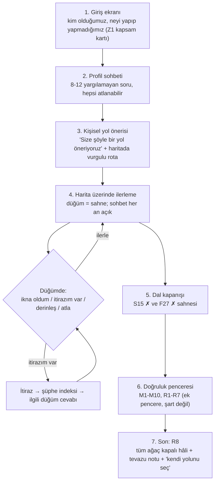

# Sunum Tasarımı — Taslak (2. tur beyin fırtınası için)

> **Durum:** Taslak. Kod yok; format/teknoloji kararları kullanıcıdadır (CLAUDE.md). Omurga kararı verilmiştir: **A + B hibrit** (ihtimaller ağacı haritası + kitaba bağlı sohbet ajanı + düğüm içinde rehberli sahne/kart/görsel modüller). Hedef kitle: **Müslüman olmayan herkes**.
> **Dayanak:** `docs/metod-haritasi.md` (93 düğüm: Z1–17, H1–16, S1–15, F1–27, M1–10, R1–8; şüphe indeksi; profil ipuçları) ve `docs/bolumler/01..07`. Sayfa numaraları kitap sayfasıdır. Yeni olgusal bilgi eklenmemiştir; bu belge **sunum tasarımıdır**, delil içeriği değildir.
> **Etiketler:** Harita §5'teki profil ipuçlarında **[d]** = bölüm dosyalarında doğrudan geçer, **[ç]** = haritanın çıkarımı (teyit gerekir). Bu belgedeki profil→düğüm kuralları da aynı etiketi taşır; **[t]** = bu tasarım belgesinin önerisi (olgu değil, ürün kararı).
> **Kutu işareti:** ❓ = kullanıcıdan karar bekleyen soru.

---

## 1. Deneyim özeti

### 1.1 Üç katman, tek deneyim

| Katman | Ne yapar | Kitaptaki karşılığı |
|---|---|---|
| **Harita (A)** | Ekranda ihtimaller ağacı: Zemin → Haber → (Samimiyet ✗ / Fetanet ✗) → Doğruluk (Mucize, Rum). Kullanıcı konumunu görür, dal seçer, kapanan dal ✗ olur. | Metod haritası §2 (birleşik ağaç), H6 |
| **Sohbet ajanı (B)** | Kullanıcının sorusunu/itirazını ilgili düğüme eşler, kitaptaki cevabı kaynak + sayfa ile verir, bilmediğini söyler. Talimatı: `docs/ajan-ilkeleri.md`. | Şüphe → düğüm indeksi (harita §4) |
| **Düğüm içi modüller** | Her düğüm bir "sahne": giriş sorusu, kısa anlatım, delil kartı, görsel, rozetler, çıkışlar. | Harita §3 "Görsel/etkileşim" alanları |

Hiçbir katman tek başına yeterli değildir: harita **yön** verir (sıra kullanıcıda, kapanış kitabın sırasıyla), sohbet **akış** verir, modül **delili** gösterir.

### 1.2 Kullanıcı yolculuğu (baştan sona)



**1. Giriş.** Tek ekran: "Bu sunum neyi yapar / yapmaz" (Z1, s. 14–16): tek bir yöntem (haber yöntemi); Tanrı'nın varlığı tartışması, İslam'ın tüm itirazlarına cevap ve bilimsel mucize **kapsam dışıdır**. Dayatma olmadığı, istenen anda çıkılabileceği söylenir. ❓ Karar bekliyor: giriş metni ve ilk cümle (bkz. Açık Kararlar).

**2. Profil sohbeti.** Bölüm 2. Anket bittiğinde kullanıcı **hiçbir etiketle** adlandırılmaz; yalnızca "şunu öne çıkaralım" denir.

**3. Kişisel yol.** Ağaç haritası aynı kalır, ancak kullanıcının yolu vurgulanır; "kısa sürüm / tam sürüm" göstergesi (≈ süre tahmini) çıkar. Kullanıcı yolu değiştirebilir.

**4. İlerleme.** Her düğüm bir sahne (Bölüm 4). Sohbet kutusu her sahnede açıktır. Kullanıcı haritadan istediği düğüme **göz atabilir** (Bölüm 3.3).

**5. Dal kapanışı.** S15 ve F27 nihai yargı sahneleri; ağaçta ilgili dal ✗ olur — **yalnızca kullanıcı o dalın kritik düğümlerini gördüyse ve "itirazım kalmadı"ı kendisi işaretlediyse** (Bölüm 5.1).

**6–7. Doğruluk ve Son.** Mucize kitabın kendi çerçevesiyle "ek pencere"dir (M ön notu, s. 409); sunumda da öyle sunulur. Son (R8): tüm ağacın kapalı hâli + hidayetin "hak etme değil lütfetme" notu + dayatmasız çıkış.

> ❓ **Karar bekliyor — Akış sırası:** Kitabın sırası Samimiyet (S) → Fetanet (F) → Mucize (M) → Rum (R). Son Söz (R8) yazarın sırasını "haber → kaynak → yöntem → tavırlar → fetanet → samimiyet → Rum" diye verir (harita §1.7, 07 dosyası: "sunumun akış sırası olarak kullanılabilir"). İki sıra farklıdır. Hangisi sunum sırası olsun? (Kitap sırası öneriliyor [t]; çünkü CLAUDE.md "kitabın kronolojisine sadık kal" der.)

---

## 2. Profil anketi

### 2.1 İlkeler

- **Yargılamaz.** Seçeneklerin hiçbiri "doğru cevap" gibi görünmez; her soruda **"Söylemek istemiyorum / emin değilim"** vardır ve varsayılan yol "standart yol"dur.
- **Neden sorduğumuzu söyler.** Her sorunun altında tek cümle: "Bunu, sana gereksiz şeyleri anlatmamak için soruyorum."
- **Cevaplar geri alınabilir.** Üst menüde "cevaplarımı değiştir"; yol anında yeniden hesaplanır.
- **Sınav değil.** Puan, rozet, etiket yok. Sonuç ekranında "Sen şöyle birisin" denmez.
- **Toplanan veri en azdır.** ❓ Anket cevapları sunucuda mı tutulur yoksa yalnız tarayıcıda mı (Bölüm 8).

### 2.2 Değişkenler

| Kod | Değişken | Değerler |
|---|---|---|
| **V1** | Kaynak güveni | `güvenmiyor` / `kısmen` / `güveniyor` / `bilmiyor` |
| **V2** | Tanrı inancı | `yok` / `bilinemez` / `var-dinsiz (deist)` / `var-başka din` / `bilmiyor` |
| **V3** | Din geçmişi | `dinsiz` / `Hristiyan` / `Yahudi` / `diğer` / `Müslüman-doğup-uzak` [t] |
| **V4** | Peygamberlik algısı (ilk hissiyat) | `sahtekâr` / `iyi niyetli reformcu` / `samimi ama yanılmış (halüsinasyon/epilepsi)` / `dâhi lider` / `kâhin türü` / `hiç düşünmedim` |
| **V5** | Bilgi seviyesi | `az` / `orta` / `ileri` (tarih/din bilgisi) |
| **V6** | Tarz | uzunluk: `kısa` / `orta` / `uzun`; biçim: `görsel ağırlıklı` / `metin ağırlıklı`; etkileşim: `anlat` / `meydan oku` (kendisi denesin) |
| **V7** | Kutsal kitap aşinalığı | `Tevrat/İncil'e aşina` / `az` / `hiç` (M6/M7 örnek seçimi için) |
| **V8** | Hassas içerik tercihi | `kutular kapalı, ben isterim` (varsayılan) / `açık göster` |

### 2.3 Sorular (11 soru)

Konuşma tonu: ikinci tekil, sıcak, kısa. (Aşağıdaki metinler taslaktır; ❓ son metinler kullanıcı onayına tabidir.)

**S-0 · (Kapsam, soru değil)** "Başlamadan bir not: Burada kimseyi ikna etmeye çalışmıyoruz; elimizdeki tarihî verileri sırayla gösterip senin neye nasıl baktığını merak ediyoruz. İstediğin yerde durabilir, atlayabilir, itiraz edebilirsin." → [Başlayalım] [Önce kapsamı göster]

**Q1 · Sunumun nasıl işleyeceği** — *Besler: V6 (etkileşim)*
"Nasıl ilerlemeyi tercih edersin?"
- Bana anlat, ben dinleyeyim · Önce kendi aklıma göre denemek isterim ("sen olsan ne yapardın?" soruları) · Karışık · Bilmiyorum

**Q2 · Süre/uzunluk** — *Besler: V6 (uzunluk)*
"Ne kadar vaktin var / ne kadar derine inelim?"
- Kısa bir tur (ana fikir) · Orta (ana deliller) · Hepsini görmek istiyorum · Sonra değiştiririm

**Q3 · Biçim** — *Besler: V6 (biçim)*
"Okumayı mı yoksa bakmayı mı seversin?"
- Görsel, grafik, harita · Yazı ve açıklama · İkisi de

**Q4 · Tanrı inancı** — *Besler: V2 (→ Z4 derinliği, H13–H15 tonu)*
"Tanrı konusunda şu an nerede duruyorsun? (Doğru bir cevap yok; sadece nereden başlayacağımızı bilmek istiyoruz.)"
- Tanrı'ya inanmıyorum · Bilmiyorum, bilinemeyeceğini düşünüyorum · Tanrı'ya inanıyorum ama bir dinim yok · Tanrı'ya inanıyorum ve bir dine bağlıyım · Kararsızım / söylemek istemiyorum

**Q5 · Din geçmişi** — *Besler: V3 (→ F11–F12, F23, M4–M7 giriş örneği)*
"Hangi inanç ya da kültür ortamında büyüdün?"
- Dinsiz/seküler bir ortam · Hristiyan · Yahudi · Başka bir inanç · Müslüman bir ailede büyüdüm ama uzaklaştım/şüpheliyim [t] · Söylemek istemiyorum

> ❓ **Karar bekliyor — "Müslüman-doğup-uzak" seçeneği:** CLAUDE.md hedef kitleyi "Müslüman olmayan herkes" diye koyar; harita §5 ise "şüpheci Müslüman" için ipuçları içerir (İslami kaynaklar öne). Bu seçenek anketteki bir seçenek olarak kalsın mı, yoksa davetçi/eğitimci sürümüne mi ait?

**Q6 · Kaynaklara güven** — *Besler: V1 (→ Z5–Z14 derinliği; en belirleyici soru)*
"Kur'an ve hadis gibi İslam'ın kendi kaynakları hakkında ilk hissiyatın nedir?"
- Bunlara güvenmem; başka kaynaklara bakarım · Kısmen; kanıt görürsem · Güvenirim · Hiç düşünmedim
*(Alt not: Hangisi olursa olsun yol, "senin kabul edeceğin kaynaklarla" kurulur. — Z3 ilkesi.)*

**Q7 · Batılı/akademik kaynaklara tutum** — *Besler: V1 (oryantalist kaynak ağırlığı), Z3 sahnesinin uzunluğu*
"Bir konuda kimin sözüne daha çok güvenirsin?"
- Üniversitelerde çalışan, o dine mensup olmayan akademisyenler · Dinin kendi âlimleri · İkisi de · Hiçbiri/emin değilim
*(Amaç: kaynak rozetlerinin sırası ve Z3 notu; değer yargısı yok.)*

**Q8 · Peygamberlik algısı** — *Besler: V4 (→ H5 giriş cümlesi, H15, H16, S1, F1/F24 öne çıkışı)*
"Hz. Muhammed hakkında ilk aklına gelen açıklama hangisi? (Bunu soruyoruz, çünkü kitap tam bu açıklamaları sırayla ele alıyor; hiçbirine 'yanlış' demeden başlıyoruz.)"
- Çıkarcı bir lider ya da yalancı olduğunu düşünüyorum · İyi niyetli bir toplum önderiydi/reformcu · Samimiydi ama bir rahatsızlık/halüsinasyon yaşamış olabilir · Çok zeki bir siyasetçi/komutan · O dönemin kâhinlerinden biri gibi · Hiç düşünmedim
*(Çoklu seçim izinli.)* Kitabın H5 düğümü bu açıklamaların hangi "kutuya" girdiğini gösterir; ajan bu cevabı kullanıcıya **etiket yapıştırmadan** ilk H5 sohbetinde yeniden sorar. [t]

**Q9 · Bilgi seviyesi** — *Besler: V5 (→ derinlik: "kısa kart / tam sahne / kaynak tablosu")*
"İslam tarihi ve erken dönem hakkında ne kadar bilgin var?"
- Neredeyse hiç · Genel kültür düzeyi · Okudum, ayrıntıya inebiliriz

**Q10 · Kutsal kitap aşinalığı** — *Besler: V7 (→ M6 tabloları, M7 giriş)*
"Tevrat/Eski Ahit ve İncil'deki anlatılara ne kadar aşinasın? (Bazı kısımlar bu anlatılarla kıyas yapıyor.)"
- Oldukça · Biraz · Hiç; kısa özet kartları isterim

**Q11 · Hassas konular** — *Besler: V8*
"Bazı konular (ör. aile geçmişiyle ilgili tartışmalı rivayetler, savaş sahneleri) hassas olabilir. Nasıl istersin?"
- Kapalı kutularda dursun, istersem açarım · Direkt göster
*(Varsayılan: kapalı. Harita/doğrulanacaklar §D: S6 Ebu Talib–anne-baba rivayetleri, S5 Hamza'ya yapılan müsle, H16 iblis sahnesi, M7 Talmud atfı yalnız muhatap isterse açılır.)*

**Q12 (isteğe bağlı) · Bir cümle** — *Besler: serbest metin → ajan başlangıç notu*
"Eklemek istediğin bir şey ya da en çok merak ettiğin soru var mı? Boş bırakabilirsin."
*(Ajan bu cümleyi şüphe indeksine eşler; eşleşme yoksa "bu soruyu kitaptaki şu bölümle ilişkilendiremiyorum" der — uydurma yok.)*

Toplam 11 soru + 1 isteğe bağlı serbest kutu; ilk 3 soru yalnız tarz sorusudur (ısınma). Sorular tek ekranda sohbet balonu gibi gelir, hepsi atlanabilir.

> ❓ **Karar bekliyor — Anket uzunluğu ve sırası:** 12 soru fazla gelirse "çekirdek 5" (Q4, Q5, Q6, Q8, Q2) + "devamını sonra sor" modu eklensin mi? Sıra: önce tarz mı, önce inanç mı? (Tarz sorusuyla ısındırma öneriliyor [t].)

---

## 3. Yol motoru

### 3.1 Girdiler ve çıktılar

Girdi: V1–V8. Çıktı, her düğüm için bir **mod**:
- **K — Tam sahne** (açılır, kapatılırken uyarı yok; kritik)
- **O — Kısa sürüm** (tek kart + "derinleş" düğmesi)
- **A — Atlanabilir / yalnız itiraz gelirse** (haritada soluk, "bunu atlıyoruz, istersen aç")
- **Ö — Özel giriş** (o profilin yolu o düğümle başlar/vurgulanır)

Kural kaynağı: harita §5 tablosu. **[d]/[ç]** etiketi orijinal tablodan taşınmıştır; ek **[t]** satırlar bu belgenin önerisidir.

### 3.2 Değişken → düğüm kuralları

| Değişken / değer | Açar / derinleştirir | Kısaltır / atlar | Örnek / giriş seçimi | Kaynak |
|---|---|---|---|---|
| **V1 = güvenmiyor** | Z5–Z13 **K** (Kur'an metni: yazım, ittifak, hafız, yazma, karbon, Corpus Coranicum, antik kıyas); Z14 **K** ("hadis tek başına delil değildir" vurgusu); M1 **K** (Kur'an içi deliller önce) | M2 (hadisli gayb) → O, "en geç tarihlerle" çerçevesinde; S/F'de hadis ağırlıklı rivayetler O | Mucizede sıra: belagat → Furkan/Nahl → kıssa alametleri; hadissiz delil önce | harita §5 **[d]** |
| **V1 = kısmen** | Z5–Z13 **O** (kısa kartlar + "derinleş") | — | Rozet: her kartta "kaynak türü" (oryantalist/gayrimüslim/Müslüman) | harita §5 (varsayılan O) |
| **V1 = güveniyor** | — | Z5–Z13 **O** (kısa); Z14 O | Müslüman kaynaklar (Kadı Abdülcebbar vb.) öne çıkabilir, oryantalist alıntı ikinci sıra | harita §5 profil notu **[d]** (şüpheci Müslüman) |
| **V2 = yok (ateist/materyalist)** | Z1–Z4 **K**; H15 **K**; F1 **K**; F24 **K**; M1 **K**; R1–R7 **K** (gayrimüslim kaynaklarla) | F13–F19 **A** (uzun, tartışmalı); F23 **A** (getirirse) | Giriş: F1 doktor deneyi; mucizede önce belagat/"yap bakalım", sonra kıssa karşılaştırmaları (M1→M6); materyalistse H15 tutarsızlık sorusu + R7 | harita §5 **[d]** |
| **V2 = bilinemez (agnostik)** | Z1–Z3 **K**; Z4 **K [ç]**; **H13 K** (sakin ton); **H14 K** ("bilemiyorum" tutarlılık testi); F1 **K** | F13–F19 A | Aynı yol, ton yumuşak; baskı yok | harita §5 **[d]** |
| **V2 = var-dinsiz (deist)** | H1–H4 (Tanrı'nın insana haber göndermesi sorusu haber çerçevesinde) **K [ç]**; M1 **K [ç]** | Z4 → **A [ç]** (Tanrı inancı zaten var) | — | harita §5 deist notu **[ç]** — *kullanıcıyla teyit gerekir* |
| **V2 = var-başka din** | bkz. V3 | Z4 A [ç] | — | — |
| **V3 = Hristiyan** | **F12 K** (Hristiyan/Yahudi kaynakların kendi kayıtları: Michael Rabo, İshoyahb, Dionysios **[d]**); **F23 K [ç]** (Bahira: Süryani/Hristiyan kökeni, Gottheil **[d]**); M4–M7 **K [d]**; S8 (Medine'de Yahudileri **ve Hristiyanları** karşısına almak) vurgulanır; Z13 İncil kıyası **K [ç]** | Z1–Z4 → O/A [ç] | Kutsal kitaba saygılı dil; "muharref" yerine "farklı metin geleneği" (kullanıcı seçimiyle) | harita §5 + profil notu **[d]** |
| **V3 = Yahudi** | F12 **K [d]**; M4–M7 **K [d]**; Z13 K [ç] | M7'deki Talmud atfı **yalnızca isterse** [d] | Aynı saygı dili | harita §5 **[d]** |
| **V3 = dinsiz** | Z1–Z4 **K** (V2'ye göre) | F11–F12 → O | — | — |
| **V4 = sahtekâr (veya "çıkarcı")** | S1–S15 **K** (S12–S14 menfaatsizlik; S9 haberden etkilenme); S15 sahnesi öne | — | Giriş: H1 + H12 (kompozisyon) + S2 | harita §4.5 [d], §3.3 |
| **V4 = iyi niyetli reformcu** | H5, H16 **K** (orta yol yok); S1 **K**; S10–S11 (ikinci irade) | — | H5'te "yeni isim yeni kutu açmaz" sahnesi | harita §4.3 [d] |
| **V4 = samimi ama yanılmış / halüsinasyon / epilepsi** | F1 **K** (doktor deneyi), F24 **K**, F20–F22 **K**, F25–F27 **K** | F2–F6 O olabilir [t]; F13–F19 A | Giriş: doktor deneyi (F1) | harita §5 **[d]** |
| **V4 = dâhi lider (Napolyon/İskender/Cengiz)** | F2 (kısa "velev ki"), F3 (kurumsallaşma), F16 (kültürde erimeme), **F25 K** | — | F2 "velev ki" kısa; sonuç F25'te | harita §5 profil notu **[d]** |
| **V4 = kâhin türü** | H15 **K** | — | "Kâhinlerin durumu sizce nedir?" → iki kutuya yerleştirme | harita H15 |
| **V4 = hiç düşünmedim** | H1–H6 **K** (tasnif); standart yol | — | H1'den başla | — |
| **V5 = az** | Z/H/S/F: **kısa kart + sade dil**; ayrıntı "derinleş"te | F11–F19 O/A; kaynak tabloları gizli | Örnekler gündelik (Ankara örneği, araba alarmı, doktor) | [t] |
| **V5 = ileri** | Kaynak tabloları/dipnot rozetleri açık; F13, F14 (alıntı/Batı merkezli okuma) **derin dalış** teklifi | — | Corpus Coranicum canlı bağlantısı, Gottheil, Bailly gibi tartışmalı kaynaklarda kaynak notu | harita F13/F14 [d] |
| **V6 uzunluk = kısa** | Her düğümde yalnız "ana fikir kartı + 1 delil" | Tüm O/A düğümleri kapalı gelir | — | [t] |
| **V6 biçim = görsel** | Haritalar, çubuk grafikler, zaman şeritleri, mushaf fotoğrafları öne | Metin akışı kısalır | Görsel modül kataloğu (Bölüm 6) | [t] |
| **V6 etkileşim = meydan oku** | "Sen olsan ne yapardın?" soruları (Hudeybiye, cizye iadesi, Irak senaryosu, Siz yapın simülatörü) önce gelir | — | F1, F4, F6, F12, M1 meydan okuma modülleri | harita §3 (görsel fikirler) |
| **V7 = hiç** | M5–M6: **kısa özet kartı** ("Tevrat'ı bilmeyenlere kısa özet kartları" **[d]**) | M6 tabloları sade | — | harita §5 **[d]** |
| **V8 = kapalı (varsayılan)** | — | S5, S6, H16, M7 hassas kutuları kapalı | "İstersen açabilirsin" | doğrulanacaklar §D |

> ❓ **Karar bekliyor — [t] satırları:** V4 → giriş sahnesi (örn. "iyi niyetli reformcu → H5 sahnesiyle başla") ve V5/V6 kuralları bu belgenin önerisidir, kitap veya harita bunu doğrudan söylemez. Onaylıyor musun?

### 3.3 Kronoloji kuralı (kesin)

1. **Düğümler kitap sırasıyla numaralıdır**; her düğümün **önkoşulu** vardır (harita §3 "Önkoşul" alanı).
2. **Önkoşulu kapanmamış düğüm "kapanış" üretmez:** kullanıcı göz atabilir (okuyabilir, ajanla konuşabilir) ama bu düğüm **"✗ / kapandı"** sayılmaz; haritada **"ön adımlar tamamlanmadı"** diye soluk işaretlenir. Örnek: Z6'yı görmeden F24'ü açan kullanıcı F24'ü okuyabilir, F24 ✗ olmaz.
3. **Zorunlu atlama yok, zorunlu onay yok.** "Atla" her K düğümünde vardır; ajan **bir kez** nazikçe der: "Bu adım sonrakilerin zeminidir; istersen yine de atlayalım." Sonra sayar.
4. **Profil yalnız derinlik/mod değiştirir; sıra sabittir** (CLAUDE.md "Profil ölçme"; harita §5 anahtarı).
5. **Çapraz atıf rozeti:** kitap aynı delili tek yerde işler (Z2); kartlarda "bu delil ayrıca X düğümünde de kullanılır" rozeti çıkar.
6. **Dal kapanışı koşulu:** S dalı ✗ için S1–S14 (kullanıcının yoluna göre K olanlar) görülmüş + kullanıcı S15'te "itirazım kalmadı" demiş olmalı. F dalı için F1–F26'da aynısı. Görülmeyen düğüm ✗ ile **gizlenmez**; haritada "gözden geçirilmedi" gri olarak kalır.

> ❓ **Karar bekliyor — "✗" ne zaman?** Seçenekler: (a) sadece sistem tamamlanma ölçütüyle (kritik düğümler görüldü); (b) kullanıcının "itirazım kalmadı" beyanıyla; (c) ikisi birden (önerilen [t]). "İkna oldum" beyanı baskı gibi algılanmamalı: işaretleme **kullanıcının kendi çıkarımı** olarak sunulur, ajan "kapattı" demez.

### 3.4 Üç persona için uçtan uca yol

Her yol kronolojik sırayı korur; farkı **mod** (K/O/A) ve giriş/örnek seçimi belirler. Düğüm sırası: Z → H → S → F → M → R.

#### Persona 1 — Kaynaklara güvenmeyen ateist
*Profil:* V1 güvenmiyor, V2 yok, V3 dinsiz, V4 "çıkarcı/halüsinasyon", V5 orta, V6 meydan oku/görsel.

| Aşama | Düğümler ve mod | Notlar |
|---|---|---|
| Giriş | Z1 K · Z2 K · Z3 K · **Z4 K** | "Önce doğaüstünü ispatlayın" şüphesi burada (harita §4.2). Z3: oryantalist rozetleri öne |
| Kur'an güvenilirliği | **Z5–Z13 K** (zaman şeridi Sıffin, ittifak haritası, hafız infografiği, yazma haritası, karbon aralıkları, Corpus Coranicum, antik kıyas çubuğu) · **Z14 K** | Mushaf fotoğrafları (lisanslı olanlar); hadis tek başına delil sayılmıyor vurgusu |
| Yorum araçları | Z15 K · Z16 K · Z17 K | Z15 "kural kartı" sonraki delillerde yeniden çağrılır |
| Haber | H1–H6 K · H7, H12 K · H13 O · H14 O · **H15 K** · H16 K | H15: "materyalist olup kehanete/paranormale inanamazsınız" tutarsızlık sorusu [d] |
| Samimiyet | S1–S5 K (S5 hassas kutu kapalı) · S6 K (Ebu Talib/anne-baba kutusu kapalı, isterse) · S7–S15 K | S9 İbrahim'in vefatı/güneş tutulması sahnesi öne |
| Fetanet | **F1 K (doktor deneyi, giriş)** · F2–F6 K · F7–F10 O · F11–F12 O · F13–F19 **A** · F20–F22 K · F23 **A** (getirirse) · **F24 K** · F25–F27 K | Denklem sürgüsü: "benzerini göster" |
| Mucize | **M1 K (siz yapın simülatörü)** · M2 O (hadis çerçevesi) · M3 O · M4–M7 O (kısa özet kartlar; V7 hiç) · M8–M10 **A** | Önce belagat, sonra kıssa karşılaştırmaları (M1→M6) [d] |
| Rum | **R1–R7 K** (yalnız gayrimüslim kaynaklarla; R7: "kehanete inanan materyalist olamaz") | |
| Son | R8 K | Ağacın kapalı hâli |

#### Persona 2 — Hristiyan
*Profil:* V1 kısmen, V2 var-başka din, V3 Hristiyan, V4 "reformcu / samimi", V5 orta, V6 uzun/metin, V7 aşina.

| Aşama | Düğümler ve mod | Notlar |
|---|---|---|
| Giriş | Z1 O · Z2 O · Z3 O · Z4 **A [ç]** | Tanrı inancı mevcut |
| Kur'an güvenilirliği | Z5 O · Z6–Z12 O · **Z13 K [ç]** (antik metin ve **İncil kıyası**, saygılı dille) · Z14 O | "Kur'an'ın seviyesine ulaşmaz" iddiası İncil'i küçümsemeden: tablolar kitaptaki (McDowell, Duygu) olduğu gibi sunulur |
| Yorum araçları | Z15–Z17 K | |
| Haber | H1–H6 K · H7 O · H12 O · H13 **A** · H14 **A** · H15 **A [ç]** · H16 K | H5: "iyi niyetli reformcu" sorusu sık [t] |
| Samimiyet | S1–S15 K (**S8 vurgu:** Medine'de Yahudiler **ve Hristiyanlar** karşısında duruş, İsa/Meryem meselesi [d]) | S6 hassas kutu kapalı |
| Fetanet | F1 O · F2–F6 O · F7–F10 O · **F11 K · F12 K** (Michael Rabo, İshoyahb III, Dionysios — kendi geleneklerinin kayıtları [d]; cizye iadesi vakası) · F13–F19 O/A · F20–F22 K · **F23 K [ç]** (Bahira — Süryani/Hristiyan kökeni, Gottheil; "velev ki") · F24 O · F25–F27 K | F12 güçlü giriş |
| Mucize | M1 O · M2 O · M3 O · **M4–M7 K [d]** (kıssa karşılaştırma tabloları; Eyyub/Yusuf/Âdem; "farklı metin geleneği" dili) · M8–M10 O | M7'de Talmud atfı bu profilde kapalı |
| Rum | R1–R7 K | |
| Son | R8 K | |

#### Persona 3 — Merak eden agnostik
*Profil:* V1 kısmen, V2 bilinemez, V3 dinsiz/ılımlı, V4 hiç düşünmedim, V5 az, V6 kısa/görsel.

| Aşama | Düğümler ve mod | Notlar |
|---|---|---|
| Giriş | Z1 K · Z2 K · Z3 K · **Z4 K [ç]** | Kapsam kartı; baskı yok |
| Kur'an güvenilirliği | Z5–Z13 **O** (kısa kartlar: Sıffin, tek yazma yetmez, karbon aralığı, yazma haritası) · Z14 O | "Derinleş" düğmesi her kartta |
| Yorum araçları | Z15–Z17 K (kısa sürüm) | |
| Haber | H1–H6 K · H7 O · H12 O · **H13 K** (sakin ton, "isterseniz devam edelim" [d]) · **H14 K** (tutarlılık testi [d]) · H15 O · H16 K | H14 kartı: yargısız soru |
| Samimiyet | S1–S15: S2, S9, S10, S12, S14 **tam**; S3–S8, S11, S13 kısa kart · S15 K | V5 az → gündelik örnekler |
| Fetanet | **F1 K** · F2–F6 O · F7–F12 O · F13–F19 A · F20–F22 K (kısa) · F24 K · F25–F27 K | Doktor deneyi giriş |
| Mucize | **M1 K** · M2–M3 O · M4–M7 O · M8–M10 A | |
| Rum | R1–R7 K (kısa sürüm) | |
| Son | R8 K | |

---

## 4. Düğüm / sahne şablonu

### 4.1 Ekran anatomisi

```
┌──────────────────────────────────────────────────────────────┐
│ [Mini harita: konumum ●, kapanan ✗, gözden geçirilmemiş ○]   │
├──────────────────────────────────────────────────────────────┤
│ DÜĞÜM ROZETİ: Z11 · Zemin / Kur'an metni · s. 42–83          │
│ ① GİRİŞ SORUSU  (kullanıcının aklındaki şüpheye bağlanan)     │
│ ② KISA ANLATIM  (3–6 cümle, sohbet tonu)                      │
│ ③ DELİL KARTI/KARTLARI (kaynak rozetli)                       │
│ ④ GÖRSEL / ETKİLEŞİM MODÜLÜ (varsa)                           │
│ ⑤ KAYNAK-SAYFA ROZETİ  (yazar · kitap sayfası · tür)          │
│ ⑥ ETİKETLER (yazarın kaba hesabı / varsayımsal / ikinci el…)  │
│ ⑦ ÇIKIŞLAR:  [İkna oldum] [İtirazım var] [Derinleş] [Atla]    │
│ ⑧ Sohbet kutusu (her zaman açık)                             │
└──────────────────────────────────────────────────────────────┘
```

**Alanların anlamı**

| Alan | İçerik kuralı |
|---|---|
| ① Giriş sorusu | Harita "Şüpheler" alanından; kullanıcıya soru olarak sorulur ("Elimizdeki en eski Kur'an ne zaman yazıldı sanıyorsun?"). Cevap zorunlu değil. |
| ② Kısa anlatım | "Tez" alanından türetilir; 3–6 cümle; V5'e göre sadeleşir. |
| ③ Delil kartı | Tek delil = tek kart; kaynak adı, kitap sayfası, kaynak türü rozeti (oryantalist / gayrimüslim / Müslüman — kimlik etiketleri `docs/kaynakca.md`'den; kitapta verilmeyen çıkarımdır **[ç]**, rozet gösterilirken "genel bilgiden" notu düşülür). |
| ④ Görsel/etkileşim | Harita §3 "Görsel/etkileşim" alanından. Bölüm 6 kataloğu. |
| ⑤ Kaynak/sayfa rozeti | Her kartta zorunlu. Doğrulanmamış kaynak/sayfa `docs/dogrulanacaklar.md`'de ise rozet "teyit bekliyor" taşır. |
| ⑥ Etiketler | `dogrulanacaklar.md` §D kuralı: *yazarın kaba hesabı · yazarın okuması · varsayımsal · bir okuma · ikinci el atıf · Kadı Abdülcebbar'ın görüşü ≠ yazarın görüşü*. |
| ⑦ Çıkışlar | Aşağıda. |

**Çıkışlar**

| Düğme | Ne yapar |
|---|---|
| **İkna oldum / bu adım bana yeterli** | Düğümü "gözden geçirildi" işaretler (✓). Dal kapanışı için sayılır (bkz. 3.3). *"Bana yeterli geldi" ifadesi, kullanıcının inancının beyanı değil, bu adımla ilgili beyanıdır.* |
| **İkna olmadım** | Ajan nedenini sorar (1–2 seçenek + serbest metin): "Hangi kısım yetmedi?" Cevap → şüphe indeksi → ilgili düğümün cevabı; yoksa "kitapta bu itiraza doğrudan cevap bulamıyorum" (Bölüm `ajan-ilkeleri.md`). |
| **İtirazım var** | Aynı akışa girer; serbest metin. Ajan itirazı harita §4 tablosuna eşler. |
| **Derinleş** | Daha uzun sürüm: kaynak tabloları, ek kartlar, "bölüm dosyası" ayrıntısı. |
| **Atla** | Düğümü "atlandı" işaretler (○, ✗ olmaz). K düğümlerde ajan bir kez nazik not düşer. |
| *(ek)* **Sonra döneceğim** | Düğümü "yer imi" yapar. |

> ❓ **Karar bekliyor — "İkna olmadım" ve "İtirazım var":** İki ayrı düğme mi, tek "Aklımda soru var" düğmesi mi? Tek düğme daha az baskı hissettirebilir [t].

### 4.2 Örnek 1 — Z11 · Mushaf listesi ve çıkarımlar (s. 42–83)

**Önkoşul:** Z10. **Mod:** V1 güvenmiyor → K; V1 güveniyor → O.

| Alan | İçerik |
|---|---|
| ① Giriş sorusu | "Elimizdeki en eski Kur'an yazması sence ne zamandan?" (harita §4.1 şüphesi: "Elimizdeki en eski Kur'an ne zaman? Kaç yazma var?") |
| ② Kısa anlatım | Kitap, ilk yüzyıla nispet edilen **44 yazma metin + 7 tek sayfalık varak** sayar; bunlar belli bir tarihe, coğrafyaya veya sureye yığılmaz, birbirini tamamlar ve bugünkü mushafla birliktelik içindedir; Medine/Basra/Şam/Kûfe nüshalarıyla eşleşme anlatılır (Z11 tezi). |
| ③ Delil kartları | (a) "Hangi yazma, nerede?" — mushaf kartı (Topkapı, Tiem 457, Kahire Hüseyin Camii, San'a, Birmingham, Paris-Petropolitanus, Tübingen vb.; liste kitabın s. 42–79). (b) "Kapsam" — kitaptaki yüzde değerleri (ör. Topkapı ≈%99,5; Kahire ≈%99,7 — **bu rakamlar `docs/bolumler/01` ve `dogrulanacaklar.md` ile çapraz kontrol edilmeden yayınlanmaz**; tekrar-sayım uyarısı kayıtlıdır). (c) Osman nüshası eşleşme şeması (s. 82). |
| ④ Görsel | **Mushaf haritası** (ülke/kurum işaretli) + kapsam çubukları + Osman nüshası eşleşme şeması. Mushaf fotoğrafları: `public/gorseller/mushaflar/kitaptan/` — **lisans doğrulanmadı** (`docs/gorseller.md`); lisansı doğrulanmayan görsel yayında kullanılmaz (CLAUDE.md). Tasarım "yer tutucu + lisanslı görsel gelince değişir" şeklinde yapılır. |
| ⑤ Kaynak rozetleri | Altıkulaç (s. 80–83) · Hamidullah (s. 80–81) · islamic-awareness.org dipnotları (s. 42–79; "dipnot URL'leri OCR'dan alınmıştır, bazıları bozuk" notu) |
| ⑥ Etiketler | "ikinci el atıf" (dipnotlar); "kitaptaki rakam; teyit bekliyor" |
| ⑦ Çıkışlar | **İkna oldum** → Z12 · **İtirazım var** → "yazmalarda farklılık çıkarsa?" → Z9; "Karbon testi neyi gösterir?" → Z10 · **Derinleş** → 45 girişlik tam liste (tablo + filtre) · **Atla** → Z12'ye geçer (Z11 ✗ olmaz) |
| Çapraz atıf | Z10 (karbon), Z12 (Corpus Coranicum), M5 (Corpus listesi) |

### 4.3 Örnek 2 — H1 · Haberin niteliği ve ihtimaller (s. 127–129)

(Kullanıcının "H ihtimaller ağacı" talebi: H1 ağacın ilk kurulduğu sahnedir; H6 ana ağaç şemasını gösterir. Burada H1 sahnesi doldurulmuştur.)

**Önkoşul:** Z17. **Mod:** tüm profillerde K.

| Alan | İçerik |
|---|---|
| ① Giriş sorusu | "Biri sana 'Dün Ankara'daydım' dese, bu söz doğru ya da yalan olabilir. Yalansa, söyleyen bunu bilerek mi söylemiştir, yoksa yanılmış mı? Başka bir ihtimal aklına geliyor mu?" |
| ② Kısa anlatım | Konu bir teori değil bir **haberdir** ("Mekke'de Muhammed b. Abdullah kırk yaşında bir melek gördüğünü, Allah'ın elçisi olduğunu söylüyor"). Yorumun üç yolu: **doğru**; **yalan-bilerek** (kitabın adlandırmasıyla sahtekâr); **yalan-bilmeyerek** (kitabın adlandırmasıyla deli). İsimler kolaylık içindir; esas olan **farkındalıktır**; dördüncü ihtimal yoktur. *(Haşa edebi korunur: "haşa" ifadesi kartlarda kitabın tasnif adlarını anarken görünür.)* |
| ③ Delil kartları | Tek kart: tanım kartı (s. 128, dn. 265–266). Not: "Bu etiketler kitabın tasnif adlarıdır, Peygamber hakkında bir hüküm değildir; delilleri görmeden hiçbir yargıya varılmıyor." |
| ④ Görsel | **Üç kutulu ihtimaller şeması**; "iki ölçüt" animasyonu (doğru/yalan × farkında/değil). Kullanıcı kendi ilk hissiyatını (Q8) şemada bir kutuya sürükleyebilir; sistem etiket koymaz. |
| ⑤ Kaynak rozetleri | Yazarın tanımı (s. 127–129); dn. 265–266 |
| ⑥ Etiketler | "yazarın tasnifi" |
| ⑦ Çıkışlar | **İkna oldum** → H2 (isteğe bağlı) / H3 · **İtirazım var** → "Deli/sahtekâr demek hakaret değil mi?" cevabı H1'in kendi içinde (harita §4.2); "Peygamber sadece yanlış bir teori kurmuş olabilir" → H4 · **Derinleş** → H2 (Gazali/Cahız alıntı kartı) · **Atla** → H4'e geçer (ama H6'ya kadar H1–H6 K olduğu için ajan bir kez nazik not düşer) |
| Ağaçta | Ağaç şeması bu sahnede **görünür olur**; kutular henüz kapalı değildir. |

### 4.4 Örnek 3 — S2 · Mükellefiyetler: emir ve yasaklar (s. 159–172)

**Önkoşul:** S1. **Mod:** tüm profillerde K (V1 güvenmiyorda hadis kartları "ek" rozetli).

| Alan | İçerik |
|---|---|
| ① Giriş sorusu | "Eğer sen insanları ikna ederek bir hareket kurmaya çalışsan, ilk bakışta insanlara ağır gelecek yükler mi getirirdin?" |
| ② Kısa anlatım | Yük ağır ve tepki çekicidir: içki/fuhuş yasağı, oruç, namaz, korku namazı; Sakif heyetiyle pazarlıkta ödün verilmemesi. Tüm sahte peygamberler yükü azaltarak başlar (kitaptaki örnekler Müseylime, Tuleyha); Peygamber bunları kendisi de uygular ve kendine fazlasını yükler (vısâl, gece namazı). Kalıp: "haşa sahtekâr olsaydı..." karşı-olgusal akıl yürütme. |
| ③ Delil kartları | (a) Emir–yasak kartları (içki/fuhuş/oruç — Arnold, Dermenghem, Dozy, Goldziher, Hitti, s. 160–162). (b) Namaz, Hevazin/Sakif (Goldziher, Armstrong, Watt, s. 162–167). (c) Tuleyha (Kister, s. 167–168). (d) Carlyle (s. 169). (e) Vısâl/teheccüd (Buhârî/Müslim, s. 170–172; hadis rozeti: "Müslüman kaynak"). |
| ④ Görsel | **İki sütunlu kart:** "Menfaat peşindeki biri ne yapardı?" ↔ "Tarihte ne oldu?" ; isteğe bağlı "bir ay deneyin" (oruç/namaz/teheccüd) görevi — davetkâr, yük bindirmeden. |
| ⑤ Kaynak rozetleri | oryantalist/gayrimüslim kaynaklar ön planda; Müslüman kaynaklar (Buhârî/Müslim) ayrı rozet |
| ⑥ Etiketler | "karşı-olgusal akıl yürütme"; S1'deki "bu delil neyi yapar/yapmaz" kutusu: bu delil tek başına nübüvveti ispatlamaz, yalnız "bilerek yalan" ihtimalini çürütür (S1) |
| ⑦ Çıkışlar | **İkna oldum** → S3 · **İtirazım var** → "Siyasi önder ama niye bu kadar yük?" (S2'nin kendi cevabı) · "Kendisi de yapıyor olması neden delil?" (S2) · **Derinleş** → Kister/Watt ayrıntıları · **Atla** → S3 |
| Çapraz atıf | S6 (atalar), S8 (uzlaşmayı reddetme), F7 (içki yasağında toplu tepki, Ebu Talha) |

---

## 5. Harita UI fikirleri

### 5.1 Ağaç ve durum dili

| Durum | Görünüm | Anlam |
|---|---|---|
| ○ **Gözden geçirilmedi** | Soluk, ince kontur | Henüz açılmadı / atlandı |
| ● **Şu an burada** | Dolu nokta + nabız | Aktif sahne |
| ✓ **Gözden geçirildi** | Tik | Kullanıcı "yeterli" dedi |
| ✗ **Dal kapandı** | Dal kararır + ✗ | Kullanıcı o dalın kritik düğümlerini gördü ve "itirazım kalmadı" dedi |
| ◌ **Önkoşul bekliyor** | Kesik çizgi | Göz atıldı, ama önceki adımlar tamam olmadığı için kapanış yok |
| ? **Açık itiraz** | Küçük soru işareti | Kullanıcının hâlâ aklında soru var — ajan "geri döneriz" der |

Üst görünüm (Z → H → ikili ayrım → doğruluk) metod haritası §2 diyagramından türetilir: Zemin, Haber, ardından **Samimiyet (bilerek)** ve **Fetanet (bilmeyerek)** iki dal; her iki ✗ olunca **"Geriye yalnız 'doğru' kalır"** düğümü; Mucize ve Rum "doğrudan" kolu.

### 5.2 Demet sopa görselleştirmesi (H7)

- Kullanıcıya her delil bir **çubuk** olarak verilir (S2, S5, S9…; F2, F6…).
- Kullanıcı "şunu çürütürdüm" diye birine dokunur; çubuk **gri** olur, demet sopa **zayıflamaz** (çünkü çok çubuk var); ekranda **sayaç**: "Çürüttün: 1 · Kalan: N".
- Hedef: kitabın "zincir değil demet sopa" aritmetiğini (s. 135–136) göstermek. **Uyarı:** "kırılamaz" havası verilmez; "tek tek itiraz yetmez, kompozisyon gerekir" mesajı verilir (H12). Sayısal "N" kitaptaki alt başlık sayısından türetilir, uydurma sayı yok.

### 5.3 Kapalı devre animasyonu

1. **Başlangıç:** "Haber" düğümünden üç ok: Doğru / Bilerek yalan / Bilmeyerek yalan.
2. **S15 sonunda:** "Bilerek" kolu kararır, ✗.
3. **F27 sonunda:** "Bilmeyerek" kolu kararır, ✗.
4. **Geçiş sahnesi:** "Geriye yalnız 'doğru' kaldı" — iki ✗ ok "Doğru"ya akar; devre **kapanır** (halka).
5. **M/R:** mucize "ek pencere" olarak halkanın dışında, "doğrudan" bir ok.
6. **R8:** ağaç kapalı hâliyle (✗ ✗ ✓) tek ekran; **kullanıcıya hitap ve tevazu notu**.

Animasyon yalnızca kullanıcı "ikna oldum/itirazım kalmadı" dediyse oynar; atlanmış kolda "bu dalı gözden geçirmedin" notu görünür, ✗ **gösterilmez**.

### 5.4 Diğer harita fikirleri

- **Konum şeridi:** Üst çubukta Z–H–S–F–M–R, altında ilerleme çizgisi.
- **Sıcak harita yok:** puanlama/oyunlaştırma yok; ilerleme "yüzdelik" değil "bölüm" diliyle (3/6 aşama).
- **"Neredeyim?" düğmesi:** ajanla tek tıkla "bu adım neden burada?" (önkoşul açıklaması).
- **İtirazlar sepeti:** "Hâlâ aklımda olanlar" listesi (? işaretli düğümler); son ekranda kullanıcıyla birlikte gözden geçirilir (R8 tevazu notuyla).
- **Kısa/uzun yol:** profile göre yol çizgisi parlak, diğer düğümler soluk; kullanıcı "tam haritayı göster" ile açar.

---

## 6. Görsel modül kataloğu

Kaynak: metod haritası §3 "Görsel/etkileşim" alanları. **Hiçbir sayı/tarih yeni üretilmez**; modüller kitaptaki veriyi gösterir; benzetme olanlar işaretlenir.

| # | Modül | Düğüm | Not / uyarı |
|---|---|---|---|
| 1 | Sıffin zaman şeridi (632 → ≈650 → ≈657; 27 ve 7 yıl göstergeleri) | Z6 | — |
| 2 | Tek devlet hâkimiyetinin bittiği 750 sonrası harita/zaman çizelgesi; "tarihî veri yok etmek" karşılaştırma kartı | Z7 | — |
| 3 | Hafız infografiği (Türkiye ≈200 bin resmî hafız → dünyada kaba 3–4 milyon) | Z8 | **"Kabaca"** etiketi zorunlu; oransal tahmin yazara ait |
| 4 | "Tek farklı yazma bulunursa ne olur?" senaryosu | Z9 | Etkileşimli |
| 5 | **Karbon zaman çizelgesi:** kronoloji şeridi (610–777) üzerinde aralık çubuğu; Birmingham aralığı (568–645, 77 yıl) ile Peygamber'in ömrü (63 yıl) karşılaştırması | Z10 | %95 aralık; "yazının değil malzemenin yaşı" notu |
| 6 | **Mushaf haritası:** ülke/kurum haritası + kapsam yüzdeleri + Osman nüshası eşleşme şeması (s. 82) + mushaf fotoğrafları | Z11 | Fotoğraf lisansı doğrulanmadan yayın yok; tekrar-sayım uyarısı (`dogrulanacaklar`) |
| 7 | Corpus Coranicum canlı bağlantısı + Tevbe 9:128–129 ve Rum 30:5 zaman ekseni | Z12 | "Yazarın kaba hesabı" etiketi (Dam 01-27.1 ≈%60) |
| 8 | Yazım–en eski kopya aralığı çubuk grafiği; Kur'an satırı vurgulu | Z13 | McDowell ve Duygu tabloları |
| 9 | "İtiraz–cevap" ayet kartı galerisi (kıble, sivrisinek, "melek inmeliydi") | Z17 | — |
| 10 | Üç kutulu ihtimal şeması + ana ağaç şeması | H1, H6 | Bölüm 5 |
| 11 | "Demet sopa" animasyonu | H7 | Bölüm 5.2 |
| 12 | "Kompozisyon panosu" (muhatap kutu seçer, sistem açıklanması gerekenleri listeler) | H12 | — |
| 13 | **Keskinlik ölçeği (0–100)**; skalada halüsinasyon ihtimali "0" değil "−100" | H16 | Sert içerik: "yalnızca bu ihtimali ciddiye alıp sonucuna bakıyoruz" çerçevesi |
| 14 | "Mescitte iblis sahnesi" iki okuma yan yana | H16 | **Hassas kutu**, yalnız isterse |
| 15 | "Kimin için ne yapardın?" değer matrisi (cahiliye değeri ↔ getirilen) | S3–S6 | — |
| 16 | Güneş tutulması sahnesi + "hiçbir ölüm için tutulmaz" hadisi | S9 | Hassas olmayan; ağır bir tek delil olarak gösterilir |
| 17 | Hitap şahısları vurgulu ayet-ses kartı ("kim kime konuşuyor?") ; Kıyamet 75/16–19 için Arapça tilavet + Türkçe meal eşzamanlı oynatma (kitabın önerisi) | S10–S11 | Ses lisansı/okuyucu ❓ |
| 18 | "Teklif edilen menfaat" zaman çizelgesi (13 yıl, hiçbiri gelmedi) | S14 | — |
| 19 | **Doktor deneyi** (kullanıcı kendi cevabını üretir) + **Başarı formülü / denklem sürgüsü:** Başarı = Son durum − (toplum koşulları + bireyin koşulları) | F1, F20, F25 | **Puanlar benzetmedir, gerçek veri gibi sunulmaz** (F20/F25 uyarısı) |
| 20 | Zaman çizelgesi: başlangıç koşulları → 23 yıl | F2 | — |
| 21 | Hudeybiye karar anı → altı sonuç | F6 | — |
| 22 | Cizye iadesi vakası ("Bu ordu olsaydınız iade eder miydiniz?") | F12 | Hristiyan/Yahudi profili için güçlü giriş |
| 23 | Kütüphane sayıları infografiği | F18 | Kaynak: Bloom vb. |
| 24 | Bahira modülü: kısa / orta / derin katman | F23 | "Konu dağılması" notu; muhatap getirmezse sona ek modül |
| 25 | Oryantalist panel kartları (kısa alıntılar, kaynak rozetli) | F24 | Etiket: "ikinci el atıf" gerekiyorsa |
| 26 | Hart kartı + "Benzerini başaran bir beşer gösterebilir misin?" | F26 | — |
| 27 | **"Siz yapın" simülatörü** (bahane seçenekleri ve cevapları) | M1 | İroni var, küçümseme yok |
| 28 | İki sesli okunuş karşılaştırması (Nasr 110/2 ve Peygamber'in şiir okuma hatası, s. 422) | M1 | Arapça bilmeyen de farkı duyar; ses ❓ |
| 29 | "Hadis kitabında geçtiği tarih / olay tarihi" iki tarihli çizelge | M2 | Moğol/Türk hadisinde yazarın yorumu **"bir okuma"** diye etiketlenir |
| 30 | Esâtîr ayet tablosu (dört grup) + "8 cevap" açılır kartı | M4 | — |
| 31 | **24 sayfalık liste + "altı dil" kartı** | M5 | — |
| 32 | **Kıssa karşılaştırma tabloları** (Eyyub, Yusuf, Âdem; "hangisi iç tutarlı?" mini quiz) | M6 | Kutsal kitaba saygılı dil; "muharref" yerine "farklı metin geleneği" (kullanıcı seçimine bağlı) |
| 33 | Firavun ağıtı sahnesi (iki sütun + Rosetta/hiyeroglif çözümü zaman çizgisi); alıntı skalası şeması | M7 | **"Yazarın okuması"** etiketi şart |
| 34 | "Susayan ve su damlası" benzetmesi; "Ağrı Dağı'nın varlığını nasıl biliyorsunuz?" | M9 | — |
| 35 | Rum güç haritası + iddialaşma sahnesi | R1 | — |
| 36 | **Rum zaman çizelgesi 603–641** (07 §2.5 tablosu); 614–618 nüzul penceresi; "nüzul penceresi + 10 yıl" hesabı (614+10=624; 618+10=628) | R2–R4 | Kitabın iki iç tutarsızlığı (Ninova 627/628) dipnotla belirtilir; Bailly "abartılı anlatım" notu |
| 37 | Mucize unsurları kontrol listesi (rozetli); beş şart onay listesi | R5, R7 | Kullanıcı kendi getirdiği "örneği" beş şarta karşı dener |
| 38 | Tüm ağacın kapalı hâli (✗ ✗ ✓) | R8 | Tevazu notu |

> ❓ **Karar bekliyor — Ses/tilavet:** Kıyamet 75/16–19 tilavet ve M1 "iki sesli okunuş" için okuyucu ve lisans nasıl çözülecek? (Hazır kayıt mı, sentezlenmiş ses mi, yalnız yazı mı?)

---

## 7. Ton ve edep kuralları; çıkış, ara verme, kaydetme

### 7.1 Ton
- **Muhatap küçümsenmez.** İroni (ör. M1 "Siz yapın") **tuzak** olmaz; davet olur.
- **İkinci tekil, sıcak, kısa.** "Sen" mi "siz" mi — ❓ aşağıda.
- **Dayatma yok.** "İkna olmak zorundasın" cümlesi yok; "şu ana kadar baktığımız veriler bu yönde" tarzı betimleyici dil.
- **Kitabın "haşa" edebi korunur:** Peygamber için olumsuz ihtimal anılırken ("sahtekâr", "deli") **kitabın tasnif adı olduğu** belirtilir ve "haşa" eklenir. Sunumda bu iki kelime tek başına başlıkta kullanılmaz; "bilerek yalan ihtimali / bilmeyerek yanılma ihtimali" gibi nötr başlıklar öne çıkar [t].
- **Hassas konularda kutu:** S5 (Hamza'ya yapılan müsle), S6 (Ebu Talib/anne-baba rivayetleri), H16 (iblis sahnesi), M7 (Talmud atfı) → **kapalı genişletilebilir kutu**, saygılı dille (`dogrulanacaklar.md` §D).
- **Başka dinlere saygı:** Hristiyan/Yahudi muhatapta kutsal kitabı kötülemeden; "tahrif" dili yerine "farklı metin geleneği" (kullanıcı seçimiyle).
- **Kitabın kendi sınırlarını açıkça söyler:** Z1 (kapsam), S1 ("tek başına nübüvveti ispatlamaz"), M ön notu ("iman için şart değil, ek pencere"), R8 ("inanç rasyoneldir değil, tarihî veri yorumudur").
- **Tevazu:** Son ekranda "hidayet hak etme değil lütfetme" notu (R8); hiçbir noktada "seni ikna ettik" tonu yok.

### 7.2 Çıkış ve ara verme
- **Her ekranda "Çık / Ara ver"** düğmesi; çıkışta suçlayıcı mesaj yok: "İstediğin zaman kaldığın yerden devam edebilirsin."
- **Ara verince:** konum, cevaplar ve yer imleri kaydedilir (bkz. 7.3). Hesap istenmez (❓).
- **"Bu konu beni ilgilendirmiyor"** (H13) bir kapı değil; sakin ton: "İstersen burada bırakalım, yarın merak edersen buradayız."
- **Hâlâ itirazı varsa:** "İtirazlar sepeti" kaydedilir; son ekranda "hâlâ aklında kalanlar" olarak sunulur.

### 7.3 Kaydetme
Önerilen [t]: **yalnız yerel** (tarayıcı) kayıt + isteğe bağlı "bağlantıyla devam et" kodu; kişisel veri toplanmaz. Sunucuda profil/sohbet tutulacaksa gizlilik metni ve silme hakkı gerekir.

> ❓ **Karar bekliyor — Kayıt ve gizlilik:** (a) Yalnız tarayıcıda (gizlilik güçlü, cihaz değişince kaybolur); (b) hesapsız "devam kodu"; (c) hesaplı. Sohbet kayıtları geliştirme için saklanacak mı? (Dini görüşe dair veriler hassastır; saklama önerilmez [t].)

> ❓ **Karar bekliyor — Hitap:** "sen" mi "siz" mi? (Sohbet havası "sen"i, saygı "siz"i işaret eder.)

---

## 8. Açık kararlar listesi

| # | Konu | Seçenekler | Etki |
|---|---|---|---|
| 1 | **Teknoloji** | Statik site + istemci tarafı yol motoru (kurallar JSON) · sunuculu uygulama · hazır sohbet UI üstüne | Kod başlamadan önce kullanıcı kararı gerekli (CLAUDE.md). Yol motoru kural tablosu (Bölüm 3) veriye çevrilebilir; sohbet ajanı için sunucu/edge işlevi gerekir |
| 2 | **AI sağlayıcı ve maliyet** | Claude API (RAG, `docs/bolumler`+`metod-haritasi` içeriği) · başka sağlayıcı · hibrit: önceden hazırlanmış cevap kartları + yalnız serbest sorularda model | Maliyet = oturum başı token × kullanıcı sayısı; önbellekleme; kötüye kullanım sınırı (oran limiti); "ajanın uydurmasını" azaltmak için sıkı RAG ve alıntılı cevap şartı |
| 3 | **Muslim AI ilişkisi** | Bağımsız ürün · Muslim AI'nın bir modülü · ortak ajan çekirdeği | Henüz belirsiz (CLAUDE.md). Marka, alan adı, ortak altyapı, hukuki sorumluluk |
| 4 | **Çok dillilik** | Yalnız Türkçe (v1) · İngilizce eklenecek | Kitap Türkçe; İngilizce'de kaynak adları ve alıntılar yeniden doğrulanmalı (oryantalist alıntıların İngilizce orijinalleri kitapta Türkçe çeviriden yeniden okunacak; **çeviri hatası riski**); ajan çok dilli olunca "kitaptaki sayfa" atfı Türkçe baskıya referans verir |
| 5 | **Görsel lisansları** | Wikimedia Commons / müze açık erişimi / kitaptan alınanlar için yayınevi izni | 44 mushaf görseli çalışma referansıdır, **lisans doğrulanmadı** (`docs/gorseller.md`); ağ erişimi kısıtlı olduğundan doğrulama yapılamadı. Yayından önce her görselde kaynak + lisans + kitap sayfası şart |
| 6 | **Yayıncı/yazar izni** | Altay Cem Meriç ve İnsan Yayınları'ndan içerik kullanım izni | Kitabın metni/tabloları/görselleri doğrudan kullanılacaksa gerekli; ❓ **hukuki teyit** |
| 7 | **Akış sırası** | Kitap sırası (S→F→M→R) · R8 sırası (F→S→R) | Bölüm 1 |
| 8 | **"✗" anlamı** | Tamamlanma / beyan / ikisi | Bölüm 3.3 |
| 9 | **Hedef kitle sınırı** | "Şüpheci Müslüman" girişi bu sürümde mi? | Anket Q5 |
| 10 | **Deist yolu** | [ç] kuralları kullanıcıyla teyit | Bölüm 3.2 (harita deist notu açıkça teyit ister) |
| 11 | **Doğrulanacaklar** | `docs/dogrulanacaklar.md` listesi yayından önce kapanmalı | Karbon çift sayım, 76:24, Zeyd b. Sabit/Harise, Margoliouth künyesi, Bailly "abartılı anlatım", Ninova 627/628 vb. |
| 12 | **Kaynak rozeti kimlik etiketleri** | `kaynakca.md` etiketleri kitapta verilmeyen çıkarımdır; kartta gösterilsin mi? | Gösterilirse "genel bilgiden" notu (Bölüm 4) |
| 13 | **Ses (tilavet)** | Bölüm 6 | S11, M1 |
| 14 | **Anket uzunluğu** | 11–12 mi, "çekirdek 5" mi | Bölüm 2 |
| 15 | **Kayıt/gizlilik** | Bölüm 7.3 | KVKK/GDPR uyumu |
| 16 | **Hitap** | sen / siz | Ton |
| 17 | **Davetçi sürümü** | Ayrı çalışma; ortak çekirdek mi? | Hedef kitle ayrımı |

> **En kritik 4 karar (öneri):** (1) AI sağlayıcı/maliyet + RAG mimarisi (ajanın uydurmaması ürünün güvenilirliğidir); (2) Görsel ve metin için lisans/yayıncı izni; (3) "✗" ve ilerleme anlamı (dayatma algısını belirleyen UX kararı); (4) Kayıt/gizlilik (dini görüş verisi hassastır).
